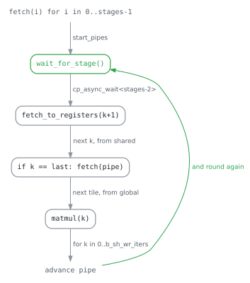

# W4A16 GEMM

The kernel computes `C = A . Bᵀ` on the tensor cores:

- `A` is f16, shape `m x k`.
- `B` is 4-bit unsigned integers, shape `n x k`.
- Every 128 consecutive weights of a row of `B` share 1 f16 scale and 1 4-bit zero point.
- `C` is f16.

A 4-bit weight is a quarter the width of the activation it meets.
A kernel that reads weights at the rate the tensor cores consume them is bound by everything except the multiply:

- how the weights are laid out
- whether the loads reach shared memory before the previous tile is done with it
- how partial results find each other afterwards

Sections 1 to 4 state one answer each.

Names: `m` is the batch, `n` the output width, `k` the reduction.
A tile is 16x16.
A threadblock owns `thread_m_blocks x thread_n_blocks` output tiles and walks `thread_k_blocks` at a time along k.

## 1. Pre-permuted weights

The kernel permutes nothing.
`src/tensor/marlin.rs` repacks the checkpoint once at load time.
Every load in the inner loop is then a contiguous 16-byte read that lands where the tensor-core fragment wants it.

The repack produces 3 arrays:

| Array | Shape | Layout |
|---|---|---|
| `b_q` | `[k/16, n.16/8]` u32 | 16x64 tile-permuted, lane-interleaved |
| `scales` | `[k/128, n]` f16 | 64-column lane permutation |
| `zp` | `[k/128, n/8]` u32 | the same permutation, plus the dequant interleave |

`b_q` folds 2 permutations together:

- **Tile permutation.** `mma.sync.m16n8k16` wants each lane to hold specific elements of the 16x16 fragment. Natural order would make every fragment load a gather. Fragment order makes it one `ldmatrix`-shaped read.
- **Dequant interleave.** `dequant.h` unpacks 4 bits into an f16 with a bit trick: it masks the nibble into the mantissa of a constant exponent, then subtracts the constant. The trick yields the 8 values of a 32-bit word in the order `0 2 4 6 1 3 5 7`. The repack stores the nibbles pre-shuffled, so the trick's output order is the fragment order and no shuffle follows an unpack.

`scales` and `zp` carry the same 64-column lane permutation.
A lane that owns output column `c` finds the scale of `c` at its own index, with no cross-lane traffic.

An index here has a counterpart in `marlin.rs`.
`repack_matches_reference_dequant` ties them.

## 2. 4 stages of `cp.async`

The kernel keeps `stages = 4` tiles of `A` and `B` in shared memory at once.
A tile is in flight several iterations before it is needed.

`cp_async_wait<stages-2>` waits until all but the last 2 groups have landed.
The tile being read is then complete while the tile after it is still arriving.
The kernel fetches the next tile at the last k of the current one, which keeps the pipe full without a second barrier.

Registers are double-buffered the same way.
`fetch_to_registers(k+1)` runs before `matmul(k)`, so the shared-memory read for the next step overlaps this step's arithmetic.

Scales and zero points ride the same pipeline on a slower schedule.
A 128-weight group spans `g = group_blocks / thread_k_blocks` stages, so they are read once per `g` stages and held.

## 3. Inner loop

Per k step, per output column pair `j`:

1. **Unpack.** `dequant_data` turns 1 32-bit word into 8 f16 weights with the mantissa trick. It uses no integer-to-float instruction and no lookup.
2. **Subtract the zero point.** The zero point is an integer in the weight's own scale, so `sub_zp` subtracts it from the dequantised value directly.
3. **Scale.** `scale` multiplies each pair by the group scale, 1 f16 multiply.
4. **Multiply.** `mma.sync.aligned.m16n8k16` runs once per `thread_m_blocks`, accumulating into `frag_c`.

Each of steps 1 to 3 is a plain elementwise operation on a register that the load already placed, thanks to the permutations of section 1.

The `m_block_size_8` variant serves decode, where `m <= 8`.
It runs `mma_trans` on a transposed fragment pair in place of 2 `mma`, because at 8 rows the second accumulator would be half empty.

On Turing the accumulator is f16 (`use_fp16_accum`).
The f32 tensor-core rate of that architecture for this shape is half its f16 rate, and a 128-weight group keeps the partial sums inside the f16 range.
Later architectures accumulate in f32.

## 4. Partial tiles

A threadblock's slice of k usually does not cover a whole output tile.
Several blocks compute the same tile in pieces and combine them in 3 ways:

- **Within a threadblock.** `thread_block_reduce` folds the warps' accumulators together through shared memory. It reuses the region of the weight tile. The 2 never live at once, so shared memory is sized by the larger.
- **Across threadblocks, in order.** `barrier_acquire` and `barrier_release` on a per-tile lock let blocks add into `C` one at a time, in slice order. `global_reduce_fp32` accumulates through an f32 scratch buffer (`C_tmp`). `global_reduce_fp16` adds in f16 directly, which is cheaper and less accurate.
- **Across threadblocks, out of order.** With `use_atomic_add`, blocks add into `C` with atomics and no lock. The result is correct only when the accumulation is associative enough for the caller, so the flag is not the default.

When `m` exceeds 1 tile of rows, the `parallel` split cuts the problem into independent problems of `m_block_size` rows.
Fewer blocks then contend for 1 tile.

## Scope

The upstream kernel also carries nvfp4, mxfp8, fp8, signed 4-bit and 8-bit, bf16, 8-bit activations, float zero points, activation reordering, a bias, and any stage count.
This build instantiates 1 cell: f16 activations, u4 weights with an integer zero point, f16 output, 4 stages, a scale every 128 weights.
The 5 template parameters that remain are the ones a launch varies: `threads`, and how the output tile is cut.

A new format joins as a policy on the pieces above.
It is not a flag threaded through all 4 sections.

## Tests

`the_int4_tensor_core_gemm_agrees_with_the_host_on_the_same_weights` runs this kernel and a host dequantise-then-multiply against the same repacked weights.
The quantisation error cancels, so the test compares the 2 paths and not one path against a reference.
It first asserts that the Marlin layer was built, so it never covers a fallback silently.

`repack_matches_reference_dequant` covers section 1 on the host side.
An index changed on one side without its counterpart on the other fails one of the 2.
