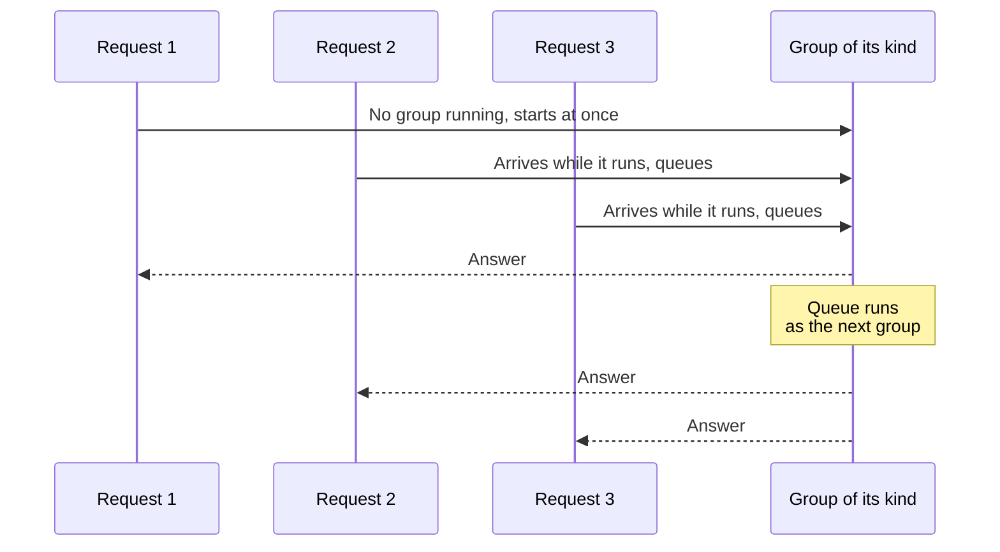

# API

1 process serves 3 APIs: Ollama under `/api`, OpenAI under `/v1`, Messages under `/v1/messages`.
A client written for any of them works unchanged.

Bodies are read as JSON whatever `Content-Type` says.  
Each API answers a malformed body in its own error envelope.

With `[server] require_auth` on, every route needs a key, as `Authorization: Bearer <key>` or `X-API-Key: <key>`.
`/health` and `/ping` need none, and the rate limit skips them.

## Ollama surface

| Route | What it does |
|---|---|
| `GET /` | Liveness, as Ollama answers it. |
| `GET /api/version` | The Ollama API level served, with the crate version beside it. |
| `GET /api/tags` | The models on this machine, with the architecture, quantisation and parameter count each header declares. Headers are read once before the port opens, then again only for a changed file. In a cluster, the peers' models follow, each under `node`, and a request naming 1 is forwarded there. A companion file, such as a stored draft, is not listed. |
| `POST /api/show` | A model's details, with a Modelfile synthesised from its blobs. `verbose` adds the vocabulary arrays. A listed checkpoint of another format is shown with the window, format, family and capabilities its files declare. Its `parameter_size` is counted from its shards' headers, an AWQ packed weight at the values it holds. A checkpoint of another quantisation reports `unknown`. |
| `GET /api/ps` | The models resident in memory. `details.running_format` joins with `+` the formats of a language model's per-layer projections, its expert stacks last: `bf16` for a checkpoint served as stored, `q8_0` or `q4_K+q6_K` for one rebuilt to fit. For an image model it joins the formats of the projections of its denoiser. For a speech model it joins the formats of the projections its load built. A model still loading is listed with size 0 and a `loading` object holding the `phase` and the `done` and `total` counts the loader reports. Safetensors, fp8 and GGUF loads of a text model count: the first count tensors, the GGUF one counts bytes. The other formats report the phase alone. |
| `POST /api/pull` | Fetch a model. Streams progress unless `stream: false`. |
| `POST /api/push` | Refused: nothing is pushed to a registry. |
| `POST /api/create` | Build a model from blobs uploaded through `/api/blobs`. Template, system, parameters, license and messages become layers of their own. Streams NDJSON. |
| `HEAD /api/blobs/{digest}`, `POST /api/blobs/{digest}` | Check for and upload a blob. |
| `POST /api/copy` | Copy a manifest under a new name. Blobs are shared. |
| `DELETE /api/delete` | Remove a manifest and every blob no manifest names. |
| `POST /api/chat` | Chat. Takes `tools`, `tool_choice`, `think`, `format`, `logprobs`, `top_logprobs`, images, and `audios` (base64 clips) on a user message for a model with the `audio` capability. Returns `thinking` apart from `content`, `done_reason` and the engine's timings. |
| `POST /api/generate` | Completion. Renders `system` and `template`, takes `suffix`, `images`, `logprobs` and `top_logprobs`, returns `context`. The images go before the prompt, as on `/api/chat`. A package with no template layer gets the prompt as given, as in Ollama. |
| `POST /api/embed` | Embeddings. Honours `dimensions` and `truncate`. |
| `POST /api/embeddings` | The legacy 1-prompt shape. |

## OpenAI surface

### Language

| Route | What it does |
|---|---|
| `POST /v1/chat/completions`, `POST /api/chat/completions` | Chat. Takes content parts, images, `input_audio` parts, `tools`, `tool_choice`, `parallel_tool_calls`, `response_format`, `reasoning_effort`, `n`, `logprobs`, `top_logprobs`, `logit_bias`, `max_completion_tokens` and [vLLM's extensions](#vllms-extensions). An `input_audio` part is `{"type": "input_audio", "input_audio": {"data": "<base64>", "format": "wav"}}`, in any container the server decodes, for a model with the `audio` capability. A `video_url` part is `{"type": "video_url", "video_url": {"url": "data:video/mp4;base64,..."}}`, in any container `ffmpeg` reads, for a vision model that reads video. `ffmpeg` and `ffprobe` must be on the PATH. A remote URL answers 400. Returns `reasoning_content` apart from `content`, and `finish_reason`. `usage` carries the reasoning tokens, `accepted_prediction_tokens`, `rejected_prediction_tokens` and the [`loken` object](#per-request-figures). A stop sequence is not part of the text. |
| `POST /v1/chat/completions/batch` | vLLM's batch of conversations. `messages` is a list of conversations, each answered as its own chat completion, 1 choice per conversation. No `stream`, no `tools`, no `n` above 1. |
| `POST /v1/completions` | Text completion. Takes `suffix` (fill-in-the-middle), `echo`, an array of prompts, `logprobs`, `logit_bias`, `response_format` and [vLLM's extensions](#vllms-extensions). `prompt_embeds` sends the prompt as embedding rows of the model's width, in a form listed under [Prompt embeddings](#prompt-embeddings). It is refused while the model batches concurrent requests. |
| `POST /v1/responses` | The Responses API, lowered to a chat completion and lifted back into output items. `GET` and `DELETE /v1/responses/{id}` read and drop a stored response. `previous_response_id` continues one. `input_image` (`image_url` as a base64 data URL, or the `file_id` of an upload) and `input_audio` (`data`, `format`) parts become the `image_url` and `input_audio` parts of a chat completion. Another part type answers 400 naming it. |
| `POST /v1/embeddings` | Embeddings, loading the model on demand. `encoding_format` is `float` or `base64`, `dimensions` cuts the vector. `input` is a string, strings or 1 conversation. `messages` is 1 conversation or a list, as vLLM takes them. A conversation is 1 vector: its text parts joined by newlines, or its single `image_url` part for a CLIP or SigLIP model. The image is a base64 data URL or an http(s) URL from a host in `image_fetch_hosts`. Text beside an image is refused. A CLIP or SigLIP checkpoint is named by its Hugging Face id, such as `openai/clip-vit-large-patch14`. See [the embeddings guide](https://loken-ai.github.io/loken/embeddings/). |
| `POST /v1/rerank`, `POST /rerank` | Score documents against a query with a cross-encoder. |
| `POST /v2/rerank` | Cohere's shape. `documents` are strings or `{text}` objects, with `top_n` and `return_documents`. Answers `{id, results, meta}`. |
| `POST /v2/embed` | Cohere's shape. Takes exactly 1 of `texts`, `images` (data URIs) or `inputs` (`content` lists of `text` and `image_url` parts), and `output_dimension`. Answers `embeddings.float`, `embeddings.base64`, `embeddings.int8`, `embeddings.uint8`, `embeddings.binary`, `embeddings.ubinary` as `embedding_types` asks, `float` by default. Images need a CLIP or SigLIP model. |
| `POST /score`, `POST /v1/score` | vLLM's pair scoring: `text_1` against `text_2`, 1 score per pair in `data[].score`. |
| `POST /pooling` | vLLM's pooling shape over the embeddings route. `data[].data` is the pooled vector. Also supports `task: "token_embed"` for one vector per token, `input` as a string or list of strings, `data[].data` as `[[...], ...]` vectors, `usage.total_tokens` as the total number of vectors. |
| `POST /v1/multi-vector` | Jina's multi-vector shape. Takes `model` and `input` (a list of strings, or a list of `{text: ...}` objects). Answers `data[].embeddings` as `[[...], ...]` vectors, one per token. `usage.total_tokens` is the total number of vectors. |
| `POST /tokenize` | vLLM's tokenizer. Takes a `prompt`, or chat `messages` rendered by the model's template (`add_generation_prompt`, `continue_final_message`, `chat_template_kwargs`, `tools`), with `add_special_tokens` and `return_token_strs`. Answers `count`, `max_model_len`, `tokens`, `token_strs`. |
| `POST /detokenize` | `tokens` back to `prompt`, special tokens kept. |
| `POST /invocations` | SageMaker's route, as vLLM serves it. A body with `messages` goes to chat, `prompt` to completions, `input` to embeddings. |
| `POST /v1/forecast` | Continue a time series with a forecaster checkpoint. Takes `model`, `series` (numbers, `null` for a missing point), `horizon` (steps, up to what the checkpoint answers) and optional `quantiles` (levels, interpolated linearly between the checkpoint's own). A checkpoint that reads covariates also takes `past_covariates` (rows as long as `series`), `known_covariates` (rows covering `series` and the horizon) and their `categorical_` forms, whose values are strings or numbers. Each covariate field is an array of rows or an object of named rows. Answers `median` and `quantiles[].{level, values}`, 1 value per future step. Runs on a card when one has room, else on the host. |
| `GET /v1/models` | The models on this machine with `max_model_len`, the widest window each takes, then the peers' models with the holder as `owned_by`. A request is served with the window its prompt and `max_tokens` need, up to that limit, and a window that must grow at least doubles. Answers in the Messages API's shape to a client sending its version header. |
| `GET /v1/models/{id}`, `DELETE /v1/models/{id}` | 1 model. Ids may contain slashes. |
| `POST /v1/moderations` | Category scores from the configured classifier, with the family's own labels under `hazards`. 501 until `moderation_model` is set. |

### Prompt embeddings

`prompt_embeds` on `/v1/completions` takes a base64 string, an array of base64 strings, or an array of rows of numbers.

An array of strings gives 1 prompt each and is answered as an array of prompts.

The first bytes of a base64 payload select its form:

| Form | First bytes | Width | Dtypes |
|---|---|---|---|
| loken's format | `00 00 C0 FF 4C 4B 45 4D` | in the header | float32, float16, bfloat16 |
| `torch.save` of 1 tensor, as vLLM clients send it | `PK 03 04` | the tensor's last dimension | float32, float16, bfloat16, float64 |
| bare little-endian f32, as `/v1/embeddings` returns them | anything else | the model's | float32 |

Every form is refused with a 400 naming the fault in 2 cases.  
Before a value is converted, when the rows are not the model's width or fill the served context window.  
After, when a value is not finite.

#### loken's format

Little-endian throughout:

| Offset | Bytes | Field |
|---|---|---|
| 0 | 8 | magic `00 00 C0 FF 4C 4B 45 4D`. Its first 4 bytes are an f32 NaN, which a bare f32 payload may not carry, so the 2 forms never collide |
| 8 | 2 | version, `1` |
| 10 | 1 | dtype: `0` float32, `1` float16, `2` bfloat16 |
| 11 | 1 | reserved, `0` |
| 12 | 4 | rows (u32) |
| 16 | 4 | width (u32) |
| 20 | 4 | reserved, `0` |
| 24 | rows x width x dtype size | values, row after row |
| end, 4 | 4 | CRC-32 of every byte before it (zlib's `crc32`) |

A payload whose length is not exactly 28 bytes plus the values is refused as truncated or padded.  
A payload whose CRC-32 does not match, header included, is refused as corrupted.

A 256 MiB request body carries about 24,000 rows of width 4096 in float16 or bfloat16, and 12,000 in float32.

```python
import struct, zlib
import numpy as np

def encode_loken(rows: np.ndarray) -> bytes:  # float32 or float16, shape (rows, width)
    code = {np.dtype("<f4"): 0, np.dtype("<f2"): 1}[rows.dtype.newbyteorder("<")]
    head = b"\x00\x00\xc0\xffLKEM" + struct.pack("<HBBIII", 1, code, 0, *rows.shape, 0)
    body = head + np.ascontiguousarray(rows, rows.dtype.newbyteorder("<")).tobytes()
    return body + struct.pack("<I", zlib.crc32(body))
```

bfloat16 is the top half of each float32: `(rows.astype("<f4").view("<u4") >> 16).astype("<u2")` with code `2`.

#### torch.save

The payload is the archive `torch.save(tensor, buffer)` writes, base64-encoded.
The tensor has shape `(tokens, hidden_size)` or `(1, tokens, hidden_size)`, any strides and storage offset, on any device.

The server reads it without running the pickle.
It accepts only the opcodes, the globals and the persistent references of 1 plain tensor.
The accepted globals are `torch._utils._rebuild_tensor_v2`, `collections.OrderedDict`, `torch.FloatStorage`, `HalfStorage`, `BFloat16Storage` and `DoubleStorage`.

Every entry used is checked against its CRC-32.  
Anything else is refused: compressed or big-endian archives, torch's legacy format, sparse and quantized tensors, and tensors carrying attributes or hooks.

### vLLM's extensions

`/v1/completions` and `/v1/chat/completions` read the fields vLLM's server adds to OpenAI's.

| Field | What it does |
|---|---|
| `repetition_penalty` | Multiplicative penalty, in (0, 4], on every token already in the prompt and the answer. Wins over `frequency_penalty` and `presence_penalty`. |
| `min_p` | Drops the tokens less probable than this share of the most probable one. |
| `allowed_token_ids` | The only tokens that may be drawn. |
| `bad_words` | Words never written. The last token of each is banned after the tokens before it, at the start of a text and after a space. |
| `min_tokens` | Tokens written before an end token, a stop token or a stop sequence may end the answer. |
| `thinking_token_budget` | Tokens the reasoning may take on a chat completion, streamed or whole. The server then closes the reasoning with `</think>` and writes the answer. |
| `ignore_eos` | The model's end tokens and default stop sequences end nothing. The answer runs to `max_tokens`. |
| `stop_token_ids` | Tokens that end the answer besides the model's own. |
| `include_stop_str_in_output` | Keeps the stop sequence the answer ended on in the text. |
| `skip_special_tokens` | `false` keeps the special tokens drawn in the text. |
| `truncate_prompt_tokens`, `truncation_side` | Reads only this many prompt tokens: the last ones (`left`, the default) or the first ones (`right`). `-1` is the model's window. |
| `return_tokens_as_token_ids` | Writes each log-probability token as `token_id:<id>`. |
| `structured_outputs` | 1 constraint: `json` (a schema, as an object or a string), `regex`, `choice` (a list of strings), `grammar` (Lark, or llama.cpp's GBNF) or `json_object`. A JSON constraint also takes `disable_any_whitespace`, `disable_additional_properties` and `whitespace_pattern`. `guided_json`, `guided_regex`, `guided_choice`, `guided_grammar` and `guided_whitespace_pattern` are read the same way. `structural_tag` answers 400. |
| `cache_salt` | The request reuses no cached prompt prefix and leaves none for another. |
| `use_beam_search`, `length_penalty`, `early_stopping` | Answers the `n` best beams of a beam search of width `n`, best first. See [Beam search](#beam-search). |
| `echo` (chat) | Writes the final assistant message in front of the answer. |
| `add_generation_prompt` (chat) | `false` renders the conversation without opening the assistant's turn, with a Jinja template. |
| `continue_final_message` (chat) | The answer continues the final assistant message instead of opening a new turn. |
| `chat_template_kwargs`, `documents` (chat) | Variables handed to the model's template. `enable_thinking` is also the thinking preference. |
| `include_reasoning` (chat) | `false` leaves the reasoning out of the answer. |

These fields decode 1 token per step, without prompt-lookup drafts, captured graphs or prefix reuse:

- `min_p`
- `allowed_token_ids`
- `bad_words`
- `min_tokens`
- `skip_special_tokens: false`
- `cache_salt`
- a structured output

These answer 400: `prompt_logprobs`, a request `chat_template`, and `continue_final_message` with `add_generation_prompt: true`.

These are accepted without effect: `priority`, `request_id`, `spaces_between_special_tokens`, `add_special_tokens`, `stream_interval` and the disaggregation fields.

#### Beam search

`use_beam_search: true` scores and stops as transformers' `generate(num_beams=n, length_penalty=..., early_stopping=...)` does:

- Each step ranks every continuation of the running beams by cumulative log-probability, read from the raw logits.
- Of the first `n`, those ending on an end token finish, and on the last step all of them finish.
  The others keep running.
- A finished beam scores its cumulative log-probability over its generated length, the end token counted, raised to `length_penalty` (default 1).
- `early_stopping: false` (default) stops once `n` beams are finished and the best running one cannot beat the worst of them at its current length.
- `early_stopping: true` stops once `n` are finished.
- `early_stopping: "never"` scores the running beam at `max_tokens` when `length_penalty` is positive.
- Ties rank the earlier beam first, then the lower token id.

The choices are the beams, best first.  
The text leaves out the end token.
`logprobs` carry every generated token, the end token included, so they sum to the beam's cumulative log-probability.

The model's end tokens and `stop_token_ids` end a beam.
`ignore_eos` runs every beam to `max_tokens`.  
Temperature, sampling knobs, penalties, stop sequences and token rules are not read.

A beam search request answers 400 with `stream`, `prompt_embeds`, `best_of` above `n`, a structured output and a required tool call.

A model whose KV cache cannot be cut back to a shorter sequence answers 500.
That covers a recurrent or sliding-window layer, and a backend other than the generic transformer.

vLLM's own beam search divides by the prompt and generated length without the end token.  
It finishes every end token among a beam's best `2n` candidates.
It always runs to `max_tokens`.

### Files and batches

| Route | What it does |
|---|---|
| `POST /v1/files`, `GET /v1/files` | Upload and list. `GET`, `DELETE /v1/files/{id}` and `GET /v1/files/{id}/content` read 1 file. |
| `POST /v1/batches`, `GET /v1/batches` | Run a JSONL of requests through the handlers a client would call, with answers written to an output file. `GET /v1/batches/{id}` and `POST /v1/batches/{id}/cancel` follow 1 batch. |

### Media

A route in the Feature column exists when its Cargo feature is compiled.

| Route | Feature | What it does |
|---|---|---|
| `POST /v1/audio/transcriptions`, `POST /v1/audio/translations` | `audio` | Speech to text. |
| `POST /v1/audio/speech` | `audio` | Text to speech. `response_format` is `wav` (default), `pcm`, `mp3`, `flac`, `opus` (Ogg) or `aac` (ADTS). Another name answers 400 with the list. `GET /v1/audio/voices` lists the voices. See [Speech requests](#speech-requests) for the formats, the stream and the fields each kind of checkpoint takes. |
| `POST /v1/audio/separate` | `audio` | Split a mix into stems. |
| `GET /v1/audio/voices` | `audio` | The `voice` presets in `data`, and the stored voices as Voice objects in `custom_voices`, oldest first. `data` also lists the speakers of each checkpoint of the store that names its voices. Such an entry has the speaker's name as `voice`, the checkpoint's id as `family` and `model`, its dialect as `accent` or `null`, `gender` `null` and `is_default` false. |
| `POST /v1/audio/voices` | `audio` | Create a voice and keep it. The answer is a Voice object: `id`, `created_at`, `name`, `object` `audio.voice`, `type` and `prompt` for a voice from a description. `type` `prompt` takes a JSON body or a multipart form with `name` (1 to 256 characters), `prompt` (1 to 2000) and `script_hint` (1 to 2000). The voice design checkpoint speaks `script_hint` once in the voice `prompt` describes. `script_hint` is a sentence in the language the voice will speak. A request without it answers 400. The speaker encoder of a checkpoint that clones then turns that speech into the stored voice. `type` `audio_sample`, the default, takes a multipart form with `name`, `audio_sample` (an audio file of at most 10 MiB and 60 s) and `consent`, the id of a consent recording. An unknown consent answers 404. `model` names either checkpoint. Absent or `auto`, each comes from the store. |
| `GET /v1/audio/voices/{id}`, `DELETE /v1/audio/voices/{id}` | `audio` | Read or delete 1 stored voice. Deleting keeps its consent. An unknown id answers 404. |
| `POST /v1/audio/voice_consents`, `GET /v1/audio/voice_consents` | `audio` | Keep a consent recording: a multipart form with `name`, `language` (a BCP 47 tag) and `recording` (an audio file of at most 10 MiB and 60 s). The answer is a VoiceConsent object: `id`, `created_at`, `language`, `name` and `object` `audio.voice_consent`. The list takes `after` and `limit` (1 to 100, 20 by default) and answers `data`, `has_more`, `first_id` and `last_id`. loken does not check that the recording speaks a consent phrase. loken cannot check that the person of the recording is the person of a sample. |
| `GET`, `POST`, `DELETE /v1/audio/voice_consents/{id}` | `audio` | Read, rename by a JSON `name`, or delete 1 consent and its recording. An unknown id answers 404. |
| `POST /v1/audio/generations` | `audio` | Music and sound effects from a description. `response_format` is `wav` (default), `mp3`, `flac`, `opus` or `aac`, another name answers 400. A MIDI model answers a `.mid` file at tempo `bpm`, from 20 to 300 and 120 when absent. A tempo out of range answers 400. |
| `POST /conversation` | `audio` | 1 turn of a conversation, routed by what the prompt asks for: chat, vision on an attached image, image generation, speech or sound. Rules decide the clear cases and a small classifier model the rest. The reply carries `route`, `routed_by` and the picture or clip beside the message. `stream` sends events, `model` is the chat model to prefer, `image_model` and `tts_model` name the renderers. |
| `POST /voice` | `audio` | Speech in, speech out: transcription, a chat turn, then the reply spoken. |
| `POST /v1/images/generations`, `POST /v1/images/edits`, `POST /v1/images/variations` | `image` | Image generation. `edits` and `variations` take a multipart form with `image` (PNG or JPEG), `prompt` (not for `variations`), `model`, `n`, `size`, `response_format` and the extension fields `strength` and `seed`. `response_format` is `url` by default: the picture is stored as a file and answered as a URL built on `public_url`, or on the request's `Host`. `b64_json` returns the picture inline. Any other value answers 400. |
| `GET /v1/loras` | `image` | The adapters this server can apply, by name. |
| `POST /v1/video/generations` | `video` | Text- and image-conditioned clips. |
| `POST /api/video/plan` | `video` | What a clip of a given length will cost, before rendering it. |
| `GET /v1/renders`, `POST /v1/renders/{id}/cancel` | none | Renders in flight of the calling key, and cancelling 1. See [Naming a render](#naming-a-render). |

### Speech requests

Every speech engine answers every format, at the rate and channel count it produces.

| `response_format` | With `stream` |
|---|---|
| `wav` (default) | A header, then the samples |
| `pcm` | The samples |
| `mp3` | 1 complete stream per sentence, in order |
| `opus` (Ogg) | 1 complete stream per sentence, in order |
| `aac` (ADTS) | 1 complete stream per sentence, in order |
| `flac` | Not streamed. The request answers 400 |

- `opus` takes 8, 12, 16, 24 and 48 kHz. Another rate is resampled to 48 kHz.
- `aac` takes the ADTS rates. Another rate is resampled to 48 kHz.
- The bit rate is the encoder's own default for speech.
- `stream` sends each sentence as it is spoken.
- `stream_format` `sse` answers every format as a base64 clip in its `done` event.

#### pocket-tts

- It speaks a long text in the chunks its reference generates apart: its sentences grouped up to the reference's chunk of tokens, a longer sentence cut at its clauses.
- Its `stream` sends each chunk as it is spoken.

#### A checkpoint whose voice is described in words

| Field | Effect |
|---|---|
| `voice_description` | The timbre. Absent, the timbre is the description of the `voice` preset |
| `instructions` | The style. With `voice_description`, the timbre comes first |
| `language` | A BCP-47 code or a name its configuration lists. Absent or `auto`, the model picks the language. Another language answers 400 with the list the checkpoint speaks |
| `seed` | Absent, the draw derives from a hash of the timbre, so the same request gives the same audio |
| `temperature`, `top_p`, `max_steps` | Replace the values of its `generation_config.json` |

A whole answer:

- It speaks a whole text in 1 call.
- It splits the text at paragraphs then sentences only when 1 call cannot hold the speech.
- A clip is drawn again once with the next seed when its frames per text token exceed both of 2 bounds: a fixed pace, and a multiple of the median the loaded checkpoint measured for texts of its language from half to twice its length.
- The shorter draw is kept when both run long.
- The 2 bounds are `TOKEN_PACE` and `MEDIAN_FACTOR` in `src/inference/model/qwen3_tts/overrun.rs`.
- A request with `seed` is drawn again the same way.

A streamed answer:

- Its audio leaves while it draws the frames: each piece the decoder gives leaves at once.
- `wav` and `pcm` leave as 1 continuous stream. `mp3`, `opus` and `aac` leave as 1 complete stream per piece.
- The text is spoken in 1 call when the talker's cache holds its prompt and the checkpoint's frame limit.
- Otherwise it is spoken a part per call, its paragraphs else its sentences, each with the same seed.
- A call that reaches the checkpoint's frame limit ends the stream there.
- A streamed clip is never drawn again.

#### A speech talker that clones

It speaks a stored voice only.

| Request | Answer |
|---|---|
| `voice` names the id of a stored voice, as a string or as an object with an `id` | The voice is spoken. Without `model`, the checkpoint that made it speaks it |
| A checkpoint whose speaker embedding has another width | 400 |
| A stored voice with `voice_description` or `instructions` | 400 |
| An id the store does not hold | 404 |
| No stored voice | 400 with how to create one |

Without `seed` the draw derives from a hash of the voice id.

#### A speech talker that names its voices

It speaks the voice `voice` names, matched without case, in the style `instructions` gives.

| Request | Answer |
|---|---|
| No `voice`, or a name its configuration does not list | 400 with the names it lists |
| A `voice` that a checkpoint of the store names, sent without that checkpoint as `model` | 400 with the checkpoint to name |
| A `model` that adds a voice after the id of a speech talker | 400 with the field its checkpoint takes the voice from |
| `voice_description` | 400: a voice described in words is spoken by the VoiceDesign variant |
| A stored voice | 400 with the checkpoint that made it |

- A dialect speaker speaks its dialect when `language` is absent, `auto` or Chinese, and another language when `language` names it.
- Without `seed` the draw derives from a hash of the voice name and the style.

### Stored voices

The voices and the consents live in a `voices` directory beside the Hugging Face store: the parent of `huggingface_models_dir` when it names a `hub` directory, else that directory.
When the key lists several directories, the first one holds them.

| Entry | Directory | Files |
|---|---|---|
| Voice | `voices/voice_<32 hex digits>/` | `voice.json` with the id, the name, the creation time, the type, the description or the consent, the checkpoint that made the embedding and its width. `speaker.safetensors` with the speaker embedding. |
| Consent | `voices/cons_<32 hex digits>/` | `consent.json` with the id, the name, the language and the creation time. The recording as uploaded. |

An entry is written under a staging name and renamed into place. The audio sample of a voice is not kept.

### Naming a render

A render takes the `X-Request-Id` of its request as its identifier.
The server answers with the same header on every response.
Without a valid header the server gives the render an identifier of its own.
A valid identifier has letters, digits, dot, underscore and dash, 64 characters at most.

- A client that sends its own identifier stops the render with `POST /v1/renders/{id}/cancel`.
- Reusing an identifier of the same key while its render runs cancels that render.
- 2 keys can use the same identifier. Each reaches its own render.
- These renders register: image generation, image edit and variation, music, sound effect, MIDI, transcription, separation, video and speech.

### Requests that share a pass

| Route | Grouped when | Shared pass |
|---|---|---|
| `POST /v1/audio/transcriptions`, `/translations` (Whisper) | the same resident model | The window of every clip of 30 s or less runs through the encoder as 1 batch. Each clip decodes on its own window. A longer clip is read as the model's reference transcription reads it. Each window decodes with timestamps, and the next window starts where the last segment the model left unfinished starts. That clip encodes each window when its decode reaches it. |
| `POST /v1/images/generations` (an SDXL checkpoint) | not streamed, `n` 1, no `control_image`, no `regions`, and the same model, `size`, step count, `sampler`, `scheduler` and `loras` | The group takes the media gate once. Its renders denoise as 1 batch, with the prompt, `negative_prompt`, `guidance` and `seed` of each request. |

A request starts at once when no group of its kind runs, and queues behind the group otherwise:



A group holds as many requests as the roomiest card has free memory for, 1 request's scratch each.
The rest of the queue waits for the group after.  
With no card, a group holds every queued request.

Each request keeps its own seed and no row of a batch reads another row.
A request answers what it answers alone, up to the rounding of a larger matrix product on a card.

A request that fails on its own, such as a clip the server cannot read, fails alone and its companions answer.
An image batch that fails as a whole renders each request alone.

A streamed render on any of these routes sends events with `status`, `phase`, `phase_label`, `step`, `total` and `elapsed_ms`.
Every event carries `node`, the name of the node that renders, or null when the server runs alone.

### Media input limits

Every chat route caps the images per request, the pixels per image and the seconds of audio.
The chat routes are `/api/chat`, `/api/generate`, `/v1/chat/completions`, `/v1/responses` and `/v1/messages`.

The caps are built in and follow the decoder's allocation budget.
No key sets them.
A request past 1 of them is answered 400 naming the cap and the value it carried, before the image is decoded.
`image_fetch_hosts`, under `[inference]`, names the hosts an image given by URL is fetched from, see [CONFIGURATION.md](CONFIGURATION.md#media-input).

## Messages API surface

| Route | What it does |
|---|---|
| `POST /v1/messages` | Messages. Takes content blocks and images, `tools`, `tool_choice`, `disable_parallel_tool_use`, `thinking` (its `budget_tokens` closes the reasoning once spent), `output_format`, `top_k`, `seed`, `stop_sequences`. `max_tokens` is required. Returns a thinking block before the text, `stop_reason` with the sequence matched, and cache counts and the [`loken` object](#per-request-figures) in `usage`. Streams as the official event stream, with `error` events. |
| `POST /v1/messages/count_tokens` | Count the prompt with the model's own tokenizer. |
| `POST /v1/messages/batches`, `GET /v1/messages/batches`, `GET /v1/messages/batches/{id}` | Batches in the Messages API's shape. |
| `POST /v1/messages/batches/{id}/cancel`, `GET /v1/messages/batches/{id}/results` | Stop 1 batch, and serve its JSONL. |

A 401, 429 or 404 under `/v1/messages` carries the Messages API envelope.
The request id comes back in the `request-id` header.

An image block with a URL source, `{"type": "image", "source": {"type": "url", "url": ...}}`, is fetched from a host in `image_fetch_hosts` and held to the media caps.
A host outside the list is answered 400 naming the host.

A part the server cannot take, such as a document block, is refused with the reason.

## How a request ends

- An answer ends on any of the model's end tokens, with `done_reason` `stop` and the token left out of the text.
  The end tokens are those the files declare:
  - the end-of-sequence id, and every id of `tokenizer.ggml.eos_token_ids` or of the `eos_token_id` list of `generation_config.json`
  - the ids of `tokenizer.ggml.eot_token_id`, `tokenizer.ggml.eom_token_id` and the FIM pad, repeat and separator keys
  - the padding token, when the vocabulary marks it as a control token
  - the control token the chat template writes right after the content of an assistant turn that ends a conversation
  - a stop sequence of the model's parameters that is the whole text of a control token
- The stop sequence an answer ends on is left out of the text.
  `include_stop_str_in_output` keeps it on the OpenAI routes.
- `logprobs` carry 1 entry per token written, in a streamed answer and in a whole one.
  The token that ended the answer is not 1.
  A stream's last entries may come with its final chunk.
  A request that asks for them is served by the serial path, which draws them.
  One that arrives while the batch worker serves other requests waits for them to end.
- A generation that fails while streaming ends an OpenAI stream with a `{"error": ...}` frame and no finish chunk.
  The Responses route turns that frame into a `response.failed` event.
- A Responses stream whose source ends without its final marker ends as `response.incomplete`.
- A request refused by the rate limit carries `Retry-After`: the seconds until the client has a token again.
  A client whose allowance never refills gets none.
- A request that waited for an inference slot and got `503` carries `Retry-After` once a request has ended. It counts the requests ahead and the request itself, each holding a slot for the mean time slots were held, over the slots that run at once.
- A request with too many messages, an unknown role or too many characters in all is refused with a 400.
  The Messages route applies the same bounds.

## Whose cached prompt it is

A cached prompt belongs to the API key that wrote it.
Another key never finds it, so the time to a first token and the count of cached tokens tell a caller nothing about what others sent.

- Covered: the prompt held in memory, the saved copies of the KV cache, the KV and decode-state caches on disk, and `POST /api/cluster/prefix`.
- Covered: the renders in flight. `GET /v1/renders` lists those of the calling key, and `POST /v1/renders/{id}/cancel` stops only those.
- Covered: a stored Responses object. Only its key reads it, continues it with `previous_response_id` or deletes it.
- With `require_auth` off, or with no distinct key, every caller shares a scope and cached prompts are shared as before.
- `cache_salt` still keeps a request out of the cache. It is not needed to keep keys apart.
- Covered: uploaded files and batches. Only the key that made them lists, reads, deletes or cancels them.

## Per-request figures

`prompt_tokens`, `input_tokens` and `prompt_eval_count` count the context rows an image, a video frame or a clip takes, as well as the prompt's tokens.

The prompt counts of an answer:

| Field | Routes | Holds |
|---|---|---|
| `prompt_eval_count` | `/api/generate`, `/api/chat` | Every prompt position, read or served from the cache. |
| `prompt_eval_cached_count` | `/api/generate`, `/api/chat` | The prompt positions served from the cache. |
| `usage.prompt_tokens` | `/v1/chat/completions`, `/v1/completions` | Every prompt position, read or served from the cache. |
| `usage.prompt_tokens_details.cached_tokens` | `/v1/chat/completions`, `/v1/completions` | The prompt positions served from the cache. |
| `usage.input_tokens` | `/v1/responses` | Every prompt position, read or served from the cache. |
| `usage.input_tokens_details.cached_tokens` | `/v1/responses` | The prompt positions served from the cache. |
| `usage.input_tokens` | `/v1/messages` | The prompt positions read. |
| `usage.cache_read_input_tokens` | `/v1/messages` | The prompt positions served from the cache. |

A whole answer and a streamed one report the same counts when the cache serves them the same positions.
A prompt sent again as it was can be served whole from the cache.
Its cached count is then the whole prompt, and no position is read.

A chat answer on `/v1/chat/completions` and `/v1/messages` reports its own figures in a `loken` object inside its final usage:

| Route | Where |
|---|---|
| `/v1/chat/completions` | `usage` of a whole answer. The usage chunk of a stream, sent when `stream_options.include_usage` is set. |
| `/v1/messages` | `usage` of a whole answer. `usage` of the `message_delta` event of a stream. |

```json
"loken": {
  "queue_ms": 1.2, "prefill_ms": 840.5, "decode_ms": 2210.0,
  "energy": {"joules": 95.3, "gpu_joules": 80.1, "cpu_joules": 15.2, "estimated": false, "share": "work"},
  "kv": {"used_tokens": 1830, "capacity_tokens": 32768}
}
```

| Field | Meaning |
|---|---|
| `queue_ms` | From the request's arrival at the model to the start of its prompt. |
| `prefill_ms` | Reading the prompt, to the first token. |
| `decode_ms` | Writing the answer after the first token. |
| `energy.joules` | The domains read, summed. |
| `energy.gpu_joules` | From the GPU energy counter. Absent when no counter is read. |
| `energy.cpu_joules` | CPU package and DRAM. Read from RAPL. `null` when RAPL is not readable. |
| `energy.estimated` | `true` when the CPU part is not read from RAPL. |
| `energy.share` | `alone` when no other request was active during the request, `work` when others were. |
| `kv.used_tokens` | The request's sequence in the KV cache when it ended. |
| `kv.capacity_tokens` | The tokens the cache of the loaded model holds. |

The energy meter is read at every start and end of a request.
Each reading between 2 of them is split among the requests active over it, by the tokens each computed over it (prompt read and answer generated).

A reading over which no request computed a token is split evenly.  
A request's energy is the sum of its parts.

A request that arrives while another reads the meter does not wait for it.
The energy drawn meanwhile goes to the next reading, so a request's figure can miss a few milliseconds of draw.

A field loken does not measure is left out.  
`energy` is absent when no domain is read.  
`kv` is absent when the backend does not report its cache.
A request served by the batch worker reports its sequence in the worker's paged pool, and the tokens of that pool.

An answer that gathers several generations (`n` above 1) reports the sum of their figures.
Times and energy are added, `share` is `work` when any generation shared its energy, and `kv` is the place after the last generation.
A beam search reports 1 set of figures for the whole search, and `decode_ms` covers every beam.

`completion_tokens_details.accepted_prediction_tokens` counts the drafted tokens the model kept, and `rejected_prediction_tokens` the ones it refused.
Both stay at 0 for a request served by the batch worker, which does not draft.
A lone request takes the serial path when its measured rate is the higher, and reports its drafts there.
A request that serial decode began and the worker finished reports its whole answer and the drafts of its serial part.

A streamed answer whose prompt is still being read after 250 ms reports the reading as an SSE comment line, about every 250 ms until the first token, on both routes:

```
: loken-prefill {"done": 2048, "total": 8192}
```

`done` is the prompt tokens read so far and `total` the tokens to read, the cached prefix left out.
The serial path and the paged batch worker read a long prompt a prefill chunk at a time, and `done` moves at each chunk.
The batch worker of a model that keeps a state per sequence reads a prompt in the forwards its model cuts it into, and `done` moves at each forward.
Inside a forward over prompt rows, `done` moves with each layer of the model: it adds the share of the forward's rows that the layers done stand for.
A prompt the prefill peer reads reports the peer's reading of the whole prompt until the peer hands it over, then the rest read here.
A peer of an earlier version reports nothing while it reads, and `done` stays at 0 until its hand-over.

A prompt read in under 250 ms sends no comment line.

A client that follows the SSE specification ignores comment lines.

## Server, models and cluster

| Route | What it does |
|---|---|
| `GET /health` | `status`, `service`, `version`, `time`, `uptime_seconds`, `loaded_models` and `loaded` (count of language models, and whether image, audio and tts are warm). Exempt from authentication, as is `GET` or `POST /ping` (an empty 200, for SageMaker and vLLM clients). |
| `GET /version` | The server's version, in vLLM's shape. |
| `GET /load` | Requests running and queued, as vLLM's `server_load`. |
| `POST /reset_prefix_cache` | Every loaded language model drops its session records, its resident KV and the logits of its last prefill. The KV snapshots, the disk tier and the batch worker's prefix cache stay. |
| `GET /metrics` | OpenMetrics, with the `metrics` feature only. Reports uptime, resident models, gate depth, in-flight generations, decode rates, devices and energy totals. Per model, it reports histograms over requests of the wait at the gate, the wait for the model, the prompt's reading, the answer's writing, the prompt and answer tokens and the prompt tokens served from the cache. |
| `GET /api/models`, `GET /api/models/loaded` | The catalogue, and what is resident with its placement per device. Every family lists its layers by device. A text or image model is 1 entry. A voice, transcription, sound or separation model, and what the video pipeline stages on the host, is 1 entry per part, named `model (part)`. A render in progress is listed the same way, 1 entry per loaded part, with a `status` such as `rendering sound: codes 12/300`. Before its first part loads, the render is 1 entry with the status alone. The free memory published beside these is what the driver has, and a finished job's memory is returned to it when the job ends. |
| `POST /api/models/validate`, `POST /api/models/repair` | Check a model's files, and fetch what is missing. |
| `POST /api/swap` | Replace the resident model. |
| `POST /api/calibrate` | Record the activations of a released checkpoint, named by its Hugging Face id, on the given `texts`, as the calibration `name`. `excerpt`, `tokens` and `rows` size the pass. Streams NDJSON unless `stream: false`. |
| `POST /api/convert` | Convert a released checkpoint into the model `name:tag`, from the calibration record named by `calibration`. `complete` finishes an existing conversion instead. Streams NDJSON unless `stream: false`. |
| `POST /api/layers/swap` | Attach or detach adapters on a loaded model without reloading it. The body is the set the model should end up with. |
| `POST /api/draft/attach`, `POST /api/draft/detach`, `GET /api/draft/status` | Speculative decoding for the resident model, after a tokenizer compatibility check. |
| `GET /api/inflight` | Requests in flight and queued, by priority. A completion with a `suffix` is an editor filling in the middle and goes first. The lines of the batch APIs yield the cards to whoever is waiting. The rest is interactive. |
| `GET /api/layer_perf`, `GET /api/stage_perf` | Where a decode step's time goes, per layer and per stage. Both record only while measurement is on. `?enable=1` on either switches it on and zeroes the counters, `?enable=0` switches it off, and each reply says whether it is on. It is off by default because it costs a device synchronisation per stage. A layer's figure is what issuing it costs the calling thread. A streamed decode also times each token's iteration and its parts (`token: prepare`, `token: launch`, `token: sample`, `token: stream`) under `offload_stages`. The batched decode of a wide-residual model times its stages there too: `mix_token`, `token mixer`, `output projection`, `combine`, `mix_ffn`, `experts`, `engram`, `exchange` and `head`. The parts of `experts` are `experts: router`, `experts: tier`, `experts: reads asked`, `experts: shared on the host`, `experts: host` and `experts: card wait`. The parts of a prompt's `token mixer` in a compressed band layer are `token mixer: front`, `token mixer: pool`, `token mixer: index keys`, `token mixer: index queries`, `token mixer: scores`, `token mixer: candidates`, `token mixer: top rows` and `token mixer: attend`. The host tier of a wide-residual model counts its decoded rows' misses by cause under `prediction` (`never_kept`, `left_at_prompt`, `left_at_decode`, `missed_ahead`) with the bytes not in memory when asked for (`absent_kept`, `absent_missed`, `absent_ahead`). Under the `fast` level, `replaced` counts the routed slots given to an expert outside the exact choice and `skipped` the slots left empty. The host tier also traces every forward of each layer under `host_tier_trace`. A read of the trace empties it. |
| `GET /api/distributed/devices` | The compute devices and their state. It lists every device a plan may give layers to, each with its `backend`: the cards of CUDA and ROCm, the Vulkan and OpenCL devices the allowed backends keep, and the host. |
| `GET /api/distributed/stats`, `GET /api/distributed/recommend` | What this node runs with, and the largest model in the catalogue that fits what is free. |
| `GET /api/multi-device/status` | How the resident model is spread across devices. |
| `GET /api/cluster/state`, `GET /api/cluster/peers` | What a node publishes about itself, and who it sees. |
| `POST /api/pipeline/tail` | Run this node as 1 segment of a pipeline: layers `from` to `to` of `model`, relaying to `next`. Answers the wire port the upstream connects to. The head calls it, not an operator. |
| `POST /api/cluster/measure` | Measure what a layer of `model` costs on this node and publish it. A head asks a peer with no cost for the model before it plans the cut of a dense model. |
| `POST /api/cluster/prefill` | Read a `prompt` for a peer serving the same model and answer its KV cache as `application/octet-stream`. A node that accepts `application/vnd.loken.prefill-stream` gets the reading as it goes, then the KV cache. |
| `POST /api/cluster/prefix` | How much of a prompt this node already holds in its KV. |
