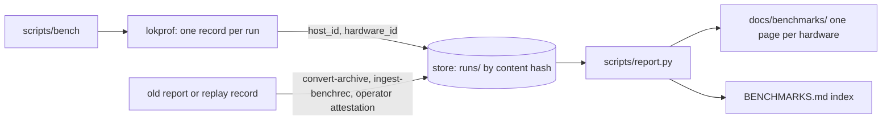

# Benchmarking loken

How to run a reproducible bench campaign, and where every input comes from. This page is the
procedure; there is no other. `BENCHMARKS.md` indexes the results it produces.

## The shape of it

A campaign compares loken against ollama and vLLM on the models loken serves, across a matrix of
context, prompt, streaming and device, files every run in the store and writes the pages under
`docs/benchmarks/`. Two layers:

- **lokprof** (`../lokprof`) is the measurement tool. It benches one model against one engine and emits
  a result JSON. It measures every modality natively - text, vision, image generation, TTS, ASR -
  selected with `--modality`; it never guesses the modality from a model name.
- **`scripts/bench`** is the driver. It reads the inputs from their single sources, provisions the
  peer engines, drives lokprof through the isolation protocol, and regenerates the report.

Nothing about a campaign is retyped or maintained by hand:

| input | where it comes from |
|---|---|
| store paths | `config.toml` (`ollama_models_dir`, `huggingface_models_dir`) - one source, no split-brain |
| model list | loken's own catalogue, `GET /api/tags` - no scan, no list to maintain |
| matrix axes + vLLM peers | `bench/matrix.toml` - the only curated data, public HF repo ids only |
| ollama / vLLM binaries | installed by the campaign into a bench-only compartment (see below) |
| the store | `bench/store/` in the loken tree, kept out of git |

## Run it

```
scripts/bench            # plan: print the cells a campaign would run, no side effects
scripts/bench run        # run the campaign
```

Plan first. It prints the store it will use, the models loken is serving, the cell count, and each
model's vLLM peer - so what a campaign will do is visible before it does it. `run` is the deliberate
step: it monopolizes the machine for hours.

`bench` needs loken already serving (it asks loken for the catalogue) and `python3`/`curl` present.

## The bench engine compartment

The campaign measures against the *current* ollama and vLLM, installed into a compartment that is
the bench's alone - never your `~/vllm` venv or whatever `ollama` is on `PATH`. They live under the
bench working tree (`results/engines/` of the repository), a fresh vLLM venv and a versioned ollama, and their
versions are recorded in the run record. Isolated so the comparison is reproducible and touches no
other environment.

## Where results live

Every run is a record of the lokprof schema, filed once in the store under the hash of its content
(`runs/<run_id>.json`, written by `lokprof/scripts/store.py`). A rerun is a new file; nothing is
overwritten, and a result file in `results/` is only the campaign's scratch copy. The store sits
in `bench/store/`, out of git; the server's configuration does not name it.



A record also names the backend loken answered on: `lokprof` asks the server for the devices it
detected (`/api/distributed/devices`) and the report takes the available non-CPU types, `cuda` for
now. A server that does not answer, ollama and vLLM included, is `unstated`, never `cpu`. The same
card through two backends is two pages.

A record names its machine: `hardware_id` identifies the cards, processor and memory, so a card
swap is a new hardware and the same machine keeps its `host_id`. `scripts/report.py` groups the
store by `hardware_id` and writes one page per group, `docs/benchmarks/<hardware>.md`, with the
hardware block, the dates and the loken builds read from its records. Each rate is shown cold
(first iteration) and warm (median of the later ones); see [BENCHMARKS.md](BENCHMARKS.md#cold-and-warm).
The campaign itself is unchanged.

```
scripts/report.py                      # regenerate the pages from the store
scripts/report.py file results/*.json  # file records first
```

A record taken before the runner described its machine can be attested by an operator
(`lokprof/scripts/convert-archive.py --attest-machine`); the page says so. A record without a
machine is kept and tabled nowhere.

## AMD cards

A machine whose only cards are AMD runs its campaign on them; on a machine with both, `GPU_VENDOR=amd`
picks the AMD cards and hides the NVIDIA ones from every engine. The loken measured is then a ROCm
build named by `LOKEN_BIN`, and ollama gets its ROCm libraries, unpacked over its release:

```sh
GPU_VENDOR=amd LOKEN_BIN=<rocm build>/lokend scripts/bench run
```

## Backends

A card is measured through its native runtime unless `BACKEND` says otherwise:

| `BACKEND` | What runs | Who is measured |
|---|---|---|
| `native` (default) | CUDA on an NVIDIA card, ROCm on an AMD card, and the host | loken, ollama, vLLM |
| `vulkan` | the card's Vulkan device, the vendor runtimes hidden from every engine | loken and ollama |
| `opencl` | the OpenCL GPU | loken alone |

```sh
GPU_VENDOR=amd BACKEND=vulkan LOKEN_BIN=<build with --features vulkan>/lokend scripts/bench run
```

`VULKAN_CARD` names the card by a part of its name when the vendor's own is not the one (the
default is `AMD`, `NVIDIA` or `Intel` by `GPU_VENDOR`). loken is given the card through
`vulkan_devices` in a copy of its configuration, ollama through `OLLAMA_VULKAN=1` and the card's
place among the Vulkan GPUs. Neither can fall back to CUDA, ROCm or the host for the run. An
ollama without a Vulkan backend is not run, and the campaign says so. vLLM does not run on
Vulkan or OpenCL and is left out; no reference engine runs a language model through OpenCL, and
the page of that backend says so.

A backend campaign measures the GPU sweep only and writes its cells beside the native ones
(`results/<model>_<context>_<mode>_vulkan.json`). Each record names the backend loken answered on,
read from the devices route (`cuda`, `rocm`, `vulkan`, `opencl`, `cpu`), and the report makes one
page per hardware and backend: loken on its native backend and on Vulkan sit side by side in the
index, and the ollama rows of a page are the ones measured on the same backend.

## Modalities

Each model is measured by the clock its modality warrants; the driver picks the modality from what
loken declares and passes `--modality` to lokprof:

| modality | endpoint | headline metric | gate |
|---|---|---|---|
| text | `/api/generate`, `/v1/completions` | decode tok/s | answer not degenerate |
| vision | `/api/generate` + image | decode tok/s | as text |
| image | `/v1/images/generations` | megapixels/s | fixed-seed determinism |
| tts | `/v1/audio/speech` | real-time factor | produced audio, not silence |
| asr | `/v1/audio/transcriptions` | word error rate | produced a transcript |

An asr cell transcribes `bench/asr/jfk.wav` and reads its word error rate against
`bench/asr/jfk.txt` (`ASR_AUDIO` and `ASR_REFERENCE` point elsewhere for a one-off run). vLLM
transcribes the same Hugging Face checkpoint as the peer, its context held to the decoder length
the checkpoint declares.

A model loken lists but cannot measure is an **error cell**, visible in the report - never a
silent skip. The reason says which side lacks it: a model no engine of this build serves (it
declares no capability), or a capability lokprof has no clock for (embedding, video, midi).

## What the driver guards (and why)

- **Binary currency** - refuses to measure if any `src/**/*.rs` is newer than
  `target/release/lokend`; the same mtime stamps each result, so a rebuild re-measures every cell.
- **Engine versions** - installs and records ollama and vLLM; a stale peer is not measured silently.
- **Store consistency** - ollama and loken read the same store because both derive from
  `config.toml`; the old default (`~/.ollama`, nearly empty) is gone.
- **Peer presence** - a vLLM peer checkpoint absent from the cache is caught before vLLM is asked to
  serve it, so a campaign never downloads gigabytes mid-run.
- **Thermal floor / one engine at a time** - the isolation protocol lives in
  `../lokprof/scripts/fair-run.sh`: peers' processes are killed, cards return to an idle floor, and
  each engine is measured alone. The driver does not reimplement it.

## The whole matrix

`FULL=1 scripts/bench run` sweeps every axis of `bench/matrix.toml`: for each device, context,
prompt and streaming mode in that order, every model once. Each cell is one `fair-run` on one
prompt, so the servers start afresh for every prompt, and its file is
`results/<model>_<ctx>_<stream|non-stream>[_<prompt>][_cpu].json` (no prompt suffix for the short
one). The CPU sweeps are streamed only and have no vLLM. A generated-media cell has no such axes
and is measured once, in the first sweep. The thermal floor is read once, before the first cell,
while nothing works on the cards.
