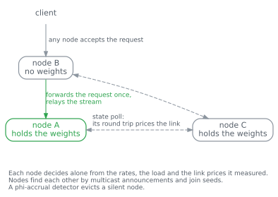
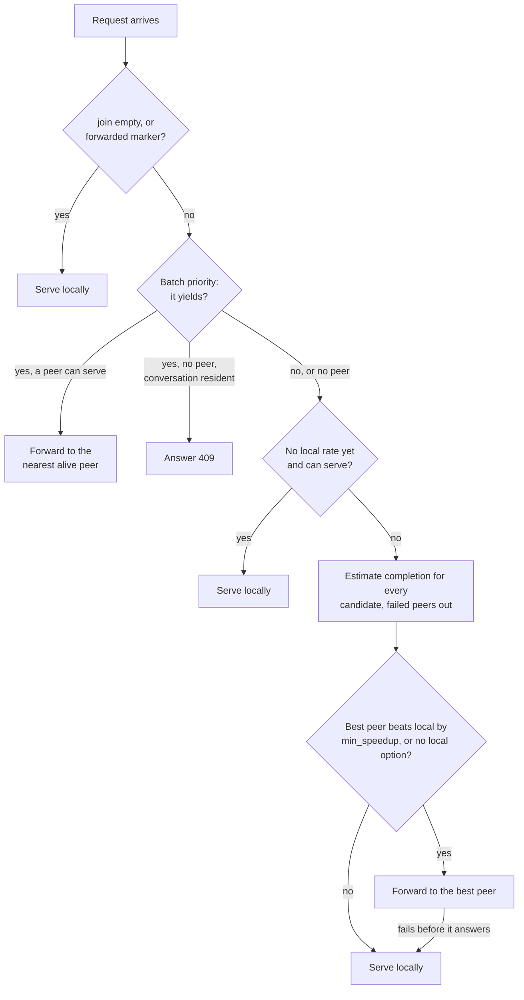
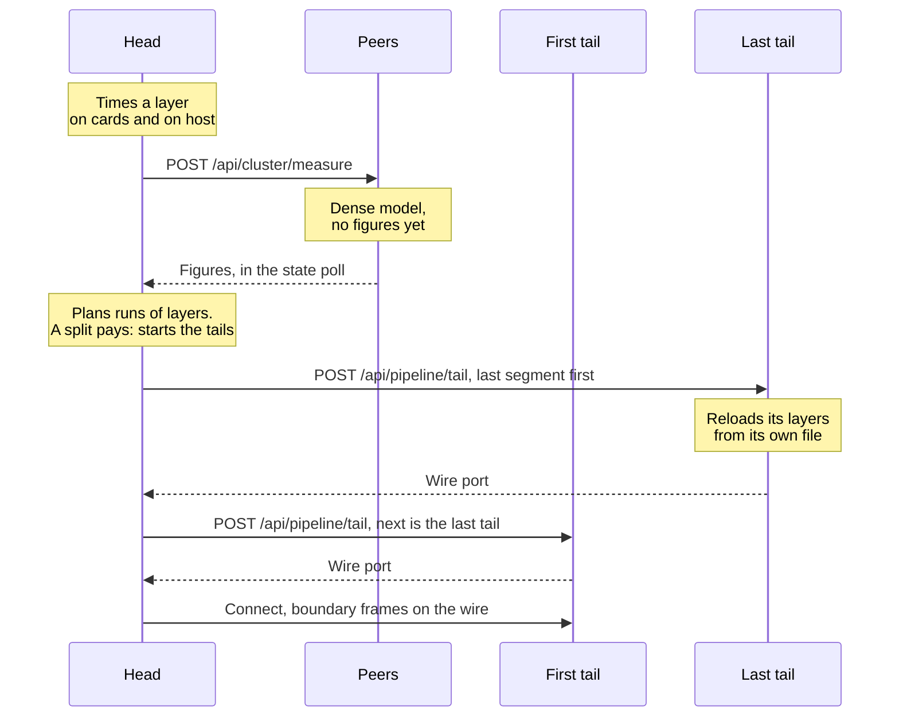

# Cluster internals

To set up 2 machines, read [Run 2 machines](operate/cluster.md).  
[Status](https://github.com/loken-ai/loken/blob/main/docs/STATUS.md#the-cluster) says what has been measured.  
[Across machines](inside/nodes.md) follows a request and a cut step by step.

## Principle

The cluster measures what it needs.
A node times its own layers and its own completed requests, and publishes them.

Every link is priced by the round trip of the state poll.
No operator gives a speed, a bandwidth or a topology.

Any node accepts any request.
A node without the weights forwards it.

A forwarded request is the original HTTP request.  
The response is the stream the peer sends, relayed unchanged.

## The `[cluster]` keys

Without a `[cluster]` section no cluster path runs.

| Key | Default | Effect |
|---|---|---|
| `name` | `"default"` | Cluster name. A node ignores announcements that carry another name. |
| `node_id` | the hostname | How the node names itself to its peers. Without a hostname file or `COMPUTERNAME`, `node`. |
| `advertise` | empty | The URL peers reach this node at. Empty advertises `http://<node_id>:<port>`. |
| `join` | `[]` | Seed URLs of peers. Discovery adds to the list. A node routes and plans only when `join` is not empty. |
| `gossip_interval_ms` | `1000` | Period of the state poll and of the multicast announcement. |
| `min_speedup` | `1.15` | A request moves to a peer only when the peer's predicted completion is this many times faster. |

## Routes

Routes under `/api/cluster` sit behind the same authentication as every other route.
Peers send no key, so a node with `require_auth` on refuses their polls.

| Route | Request | Answer |
|---|---|---|
| `GET /api/cluster/state` | none | What this node publishes: `node_id`, `models` resident, `serves` (what it could load), `load`, `busy`, `lanes`, `devices`, `cards` (bytes each card admits whole), measured rates, `prefix_blocks`, the cost of a layer per model, the bytes its cards carry per model, and the round trips it timed to its peers. |
| `GET /api/cluster/peers` | none | `clustered` and `peers`. Each peer has `node_id`, `endpoint`, `alive`, `phi`, `rtt_ms`, `is_self` and `state`. |
| `POST /api/cluster/prefix` | `model`, `prompt` | `cached_tokens`: how many tokens of the prompt this node holds in its prefix cache. A model that is not resident answers 0. |
| `POST /api/cluster/measure` | `model` | `card_ms`, `host_ms`, `card_bytes`: what a layer of the model costs on this node. A head that plans the cut of a dense model asks it of a peer that has no cost for the model yet. |
| `POST /api/cluster/prefill` | `model`, `prompt` | `application/octet-stream`: the KV cache after reading the prompt, which the asking node imports and decodes from. |
| `POST /api/pipeline/tail` | `model`, `from`, `to`, `next`, `context` | `port`: the wire port. The node serves layers `[from, to)` and relays to `next`, a `host:port`, unless it holds the last segment. |

`measure`, `prefill` and `pipeline/tail` are calls between nodes.  
`GET /api/tags` lists the models of the peers beside the local ones, each under `node`.

## Discovery and membership

| Part | Behaviour |
|---|---|
| Announcement | A UDP datagram to the multicast group `239.255.42.99`, port `41999`, carrying `cluster`, `node_id` and `endpoint`. |
| Ignored | An announcement with another `cluster`, one with this node's own `node_id`, and a malformed datagram. |
| Peer book | The union of the `join` seeds and the announced endpoints, without duplicates. A peer that moves is the same `node_id` at a new endpoint. |
| No multicast | A bind failure logs `cluster: no multicast discovery (...); seeds only` once. The seeds still work. |
| State poll | Every `gossip_interval_ms`, a node polls `GET /api/cluster/state` of each known endpoint. The poll times the round trip. A failed poll is a debug line. |
| Failure detector | A phi-accrual detector learns each node's interval between answers. A silent node is evicted when its suspicion passes the threshold. A node that paused and resumed is not. |
| Self | A node ignores its own `node_id` in a poll. |

## Routing a request

A node decides in this order.  
A verdict that keeps the request logs `cluster: serving locally: <reason>`.

1. `join` is empty: serve locally, `single node`.
2. The request carries the forwarded marker: serve locally, `already forwarded once - a second hop would risk a loop`.
   A request moves at most once.
3. A request that yields (batch priority) goes to the nearest alive peer that can serve it.
   With no peer and a conversation resident, the node answers `409`.
   With no peer and no conversation resident, the request goes on to step 4.
4. A node that has no measured rate for the model, and can serve it, serves it first, `no local price for this model yet`.
5. Every candidate gets a predicted completion time, round trip included.
   The inputs are the rates the node measured for that model, its load and lanes, the prefix tokens it reports on `/api/cluster/prefix`, and the cost of loading the model when it is not resident.
6. The lowest estimate wins.
   A peer that failed a hand-over is out for 10 gossip intervals.
7. The best peer must beat the local estimate by `min_speedup`, unless this node cannot serve the model at all.

When a peer stops mid-stream, the relay appends the closing chunk of the API format so the client sees an end.

## Planning a cut

At load, a clustered node measures itself and plans the split.
The node that loads the model becomes the head.

1. The head times a layer on its cards (`layer_ms`), the cost of a layer on its host (`miss_ms`), and the bytes its cards can carry for the model.
2. Every node publishes these figures in `/api/cluster/state`.
   For a dense model, the head asks a peer that lacks them on `/api/cluster/measure`.
3. The head collects the profiles of the alive nodes that have a cost for the model, and the measured round trips between nodes.
4. The planner picks which node runs which contiguous run of layers.
   It minimises the predicted time of 1 token: the compute of each used node plus the crossing of each boundary.
5. A boundary costs the measured round trip between the 2 nodes.  
   Capacity is a hard limit: a plan never overflows a node.
6. A node that would only slow the pipeline gets no layers.  
   With up to a small number of nodes, the planner tries every order.
   Beyond that, it orders nodes by speed.
7. When 1 node is fastest, the head logs `single node is fastest; not splitting` and serves alone.

| Model | Cost of a node's run of layers |
|---|---|
| Mixture of experts (DeepSeek V4.1) | Layers at `layer_ms`, plus the routed experts the cards do not hold at `miss_ms` each. Residency is the room left after the always-read weights. |
| Dense transformer | Each layer at `layer_ms` on a card, or `miss_ms` on the host. The stack starts on the node that holds the request. |

When a split pays, the head calls `/api/pipeline/tail` on every later segment, the last first, then connects its own model to the first tail.

The tail reloads its layers through its own placement ladder and needs the model file locally.  
A failure logs `pipeline not formed (...); one node`, and the head serves alone.

A split is refused for models whose layers read state outside themselves: per-layer inputs, shared KV, recurrent state, experts held in host memory, an adapter or an image tower.

## The wire between nodes

Control traffic is HTTP and JSON.  
Activations travel on a persistent TCP connection in binary frames.
A tail opens its wire port on every interface at a port the system assigns, and returns it from `/api/pipeline/tail`.

A frame is little endian:

| Field | Size | Content |
|---|---|---|
| magic | 4 bytes | The number `0x4C4D5731`. Another value is refused. |
| version | 2 bytes | A peer on another version is refused. |
| request id | 8 bytes | Matches a reply to its request. |
| layer id | 4 bytes | The layer boundary, or the position of the first token for a pipeline boundary. |
| dtype | 1 byte | `F32`, `F16`, `BF16` or `Q8`. |
| rank | 1 byte | The number of dimensions. |
| shape | 4 bytes each | One value per dimension. |
| payload length | 8 bytes | Must equal the shape times the dtype size. |
| payload | the length | The raw bytes, written without a copy. |

A frame whose shape and length disagree, or whose length passes the cap, is refused before any allocation.

A multiplexed link carries many requests on 1 connection.
A reply is routed by its request id, and a bound on requests in flight makes a fast sender wait.

Pipeline frames:

| Frame | Layer id | Shape and answer |
|---|---|---|
| Boundary | Position of the first token | `[1, tokens, hidden]` in the stream's dtype. The answer is `[1, vocab]` f32 logits. |
| Verify boundary | Top bit set | The answer holds the logits of every token, `[1, tokens, vocab]`. |
| Cut | Length to cut the KV caches back to | One `Q8` byte for the operation. The answer is an empty `Q8` frame. |
| Failure | none | A non-empty `Q8` answer holding the message. |

A prefill chunk and a decode step are the same frame.  
Each segment keeps the KV cache of its own layers.
