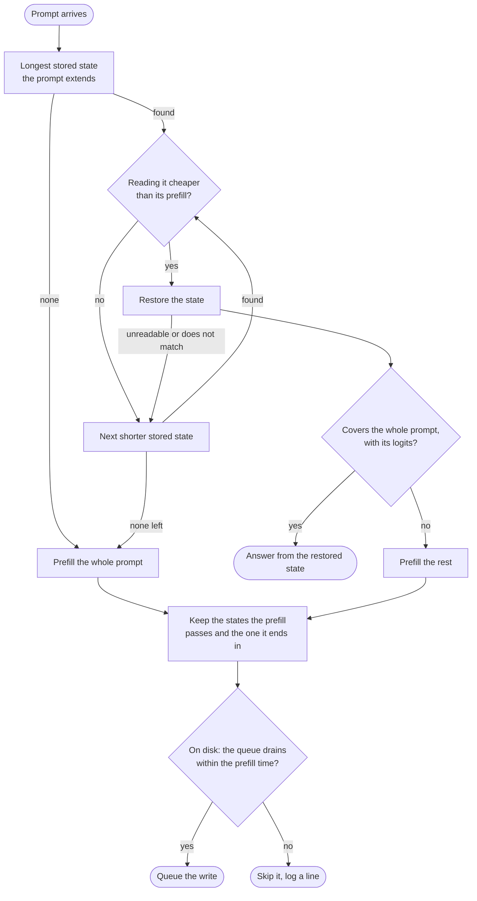
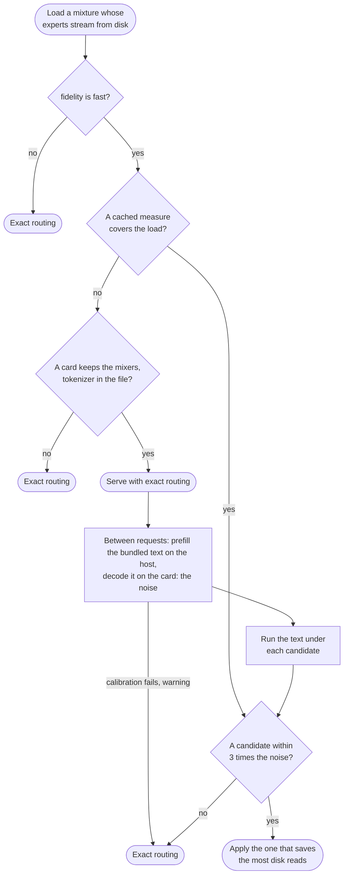

# Configuration

The daemon reads `config.toml` from the first of these places:

1. its working directory
2. beside the executable, walking up through a build tree
3. the user configuration directory: `~/.config/loken/config.toml`, or `%APPDATA%\loken\config.toml` on Windows

`config.toml.example` at the root of the repository is a working starting point.

Every key is optional.
A key left out takes the default shown.

Logs carry lengths and counts, never a prompt, a message, a transcript or a generated text, at any level.

A component that falls back to the host is admitted against the memory the host can give without swapping, minus a quarter kept as headroom.
Past that, the request is refused with the figures instead of running in swap.

A health probe or a model listing never waits on a load or a render.
It reports what was last known.

## Top level

| Key | Default | What it does |
|---|---|---|
| `ollama_models_dir` | `~/.ollama/models` | The Ollama-style store of manifests and blobs. A string, or a list: see [Model directories on several disks](#model-directories-on-several-disks). |
| `huggingface_models_dir` | `~/.cache/huggingface/hub` | The Hugging Face store, as a string or a list. A bare GGUF at its root, or under its `hub/`, is found by file name. |
| `lora_dir` | `loras` beside the first Hugging Face store | Where adapters live. Requests name an adapter, never a path. |

### Model directories on several disks

```toml
ollama_models_dir = ["/mnt/nvme/ollama", "/mnt/hdd/ollama"]
huggingface_models_dir = ["/mnt/nvme/huggingface", "/mnt/hdd/huggingface"]
```

The directories of a key form 1 catalogue: listings and loads see the models of all of them.  
List order is the order of preference, so put the fastest disk first.

| Case | What happens |
|---|---|
| A model held by several directories | Listed once, read from the first of them in the list. The log says once which copy is read. |
| A pull | Lands on the directory already holding the model (its manifest or weights blob, its repository) when that directory has room for the bytes it lacks. Otherwise lands on the first directory with room for the whole model. With no room anywhere, it fails and names each directory's free space. |
| A pull that replaces an Ollama model held elsewhere | The manifest in the other directory is removed. Its blobs stay until a delete prunes them. |
| A model built here (`/api/create`, `/api/blobs`, conversions) | Written to the first directory listed. A manifest goes to the first directory holding every blob it names. |
| A copy (`/api/copy`) | Stays in the directory of its source, beside the blobs it shares. |
| A delete | Removes every copy. |

A manifest and every blob it names stay in 1 directory.  
A Hugging Face repository stays whole in 1 directory.

A single string reads as a list of 1.  
Some media families read checkpoints from fixed paths under the store: `boogu/`, `wan/`, `flux-kontext-q4km.gguf` and `qwen-image-edit/`.
These are looked up in the first Hugging Face directory only.

## `[server]`

<!-- site: widget table id=config-server -->
| Key | Default | What it does |
|---|---|---|
| `host` | `"127.0.0.1"` | Listening address. The address is the security boundary: see [SECURITY.md](../SECURITY.md). |
| `port` | `11435` | Listening port. |
| `require_auth` | `false` | Demand an API key on every request but the health probes (`/health`, `/ping`). Turn it on before the daemon listens on anything but localhost. |
| `api_keys` | `[]` | Accepted keys, sent as `Authorization: Bearer <key>` or `X-API-Key: <key>`. Empty with `require_auth = true` refuses every request. |
| `allowed_origins` | `[]` | Browser origins allowed when authentication is on. Empty allows none. |
| `rate_limit_per_minute` | `0` | Requests per minute per client. `0` is unlimited. |
| `rate_limit_burst` | `10` | Requests that may arrive back to back before the per-minute rate applies. |
<!-- site: end -->

## `[inference]`

### Model

| Key | Default | What it does |
|---|---|---|
| `model_id` | `"ollama:qwen3:0.6b"` | The model loaded when a request names none. `loken list` prints the tags on this machine. |

### Fidelity to the published model

| Key | Default | What it does |
|---|---|---|
| `fidelity` | `balanced` | How closely the output follows the published model, against speed and memory: `reference`, `balanced` or `fast`. Any other value is a startup error. The server logs the level and what it chose at start. |

What each level chooses:

<!-- site: widget table id=config-fidelity-levels -->
| Choice | `reference` | `balanced` | `fast` |
|---|---|---|---|
| Float projections of an F32, F16 or BF16 checkpoint | As stored | Q8_0 when the stack sits on one kind of memory, Q4_K (Q6_K for the feed-forward output) when it is split between cards and host | Q4_K (Q6_K for the feed-forward output) |
| KV cache format | Full width | Q8 for a model the quantised kernels serve | Q8 for a model the quantised kernels serve |
| Float GEMMs on a CUDA card | IEEE F32 reduction | TF32 and fast BF16 | TF32 and fast BF16 |
| Parler-TTS decoder on a CUDA card | F32, as stored | F16 | F16 |
| Context shift | Off | On | On |
| Drafts verified in recorded windows | No | No | Yes |
| Exactness the experts streamed from disk may give up | `exact` | `exact` | `fast` |
| File each expert is read from, for a model served from several files | `largest` | `plan` | `smallest` |
<!-- site: end -->

The level decides these choices alone.
The file names none of them.

A quantised checkpoint (Q4_K, Q8_0 and the like) is read as stored at every level.
Its products quantise the activation to 8 bits, as llama.cpp does.

The level does not choose these, which are the same at all 3:

| Choice | Behaviour |
|---|---|
| Prompt lookup, and a drafter attached to a model that spills | Every draft is verified by the target's own sampler. A short verify runs the decode step's numerics row by row. |
| A prompt longer than the window | Refused with an error on every route. A cut prompt could lose its system prompt or tool instructions and still read as a plausible answer. |
| Batched serving of overlapping requests | Runs the residual stream in F16 on the cards. No level turns it off. |
| Approximate kernels (fast exp, fused attention in F16 with F32 sums) | Built into the kernels, within float rounding of their precise forms. |
| Float output head on a card | Held F16, whatever the file stores. The load log names it. |

### Decided by loken

None of these is configured.
A key of that name in an older `config.toml` loads and is reported as no longer read.

| Decision | Where it comes from |
|---|---|
| Sampling (`temperature`, `top_p`, `top_k`, repetition penalty, stop sequences) | The request, else the model's own recommendation (the `params` layer of an Ollama manifest, the checkpoint's generation config), else the Ollama API defaults. |
| Seed | The request's, else a fresh one per request. |
| Generation length | The request's cap, else the end of the context window. |
| Context window | The request's `num_ctx`, a load request's included, else what the checkpoint declares. A quantised cache grows into it on demand. An F16 cache is sized by the placement plan. A model whose cards keep some of its weights in the room the plan leaves opens the working window when no request asks for more: a larger cache would take that room. A longer prompt reloads it with a wider window. |
| Card a model loads on | The fastest card that holds it, from the probe. |
| Memory each card offers | The measured free memory. The load keeps its own runtime reserve and backs off after an out-of-memory. |
| Layers on cards, host threads | The placement plan, and the physical (or performance) cores. |
| KV cache format | Q8 for every model whose head shape the quantised kernels serve, at `balanced` and `fast`. Full width at `reference`, for a head shape they do not cover, and for capped attention scores (Gemma2), attention sinks and gemma4. |
| Conversation snapshots | Each finished sequence is copied aside, a quantised cache in its packed form, so a later request on it resumes from its own KV. The count kept is bounded by the free device memory, leaving the cache its working window and the next prefill the memory it sizes its chunk from. A copy that would not fit is not taken. |
| Batched serving | Requests that overlap on a model on cards share its paged worker. The worker takes a mixture whose experts the card holds, attention sinks, layers that read a sliding window, and a rotation stretched or over part of each head. It decodes those models without its captured decode graph. The worker runs every layer whole on one card. It reads a prompt longer than a prefill chunk alone, a chunk at a time. A model whose layers sit on several cards, or are split across them, decodes serially. A lone request takes the path with the higher measured decode rate: serial decode, which drafts and takes a prompt from a prefill peer, or the worker, which does neither. Each path is measured on the lone requests it serves, and a path not yet measured takes the next one, the worker first. A request that arrives while a lone request decodes serially moves that request into the worker at its next token. The model keeps the worker's paged pool while it serves serially, so the worker starts again at its first size. The time the arriving requests wait for that move counts against the serial path. A grammar, token rules or prompt embeddings take the model back to serial decode until the next overlap. |
| Speculative decoding | A model that spills layers to the host is drafted for by the smallest model in the store with the same ordinary vocabulary, loaded on the fastest card before the target. The draft length is learned from measured acceptance and cycle time. On a model whose experts stream, it also counts the experts a longer draft adds that no card holds, from the routing and the measured copy and host pace. A cycle that recorded a verify window, or the drafter's step, counts its acceptance alone. The drafter's decode step is recorded where the model allows it and kept between requests while nothing it reads has moved. A drafter with a recurrent state keeps the state before each draft and returns to it, then takes in only the tokens the target kept. A model held on the cards gets no drafter. `POST /api/draft/attach` attaches one by hand. |
| Resident models | As many language models stay loaded as the cards hold. The least recently used is unloaded only when an incoming model would otherwise be pushed off the cards. |
| Sleeping models | When a keep-alive ends, a language model whose files fit the host memory budget (the available memory less a quarter of the machine) keeps them read into host memory, locked when the system allows, and its card memory is released. The files are every part of a GGUF set with its draft head, vision projector and tokenizer files, or the shards and JSON files of a checkpoint directory. The next request loads it without reading the disk. Otherwise it is unloaded. |
| Context shift | At `balanced` and `fast`, once a conversation outgrows the window, the resident tail is kept and re-phased instead of prefilling the whole window, wherever the cache supports it (not Q4 caches, sliding-window layers or recurrent hybrids). |

### Copies of a model

| Key | Default | What it does |
|---|---|---|
| `replicas` | `1` | Copies of a model served side by side, each whole on a card of its own, so concurrent requests run in parallel. A request goes to the least busy copy, or to the one that served the last request while it is free, so a conversation keeps its cache. A model that does not fit 1 card is served once whatever this says. A copy that cannot be placed whole on its card is dropped. A reload for a wider window or another cache format brings the model back as 1 copy until its next cold load. |

### KV reuse across requests

| Key | Default | What it does |
|---|---|---|
| `kv_disk_dir` | none | Directory of the disk tier under the snapshots. Holds token blocks shared between sequences by prefix, and 1 manifest per sequence. Survives a restart. |

The next turn of a conversation keeps the rows it shares with the turn before, up to the last turn marker of the chat template:

- It reads only the answer and the new turn: a conversation of 7000 tokens reads 30 at its second turn.
- Several conversations are kept side by side, each restored when its turn comes, as long as the lease holds.
- The usage of a reply names the tokens a kept state served (`cached_tokens`), on the chat route and on the Responses route, where `previous_response_id` names the conversation.
- A prompt with no turn marker keeps what a cold read of it would have produced, in whole blocks.

### Prompts read by another instance

An instance with `prefill_peer` set has its long prompts read by that peer, which serves the same model.
The peer answers with its KV cache over `/api/cluster/prefill`, and this instance imports it and decodes.  
[Across machines](https://loken-ai.github.io/loken/nodes/) draws the steps.

The instance asks the peer only while handing the whole prompt over is expected to take no longer than reading the tokens its cache lacks.
Both speeds are measured by the instance itself, the first from its hand-overs and the second from its prefills.
A peer never measured is asked once.
A peer measured slow is asked again after the local prefill has run as long as its last hand-over took.

A model with recurrent or windowed layers hands over its whole decode state instead of rows.

The decode state holds every recurrent state, the windowed layers' rows, the global layers' rows and the logits to resume from.
It is checked against this instance's layer kinds and row geometry before it is read.

The prompt is read here when:

- the prompt adds less than 1 prefill chunk to what the cache holds
- the request carries an image
- the model has a split layer
- the cache is cut over the cards
- the peer cannot answer

The rows travel as f32, about 4 times the cache's own size.

| Key | Default | What it does |
|---|---|---|
| `prefill_peer` | none | URL of the instance that reads this one's long prompts. |

### A context cut over the cards

With `context_parallel` set, the cache of each attention layer is cut into ranges of positions, 1 on each card the machine shows: the layer's own card first, then the others.

- Before its prefill, a request reserves the positions it needs, each card's room past the work of a prefill shared by the layers.
- A decode past them grows a range a working window at a time.
- A query attends to every range on the range's card, and the parts are combined on the layer's card, so a context no single card holds is served whole.

The ranges hold F16 rows.
The layers so cut run outside the recorded decode step, and their prefixes are not kept as snapshots.

These layers keep their own cache: layers with a sliding window, attention sinks or indexed attention, layers sharing a cache with others, and layers split across cards.

| Key | Default | What it does |
|---|---|---|
| `context_parallel` | `false` | Cut attention layers' caches over every card. |

### One directory for each disk cache

`kv_disk_dir` and `state_cache_dir` are separate keys because the caches ask different things of their disk.

The KV disk tier writes blocks of 256 tokens, shared between sequences by prefix.
It writes and reads at the speed of its disk and measures nothing.

The decode-state cache writes whole decode states, far larger than a block.
It measures the write speed, the cost per file and the restore time of its disk.
It writes a state only when the disk can drain it within the prefill time of the prompt it came from.
It restores a state only when reading it costs less than prefilling the tokens it covers.
It sizes its files from the cost per file.

A machine with a fast disk and a large one can put each cache on the disk that suits it, the KV tier on the fast disk and the states on the large one.
Both keys unset keep nothing on disk.

### Decode-state cache (DeepSeek V4.1 and recurrent hybrids)

The cache lives in host memory for the life of the process, or on disk when `state_cache_dir` is set.

A DeepSeek V4.1 prompt costs 1 pass over the routed experts the cards do not keep, read from the file's mapping.

The cache stores the model's decode state after a prompt and after each finished turn.
A later prompt that begins with the same tokens restores a stored state and prefills only the rest:



A state whose read costs more than the prefill of its tokens is passed over for the next shorter one, with a log line.

Every file a cache keeps on disk (the state cache, the KV disk tier, the expert routing profile) has the same format:

- A 20-byte header names the kind of file and its version, then comes a binary body.
- A body is stored compressed when that makes it clearly smaller, and read back whole.
  A store in memory is never compressed.
- A file of another kind, another version or cut short is refused, and the cache rebuilds what it lost.
- Files hold no text and are not encrypted.
- A manifest of the KV disk tier holds the token ids of its sequence.
  A file of the state cache holds none.

The same keys open the same store for a generic-route model that carries a recurrent state beside its KV (a convolution, state-space or delta-rule mixer interleaved with attention).

The recurrent state cannot be cut back to a shorter prefix, so trimming never reuses an earlier prompt and every turn re-prefills.
With the store open, a hybrid restores and keeps states on the same path as DeepSeek V4.1.
It keeps no state after a finished turn.

A dense model keeps its disk tier (`kv_disk_dir`) and is unchanged.

In memory, states are kept as the KV snapshots are: never written, gone with the process.

On disk, the files hold state derived from prompts: KV tensors, hidden rows of the filling compression group and compressed token-class ids.

The state cache's files hold no text and no token ids, and names and keys are hashes.
The state is as private as the prompt it came from.

Keep the directory where the prompts could live, and leave the key unset where nothing about an exchange may reach the disk.

| Key | Default | What it does |
|---|---|---|
| `state_cache_dir` | none | Directory of the cache. None keeps it in host memory. |

The cache works out these quantities from what the model, the disk and the engine report, and logs when they change:

| Quantity | Derived from |
|---|---|
| Block size | The bytes a token adds to the blocks, the model's granule, and the directory's per-file cost and write throughput. These are measured once on the directory with synced probe files and kept, so a restart finds the chain it wrote. |
| Spacing of kept states | The measured write throughput, the size of a manifest and the measured prefill time per token. A state is kept no closer than the disk can finish writing it within the prefill of the tokens in between. Until both are measured, the spacing is the prefill's own chunk. It is a multiple of the block size and of the chunk. |
| Whether to restore | A stored state is read only while its measured read-and-decode cost per byte, times its bytes, is below the measured prefill time of the tokens it covers. It is tried while either is unmeasured. |
| Writes | 1 at a time. A write queues behind earlier ones only while the disk drains the queue within the prefill time of the prompt that produced the state. Otherwise it is skipped with a log line. |

A DeepSeek V4.1 state is a manifest and blocks, as a hybrid's is:

- The manifest holds each latent layer's token count and window of key rows, and the part of each band layer's state past the last whole block.
- Blocks hold the band layers' compressed rows and index keys, once per shared prefix.
- Rows are written as the codes of the fp8 or fp4 grid they lie on, and as f32 where a value is off it, so a restore returns the stored bits.

The rest of the prompt is prefilled in chunks onto the restored state, and the states the prefill passes are kept.
A prompt kept whole in host memory with its logits is answered from them, with nothing to prefill.

A pass over a few 100 tokens still routes to nearly every expert of every layer, so it reads about as many expert bytes as a whole prompt.

The batch worker and the serial path use the cache.  
A pipelined model does not, because half of its state is on the tail node.

A state is keyed by the model files (length, modification time and header), so a different file starts from nothing.
A damaged, truncated or foreign file is ignored with a log line.

For a recurrent hybrid, a stored state is a manifest and blocks:

- The manifest holds every recurrent mixer's state, every windowed layer's resident rows and the global layers' rows past the last whole block.
  Its size depends on the model, not on the prompt.
- Blocks hold the global layers' rows for 1 block size of tokens (derived, see above), once per shared prefix.
  A block is stored as f16 where every value is exactly an f16, and as f32 otherwise, so a restore returns the stored bits.
- States are kept at the derived spacing of kept states, and at the end of every prompt of at least 1 block.
- A state is keyed by the file, `kv_quant`, the layer kinds, the row geometry and which layers run on a card, so another placement or KV format starts from nothing.

A restore removes the prefill of the covered tokens: the recurrent state and the global KV are read from disk instead of recomputed.
The gain grows with the covered length and with how slow a prefill is on the machine and placement in use.

The read speed of the cache directory against the state size bounds the gain.

A restore from disk leaves at least 1 token to prefill, to produce the logits.
A model with a draft head leaves 2.

### Streamed mixtures (DeepSeek V4.1)

The `fidelity` level decides both choices of a model whose routed experts stream from disk.
The file names neither.

At `reference` and `balanced`, the output is identical to the full model, the same tokens whichever experts the cards hold, because a routed expert on a card gives the bits the host gives.

At `fast`, the output differs from the exact one by at most 3 times the model's own run-to-run noise, the divergence between its exact runs on the card's kernels and on the host's.
The host run prefills the bundled text.
The card run decodes the same tokens 1 at a time, through the mixers a card keeps.

For a model whose manifest names further files of its checkpoint, the level also chooses the file each routed expert is read from, see [Mixture variants](MODELS.md#mixture-variants).

The engine settles how far `fast` gives up exact routing.
A load that finds the measure in the cache applies it at once.
Otherwise the load ends with exact routing, and the calibration runs between requests:



The bundled text runs teacher-forced.
It mixes code and prose, the kinds the quality harness scores.
A candidate fits when its divergence over the text and over each half of it stays within the budget.
With no card that keeps the mixers, `fast` runs exact and says why in the log.
When no candidate fits the budget, routing stays exact and the log says so.

The candidates derive from `K`, the number of experts a token routes to.
Each candidate either keeps the `K-1` or `K-2` heaviest experts, or replaces a light expert that is not in memory when its weight share is under `0.5/K`, `0.75/K` or `1/K`.
A replaced expert gives its slot to the best ranked expert in memory beyond the choice.

An expert is in memory when a card keeps it or the host tier keeps it.
The calibration counts the experts the tiers keep when the load ends.
In service, the router reads what the tiers keep at each forward, so the trade follows the tiers.
The read-ahead of the next layer's experts guesses with the same choice, so it reads no expert the trade replaces.

The measured table and the noise are cached per model file, bundled text and count of experts in memory, under `loken/` in the user cache directory.
A later load reuses the measure of the largest count not above its own, without a time limit.
The tiers start from the hottest experts, so a measure with fewer in memory replaced at least the experts the router replaces now.
A load measures only when no cached measure covers its count, as at the first load of a file.

The calibration runs while the server handles no request, 1 run of the text at a time.
A run is the exact prefill, the decode of the noise or 1 candidate.
A request that arrives during a run waits for the end of that run, and the decode of the noise gives way at its next token.
Each run drops the KV it wrote, so the next prompt is prefilled whole.
Until the last run ends, routing stays exact, and every answer is the exact one.
Each run keeps its result in the cache, and a later load resumes the calibration where it stopped.
The truncation applies from the request after the last run.
A preload, a request with an empty prompt, lets the calibration run before the first prompt arrives.

The routed experts of a wide-residual model stay in the file's mapping, read as routing asks for them.
The card tier keeps the busiest of them on a card when the card measures faster than the host.
A mixture of another family keeps its experts in the cache below.

### Expert cache of a mixture held in the file's mapping

A mixture too large for the cards keeps its routed experts in the file's mapping.  
The load sizes the cache on each layer's card.

| Quantity | Derived from |
|---|---|
| Experts a layer's cache holds | The budget the plan gave the card, less what the load took of it, the room for copies and the working memory of a chunk, divided by the bytes of 1 more expert in every layer the card holds. When the budget covers every expert of every layer, they are all on the card and the layers run as loaded ones, with no cache. |
| Which card holds which layers | Cards on equal links are cut in proportion to their room beside the output head. On unequal links, read from the driver as the generation and width of each card's PCIe link, the slower card holds the layers it can hold whole, every expert on the card, and the card on the fastest link takes the rest. |
| Where a missing expert runs | On the card, copied into a transit room and run with the cached ones, or on the host. The split is the one at which both finish together, from the time a copy and a host computation have each taken on the layer. A transited expert hotter than the coldest slot not in use stays in that slot. |
| Whether the next layer's experts are copied early | After a layer's request, the experts the next layer found missing on its last token are queued into the transit buffer that layer will use. The layer finds them there, keeps their places, and copies only the others. A layer queues them when the share of the guess that proved missing, measured over the layer's tokens, is above `1 - lead / copies`. The lead is the measured time from the copy stream going free to the next layer's request. The copies are the guess's size times the measured copy time of 1 expert. The counters, the break-even and the experts fetched and used are in the tier worker's log. |
| Which expert a slot holds | Counts of each expert's use, scaled down every few tens of tokens through a layer, so the cache follows the text in hand. A missing expert replaces the coldest slot not in use only when its count is higher by a margin. |
| Uses before a slot takes an expert | The uses that repay an upload: the measured time of a slot copy over the measured host time of 1 expert, rounded up. A bias learned from evictions is added. An expert that left its slot with fewer uses than that raises it, and one that repaid it lowers it. The count never falls below the floor the cache already had. The layer samples and the tier worker's log give it. |
| Bytes page-locked for copies to the cards | 3 quarters of the memory the kernel still has free, within the cap of the process's control group. |
| Experts locked in host memory per layer, when the layers do not fit whole | Starts at the page-locked bytes above. At a request's end it grows by 1 expert in every layer while the host has the room for it and the kernel's memory stall time did not rise with the last growth. It falls back 1 step when the stalls rose. The log gives each move. |
| Whether the experts the next layer is expected to miss are read from the disk ahead | Only when experts are locked in host memory per layer. A controller times the tokens between the card's first and last cached layer, tries the reads for 1 window, and keeps them only when the tokens ran faster by more than the noise. |
| Reader threads for those reads | The smallest count that reaches the device's read rate, from a probe of direct reads at load. The experts a token routes to when the probe cannot run. |
| Pages of an expert the host read and the card did not take | Dropped from the page cache after the request while the kernel reports tasks waiting for memory. Kept otherwise, for the next use. Experts locked in host memory keep theirs. |
| How long a recorded token waits on the host | 64 times the longest request the card's tier worker has answered, or the longest a layer's widest request takes at the measured paces of a host product and a copy. A request left unanswered that long while the worker does not move releases the card, logs the layer and the worker's step at error level, and fails the request. The layers serve again once the worker answers. |
| A wide batch streams a layer's experts | Only when copying what the card does not hold, at the measured host-to-card rate, takes less than running the rows through the cache at the pace tokens have decoded. |
| Host memory admitted for a spill | The bytes the process owns. Pages viewed in place from the mapping are not counted. The log gives the bytes read from the mapping, with a warning when they exceed the host's memory. |

### Files, moderation and URLs

| Key | Default | What it does |
|---|---|---|
| `files_dir` | `files` under the first Ollama store | Where `/v1/files` keeps uploads, batch inputs and batch outputs. |
| `moderation_model` | none | The classifier `/v1/moderations` asks, by tag. Recognised by name: Llama Guard, Shieldstral, ShieldGemma, Granite Guardian and gpt-oss Safeguard. Without it, the endpoint answers 501. |
| `public_url` | request `Host` | The origin clients reach this server at, used in the URLs it hands out, such as image files answered as `url`. Set it behind a proxy. |

### Media input

Every chat route holds a request to caps before its media reach the model.
The caps follow the decoder's allocation budget: a request past 1 is answered 400 naming the cap and the value it carried.

<!-- site: widget table id=config-media-input -->
| Key | Default | What it does |
|---|---|---|
| `image_fetch_hosts` | none | Hosts, or `host:port` pairs, an image given by URL on the Messages API or `/v1/embeddings` is fetched from. Redirects are followed only to them. Empty fetches nothing. |
<!-- site: end -->

## `[energy]`

<!-- site: widget table id=config-energy -->
| Key | Default | What it does |
|---|---|---|
| `carbon_intensity` | `50` | Grid intensity in gCO2eq per kWh, for the CO2 estimate. |
<!-- site: end -->

## `[cluster]`

Without this table, the node runs alone and every cluster path is skipped.  
See [CLUSTER.md](CLUSTER.md) for the model.

<!-- site: widget table id=config-cluster -->
| Key | Default | What it does |
|---|---|---|
| `name` | `"default"` | Cluster name. Nodes announcing another name are ignored. |
| `node_id` | hostname | How this node calls itself. |
| `advertise` | empty | The URL peers reach this node at. Empty advertises `http://<node_id>:<port>`. |
| `join` | `[]` | Seed URLs of peers. Discovery adds to the list. A node routes and plans only when this list is not empty. |
| `gossip_interval_ms` | `1000` | How often peers exchange state. |
| `min_speedup` | `1.15` | Predicted speedup below which a request is not handed over. |
<!-- site: end -->

## Command line and environment

| Setting | Default | What it does |
|---|---|---|
| `LOKEN_API_KEY` | unset | Read by `loken launch`: the key handed to the agent when the daemon requires one. |
| `OLLAMA_KEEP_ALIVE` | unset | The keep-alive of a loaded model, 5 minutes when unset. A bare number is minutes. |
| `HF_TOKEN` | unset | Sent when a pull fetches from Hugging Face. |

## Build features

<!-- site: widget table id=config-build-features -->
| Feature | Default | What it adds |
|---|---|---|
| `cuda`, `opencl` | on | The device backends. |
| `rocm` | off | AMD cards through HIP. Alone with `--no-default-features --features rocm,cpu`, or beside `cuda` with `--features cuda,rocm`, where 1 binary drives both vendors' cards. |
| `image`, `audio`, `video`, `midi`, or `media` for all | on | The generative-media families and their routes. |
| `vulkan` | off | Dense decoder layers on Vulkan GPUs that no other runtime of the build drives. A build with `vulkan` alone drives every GPU. |
| `metrics` | off | `GET /metrics` in OpenMetrics, behind the same authentication as every other route. |
| `cpu` | off | Language models on the host only. |
<!-- site: end -->
