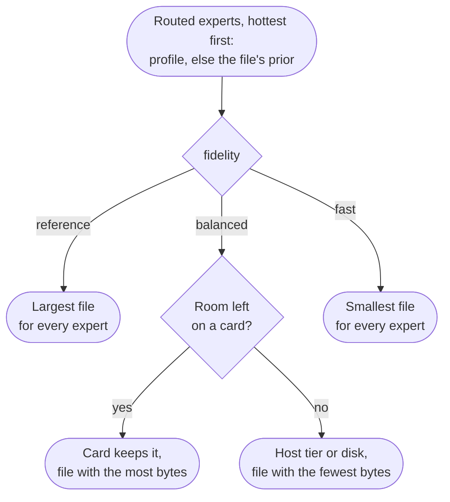

# Models

## Formats and stores

<!-- site: widget table id=models-stores -->
| Store | Layout | Formats | Named as |
|---|---|---|---|
| Ollama | `manifests/` and `blobs/` under `ollama_models_dir` | GGUF, with the template, system prompt and parameters of the manifest | `name:tag`, as in `qwen3:0.6b` |
| Hugging Face | The cache layout under `huggingface_models_dir`, or its `hub/` subdirectory | safetensors, and the `.pth` archives some media families ship | `owner/repo`, as in `Qwen/Qwen3-0.6B` |
| Bare file | A GGUF at the root of the Hugging Face store | GGUF | Its file name, with or without a tag |
<!-- site: end -->

| Command | Effect |
|---|---|
| `loken pull <name> --source ollama\|huggingface` | Fetches into the matching store. An Ollama tag comes whole. A Hugging Face repository brings its safetensors, GGUF, bin and JSON files |
| `loken list` | Prints what both stores hold |
| `loken delete` | Removes a model |

A `.pth` archive that a media family needs is placed in the store by hand.  
A request that names a model not yet loaded loads it.
A model stays resident for the keep-alive the daemon was started with.
When the keep-alive ends, a language model sleeps if its files fit the host memory budget: the files stay read into host memory and the card memory is released.
A model in GGUF keeps every part of its set, the draft head beside it, its vision projector and its tokenizer files.
A checkpoint directory keeps its safetensors shards and its JSON files.
The next request loads it from that memory, without reading the disk.
A model that does not fit is unloaded.
An unload by name also frees a sleeping model.

Quantisations are read as the file carries them.  
On a card, the block formats run through their own kernels.  
On the host, they need AVX2 (see [Building](https://github.com/loken-ai/loken/blob/main/docs/BUILDING.md)).

<!-- site: widget table id=models-tensor-formats -->
| Tensor formats a GGUF may carry | |
|---|---|
| Float | `F32`, `F16`, `BF16` |
| Legacy blocks | `Q4_0`, `Q4_1`, `Q5_0`, `Q5_1`, `Q8_0`, `Q8_1` |
| K-quants | `Q2_K`, `Q3_K`, `Q4_K`, `Q5_K`, `Q6_K`, `Q8_K` |
| Codebook | `IQ2_XXS`, `IQ2_S`, `IQ3_XXS`, `IQ3_S`, `IQ4_NL`, `IQ4_XS`, `Q2_0` |
| Others | `MXFP4` |
<!-- site: end -->

The codebook formats run on a card for the experts, in decode and prefill.  
On the host, they run through integer dot products that need AVX2.

A dense projection stored in a codebook format is requantised once at load to `Q8_0` for a card.
The experts keep their format.

A file that stores a tensor in another format is refused with the format's id.

Token and per-layer embedding tables stay as stored, and a lookup decodes the rows it needs.  
A load that rebuilds a weight in another representation logs 1 ledger line with the bytes before and after.

### Pull a selection

`loken pull owner/repo:SELECTOR` keeps the GGUF files of a repository whose directory, or dash-delimited file-name token, equals `SELECTOR` (case-insensitive).
It also keeps the repository's configuration files.

Without a selector, every file is pulled.

Each file is checked against its listed size and its sha256.

A pull follows the daemon's streamed progress.
It stops when no frame arrives for 8 times the longest gap seen.  
A repository that holds a model GGUF and its `mmproj` resolves to the model file.

### Split GGUF

A GGUF split into parts by `gguf-split` is read as 1 model on the generic route.  
The loader takes the first part's metadata and the union of the parts' tensor directories.
Each tensor is read from the part that holds it.

| Rule | Detail |
|---|---|
| Name | The first part names the set |
| Missing part | A part whose siblings are missing is refused |
| Placement | Layer by layer. A set is never split tensor-parallel, even when it does not fit 1 card |
| Vision tower | Read from the first part only. A set whose `v.*` tensors sit in another part is served as text, and the log says why |

### Mixture variants

A mixture model may be served from several GGUF files of 1 checkpoint, each quantising the routed experts to its own format.

The mixture model's Ollama manifest names the first file as its model layer.  
Each further file is a layer of media type `application/vnd.loken.image.model.variant`.  
`/api/tags` lists the tag like any other.

```json
{"layers": [
  {"mediaType": "application/vnd.ollama.image.model", "digest": "sha256:<iq2 file>", "size": 374255419392},
  {"mediaType": "application/vnd.loken.image.model.variant", "digest": "sha256:<iq3 file>", "size": 437973673600}
]}
```

Every tensor is read from the first file, except the routed experts.
The placement reads the routed experts expert by expert, from 1 file or another.

The placement fills the tiers that keep routed experts in routing-heat order: the cards, then the host tier.
The heat is the model's routing profile in `profiles/` of the store.
The routing prior orders the experts the profile never counted, and every expert when there is no profile.
The prior is the one the file records, else the one a companion GGUF of the model declares.
A wide-residual model keeps its hottest routed experts on a card when the load measures the card faster than the host's cores on a token's experts.
The host then keeps, per layer, the experts its rows routed to most recently, as many as its memory holds beside a request's needs.
Every other routed expert is read from the file at its use and leaves the page cache after it.
The card keeps them in the room it has left after the token mixers, the cache and a request's work.
Every card the load was offered takes part, the cards the plan leaves out included.
A card outside the plan keeps routed experts only: its room is its free memory less a request's work.
The cards take the experts in heat order, the first card by ordinal the hottest, the next card the next ones.
Each card runs its experts on a thread of its own, beside the host's cores.
In a forward of several rows, a card the load measured faster also runs experts it does not keep, after its own.
Their blocks go up from the host's memory, run over all their rows and are dropped.
The load's measure gives the cost of each side: the upload rate, the card's product and a host core's product.
The experts go, the most rows first, to the card or the host core that finishes them soonest.
A batch in transit takes what the card has free at that moment.
An expert a card read from the file past the page cache does not join the experts the host keeps.
A card reads through the page cache the experts in transit the host keeps after the prompt.
An expert that does not fit, or whose batch fails, runs on the host.
A decoded row moves no expert.
The weights every token reads take their part of the room of the plan's card first: the output projections, the shared experts, the routers and the head.
The load times each kind on the host and on the card, and keeps it on the card when a byte of it saves more host time than a byte of routed experts.
The load log names what it measured and kept.
An expert on a card gives the bits it gives on the host.
The other routed experts run on the host's cores, read from their file.
The `fidelity` level in [Configuration](CONFIGURATION.md) picks the file:



At `balanced`, each tier takes the file that suits its compute:

| Tier | File an expert comes from | Reason |
|---|---|---|
| Cards, while they have room | The file that stores it in the most bytes | A card computes an expert at the same speed whatever its format |
| Host tier, or read from disk | The file that stores it in the fewest bytes | The host's cores read every byte of an expert at each use |

A further file is refused at load, with what differs, unless it matches the first file on all of these:

- `general.architecture` and `tokenizer.*` metadata.
- The routed experts (layer, projection and expert), at the same shapes, stacked or 1 tensor each.
- Every other tensor of the first file, at the same shape, format and bytes.

A table read row by row (the engram tables) is compared on evenly spread spans.  
Tensors that only the further file carries are ignored.  
The generic route reads this layout for a wide-residual model, DeepSeek V4.1 among them.
Another model's further files are left unread, and the log says so.

### Convert DeepSeek V4.1

`loken convert` writes a DeepSeek V4.1 file in llama.cpp's `deepseek41` layout. llama.cpp and the engines that vendor it load that file.

| Element | Content |
|---|---|
| Keys and tensor names | llama.cpp's |
| Model name | The last segment of the checkpoint's Hugging Face id |
| Vocabulary | llama.cpp's arrays, beside the checkpoint's own `tokenizer.json` |
| Engram tables | 1 `per_layer_token_embd` table in `Q8_0`. ggml has no fp8 type, and `Q8_0` holds the released values in about the same bytes |
| Engram layer weights | Each layer's query and key weights, stored as their product |
| Routed experts | The formats asked for |
| DSpark draft | Stored apart as `<name>:<tag>-dspark`, the companion the loader reads for `<name>:<tag>` |

A partial conversion of layers `0:N` is a model of N + 1 layers that llama.cpp loads as such.

The model file is read and written by the generic block-scaled reader and its streaming driver.
The calibration, the DSpark draft and `--complete` run on the generic route too.

The route still reads the files loken wrote before, under `deepseek_v41` and its own names.  
A file that `--complete` lays out is loken's own layout, not llama.cpp's.

### Draft head

A checkpoint may ship a draft head that the served file leaves out: the multi-token-prediction layer of the wide-residual family.
The loader reads it from a companion file, `<stem>.mtp.gguf`, beside the model.

The stem is that of a split's parts.
A model without the companion decodes without a head.

`loken draft-head <repo> <out.gguf>` writes the companion from the checkpoint's `mtp.*` tensors.
It fetches them by range requests and keeps them as released: the checkpoint's names, shapes and bytes.

The file carries `general.architecture` and `general.name` and nothing else.
This layout is loken's own.

At load, the loader:

- Lists the head under the model's names, its layer `blk.N.*` with N the model's layer count.
- Splits the fused indexer projection and the expert stacks by rows.
- Reads each norm scale as stored plus 1.
- Quantises a matrix as it reads it.

## Language models

1 generic transformer reads its shape from the checkpoint, so a family is a row.

<!-- site: widget table id=models-architectures -->
| Line | Architectures as the GGUF header declares them |
|---|---|
| Llama and its distils | `llama`, `mistral`, `mistral3`, `yi`, `falcon`, `falcon3`, `internlm2`, `stablelm` |
| Qwen | `qwen2`, `qwen3`, `qwen3moe`, `qwen35`, `qwen35moe`, `qwen3next`, `qwen4exp` |
| Gemma | `gemma`, `gemma2`, `gemma3`, `gemma4` |
| Phi | `phi`, `phi2`, `phi3`, `phi4` |
| Granite | `granite`, `granite3`, `granitemoe` |
| OLMo | `olmo2`, `olmoe` |
| Others | `gptoss`, `lfm2`, `lfm2moe`, `nemotron_h_moe`, `smollm3`, `starcoder`, `starcoder2`, `glm4`, `chatglm`, `ernie4_5`, `dbrx`, `glm_moe_dsa`, `mpt`, `orion` |
<!-- site: end -->

Mixtures route their experts on the card.
When the model does not fit, only the experts spill.

The recurrent hybrids (`lfm2moe`, `nemotron_h_moe`, `qwen3next`) carry their state-space blocks beside attention.

Reasoning models return their thinking apart from the answer on every surface.  
`gptoss` speaks Harmony and is read as such.

### DeepSeek V4.1

DeepSeek V4.1 loads through the generic route as a wide-residual model.
The hyper-connection tensors of the file or the checkpoint directory select its layers.
The routed experts stay in the file, which may be split, and are read as routing asks for them.
The placement plan decides which layers sit on the cards.
The card tier keeps the busiest routed experts on a card when the card measures faster than the host.
A card the plan leaves out keeps routed experts too, the next ones in heat order, and no cache.
It takes a layer's feed-forward input and gives back the outputs of its experts.
A run on it that fails leaves those experts to the host for the step.
The card then drops its coldest experts before the next forward until the run's bytes are free.
The card of a layer's token mixer also keeps the layer's output projection, shared expert and router when the load measures that they save more there than routed experts.
Until a sequence passes the working window, these weights and experts also take the card room kept for a larger cache.
They share it in 1 ranking, by the host time a byte saves on the card.
A forward that needs that room takes it back first: the card drops what saves the least per byte, coldest experts and cheapest weights alike.
A prompt also reads the card's free memory first and takes back what the request's work and the prompt's cache would lack.
A prompt that still runs out of card memory gives back all the lent room and runs again.
The host runs each dropped weight from then on, as it runs a weight the load leaves on the host.
The next load places them again.
A decoded row's router runs on the card with the host's bits, so the card never changes the experts a row routes to.
A packed weight on the card runs the fastest of its products that is no farther from the exact product than the host.
Products whose measured times differ by less than their measured noise are tied.
A tie falls to the product nearest the exact one, so the timing noise of a load does not change the text.

A routing prior that the file lacks is borrowed from a companion GGUF, found by the metadata it declares.

The companions of a model in an Ollama store are the files its manifest names.
They are the further layers of its manifest and the model of its `<tag>-dspark` manifest.
Another model's blob in the same `blobs/` directory is never one.
A model file outside a store takes its companions from its directory.

Across machines, the model splits into runs of layers as a dense stack does, see [Cluster](CLUSTER.md#planning-a-cut).

### Vision and speech in

| Input | Families | Transport |
|---|---|---|
| Vision | `moondream`, `pixtral`, the Qwen vision lines (`qwen25` vision, `qwen3vl`, `qwen35`) | Base64 in the request, on all 3 surfaces |
| Speech | `voxtral`, `ultravox` | Base64 clip in a chat turn |

A Qwen vision prompt gives the tokens of an image or of a frame of a clip the positions of their grid.
The position of the next token then runs behind the cache length.
Such a request decodes one step at a time, streamed or not, without the recorded step and without drafts.

A model whose files carry a speech tower lists `audio` among its capabilities.
The tower comes from one of 2 sources:

- The `mmproj*.gguf` beside a text GGUF.
  `clip.projector_type` names the family.
- A checkpoint directory whose `config.json` declares an `audio_config`.

Ultravox ships only the tower and the projector.

Ultravox names its text model by `text_model_id`, which the loader looks up in the hub cache by id, else by name under any owner.

Ultravox's safetensors are served through the dense checkpoint route below, so no GGUF is needed.
Pulling the checkpoint pulls that text model too when the cache holds no copy of it.  
A gated id needs a token, or a copy pulled under another owner.

The tower is placed after the text model, on a card the text model does not use when there is one.

A clip arrives base64 as an `input_audio` part of `/v1/chat/completions`, or in `audios` of an `/api/chat` message.
Any container the server decodes is accepted.

The clip is mixed down and resampled to the tower's rate.
Clips over 30 s are encoded window by window.

The clip's embeddings take the place of 1 marker in the prompt.
The clip counts against the context window and in `prompt_tokens` and `prompt_eval_count`.  
A request that carries a clip is not served from the prompt cache and takes no grammar.

### Dense checkpoints

A directory of `config.json`, a tokenizer and F32, F16 or BF16 safetensors shards of a Llama, Mistral or Qwen text model is served through the generic route, as a GGUF file is.

Shapes come from the configuration.  
Tensors are read in their stored width.  
A long-context rope declared there becomes the frequency table that a GGUF file would carry.

The projections of a float checkpoint run in their stored format when the placement fits it, on the host and on every card family.
The layers a card takes fit as stored.

The layers the host keeps are weighed against the memory it can give.
A checkpoint that does not fit is rebuilt once at load, in the widest format that does:

| Rung | Projections | Feed-forward output |
|---|---|---|
| 1 | As stored (`F32`, `F16`, `BF16`) | As stored |
| 2 | `Q8_0` | `Q8_0` |
| 3 | `Q4_K` | `Q6_K` |

The load log says which rung runs, and `/api/ps` reports it as `details.running_format`.  
A float output head on a card runs in `F16` at `balanced` and `fast`, and as stored at `reference`. The load log says which.
A GGUF file with block projections rebuilds its stray float matrices in `Q8_0`, or in `Q4_K` when its stack spills to the host.

| Backend | Float matrix behaviour |
|---|---|
| Vulkan | A `BF16` or `F32` matrix runs the mat-vec kernel at every token count. Only `F16` has a mat-mat kernel |
| OpenCL | The kernels do not read `BF16`. A `BF16` matrix kept as stored runs there widened to `F32`, and the load log says so |

Z-Image holds each projection on a CUDA or ROCm card in the narrowest form exact for its stored values: `BF16`, then `F16`, else `F32`.
Its blocks on the host hold each projection in the same form, and the host products read it with `F32` rows.
The placement weighs each projection in the form it is held in.
A narrower form than the stored one goes in the conversion ledger.
The load log and `/api/ps` name the formats the blocks run in.

The Wan 1.3B video DiT holds each block projection in the narrowest form exact for its stored values, on a card and on the host.
A narrower form than the stored one goes in the conversion ledger.
A projection merged with an adapter is held in the form of its stored values, rounded once, and the ledger says so.
The load log names the formats the blocks run in.

A layer on Vulkan or OpenCL runs its projections in the format the rung and the fidelity level give every layer.

The expert stacks of a mixture-of-experts checkpoint follow the kernels instead.
A stack runs as stored where a kernel of its device reads that format.

On the host that includes `F32`, through the dense expert product, which copies the stack on each call and is slow for a large one.
`F16` and `BF16` stacks are rebuilt in `Q8_0`.

### Embeddings and reranking

| Model | Route |
|---|---|
| BERT-shaped encoders (`nomic`, `bge` and the like) | `/v1/embeddings`, `/api/embed` |
| Qwen3-Reranker checkpoint | `/v1/rerank` |
| CLIP or SigLIP checkpoint directory | `/v1/embeddings`, `/v2/embed`, texts and images in 1 space ([guide](https://loken-ai.github.io/loken/embeddings/)) |

## The qwen4exp family

The generic transformer reads the architecture from the file.

<!-- site: widget table id=models-qwen4exp-elements -->
| Element | Read from the file |
|---|---|
| Wide residual (hyper-connections) | The stream count and the low-rank width, with the mixers that replace the layer norms and the output mixer. Mixers and tables stored in BF16 or a block format are read as stored |
| Layer pattern | 1 indexed-attention layer after every `full_attention_interval` layers, the others delta-rule (3 delta-rule layers, then 1 attention layer, in the files measured) |
| Indexed attention | The indexer's head count, key length and top-k, and the per-layer compress ratio |
| Experts | Routed and used counts, expert width, a shared expert with a scalar gate. 160, 256 and 512 routed experts have been loaded |
| N-gram table | 1 table at the layer `ple.layers` names, 16 heads over bigrams and trigrams. It is read by row from the mapping and never staged on a card |
<!-- site: end -->

The files measured all load through the generic route:

<!-- site: widget table id=models-qwen4exp-files -->
| File | Experts | Parts | Size |
|---|---|---|---|
| Q4_K_M | 160 | 1 | 28.4 GB |
| IQ1_M | 256 | 2 | 58.4 GB, 28.8 GB of it the n-gram table |
| UD-Q4_K_XL | 512 | 4 | 111 GB |
<!-- site: end -->

The experts stay in the file's mapping.

A card holds a cache of the hot ones per layer, and the rest run on the host beside it.

A wide prompt batch streams the layer's experts to the card through 2 buffers when that costs less than running its rows 1 by 1.
Host memory is admitted against the bytes the process owns.

Limits and measurements are in [Status](https://github.com/loken-ai/loken/blob/main/docs/STATUS.md#the-qwen4exp-family).

## Image

The `model` of an image request names the family by substring.
The loader then reads that family's files from the Hugging Face store.  
A loader that lacks a file says which one it looked for.

<!-- site: widget table id=models-image -->
| Family | `model` contains | Files |
|---|---|---|
| FLUX.1 | `flux` | `black-forest-labs/FLUX.1-schnell`, with the T5 and CLIP encoders it references |
| FLUX.2 klein | `flux2` | The klein checkpoint and its Qwen text encoder |
| Z-Image | `z-image` | `Tongyi-MAI/Z-Image-Turbo` |
| Qwen-Image | `qwen-image` | The Qwen-Image checkpoint and its text encoder |
| SDXL | `sdxl` | An SDXL checkpoint in safetensors, adapters through `/v1/loras` |
| Boogu | `boogu` | The Boogu checkpoint |
<!-- site: end -->

An SDXL checkpoint's UNet and text towers are held in the float format it stores.
Its VAE is held in F32.

Image parity across machines is a hash of 1 render per family.
The hash depends on the placement, see [Status](https://github.com/loken-ai/loken/blob/main/docs/STATUS.md).

## Video

`wan` produces clips conditioned on text or on an image, with the umT5 encoder the family ships.  
`POST /api/video/plan` returns what a clip of a given length costs before rendering it.

## Audio

<!-- site: widget table id=models-audio -->
| Task | Family | `model` |
|---|---|---|
| Transcription | Whisper | `whisper-1`, `whisper-small`, `whisper-medium`, `whisper-large-v3`, distil and faster-whisper checkpoints by their repository |
| Speech | Parler-TTS | `tts-1`, `tts-1-hd`, `parler-tts/parler-tts-mini-v1`, `parler-tts/parler-tts-large-v1` |
| Speech | Piper | `piper/<voice>`, as in `piper/fr_FR-tom-medium` |
| Speech | Pocket-TTS, Kyutai | `pocket-tts`, `kyutai` |
| Music | ACE-Step, Stable Audio | `acestep`, `stable-audio` |
| Sound effects | EzAudio | `ezaudio` |
| Separation | Mel-Band RoFormer | `/v1/audio/separate` |
<!-- site: end -->

The OpenAI voice names (`alloy`, `echo`, `fable`, `onyx` and the rest) are accepted and mapped.
`GET /v1/audio/voices` lists what the resident model offers.

## Time series

A forecaster answers `POST /v1/forecast` (see [API](API.md)) and is named by its repository.
Its configuration says which network it is.

<!-- site: widget table id=models-forecasters -->
| Family | Repositories | Reads | Horizon |
|---|---|---|---|
| Chronos-2 | `autogluon/chronos-2-small` and the other sizes | 1 series | What 1 pass answers |
| Timestral | `mistralai/Timestral-5M`, `-28M`, `-123M`, `-209M` | 1 series, past and known covariates, numeric or categorical | Up to the context length, 1,024 steps per block |
<!-- site: end -->

A Timestral forecast reads the last 32,768 points and answers 21 quantile levels, 0.01 to 0.99.
A horizon longer than 1 block is decoded block by block, each block's median read back as context.

The forecast is averaged with the reflected forecast of the negated series.  
The forecast is clipped at zero when the context never goes below it.

A categorical covariate is encoded by the mean of the series over each category.

The 4 checkpoints match the reference library within 5e-4 of the largest quantile on the fixed set of the Timestral gate.

## What a request may not ask for

A family that is not compiled reports its models as unknown.
A media request for a family the build lacks is refused with the feature to enable.
