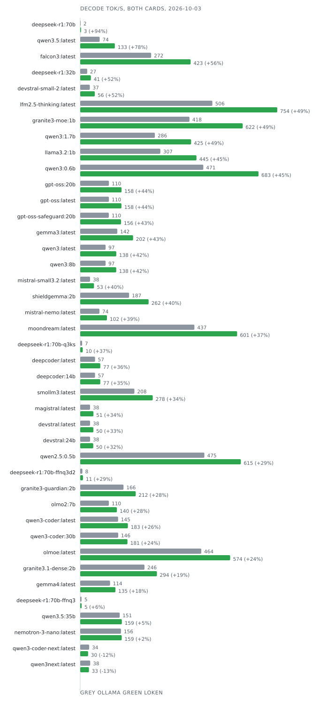

# Status

What is measured, what is slower, what has never run. Revised 2026-10-05.

Every figure comes from one machine: RTX 5070 Ti + RTX 5060 Ti (16 GB each), Linux, CUDA 13.3,
models on a USB disk reading at 460 MB/s.

## Decode rate vs ollama

Measured by the campaign of 2026-10-03 on the binary this page describes, and regenerated
from `docs/BENCHMARKS.md` by `scripts/figures.py` as the campaign advances. Conditions: both
cards available to every engine, idle machine, greedy, streamed, short prompt, 4096 ctx,
median of three iterations, decode tokens/s. The earlier table on this page came from a
one-card probe of 2026-08-27 taken between kernel changes; it is superseded, not corrected.

<!-- table:decode -->
| model | ollama | loken | |
|---|---:|---:|---|
| deepseek-r1:70b | 1.6 | **3.1** | +94% |
| qwen3.5:latest | 74.5 | **132.6** | +78% |
| falcon3:latest | 271.6 | **422.9** | +56% |
| deepseek-r1:32b | 26.7 | **40.7** | +52% |
| devstral-small-2:latest | 36.8 | **55.9** | +52% |
| lfm2.5-thinking:latest | 506.1 | **754.5** | +49% |
| granite3-moe:1b | 418.4 | **622.2** | +49% |
| qwen3:1.7b | 285.8 | **424.6** | +49% |
| llama3.2:1b | 306.9 | **445.1** | +45% |
| qwen3:0.6b | 471.3 | **682.9** | +45% |
| gpt-oss:20b | 110.0 | **158.3** | +44% |
| gpt-oss:latest | 109.9 | **157.9** | +44% |
| gpt-oss-safeguard:20b | 109.6 | **156.3** | +43% |
| gemma3:latest | 142.1 | **202.5** | +43% |
| qwen3:latest | 97.2 | **138.1** | +42% |
| qwen3:8b | 97.1 | **137.9** | +42% |
| mistral-small3.2:latest | 37.8 | **52.9** | +40% |
| shieldgemma:2b | 187.2 | **261.9** | +40% |
| mistral-nemo:latest | 73.6 | **102.4** | +39% |
| moondream:latest | 437.2 | **600.9** | +37% |
| deepseek-r1:70b-q3ks | 7.1 | **9.7** | +37% |
| deepcoder:latest | 56.7 | **76.9** | +36% |
| deepcoder:14b | 56.7 | **76.8** | +35% |
| smollm3:latest | 207.5 | **277.8** | +34% |
| magistral:latest | 37.8 | **50.6** | +34% |
| devstral:latest | 37.8 | **50.4** | +33% |
| devstral:24b | 37.8 | **50.0** | +32% |
| qwen2.5:0.5b | 475.4 | **615.1** | +29% |
| deepseek-r1:70b-ffnq3d2 | 8.2 | **10.6** | +29% |
| granite3-guardian:2b | 165.9 | **212.5** | +28% |
| olmo2:7b | 109.7 | **140.4** | +28% |
| qwen3-coder:latest | 145.1 | **182.6** | +26% |
| qwen3-coder:30b | 145.5 | **180.9** | +24% |
| olmoe:latest | 463.6 | **574.2** | +24% |
| granite3.1-dense:2b | 246.2 | **293.7** | +19% |
| gemma4:latest | 114.2 | **134.9** | +18% |
| deepseek-r1:70b-ffnq3 | 5.1 | **5.4** | +6% |
| qwen3.5:35b | 151.2 | **159.4** | +5% |
| nemotron-3-nano:latest | 156.1 | **158.9** | +2% |
| qwen3-coder-next:latest | **34.3** | 30.2 | **-12%** |
| qwen3next:latest | **38.2** | 33.4 | **-13%** |
<!-- /table:decode -->

The two mixtures that lose here came from a harness that had moved into its own repository and
started the engine without its configuration; measured configured on 2026-09-02, olmoe is
+17.4% and granite3-moe +0.2%. The mixtures that do lose are the ones too large for the cards.
A layer was placed whole, so a spilled mixture ran attention on the host for the sake of expert
weights that are 97% of its bytes and read a few at a time. Spilling the experts and keeping
everything else on the cards took qwen3next from 15.6 to 34.7 tok/s against ollama's 33, and
qwen3-coder-next from 10.7 to 30.8 against 26-28. A mixture that already fits is untouched by it.

## Placement, measured separately

Given both cards, ollama splits models that fit on one; this engine keeps them on the fast
card, and pays nothing for having the second one present. Measured 2026-09-03, olmoe: 464 tok/s
on card 0 alone, 462 with both cards visible, 252 on card 1 alone - the placer picks the fast
card, and the 390-against-496 penalty an earlier revision of this page reported is gone.

For a model that fits on neither card the limit is the bus. deepseek-r1:70b at Q4_K_M holds
26 of its 80 layers on the host, every one read in full per token at ~36 GB/s, this machine's
DRAM ceiling. Unaided, the host path is the limit: 1.6 tok/s for loken against 1.5 for ollama
in the 2026-09 rows of `docs/BENCHMARKS.md`. In the table above, which is the 2026-10-03 row,
loken decodes 3.1 against ollama's 1.6: the drafter loken picks itself for a model that spills
proposes tokens and the 70B verifies them. The 2026-09 row with a llama3.2:1b drafter measures
2.0 tok/s. A variant that fits is the other way out: the FFN-at-Q3 requantisations
(`deepseek-r1:70b-ffnq3`, `-ffnq3d2`, `-q3ks`) appear in the table.

A checkpoint that ships split is read as one model across its parts. unsloth/Qwen3-235B-A22B-GGUF,
a mixture of 235B parameters, runs on the two cards and the host at 7.0 tok/s prefill and
4.7 tok/s decode (`docs/BENCHMARKS.md`, 4096 ctx, short prompt, streamed).

## Context shift

A prompt longer than the window keeps its first token and its tail, as ollama does. Once a
conversation outgrows the window, the prefix it shares with the resident KV is that first
token alone, and a cold run re-prefills the whole window every turn. loken keeps the tail
instead: the resident keys are pulled down to their new positions and
re-phased in place (the rotary phase of the shift is read off the layer's own table, so
YaRN and factored frequencies need nothing special), and only the new tokens are prefilled.
Measured 2026-09-04, second turn of a conversation 500 tokens past a 4,096 window,
qwen3:8b: 1,256 ms of prefill cold, 156 ms with the shift, 508 tokens dropped and 3,519
reused. On deepseek-r1:70b, 26 layers on the host and a 2,048 window: 153 s cold, 38 s with
the shift, 430 dropped and 1,554 reused. The answer is coherent both ways, and not the same
text: a re-phased key is not the key a cold prefill would have produced, bit for bit.

The shift runs by itself wherever the cache supports it. Refused, with a cold prefill
instead, on a Q4 KV cache (a block groups 32 positions of one channel), on sliding-window layers (the buffer
index stops being the position after a slide), and on the recurrent hybrids, whose state
holds no positions to shift.

## Large mixtures streamed from disk

DeepSeek V4.1 is served from its own GGUF, which may be split, with the routed experts read
from the file as routing asks for them. Its rows are in the `deepseek_v41` section of
[`BENCHMARKS.md`](BENCHMARKS.md); the other engines could not run it.

| Piece | State |
|---|---|
| Prefill on the cards | A prompt's attention, residual stream, expert products and routing run on the cards; a layer's experts are read into page-locked slabs ahead and sent on a copy stream. See the benchmark rows of the model |
| Read-ahead, reader threads, expert tier | Derived from measurement at load and while decoding, see [`CONFIGURATION.md`](CONFIGURATION.md#streamed-mixtures-deepseek-v41) |
| Decode-state cache | In host memory unless `state_cache_dir` puts it on disk. A stored prefix always pays; a short remainder still reads nearly every expert, which bounds how little it costs |
| `quality` | `exact`. The other levels change the output; the budget is derived from the model's own noise and chosen against a teacher-forced run of a bundled text, not against a task score |
| Sharding across nodes | Unmeasured at two nodes, see below |

A transformer with recurrent layers (a convolution, state-space or delta-rule mixer beside
attention) cannot trim its state back to a shorter prefix, so the cache stores the states its prefill passes and
restores the longest one a prompt extends, in host memory or, with `state_cache_dir` set, on
disk. No row of the benchmark tables measures that cache.

The quality harness (`src/inference/model/deepseek_v41/quality.rs`) scores a setting against the
exact run on held-out text: top-1 agreement, divergence over the exact run's top 20, and the
log-probability given to the exact choice. It runs by hand on a real checkpoint, as ignored tests.

## Audio in

Voxtral and Ultravox towers are read from an `mmproj` GGUF or a checkpoint directory, with every
dimension taken from the file, and spliced into a chat turn. The mel features and the towers are
held against the reference implementation at rounding level on toy towers
(`tests/vectors/audio_in/`). An Ultravox checkpoint serves alone: its text model is the safetensors
checkpoint its config names, found in the hub cache or pulled with it. A Voxtral model is prompted
in the bracket instruction format whatever template its file carries: the published GGUF holds
another model's template, whose default system prompt made the model answer the clip instead of
transcribing it.

Real checkpoints against the reference implementation (transformers 4.57.1, F32), 2026-10-19:
the 20 clips of `bench/asr/librispeech-20/` (183 s), each sent as one chat turn of an audio part
and a text part, greedy, at most 256 tokens. Both sides run on the CPU of an i9-10900K shared
with other jobs, so the real-time factor (wall time over clip time) is indicative. Words are
lowercased with punctuation removed on both sides. "On task" leaves out the clips where either
side answers or comments instead of transcribing (errors at least the clip's word count).

| Model | Prompt | Side | WER | Errors per clip | WER on task | Clips on task | RTF |
|---|---|---|---:|---:|---:|---:|---:|
| Voxtral Mini 3B | Transcribe this audio | reference | 20.4% | 5.05 | 7.4% | 18 | 3.96 |
| Voxtral Mini 3B | Transcribe this audio | loken | 33.8% | 8.35 | 1.6% | 18 | 5.82 |
| Ultravox 0.5 1B | Repeat exactly what the speaker says. | reference | 22.9% | 5.65 | 2.6% | 16 | 1.64 |
| Ultravox 0.5 1B | Repeat exactly what the speaker says. | loken | 41.1% | 10.15 | 3.6% | 16 | 1.33 |
| Ultravox 0.5 1B | Transcribe this audio | reference | 356% | 88.0 | - | 1 | 6.74 |
| Ultravox 0.5 1B | Transcribe this audio | loken | 370% | 91.4 | - | 1 | 2.77 |

On the clips both sides transcribe, loken is within a quarter of a word per clip of the reference
or better. The whole-set gap is one clip per model where both sides answer instead of
transcribing and loken's answer is longer: 2830-3979-0000 for Voxtral (159 errors against 13),
1995-1826-0000 for Ultravox (141 against 27). loken runs the published Q4_K_M Voxtral file and holds
the Ultravox text model in Q4_K, the reference both in F32, so an off-task answer takes another
course. Ultravox answers "Transcribe this audio" with commentary on nearly every clip on both sides,
which leaves that prompt nothing to compare but the length of the commentary. Between a Voxtral
request's arrival and its prefill, where the clip is decoded and the speech tower runs on its 30 s
window, loken spends 29 to 74 s (median 36 s): most of its time per clip.

`scripts/asr_chat.py` reproduces loken's side against a running lokend
(`--model`, `--prompt`, `--port`).

## The qwen4exp family

Three files of the architecture load through the generic route on the two-card machine: a
160-expert Q4_K_M (28.4 GB), a 256-expert IQ1_M in two parts (58.4 GB) and a 512-expert
UD-Q4_K_XL in four (111 GB). Speed is in the rows of [`BENCHMARKS.md`](BENCHMARKS.md); none is
quoted here.

| What | State |
|---|---|
| Card against host numerics | The card paths agree with the host to a cosine of 0.9997 per layer on the 160-expert file |
| Low-bit expert formats | Run on the card in decode and prefill, judged against the host decoder |
| Expert cache | Hot experts held on each layer's card; a missing expert is copied into the card's transit room or computed on the host, split by measured rates; a wide batch streams a layer's experts through two buffers when that costs less than its rows. A card with room for all its experts holds them and runs its layers as loaded ones |
| 256 experts, decode | On a 4.0k token prompt one card decodes 21 to 23 tok/s and two cards 30 to 33; on 14k tokens 20 and 28 to 30. Before the cache plan used the second card: 16 to 17 on 4.0k and 12 on 14k |
| Decode graph | Captured for files without an n-gram table or indexed attention. The others, and every file under the cache plan, decode eagerly |
| 160 experts, one card | Measured on 3.2k and 12.9k token prompts |
| 160 experts, two cards | Measured on a 4.5k token prompt |
| 256 experts, one card | Answers a 72-token prompt coherently; 3.2k tokens prefill, the first request then ends after one token and a second fails out of memory |
| 256 experts, two cards | Measured on a 72-token prompt before the cache plan; the 3.2k-token prompt fails as on one card |
| 512 experts | Loads. Not measured on either envelope |

Quality, as the mean negative log-likelihood per token of held-out texts from this repository
(code, 1500 tokens; docs, 2200 tokens), chunk 512, two cards, scored by the quality harness:

| File | Code | Docs |
|---|---:|---:|
| 160 experts, Q4_K_M | 2.18 | 3.37 |
| 256 experts, IQ1_M | 1.23 | 1.81 |
| 512 experts, UD-Q4_K_XL | 1.03 | 1.76 |

For the 160-expert file the placements differ by at most 0.01 nat: host only 2.176 and 3.359,
two cards 2.181 and 3.370. Host against cards, top-1 agreement is 0.94 and 0.92 at a mean KL of
0.017 and 0.021. One run per cell.

Limits:

- **Out of memory in prefill.** The 256-expert file on a 3.2k token prompt fails with a card
  reported nearly full (27 to 59 MB free) while the chunk accounting counted several GB free.
  The engine halves the chunk and the request ends with one token or an error. The cause is not
  found; a 2.7k token prompt completes.
- **Prefill is compute-bound** in the delta-rule projections, convolution, scan and the wide
  mixers. The expert copy is hidden behind it.
- **The first 128 decoded tokens run while the expert cache learns**, so a decode rate over
  fewer tokens understates the steady state.
- **The 512-expert file** holds 77 GB of experts against 56 GB of host memory in the scope
  measured, which is untried. Only three quarters of the memory the kernel still has free is
  page-locked; the rest copies through the driver's staging at a lower rate.
- **Two cards** under the cache plan cut the layers by link: the card on the slower link (x4 here)
  holds the layers it can hold whole, the other the rest with a cache. The decode of a card
  with a cache is bound by the host launching its kernels one by one, since the decode graph
  is off for these files.
- **Multi-token prediction** is not implemented.
- A unit test of the q4 KV decode parity fails now and then when GPU tests run in parallel, and
  passes alone.

## Costs

- **~870 MiB per load, any model.** CUDA contexts, cuBLAS workspace, preloaded module images.
  Fixed, not proportional - 893 and 867 MiB on models differing 2x in weights. The placement
  planner does not know about it.
- **First answer after load is slower.** A mixture pays ~0.5 s if a request arrives before the
  background repack finishes - when it fits. A spilled one pays far more: qwen3next decodes its
  first request at 2.0 tok/s and the next at 34.7. The benchmark table takes the median over
  its iterations, so that cost no longer reaches a published rate; a user's first answer still
  pays it.
- **A spilled model was double-held in host RAM.** The file was prefetched whole before
  placement, so the 28 GB already on the cards stayed cached beside the 14 GB the host actually
  reads, and a 64 GB box swapped 16 GB during the decode being timed. The advice now follows
  the plan - DontNeed for what the cards hold, WillNeed for what the host reads - and each
  layer's pages are dropped the moment it lands on a card, because waiting for the end of the
  load was already too late: the cache had reached 44 GB and 12-15 GB of the process had gone
  to zram, and the same cell then decoded anywhere between 1.5 and 2.2 tok/s from one run to
  the next. Dropped per layer, the cell measures 2.25 three times. Those figures predate two
  changes: a weight the loader built (fused q/k/v and gate/up, a rebuilt float projection) and
  now sits on a card keeps no host copy, and the token tables stay as the file stores them
  instead of widening to F32. The load logs one ledger line with every conversion it made, its
  bytes before and after, and warns when the cards grow by more than the file. The load still
  reads the pages of host layers once their repack exists; no figure here measures the peak
  after the changes.
- **Load time is your disk.** 24 GB over USB: 52 s reading, 6 s to the cards.

## The cluster

Two halves live in [`CLUSTER.md`](CLUSTER.md), and only one of them runs.

**Replicated serving runs.** Any node is an entry point and an entry point holds nothing: a
client talks to whichever node it knows, that node forwards the whole HTTP request to the best
holder and relays the stream back. Membership is SWIM gossip with a phi-accrual detector,
seeded by multicast announcement or by a `join` list. `/api/cluster/state`, `/api/cluster/peers`
and `/api/cluster/prefix` report it. No consensus protocol: routing to a dead node costs a
retry, not a corruption.

A hand-over is priced on rates each node measures from its own completed generations, never
from hardware nameplates - what a card could do is not what this build achieves on this model
at this quantisation.

**Sharding runs for DeepSeek V4.1, unmeasured at two nodes.** At load, each node measures its
own profile, the planner compares a split against local serving, and when a split pays the head
forms a pipeline of any length over the binary data plane. A three-node loopback chain decodes
bit-identically to one node.

**Sharding runs for dense generic transformers, measured at two nodes on one machine.** Each
clustered node times a layer on its cards and on its host and publishes it with the bytes its
cards carry of the model. The node that loads the model second plans the cut from those and the
gossip round trip, asks the other node to reload its layers through its own placement ladder,
reloads its own the same way, and sends the boundary of every prefill chunk and decode step over
the binary frames; each node keeps the KV cache of its layers. On two loopback servers, one card
each, DeepSeek R1 32B (19.9 GB, 64 layers, does not fit one 16 GB card): prefill 1170 tok/s and
decode 26 tok/s at 2k tokens, 1060 and 21 at 6k, against 43 and 3.3 for one card with 21 layers
on the host, and 711 and 27 for the two cards of one node as tensor-parallel. Greedy output
matches the one-card node for 64 tokens on two prompts and for a 6k prompt with its
continuation; the one-card node itself varies between runs past about 25 tokens. A two-way and a
four-way split are bit-identical to one part on the host in the tests. Refused, with the reason:
models whose layers take per-layer inputs, share KV, keep a recurrent state, hold experts in
host memory, or carry an adapter or an image tower; verify batches. The tail node gives up its
own copy of the model while it serves a segment. The crossing is priced by the gossip round
trip alone, not by the logits that come back. The link-cost matrix, the tiered KV, the resume
path and the layer scheduler are still reached by nothing: `distributed::wiring_gate` records
the state of every module in that directory.

**One defect found, and its fix unverified at two nodes.** A node published a capacity derived
from one generation's decode rate multiplied by its lane count, while its generations serialise
behind the model lock. Two comparable machines therefore priced each other an order of
magnitude apart, and the cluster handed over a few requests where it should have split the work
roughly in half. The meter now publishes what a window of real completions produced. The second
machine left the bench before the fix could be measured, so **the two-node gain is currently
unmeasured** - the correction is judged by trace replay, not by a cluster.

**Open.** A peer that has never answered is priced from a floor rather than from its catalogue,
so a cold node looks worse than an idle one that holds nothing. And a replica set keyed on a
placeholder digest - what models cached from Hugging Face carry - groups every such model into
one set.

## Written, wired to nothing

- **Layer scheduler** (`src/distributed/layer_scheduler.rs`) - one caller: itself, since the
  engine that used to build a plan by hand was removed. Judged over 21 placement and 119 naming
  cases, with two perturbations proving the judge can fail.
- **Reserve pass** (`src/tensor/dry.rs`) - runs the forward on a device that allocates nothing,
  to replace the per-model formulas. Called by the Z-Image, FLUX and other image loaders. Every
  language-model placement is still budgeted by formula.

## Shipped as source, never compiled

The CUDA kernels carry AMD arms - MFMA on CDNA, WMMA on RDNA3+ - guarded and complete. There is
no hipcc build here, so none has been through a compiler. Treat AMD as source, not support.

## Next

A Vulkan backend. One generic compute backend reaches AMD, Intel and NVIDIA; HIP reaches one
vendor and a subset of its cards.

## Judged partially

- **Mat-vec core** - checked against an independent reference for 2 formats of 10. The production
  entry point does not reach the core.
- **Z-Image bends its schedule twice.** `new` derives timesteps from bent sigmas,
  `set_timesteps` from the pre-bend ramp. At 9 steps: `[1.0, 0.960129, 0.913349, ...]` against
  `[1.0, 0.96, 0.913043, ...]` for one bend. Only a render says which the checkpoint expects.
- **Image parity is a hash**, one prompt and seed per family - and not a property of the code
  alone. The placer reads free VRAM at load, and four runs of one binary gave four hashes. Run it
  on a quiet machine.

## Measured and refused

A 3-bit KV cache through a randomised Hadamard rotation. The rotation is orthogonal and does
spread outliers (excess kurtosis 35.7 -> -0.6); against f16 it delivers what it promises. Against
the Q4_0 cache already here it does not: token-axis grouping removes the outliers first, so
rotating changes the error by under 0.5%, and Q4_0 is 2.6x more accurate for one more bit. The
harness stays, wired to nothing.

## Borrowed code

One file shares body lines with upstream, at 58%, recorded in [`NOTICE.md`](../NOTICE.md). Its
largest matched range is the GGUF k-quant bit specification, which any correct reader reproduces.

## Open

The 870 MiB nobody budgets, and the reserve pass reaching language models. Each has a
measurement waiting. olmoe's deficit is closed: it was the harness, not the engine.

granite3-moe:1b loses 1-5% streamed and wins 7-20% not streamed, on six runs across three
days. At ~3 ms a token the stream's per-token cost - the chunk, its JSON, the client's read
loop - is the same order as the token, and that is where the gap lives, not in the kernels.

One speculative loop, with the draft length learned from the cycles. deepseek-r1:70b spilling
to the host, drafted for by llama3.2:1b, greedy: 1.49 tok/s alone, 2.72 drafted, same text.
