# Benchmarks - NVIDIA GeForce RTX 5060 Ti + NVIDIA GeForce RTX 5070 Ti | Intel(R) Core(TM) i9-10900K CPU @ 3.70GHz

711 run(s), 2026-09-03 to 2026-10-05. loken builds measured: 0.1.0-dev, 0.2.0-dev. A row's `Date` and `Run` name the run behind it. 30 replayable record(s) of this hardware are in the store and not tabled.

## Hardware

| | |
|---|---|
| GPU 0 | NVIDIA GeForce RTX 5070 Ti - 16 GB, 300 W |
| GPU 1 | NVIDIA GeForce RTX 5060 Ti - 16 GB, 180 W |
| CPU | Intel(R) Core(TM) i9-10900K CPU @ 3.70GHz - 20 threads |
| RAM | 62 GB |
| Driver | 610.43.02 |
| Kernel | 6.12.90+deb13.1-amd64 |

Runs taken before the runner recorded its machine carry the hardware an operator attested for them; their driver and kernel are unknown.

## Results

Method and column definitions: [BENCHMARKS.md](../BENCHMARKS.md).

### deepseek_v41

| Model                              | Ctx  | Prompt | Mode       | Device | Engine                           | Prefill tok/s | Decode tok/s | Tokens  | E2E ms      | J/req     | J/token    | Δ decode   | Δ energy | Date             | Run      |
|------------------------------------|------|--------|------------|--------|----------------------------------|---------------|--------------|---------|-------------|-----------|------------|------------|----------|------------------|----------|
| deepseek-v4.1-flash:iq2-calibrated | 4096 | short  | stream     | GPU    | Ollama 0.35.1                    |  -            |  -           |  -      |  -          |  -        |  -         | impossible |          | 2026-10-03 19:53 | f6aed71b |
| deepseek-v4.1-flash:iq2-calibrated | 4096 | short  | stream     | GPU    | **loken 0.1.0-dev**              | **0.6**       | **1.0**      | **122** | **169 973** | **9 172** | **74.978** |            |          | 2026-10-03 19:53 | f6aed71b |
| deepseek-v4.1-flash:iq2-q6attn     | 4096 | long   | non-stream | GPU    | Ollama 0.34.2                    |  -            |  -           |  -      |  -          |  -        |  -         | impossible |          | 2026-09-20 15:49 | 62b7b67d |
| deepseek-v4.1-flash:iq2-q6attn     | 4096 | long   | non-stream | GPU    | vLLM 0.29.1rc1.dev350+gd5f0a6e82 |  -            |  -           |  -      |  -          |  -        |  -         | impossible |          | 2026-09-20 15:49 | 62b7b67d |
| deepseek-v4.1-flash:iq2-q6attn     | 4096 | long   | non-stream | GPU    | **loken 0.1.0-dev**              |  -            | **1.7**      | **128** | **81 860**  | **6 025** | **47.069** |            |          | 2026-09-20 15:49 | 62b7b67d |
| deepseek-v4.1-flash:iq2-q6attn     | 4096 | long   | stream     | CPU    | Ollama 0.34.2                    |  -            |  -           |  -      |  -          |  -        |  -         | impossible |          | 2026-09-20 20:11 | ca668562 |
| deepseek-v4.1-flash:iq2-q6attn     | 4096 | long   | stream     | CPU    | **loken 0.1.0-dev**              | **5.1**       | **1.5**      | **128** | **132 273** | **2 504** | **19.563** |            |          | 2026-09-20 20:11 | ca668562 |
| deepseek-v4.1-flash:iq2-q6attn     | 4096 | long   | stream     | GPU    | Ollama 0.34.2                    |  -            |  -           |  -      |  -          |  -        |  -         | impossible |          | 2026-09-20 14:50 | 41df9feb |
| deepseek-v4.1-flash:iq2-q6attn     | 4096 | long   | stream     | GPU    | vLLM 0.29.1rc1.dev350+gd5f0a6e82 |  -            |  -           |  -      |  -          |  -        |  -         | impossible |          | 2026-09-20 14:50 | 41df9feb |
| deepseek-v4.1-flash:iq2-q6attn     | 4096 | long   | stream     | GPU    | **loken 0.1.0-dev**              | **4.2**       | **3.2**      | **128** | **98 131**  | **7 020** | **54.846** |            |          | 2026-09-23 00:40 | 4fb1fb88 |
| deepseek-v4.1-flash:iq2-q6attn     | 4096 | medium | non-stream | GPU    | Ollama 0.34.2                    |  -            |  -           |  -      |  -          |  -        |  -         | impossible |          | 2026-09-20 15:49 | 62b7b67d |
| deepseek-v4.1-flash:iq2-q6attn     | 4096 | medium | non-stream | GPU    | vLLM 0.29.1rc1.dev350+gd5f0a6e82 |  -            |  -           |  -      |  -          |  -        |  -         | impossible |          | 2026-09-20 15:49 | 62b7b67d |
| deepseek-v4.1-flash:iq2-q6attn     | 4096 | medium | non-stream | GPU    | **loken 0.1.0-dev**              |  -            | **3.2**      | **128** | **41 629**  | **3 045** | **23.788** |            |          | 2026-09-20 15:49 | 62b7b67d |
| deepseek-v4.1-flash:iq2-q6attn     | 4096 | medium | stream     | CPU    | Ollama 0.34.2                    |  -            |  -           |  -      |  -          |  -        |  -         | impossible |          | 2026-09-20 20:11 | ca668562 |
| deepseek-v4.1-flash:iq2-q6attn     | 4096 | medium | stream     | CPU    | **loken 0.1.0-dev**              | **5.2**       | **1.7**      | **128** | **87 277**  | **1 591** | **12.428** |            |          | 2026-09-20 20:11 | ca668562 |
| deepseek-v4.1-flash:iq2-q6attn     | 4096 | medium | stream     | GPU    | Ollama 0.34.2                    |  -            |  -           |  -      |  -          |  -        |  -         | impossible |          | 2026-09-20 14:50 | 41df9feb |
| deepseek-v4.1-flash:iq2-q6attn     | 4096 | medium | stream     | GPU    | vLLM 0.29.1rc1.dev350+gd5f0a6e82 |  -            |  -           |  -      |  -          |  -        |  -         | impossible |          | 2026-09-20 14:50 | 41df9feb |
| deepseek-v4.1-flash:iq2-q6attn     | 4096 | medium | stream     | GPU    | **loken 0.1.0-dev**              | **2.1**       | **4.3**      | **128** | **48 632**  | **3 797** | **29.665** |            |          | 2026-09-23 00:40 | 4fb1fb88 |
| deepseek-v4.1-flash:iq2-q6attn     | 4096 | short  | non-stream | GPU    | Ollama 0.34.2                    |  -            |  -           |  -      |  -          |  -        |  -         | impossible |          | 2026-09-20 15:49 | 62b7b67d |
| deepseek-v4.1-flash:iq2-q6attn     | 4096 | short  | non-stream | GPU    | vLLM 0.29.1rc1.dev350+gd5f0a6e82 |  -            |  -           |  -      |  -          |  -        |  -         | impossible |          | 2026-09-20 15:49 | 62b7b67d |
| deepseek-v4.1-flash:iq2-q6attn     | 4096 | short  | non-stream | GPU    | **loken 0.1.0-dev**              |  -            | **3.2**      | **44**  | **18 527**  | **1 045** | **23.760** |            |          | 2026-09-20 15:49 | 62b7b67d |
| deepseek-v4.1-flash:iq2-q6attn     | 4096 | short  | stream     | CPU    | Ollama 0.34.2                    |  -            |  -           |  -      |  -          |  -        |  -         | impossible |          | 2026-09-20 20:11 | ca668562 |
| deepseek-v4.1-flash:iq2-q6attn     | 4096 | short  | stream     | CPU    | **loken 0.1.0-dev**              | **4.1**       | **1.7**      | **128** | **79 569**  | **1 475** | **11.520** |            |          | 2026-09-20 20:11 | ca668562 |
| deepseek-v4.1-flash:iq2-q6attn     | 4096 | short  | stream     | GPU    | Ollama 0.34.2                    |  -            |  -           |  -      |  -          |  -        |  -         | impossible |          | 2026-09-20 14:50 | 41df9feb |
| deepseek-v4.1-flash:iq2-q6attn     | 4096 | short  | stream     | GPU    | Ollama 0.35.1                    |  -            |  -           |  -      |  -          |  -        |  -         | impossible |          | 2026-10-05 22:57 | 5455fad3 |
| deepseek-v4.1-flash:iq2-q6attn     | 4096 | short  | stream     | GPU    | vLLM 0.29.1rc1.dev350+gd5f0a6e82 |  -            |  -           |  -      |  -          |  -        |  -         | impossible |          | 2026-09-20 14:50 | 41df9feb |
| deepseek-v4.1-flash:iq2-q6attn     | 4096 | short  | stream     | GPU    | **loken 0.2.0-dev**              | **2.3**       | **4.2**      | **123** | **40 180**  | **3 030** | **24.570** |            |          | 2026-10-05 22:57 | 5455fad3 |

### ernie4_5

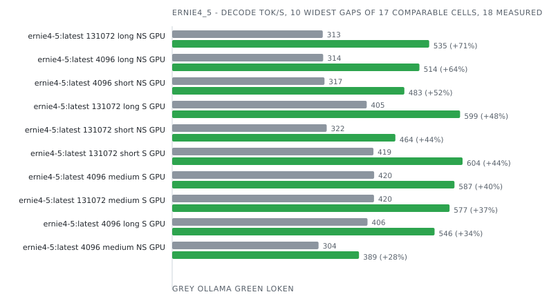

| Model           | Ctx    | Prompt | Mode       | Device | Engine              | Prefill tok/s | Decode tok/s | Tokens  | E2E ms    | J/req   | J/token   | Δ decode   | Δ energy   | Date             | Run      |
|-----------------|--------|--------|------------|--------|---------------------|---------------|--------------|---------|-----------|---------|-----------|------------|------------|------------------|----------|
| ernie4-5:latest | 4096   | long   | non-stream | GPU    | Ollama 0.34.2       |  -            | 314.2        | 128     | 1 557     | 49      | 0.385     |            |            | 2026-09-04 00:13 | 2a9f02eb |
| ernie4-5:latest | 4096   | long   | non-stream | GPU    | **loken 0.1.0-dev** |  -            | **514.4**    | **128** | **278**   | **41**  | **0.322** | **+63.7%** | **+19.5%** | 2026-09-04 00:13 | 2a9f02eb |
| ernie4-5:latest | 4096   | long   | stream     | CPU    | Ollama 0.34.2       | 1 385.3       | 54.0         | 128     | 3 246     | 64      | 0.499     |            |            | 2026-09-05 05:49 | d630f779 |
| ernie4-5:latest | 4096   | long   | stream     | CPU    | **loken 0.1.0-dev** | **654.2**     | **49.7**     | **128** | **3 003** | **177** | **1.383** | -7.9%      | -63.9%     | 2026-09-05 05:49 | d630f779 |
| ernie4-5:latest | 4096   | long   | stream     | GPU    | Ollama 0.34.2       | 2 693.4       | 406.3        | 128     | 1 590     | 45      | 0.350     |            |            | 2026-09-03 22:36 | c7ebcc24 |
| ernie4-5:latest | 4096   | long   | stream     | GPU    | **loken 0.1.0-dev** | **6 203.7**   | **545.9**    | **128** | **299**   | **37**  | **0.285** | **+34.4%** | **+22.5%** | 2026-09-03 22:36 | c7ebcc24 |
| ernie4-5:latest | 4096   | medium | non-stream | GPU    | Ollama 0.34.2       |  -            | 304.5        | 80      | 1 462     | 29      | 0.367     |            |            | 2026-09-03 20:57 | 3e2f67d3 |
| ernie4-5:latest | 4096   | medium | non-stream | GPU    | **loken 0.1.0-dev** |  -            | **388.7**    | **60**  | **172**   | **17**  | **0.280** |            |            | 2026-09-03 20:57 | 3e2f67d3 |
| ernie4-5:latest | 4096   | medium | stream     | CPU    | Ollama 0.34.2       | 236.4         | 56.7         | 22      | 1 192     | 18      | 0.832     |            |            | 2026-09-05 00:47 | f02b96b5 |
| ernie4-5:latest | 4096   | medium | stream     | CPU    | **loken 0.1.0-dev** | **223.5**     | **53.5**     | **128** | **2 584** | **152** | **1.188** |            |            | 2026-09-05 00:47 | f02b96b5 |
| ernie4-5:latest | 4096   | medium | stream     | GPU    | Ollama 0.34.2       | 319.5         | 420.1        | 80      | 1 469     | 34      | 0.421     |            |            | 2026-09-03 19:14 | 4520eab7 |
| ernie4-5:latest | 4096   | medium | stream     | GPU    | **loken 0.1.0-dev** | **2 536.8**   | **587.3**    | **60**  | **152**   | **19**  | **0.320** |            |            | 2026-09-03 19:14 | 4520eab7 |
| ernie4-5:latest | 4096   | short  | non-stream | GPU    | Ollama 0.34.2       |  -            | 316.8        | 128     | 1 560     | 44      | 0.342     |            |            | 2026-09-03 17:36 | 4f63e8f1 |
| ernie4-5:latest | 4096   | short  | non-stream | GPU    | **loken 0.1.0-dev** |  -            | **483.0**    | **128** | **277**   | **32**  | **0.250** | **+52.5%** | **+36.8%** | 2026-09-03 17:36 | 4f63e8f1 |
| ernie4-5:latest | 4096   | short  | stream     | CPU    | Ollama 0.34.2       | 87.7          | 56.5         | 128     | 3 043     | 57      | 0.443     |            |            | 2026-09-04 20:12 | b9338a02 |
| ernie4-5:latest | 4096   | short  | stream     | CPU    | **loken 0.1.0-dev** | **266.2**     | **54.6**     | **8**   | **278**   | **16**  | **1.991** |            |            | 2026-09-04 20:12 | b9338a02 |
| ernie4-5:latest | 4096   | short  | stream     | GPU    | Ollama 0.35.1       |  -            |  -           | 128     |  -        |  -      |  -        | incoherent |            | 2026-10-03 20:12 | 21523547 |
| ernie4-5:latest | 4096   | short  | stream     | GPU    | **loken 0.1.0-dev** | **2 358.3**   | **833.9**    | **128** | **244**   | **26**  | **0.204** |            |            | 2026-10-03 20:12 | 21523547 |
| ernie4-5:latest | 131072 | long   | non-stream | GPU    | Ollama 0.34.2       |  -            | 313.2        | 128     | 1 730     | 39      | 0.305     |            |            | 2026-09-04 15:57 | b0017019 |
| ernie4-5:latest | 131072 | long   | non-stream | GPU    | **loken 0.1.0-dev** |  -            | **534.7**    | **128** | **271**   | **41**  | **0.320** | **+70.7%** | -4.6%      | 2026-09-04 15:57 | b0017019 |
| ernie4-5:latest | 131072 | long   | stream     | CPU    | Ollama 0.34.2       | 1 480.0       | 54.1         | 128     | 3 319     | 62      | 0.482     |            |            | 2026-09-06 02:36 | 9bb2ec96 |
| ernie4-5:latest | 131072 | long   | stream     | CPU    | **loken 0.1.0-dev** | **663.8**     | **50.6**     | **128** | **2 960** | **178** | **1.389** | -6.5%      | -65.3%     | 2026-09-06 02:36 | 9bb2ec96 |
| ernie4-5:latest | 131072 | long   | stream     | GPU    | Ollama 0.34.2       | 2 989.2       | 404.8        | 128     | 1 703     | 40      | 0.313     |            |            | 2026-09-04 13:55 | 71811899 |
| ernie4-5:latest | 131072 | long   | stream     | GPU    | **loken 0.1.0-dev** | **13 584.3**  | **598.9**    | **128** | **274**   | **34**  | **0.267** | **+47.9%** | **+17.4%** | 2026-09-04 13:55 | 71811899 |
| ernie4-5:latest | 131072 | medium | non-stream | GPU    | Ollama 0.34.2       |  -            | 308.7        | 80      | 1 596     | 32      | 0.399     |            |            | 2026-09-04 12:05 | 5b3dfd01 |
| ernie4-5:latest | 131072 | medium | non-stream | GPU    | **loken 0.1.0-dev** |  -            | **375.8**    | **60**  | **173**   | **17**  | **0.286** |            |            | 2026-09-04 12:05 | 5b3dfd01 |
| ernie4-5:latest | 131072 | medium | stream     | CPU    | Ollama 0.34.2       | 251.6         | 56.7         | 22      | 1 269     | 18      | 0.809     |            |            | 2026-09-05 23:42 | 97ca7119 |
| ernie4-5:latest | 131072 | medium | stream     | CPU    | **loken 0.1.0-dev** | **207.6**     | **53.5**     | **128** | **2 613** | **158** | **1.230** |            |            | 2026-09-05 23:42 | 97ca7119 |
| ernie4-5:latest | 131072 | medium | stream     | GPU    | Ollama 0.34.2       | 477.2         | 419.9        | 80      | 1 608     | 29      | 0.363     |            |            | 2026-09-04 10:13 | e67dc4da |
| ernie4-5:latest | 131072 | medium | stream     | GPU    | **loken 0.1.0-dev** | **2 509.3**   | **577.1**    | **60**  | **160**   | **19**  | **0.312** |            |            | 2026-09-04 10:13 | e67dc4da |
| ernie4-5:latest | 131072 | short  | non-stream | GPU    | Ollama 0.34.2       |  -            | 321.5        | 128     | 1 728     | 45      | 0.353     |            |            | 2026-09-04 08:11 | a145ecff |
| ernie4-5:latest | 131072 | short  | non-stream | GPU    | **loken 0.1.0-dev** |  -            | **464.3**    | **128** | **289**   | **31**  | **0.242** | **+44.4%** | **+46.1%** | 2026-09-04 08:11 | a145ecff |
| ernie4-5:latest | 131072 | short  | stream     | CPU    | Ollama 0.34.2       | 75.3          | 56.5         | 128     | 3 144     | 60      | 0.469     |            |            | 2026-09-05 20:49 | ba5fb92d |
| ernie4-5:latest | 131072 | short  | stream     | CPU    | **loken 0.1.0-dev** | **156.7**     | **54.5**     | **8**   | **266**   | **18**  | **2.279** |            |            | 2026-09-05 20:49 | ba5fb92d |
| ernie4-5:latest | 131072 | short  | stream     | GPU    | Ollama 0.34.2       | 169.1         | 418.7        | 128     | 1 717     | 40      | 0.316     |            |            | 2026-09-04 02:14 | f88fe984 |
| ernie4-5:latest | 131072 | short  | stream     | GPU    | **loken 0.1.0-dev** | **1 061.7**   | **604.1**    | **128** | **262**   | **38**  | **0.296** | **+44.3%** | **+6.9%**  | 2026-09-04 02:14 | f88fe984 |

### gemma2

| Model          | Ctx  | Prompt | Mode   | Device | Engine              | Prefill tok/s | Decode tok/s | Tokens  | E2E ms  | J/req  | J/token   | Δ decode   | Δ energy   | Date             | Run      |
|----------------|------|--------|--------|--------|---------------------|---------------|--------------|---------|---------|--------|-----------|------------|------------|------------------|----------|
| shieldgemma:2b | 4096 | short  | stream | GPU    | Ollama 0.35.1       | 246.8         | 187.2        | 128     | 2 172   | 119    | 0.926     |            |            | 2026-10-03 21:47 | 5f8dfce2 |
| shieldgemma:2b | 4096 | short  | stream | GPU    | **loken 0.1.0-dev** | **1 114.9**   | **261.9**    | **128** | **631** | **93** | **0.726** | **+39.9%** | **+27.6%** | 2026-10-03 21:47 | 5f8dfce2 |

### gemma3

| Model         | Ctx  | Prompt | Mode   | Device | Engine              | Prefill tok/s | Decode tok/s | Tokens  | E2E ms  | J/req   | J/token   | Δ decode   | Δ energy  | Date             | Run      |
|---------------|------|--------|--------|--------|---------------------|---------------|--------------|---------|---------|---------|-----------|------------|-----------|------------------|----------|
| gemma3:latest | 4096 | short  | stream | GPU    | Ollama 0.35.1       | 217.9         | 142.1        | 128     | 2 750   | 171     | 1.338     |            |           | 2026-10-03 20:19 | d6f03ffd |
| gemma3:latest | 4096 | short  | stream | GPU    | **loken 0.1.0-dev** | **1 477.1**   | **202.5**    | **128** | **884** | **156** | **1.222** | **+42.4%** | **+9.5%** | 2026-10-03 20:19 | d6f03ffd |

### gemma4

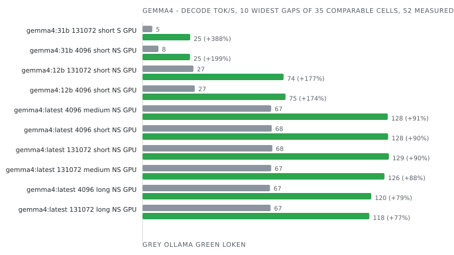

| Model         | Ctx    | Prompt | Mode       | Device | Engine              | Prefill tok/s | Decode tok/s | Tokens  | E2E ms      | J/req     | J/token    | Δ decode    | Δ energy   | Date             | Run      |
|---------------|--------|--------|------------|--------|---------------------|---------------|--------------|---------|-------------|-----------|------------|-------------|------------|------------------|----------|
| gemma4:12b    | 4096   | long   | non-stream | GPU    | Ollama 0.34.2       |  -            | 42.8         | 128     | 5 171       | 501       | 3.915      |             |            | 2026-09-04 00:16 | 0da6a93a |
| gemma4:12b    | 4096   | long   | non-stream | GPU    | **loken 0.1.0-dev** |  -            | **67.4**     | **128** | **1 932**   | **431**   | **3.369**  | **+57.7%**  | **+16.2%** | 2026-09-04 00:16 | 0da6a93a |
| gemma4:12b    | 4096   | long   | stream     | CPU    | Ollama 0.34.2       | 223.7         | 3.0          | 128     | 48 409      | 1 029     | 8.041      |             |            | 2026-09-05 05:55 | fb0db693 |
| gemma4:12b    | 4096   | long   | stream     | CPU    | **loken 0.1.0-dev** | **42.2**      | **2.8**      | **128** | **51 938**  | **1 183** | **9.245**  | -4.4%       | -13.0%     | 2026-09-05 05:55 | fb0db693 |
| gemma4:12b    | 4096   | long   | stream     | GPU    | Ollama 0.34.2       | 468.0         | 53.6         | 128     | 5 139       | 503       | 3.931      |             |            | 2026-09-03 22:38 | 4c0d6214 |
| gemma4:12b    | 4096   | long   | stream     | GPU    | **loken 0.1.0-dev** | **2 482.9**   | **69.9**     | **128** | **1 976**   | **446**   | **3.484**  | **+30.4%**  | **+12.8%** | 2026-09-03 22:38 | 4c0d6214 |
| gemma4:12b    | 4096   | medium | non-stream | GPU    | Ollama 0.34.2       |  -            |  -           | 128     |  -          |  -        |  -         | incoherent  |            | 2026-09-03 20:59 | b3f14b4a |
| gemma4:12b    | 4096   | medium | non-stream | GPU    | **loken 0.1.0-dev** |  -            |  -           | **128** |  -          |  -        |  -         | incoherent  |            | 2026-09-03 20:59 | b3f14b4a |
| gemma4:12b    | 4096   | medium | stream     | CPU    | Ollama 0.34.2       |  -            |  -           | 128     |  -          |  -        |  -         | incoherent  |            | 2026-09-05 00:52 | a3c02b4f |
| gemma4:12b    | 4096   | medium | stream     | CPU    | **loken 0.1.0-dev** |  -            |  -           | **128** |  -          |  -        |  -         | incoherent  |            | 2026-09-05 00:52 | a3c02b4f |
| gemma4:12b    | 4096   | medium | stream     | GPU    | Ollama 0.34.2       |  -            |  -           | 74      |  -          |  -        |  -         | incoherent  |            | 2026-09-03 19:16 | abf5f2d2 |
| gemma4:12b    | 4096   | medium | stream     | GPU    | **loken 0.1.0-dev** |  -            |  -           | **128** |  -          |  -        |  -         | incoherent  |            | 2026-09-03 19:16 | abf5f2d2 |
| gemma4:12b    | 4096   | short  | non-stream | GPU    | Ollama 0.34.2       |  -            | 27.3         | 61      | 3 805       | 292       | 4.757      |             |            | 2026-09-03 17:38 | 1f2f0569 |
| gemma4:12b    | 4096   | short  | non-stream | GPU    | **loken 0.1.0-dev** |  -            | **74.7**     | **128** | **1 745**   | **402**   | **3.139**  |             |            | 2026-09-03 17:38 | 1f2f0569 |
| gemma4:12b    | 4096   | short  | stream     | CPU    | Ollama 0.34.2       | 13.3          | 3.0          | 128     | 45 788      | 1 008     | 7.878      |             |            | 2026-09-04 20:17 | a300225b |
| gemma4:12b    | 4096   | short  | stream     | CPU    | **loken 0.1.0-dev** | **17.3**      | **2.9**      | **128** | **45 228**  | **1 031** | **8.051**  | -4.1%       | -2.2%      | 2026-09-04 20:17 | a300225b |
| gemma4:12b    | 4096   | short  | stream     | GPU    | Ollama 0.35.1       |  -            |  -           | 111     |  -          |  -        |  -         | incoherent  |            | 2026-10-03 20:21 | f7081e90 |
| gemma4:12b    | 4096   | short  | stream     | GPU    | **loken 0.1.0-dev** | **533.6**     | **58.3**     | **128** | **2 375**   | **450**   | **3.519**  |             |            | 2026-10-03 20:21 | f7081e90 |
| gemma4:12b    | 131072 | long   | non-stream | GPU    | Ollama 0.34.2       |  -            | 42.8         | 128     | 5 296       | 506       | 3.954      |             |            | 2026-09-04 15:59 | 7a449cbb |
| gemma4:12b    | 131072 | long   | non-stream | GPU    | **loken 0.1.0-dev** |  -            | **67.2**     | **128** | **1 937**   | **430**   | **3.363**  | **+57.2%**  | **+17.6%** | 2026-09-04 15:59 | 7a449cbb |
| gemma4:12b    | 131072 | long   | stream     | CPU    | Ollama 0.34.2       | 222.5         | 3.0          | 128     | 48 668      | 1 031     | 8.057      |             |            | 2026-09-06 02:41 | 56309e16 |
| gemma4:12b    | 131072 | long   | stream     | CPU    | **loken 0.1.0-dev** | **42.4**      | **2.9**      | **128** | **51 304**  | **1 171** | **9.147**  | -3.2%       | -11.9%     | 2026-09-06 02:41 | 56309e16 |
| gemma4:12b    | 131072 | long   | stream     | GPU    | Ollama 0.34.2       | 465.6         | 53.4         | 128     | 5 276       | 494       | 3.863      |             |            | 2026-09-04 13:57 | f5eaf746 |
| gemma4:12b    | 131072 | long   | stream     | GPU    | **loken 0.1.0-dev** | **2 417.6**   | **69.9**     | **128** | **1 968**   | **448**   | **3.497**  | **+30.8%**  | **+10.5%** | 2026-09-04 13:57 | f5eaf746 |
| gemma4:12b    | 131072 | medium | non-stream | GPU    | Ollama 0.34.2       |  -            |  -           | 128     |  -          |  -        |  -         | incoherent  |            | 2026-09-04 12:07 | 5ff34d48 |
| gemma4:12b    | 131072 | medium | non-stream | GPU    | **loken 0.1.0-dev** |  -            |  -           | **128** |  -          |  -        |  -         | incoherent  |            | 2026-09-04 12:07 | 5ff34d48 |
| gemma4:12b    | 131072 | medium | stream     | CPU    | Ollama 0.34.2       |  -            |  -           | 128     |  -          |  -        |  -         | incoherent  |            | 2026-09-05 23:47 | 1007f834 |
| gemma4:12b    | 131072 | medium | stream     | CPU    | **loken 0.1.0-dev** |  -            |  -           | **128** |  -          |  -        |  -         | incoherent  |            | 2026-09-05 23:47 | 1007f834 |
| gemma4:12b    | 131072 | medium | stream     | GPU    | Ollama 0.34.2       |  -            |  -           | 74      |  -          |  -        |  -         | incoherent  |            | 2026-09-04 10:15 | aa7002db |
| gemma4:12b    | 131072 | medium | stream     | GPU    | **loken 0.1.0-dev** |  -            |  -           | **128** |  -          |  -        |  -         | incoherent  |            | 2026-09-04 10:15 | aa7002db |
| gemma4:12b    | 131072 | short  | non-stream | GPU    | Ollama 0.34.2       |  -            | 26.6         | 61      | 3 975       | 298       | 4.863      |             |            | 2026-09-04 08:13 | 382bcf16 |
| gemma4:12b    | 131072 | short  | non-stream | GPU    | **loken 0.1.0-dev** |  -            | **73.7**     | **128** | **1 759**   | **395**   | **3.085**  |             |            | 2026-09-04 08:13 | 382bcf16 |
| gemma4:12b    | 131072 | short  | stream     | CPU    | Ollama 0.34.2       | 13.5          | 3.0          | 128     | 45 733      | 1 004     | 7.847      |             |            | 2026-09-05 20:54 | e5f50606 |
| gemma4:12b    | 131072 | short  | stream     | CPU    | **loken 0.1.0-dev** | **17.7**      | **2.9**      | **128** | **44 763**  | **1 019** | **7.960**  | -3.4%       | -1.4%      | 2026-09-05 20:54 | e5f50606 |
| gemma4:12b    | 131072 | short  | stream     | GPU    | Ollama 0.34.2       | 27.9          | 54.5         | 61      | 3 992       | 316       | 5.155      |             |            | 2026-09-04 02:16 | c0c970df |
| gemma4:12b    | 131072 | short  | stream     | GPU    | **loken 0.1.0-dev** | **332.1**     | **73.9**     | **128** | **1 786**   | **401**   | **3.130**  |             |            | 2026-09-04 02:16 | c0c970df |
| gemma4:26b    | 4096   | long   | non-stream | GPU    | Ollama 0.34.2       |  -            |  -           | 128     |  -          |  -        |  -         | incoherent  |            | 2026-09-04 00:18 | 77e2109e |
| gemma4:26b    | 4096   | long   | non-stream | GPU    | **loken 0.1.0-dev** |  -            | **83.2**     | **128** | **1 666**   | **265**   | **2.068**  |             |            | 2026-09-04 00:18 | 77e2109e |
| gemma4:26b    | 4096   | long   | stream     | CPU    | Ollama 0.34.2       | 315.6         | 7.5          | 128     | 23 098      | 407       | 3.177      |             |            | 2026-09-05 06:00 | 25758b27 |
| gemma4:26b    | 4096   | long   | stream     | CPU    | **loken 0.1.0-dev** |  -            |  -           | **128** |  -          |  -        |  -         | incoherent  |            | 2026-09-05 06:00 | 25758b27 |
| gemma4:26b    | 4096   | long   | stream     | GPU    | Ollama 0.34.2       |  -            |  -           | 128     |  -          |  -        |  -         | incoherent  |            | 2026-09-03 22:40 | 01ba9e48 |
| gemma4:26b    | 4096   | long   | stream     | GPU    | **loken 0.1.0-dev** | **1 145.1**   | **95.4**     | **128** | **1 699**   | **266**   | **2.074**  |             |            | 2026-09-03 22:40 | 01ba9e48 |
| gemma4:26b    | 4096   | medium | non-stream | GPU    | Ollama 0.34.2       |  -            |  -           | 128     |  -          |  -        |  -         | incoherent  |            | 2026-09-03 21:01 | b9f6d82a |
| gemma4:26b    | 4096   | medium | non-stream | GPU    | **loken 0.1.0-dev** |  -            |  -           | **128** |  -          |  -        |  -         | incoherent  |            | 2026-09-03 21:01 | b9f6d82a |
| gemma4:26b    | 4096   | medium | stream     | CPU    | Ollama 0.34.2       |  -            |  -           | 98      |  -          |  -        |  -         | incoherent  |            | 2026-09-05 00:57 | dad2f49a |
| gemma4:26b    | 4096   | medium | stream     | CPU    | **loken 0.1.0-dev** |  -            |  -           | **128** |  -          |  -        |  -         | incoherent  |            | 2026-09-05 00:57 | dad2f49a |
| gemma4:26b    | 4096   | medium | stream     | GPU    | Ollama 0.34.2       |  -            |  -           | 128     |  -          |  -        |  -         | incoherent  |            | 2026-09-03 19:18 | cc9f125b |
| gemma4:26b    | 4096   | medium | stream     | GPU    | **loken 0.1.0-dev** |  -            |  -           | **128** |  -          |  -        |  -         | incoherent  |            | 2026-09-03 19:18 | cc9f125b |
| gemma4:26b    | 4096   | short  | non-stream | GPU    | Ollama 0.34.2       |  -            |  -           | 128     |  -          |  -        |  -         | incoherent  |            | 2026-09-03 17:40 | 5fe5fd20 |
| gemma4:26b    | 4096   | short  | non-stream | GPU    | **loken 0.1.0-dev** |  -            |  -           | **128** |  -          |  -        |  -         | incoherent  |            | 2026-09-03 17:40 | 5fe5fd20 |
| gemma4:26b    | 4096   | short  | stream     | CPU    | Ollama 0.34.2       |  -            |  -           | 128     |  -          |  -        |  -         | incoherent  |            | 2026-09-04 20:22 | 323b7aea |
| gemma4:26b    | 4096   | short  | stream     | CPU    | **loken 0.1.0-dev** |  -            |  -           | **128** |  -          |  -        |  -         | incoherent  |            | 2026-09-04 20:22 | 323b7aea |
| gemma4:26b    | 4096   | short  | stream     | GPU    | Ollama 0.35.1       |  -            |  -           | 128     |  -          |  -        |  -         | incoherent  |            | 2026-10-03 20:22 | d75a6b7f |
| gemma4:26b    | 4096   | short  | stream     | GPU    | **loken 0.1.0-dev** |  -            |  -           | **128** |  -          |  -        |  -         | incoherent  |            | 2026-10-03 20:22 | d75a6b7f |
| gemma4:26b    | 131072 | long   | non-stream | GPU    | Ollama 0.34.2       |  -            |  -           | 128     |  -          |  -        |  -         | incoherent  |            | 2026-09-04 16:01 | 39dcf63b |
| gemma4:26b    | 131072 | long   | non-stream | GPU    | **loken 0.1.0-dev** |  -            | **82.7**     | **128** | **1 664**   | **258**   | **2.018**  |             |            | 2026-09-04 16:01 | 39dcf63b |
| gemma4:26b    | 131072 | long   | stream     | CPU    | Ollama 0.34.2       | 312.1         | 7.5          | 128     | 23 323      | 413       | 3.224      |             |            | 2026-09-06 02:46 | 3735a347 |
| gemma4:26b    | 131072 | long   | stream     | CPU    | **loken 0.1.0-dev** |  -            |  -           | **128** |  -          |  -        |  -         | incoherent  |            | 2026-09-06 02:46 | 3735a347 |
| gemma4:26b    | 131072 | long   | stream     | GPU    | Ollama 0.34.2       |  -            |  -           | 128     |  -          |  -        |  -         | incoherent  |            | 2026-09-04 13:59 | dc2b6f50 |
| gemma4:26b    | 131072 | long   | stream     | GPU    | **loken 0.1.0-dev** | **1 126.9**   | **95.3**     | **128** | **1 696**   | **263**   | **2.057**  |             |            | 2026-09-04 13:59 | dc2b6f50 |
| gemma4:26b    | 131072 | medium | non-stream | GPU    | Ollama 0.34.2       |  -            |  -           | 128     |  -          |  -        |  -         | incoherent  |            | 2026-09-04 12:09 | 3ec111b5 |
| gemma4:26b    | 131072 | medium | non-stream | GPU    | **loken 0.1.0-dev** |  -            |  -           | **128** |  -          |  -        |  -         | incoherent  |            | 2026-09-04 12:09 | 3ec111b5 |
| gemma4:26b    | 131072 | medium | stream     | CPU    | Ollama 0.34.2       |  -            |  -           | 98      |  -          |  -        |  -         | incoherent  |            | 2026-09-05 23:52 | 8cdda591 |
| gemma4:26b    | 131072 | medium | stream     | CPU    | **loken 0.1.0-dev** |  -            |  -           | **128** |  -          |  -        |  -         | incoherent  |            | 2026-09-05 23:52 | 8cdda591 |
| gemma4:26b    | 131072 | medium | stream     | GPU    | Ollama 0.34.2       |  -            |  -           | 128     |  -          |  -        |  -         | incoherent  |            | 2026-09-04 10:17 | 882bcb51 |
| gemma4:26b    | 131072 | medium | stream     | GPU    | **loken 0.1.0-dev** |  -            |  -           | **128** |  -          |  -        |  -         | incoherent  |            | 2026-09-04 10:17 | 882bcb51 |
| gemma4:26b    | 131072 | short  | non-stream | GPU    | Ollama 0.34.2       |  -            |  -           | 128     |  -          |  -        |  -         | incoherent  |            | 2026-09-04 08:15 | 4b008b7f |
| gemma4:26b    | 131072 | short  | non-stream | GPU    | **loken 0.1.0-dev** |  -            |  -           | **128** |  -          |  -        |  -         | incoherent  |            | 2026-09-04 08:15 | 4b008b7f |
| gemma4:26b    | 131072 | short  | stream     | CPU    | Ollama 0.34.2       |  -            |  -           | 128     |  -          |  -        |  -         | incoherent  |            | 2026-09-05 20:59 | 3d28d199 |
| gemma4:26b    | 131072 | short  | stream     | CPU    | **loken 0.1.0-dev** |  -            |  -           | **128** |  -          |  -        |  -         | incoherent  |            | 2026-09-05 20:59 | 3d28d199 |
| gemma4:26b    | 131072 | short  | stream     | GPU    | Ollama 0.34.2       |  -            |  -           | 93      |  -          |  -        |  -         | incoherent  |            | 2026-09-04 02:18 | 0f9d191f |
| gemma4:26b    | 131072 | short  | stream     | GPU    | **loken 0.1.0-dev** |  -            |  -           | **128** |  -          |  -        |  -         | incoherent  |            | 2026-09-04 02:18 | 0f9d191f |
| gemma4:31b    | 4096   | long   | non-stream | GPU    | Ollama 0.34.2       |  -            |  -           |  -      |  -          |  -        |  -         | incoherent  |            | 2026-09-04 00:20 | 78c1e588 |
| gemma4:31b    | 4096   | long   | non-stream | GPU    | **loken 0.1.0-dev** |  -            | **22.3**     | **128** | **5 824**   | **1 219** | **9.527**  |             |            | 2026-09-04 00:20 | 78c1e588 |
| gemma4:31b    | 4096   | long   | stream     | CPU    | Ollama 0.34.2       |  -            |  -           | 53      |  -          |  -        |  -         | incoherent  |            | 2026-09-05 06:29 | b63e31a5 |
| gemma4:31b    | 4096   | long   | stream     | CPU    | **loken 0.1.0-dev** | **17.1**      | **1.1**      | **128** | **130 751** | **2 909** | **22.730** |             |            | 2026-09-05 06:29 | b63e31a5 |
| gemma4:31b    | 4096   | long   | stream     | GPU    | Ollama 0.34.2       |  -            |  -           | 44      |  -          |  -        |  -         | incoherent  |            | 2026-09-03 22:43 | 87d81d8b |
| gemma4:31b    | 4096   | long   | stream     | GPU    | **loken 0.1.0-dev** | **828.2**     | **23.4**     | **128** | **5 885**   | **1 222** | **9.547**  |             |            | 2026-09-03 22:43 | 87d81d8b |
| gemma4:31b    | 4096   | medium | non-stream | GPU    | Ollama 0.34.2       |  -            |  -           |  -      | 5 747       |  -        |  -         |             |            | 2026-09-03 21:04 | 2c0d611d |
| gemma4:31b    | 4096   | medium | non-stream | GPU    | **loken 0.1.0-dev** |  -            |  -           | **128** |  -          |  -        |  -         | incoherent  |            | 2026-09-03 21:04 | 2c0d611d |
| gemma4:31b    | 4096   | medium | stream     | CPU    | Ollama 0.34.2       | 13.4          | 1.2          | 75      | 72 207      | 1 584     | 21.214     |             |            | 2026-09-05 01:25 | 7ffb02f0 |
| gemma4:31b    | 4096   | medium | stream     | CPU    | **loken 0.1.0-dev** | **12.3**      | **1.2**      | **128** | **115 692** | **2 593** | **20.258** |             |            | 2026-09-05 01:25 | 7ffb02f0 |
| gemma4:31b    | 4096   | medium | stream     | GPU    | Ollama 0.34.2       |  -            | 25.6         | 48      | 5 798       | 452       | 9.414      |             |            | 2026-09-03 19:21 | 3884534e |
| gemma4:31b    | 4096   | medium | stream     | GPU    | **loken 0.1.0-dev** |  -            |  -           | **128** |  -          |  -        |  -         | incoherent  |            | 2026-09-03 19:21 | 3884534e |
| gemma4:31b    | 4096   | short  | non-stream | GPU    | Ollama 0.34.2       |  -            | 8.3          | 128     | 7 619       | 1 831     | 14.304     |             |            | 2026-09-03 17:42 | 0a232cbd |
| gemma4:31b    | 4096   | short  | non-stream | GPU    | **loken 0.1.0-dev** |  -            | **24.8**     | **128** | **5 262**   | **1 097** | **8.570**  | **+197.4%** | **+66.9%** | 2026-09-03 17:42 | 0a232cbd |
| gemma4:31b    | 4096   | short  | stream     | CPU    | Ollama 0.34.2       | 4.9           | 1.2          | 121     | 110 769     | 2 416     | 19.911     |             |            | 2026-09-04 20:51 | d270624b |
| gemma4:31b    | 4096   | short  | stream     | CPU    | **loken 0.1.0-dev** | **7.8**       | **1.2**      | **128** | **113 423** | **2 518** | **19.670** |             |            | 2026-09-04 20:51 | d270624b |
| gemma4:31b    | 4096   | short  | stream     | GPU    | Ollama 0.35.1       | 86.8          | 27.1         | 128     | 8 300       | 976       | 7.628      |             |            | 2026-10-03 20:24 | 7711a65e |
| gemma4:31b    | 4096   | short  | stream     | GPU    | **loken 0.1.0-dev** |  -            |  -           | **128** |  -          |  -        |  -         | incoherent  |            | 2026-10-03 20:24 | 7711a65e |
| gemma4:31b    | 131072 | long   | non-stream | GPU    | Ollama 0.34.2       |  -            |  -           |  -      |  -          |  -        |  -         | incoherent  |            | 2026-09-04 16:04 | 402614d3 |
| gemma4:31b    | 131072 | long   | non-stream | GPU    | **loken 0.1.0-dev** |  -            | **22.2**     | **128** | **5 842**   | **1 255** | **9.802**  |             |            | 2026-09-04 16:04 | 402614d3 |
| gemma4:31b    | 131072 | long   | stream     | CPU    | Ollama 0.34.2       |  -            |  -           | 53      |  -          |  -        |  -         | incoherent  |            | 2026-09-06 03:20 | dba71f26 |
| gemma4:31b    | 131072 | long   | stream     | CPU    | **loken 0.1.0-dev** | **16.9**      | **1.2**      | **128** | **130 286** | **2 885** | **22.541** |             |            | 2026-09-06 03:20 | dba71f26 |
| gemma4:31b    | 131072 | long   | stream     | GPU    | Ollama 0.34.2       |  -            |  -           | 41      |  -          |  -        |  -         | incoherent  |            | 2026-09-04 14:02 | 658b6a00 |
| gemma4:31b    | 131072 | long   | stream     | GPU    | **loken 0.1.0-dev** | **824.4**     | **23.4**     | **128** | **5 871**   | **1 243** | **9.708**  |             |            | 2026-09-04 14:02 | 658b6a00 |
| gemma4:31b    | 131072 | medium | non-stream | GPU    | Ollama 0.34.2       |  -            |  -           |  -      | 22 092      |  -        |  -         |             |            | 2026-09-04 12:13 | 11c9d261 |
| gemma4:31b    | 131072 | medium | non-stream | GPU    | **loken 0.1.0-dev** |  -            |  -           | **128** |  -          |  -        |  -         | incoherent  |            | 2026-09-04 12:13 | 11c9d261 |
| gemma4:31b    | 131072 | medium | stream     | CPU    | Ollama 0.34.2       | 13.0          | 1.2          | 75      | 73 127      | 1 576     | 21.105     |             |            | 2026-09-06 00:23 | 8d381ee3 |
| gemma4:31b    | 131072 | medium | stream     | CPU    | **loken 0.1.0-dev** | **12.8**      | **1.2**      | **128** | **115 016** | **2 559** | **19.993** |             |            | 2026-09-06 00:23 | 8d381ee3 |
| gemma4:31b    | 131072 | medium | stream     | GPU    | Ollama 0.34.2       |  -            | 3.7          | 82      | 33 104      | 2 729     | 33.285     |             |            | 2026-09-04 10:21 | 087e490f |
| gemma4:31b    | 131072 | medium | stream     | GPU    | **loken 0.1.0-dev** |  -            |  -           | **128** |  -          |  -        |  -         | incoherent  |            | 2026-09-04 10:21 | 087e490f |
| gemma4:31b    | 131072 | short  | non-stream | GPU    | Ollama 0.34.2       |  -            |  -           |  -      | 18 183      |  -        |  -         |             |            | 2026-09-04 08:18 | 7ccc26f0 |
| gemma4:31b    | 131072 | short  | non-stream | GPU    | **loken 0.1.0-dev** |  -            | **24.8**     | **128** | **5 253**   | **1 098** | **8.576**  |             |            | 2026-09-04 08:18 | 7ccc26f0 |
| gemma4:31b    | 131072 | short  | stream     | CPU    | Ollama 0.34.2       | 5.2           | 1.2          | 121     | 111 351     | 2 416     | 19.915     |             |            | 2026-09-05 21:29 | 49c38027 |
| gemma4:31b    | 131072 | short  | stream     | CPU    | **loken 0.1.0-dev** | **7.5**       | **1.2**      | **128** | **113 337** | **2 534** | **19.794** |             |            | 2026-09-05 21:29 | 49c38027 |
| gemma4:31b    | 131072 | short  | stream     | GPU    | Ollama 0.34.2       |  -            | 5.1          | 63      | 18 065      | 1 195     | 18.974     |             |            | 2026-09-04 02:21 | 16b83777 |
| gemma4:31b    | 131072 | short  | stream     | GPU    | **loken 0.1.0-dev** | **190.7**     | **24.9**     | **128** | **5 284**   | **1 118** | **8.734**  |             |            | 2026-09-04 02:21 | 16b83777 |
| gemma4:latest | 4096   | long   | non-stream | GPU    | Ollama 0.34.2       |  -            | 66.6         | 128     | 3 954       | 258       | 2.016      |             |            | 2026-09-04 00:22 | 9b2663bb |
| gemma4:latest | 4096   | long   | non-stream | GPU    | **loken 0.1.0-dev** |  -            | **119.5**    | **128** | **1 121**   | **202**   | **1.582**  | **+79.3%**  | **+27.5%** | 2026-09-04 00:22 | 9b2663bb |
| gemma4:latest | 4096   | long   | stream     | CPU    | Ollama 0.34.2       | 351.1         | 7.1          | 128     | 21 528      | 437       | 3.418      |             |            | 2026-09-05 06:38 | c1f91c19 |
| gemma4:latest | 4096   | long   | stream     | CPU    | **loken 0.1.0-dev** | **97.4**      | **6.7**      | **128** | **22 399**  | **513**   | **4.006**  | -5.7%       | -14.7%     | 2026-09-05 06:38 | c1f91c19 |
| gemma4:latest | 4096   | long   | stream     | GPU    | Ollama 0.34.2       | 544.4         | 89.5         | 128     | 3 973       | 254       | 1.982      |             |            | 2026-09-03 22:45 | 1a7e0e5a |
| gemma4:latest | 4096   | long   | stream     | GPU    | **loken 0.1.0-dev** | **3 852.7**   | **125.0**    | **128** | **1 125**   | **196**   | **1.534**  | **+39.7%**  | **+29.2%** | 2026-09-03 22:45 | 1a7e0e5a |
| gemma4:latest | 4096   | medium | non-stream | GPU    | Ollama 0.34.2       |  -            | 67.2         | 128     | 3 927       | 243       | 1.900      |             |            | 2026-09-03 21:06 | 19b79460 |
| gemma4:latest | 4096   | medium | non-stream | GPU    | **loken 0.1.0-dev** |  -            | **128.1**    | **128** | **1 026**   | **189**   | **1.479**  | **+90.6%**  | **+28.5%** | 2026-09-03 21:06 | 19b79460 |
| gemma4:latest | 4096   | medium | stream     | CPU    | Ollama 0.34.2       | 56.5          | 7.2          | 128     | 20 635      | 432       | 3.373      |             |            | 2026-09-05 01:34 | 94de5bca |
| gemma4:latest | 4096   | medium | stream     | CPU    | **loken 0.1.0-dev** | **80.4**      | **7.0**      | **128** | **19 197**  | **437**   | **3.410**  | -2.2%       | -1.1%      | 2026-09-05 01:34 | 94de5bca |
| gemma4:latest | 4096   | medium | stream     | GPU    | Ollama 0.34.2       | 87.9          | 90.3         | 128     | 3 923       | 251       | 1.958      |             |            | 2026-09-03 19:23 | aff92fef |
| gemma4:latest | 4096   | medium | stream     | GPU    | **loken 0.1.0-dev** | **540.5**     | **131.8**    | **128** | **1 072**   | **185**   | **1.445**  | **+46.0%**  | **+35.5%** | 2026-09-03 19:23 | aff92fef |
| gemma4:latest | 4096   | short  | non-stream | GPU    | Ollama 0.34.2       |  -            | 67.5         | 128     | 3 903       | 247       | 1.926      |             |            | 2026-09-03 17:44 | e556c965 |
| gemma4:latest | 4096   | short  | non-stream | GPU    | **loken 0.1.0-dev** |  -            | **128.3**    | **128** | **1 023**   | **175**   | **1.368**  | **+90.1%**  | **+40.8%** | 2026-09-03 17:44 | e556c965 |
| gemma4:latest | 4096   | short  | stream     | CPU    | Ollama 0.34.2       | 19.6          | 7.2          | 128     | 20 567      | 429       | 3.354      |             |            | 2026-09-04 20:59 | b8e2192b |
| gemma4:latest | 4096   | short  | stream     | CPU    | **loken 0.1.0-dev** | **42.5**      | **7.1**      | **128** | **18 846**  | **428**   | **3.347**  | -1.6%       | **+0.2%**  | 2026-09-04 20:59 | b8e2192b |
| gemma4:latest | 4096   | short  | stream     | GPU    | Ollama 0.35.1       | 565.2         | 114.1        | 128     | 6 493       | 191       | 1.491      |             |            | 2026-10-05 20:28 | 41f979ec |
| gemma4:latest | 4096   | short  | stream     | GPU    | **loken 0.2.0-dev** | **490.9**     | **134.3**    | **128** | **1 200**   | **200**   | **1.559**  | **+17.7%**  | -4.4%      | 2026-10-05 20:28 | 41f979ec |
| gemma4:latest | 131072 | long   | non-stream | GPU    | Ollama 0.34.2       |  -            | 66.9         | 128     | 4 042       | 253       | 1.978      |             |            | 2026-09-04 16:06 | 28785718 |
| gemma4:latest | 131072 | long   | non-stream | GPU    | **loken 0.1.0-dev** |  -            | **118.5**    | **128** | **1 098**   | **198**   | **1.550**  | **+77.0%**  | **+27.7%** | 2026-09-04 16:06 | 28785718 |
| gemma4:latest | 131072 | long   | stream     | CPU    | Ollama 0.34.2       | 338.9         | 7.1          | 128     | 21 645      | 433       | 3.384      |             |            | 2026-09-06 03:29 | 35984eb9 |
| gemma4:latest | 131072 | long   | stream     | CPU    | **loken 0.1.0-dev** | **97.1**      | **6.7**      | **128** | **22 348**  | **510**   | **3.984**  | -5.4%       | -15.1%     | 2026-09-06 03:29 | 35984eb9 |
| gemma4:latest | 131072 | long   | stream     | GPU    | Ollama 0.34.2       | 558.5         | 89.5         | 128     | 4 037       | 255       | 1.994      |             |            | 2026-09-04 14:04 | ac32c69a |
| gemma4:latest | 131072 | long   | stream     | GPU    | **loken 0.1.0-dev** | **3 554.5**   | **124.3**    | **128** | **1 146**   | **199**   | **1.556**  | **+38.9%**  | **+28.2%** | 2026-09-04 14:04 | ac32c69a |
| gemma4:latest | 131072 | medium | non-stream | GPU    | Ollama 0.34.2       |  -            | 67.2         | 128     | 3 977       | 259       | 2.020      |             |            | 2026-09-04 12:14 | 16d5c26d |
| gemma4:latest | 131072 | medium | non-stream | GPU    | **loken 0.1.0-dev** |  -            | **126.4**    | **128** | **1 026**   | **188**   | **1.468**  | **+88.2%**  | **+37.7%** | 2026-09-04 12:14 | 16d5c26d |
| gemma4:latest | 131072 | medium | stream     | CPU    | Ollama 0.34.2       | 54.9          | 7.2          | 128     | 20 808      | 426       | 3.331      |             |            | 2026-09-06 00:31 | 3fc9b9a8 |
| gemma4:latest | 131072 | medium | stream     | CPU    | **loken 0.1.0-dev** | **58.7**      | **7.0**      | **128** | **19 228**  | **439**   | **3.431**  | -1.8%       | -2.9%      | 2026-09-06 00:31 | 3fc9b9a8 |
| gemma4:latest | 131072 | medium | stream     | GPU    | Ollama 0.34.2       | 52.5          | 68.4         | 128     | 6 780       | 303       | 2.370      |             |            | 2026-09-04 10:24 | b81a3500 |
| gemma4:latest | 131072 | medium | stream     | GPU    | **loken 0.1.0-dev** | **315.5**     | **75.6**     | **128** | **1 962**   | **244**   | **1.908**  | **+10.5%**  | **+24.2%** | 2026-09-04 10:24 | b81a3500 |
| gemma4:latest | 131072 | short  | non-stream | GPU    | Ollama 0.34.2       |  -            | 67.8         | 128     | 4 022       | 248       | 1.941      |             |            | 2026-09-04 08:20 | b1eb2b70 |
| gemma4:latest | 131072 | short  | non-stream | GPU    | **loken 0.1.0-dev** |  -            | **128.7**    | **128** | **1 020**   | **184**   | **1.439**  | **+90.0%**  | **+34.8%** | 2026-09-04 08:20 | b1eb2b70 |
| gemma4:latest | 131072 | short  | stream     | CPU    | Ollama 0.34.2       | 19.2          | 7.2          | 128     | 20 680      | 433       | 3.379      |             |            | 2026-09-05 21:37 | 36fe7aa5 |
| gemma4:latest | 131072 | short  | stream     | CPU    | **loken 0.1.0-dev** | **30.1**      | **7.1**      | **128** | **18 869**  | **431**   | **3.371**  | -1.6%       | **+0.3%**  | 2026-09-05 21:37 | 36fe7aa5 |
| gemma4:latest | 131072 | short  | stream     | GPU    | Ollama 0.34.2       | 32.8          | 91.2         | 128     | 4 024       | 252       | 1.967      |             |            | 2026-09-04 02:26 | 811ea911 |
| gemma4:latest | 131072 | short  | stream     | GPU    | **loken 0.1.0-dev** | **331.0**     | **133.4**    | **128** | **1 060**   | **181**   | **1.413**  | **+46.2%**  | **+39.3%** | 2026-09-04 02:26 | 811ea911 |

### gptoss

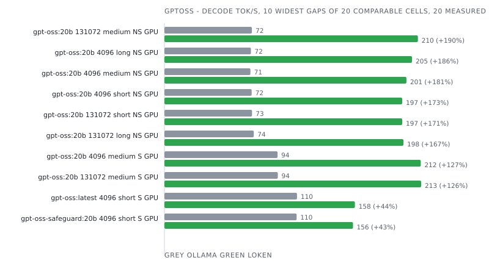

| Model                 | Ctx    | Prompt | Mode       | Device | Engine              | Prefill tok/s | Decode tok/s | Tokens  | E2E ms     | J/req   | J/token   | Δ decode    | Δ energy    | Date             | Run      |
|-----------------------|--------|--------|------------|--------|---------------------|---------------|--------------|---------|------------|---------|-----------|-------------|-------------|------------------|----------|
| gpt-oss-safeguard:20b | 4096   | short  | stream     | GPU    | Ollama 0.35.1       | 279.3         | 109.6        | 128     | 7 110      | 212     | 1.655     |             |             | 2026-10-03 20:28 | e3c68b87 |
| gpt-oss-safeguard:20b | 4096   | short  | stream     | GPU    | **loken 0.1.0-dev** | **543.9**     | **156.3**    | **128** | **1 056**  | **156** | **1.221** | **+42.7%**  | **+35.5%**  | 2026-10-03 20:28 | e3c68b87 |
| gpt-oss:20b           | 4096   | long   | non-stream | GPU    | Ollama 0.34.2       |  -            | 71.7         | 128     | 4 380      | 252     | 1.966     |             |             | 2026-09-04 00:24 | 94d32872 |
| gpt-oss:20b           | 4096   | long   | non-stream | GPU    | **loken 0.1.0-dev** |  -            | **205.2**    | **128** | **888**    | **130** | **1.012** | **+186.4%** | **+94.3%**  | 2026-09-04 00:24 | 94d32872 |
| gpt-oss:20b           | 4096   | long   | stream     | CPU    | Ollama 0.34.2       | 361.2         | 6.1          | 128     | 24 697     | 503     | 3.931     |             |             | 2026-09-05 06:42 | 0a515265 |
| gpt-oss:20b           | 4096   | long   | stream     | CPU    | **loken 0.1.0-dev** | **1 406.8**   | **7.3**      | **128** | **20 048** | **416** | **3.252** | **+20.7%**  | **+20.9%**  | 2026-09-05 06:42 | 0a515265 |
| gpt-oss:20b           | 4096   | long   | stream     | GPU    | Ollama 0.34.2       | 575.4         | 96.1         | 128     | 4 435      | 251     | 1.958     |             |             | 2026-09-03 22:46 | 2db8dcae |
| gpt-oss:20b           | 4096   | long   | stream     | GPU    | **loken 0.1.0-dev** | **10 647.6**  | **210.0**    | **128** | **913**    | **128** | **1.004** | **+118.5%** | **+95.1%**  | 2026-09-03 22:46 | 2db8dcae |
| gpt-oss:20b           | 4096   | medium | non-stream | GPU    | Ollama 0.34.2       |  -            | 71.3         | 128     | 4 377      | 245     | 1.914     |             |             | 2026-09-03 21:08 | e862af53 |
| gpt-oss:20b           | 4096   | medium | non-stream | GPU    | **loken 0.1.0-dev** |  -            | **200.6**    | **128** | **828**    | **123** | **0.960** | **+181.2%** | **+99.5%**  | 2026-09-03 21:08 | e862af53 |
| gpt-oss:20b           | 4096   | medium | stream     | CPU    | Ollama 0.34.2       | 50.7          | 6.1          | 128     | 24 032     | 509     | 3.979     |             |             | 2026-09-05 01:37 | 5112d23e |
| gpt-oss:20b           | 4096   | medium | stream     | CPU    | **loken 0.1.0-dev** | **268.5**     | **7.5**      | **128** | **18 588** | **407** | **3.183** | **+21.5%**  | **+25.0%**  | 2026-09-05 01:37 | 5112d23e |
| gpt-oss:20b           | 4096   | medium | stream     | GPU    | Ollama 0.34.2       | 99.5          | 93.8         | 128     | 4 350      | 250     | 1.956     |             |             | 2026-09-03 19:24 | 139c7d6b |
| gpt-oss:20b           | 4096   | medium | stream     | GPU    | **loken 0.1.0-dev** | **1 232.4**   | **212.5**    | **128** | **836**    | **123** | **0.962** | **+126.4%** | **+103.3%** | 2026-09-03 19:24 | 139c7d6b |
| gpt-oss:20b           | 4096   | short  | non-stream | GPU    | Ollama 0.34.2       |  -            | 72.3         | 128     | 4 281      | 245     | 1.913     |             |             | 2026-09-03 17:46 | db314c82 |
| gpt-oss:20b           | 4096   | short  | non-stream | GPU    | **loken 0.1.0-dev** |  -            | **197.1**    | **128** | **805**    | **128** | **1.001** | **+172.6%** | **+91.1%**  | 2026-09-03 17:46 | db314c82 |
| gpt-oss:20b           | 4096   | short  | stream     | CPU    | Ollama 0.34.2       | 18.3          | 6.1          | 128     | 23 835     | 505     | 3.943     |             |             | 2026-09-04 21:03 | f5ea7ae0 |
| gpt-oss:20b           | 4096   | short  | stream     | CPU    | **loken 0.1.0-dev** | **95.5**      | **7.5**      | **128** | **18 266** | **405** | **3.160** | **+21.7%**  | **+24.7%**  | 2026-09-04 21:03 | f5ea7ae0 |
| gpt-oss:20b           | 4096   | short  | stream     | GPU    | Ollama 0.35.1       | 340.3         | 110.0        | 128     | 9 140      | 214     | 1.668     |             |             | 2026-10-05 20:30 | 2e6ff84f |
| gpt-oss:20b           | 4096   | short  | stream     | GPU    | **loken 0.2.0-dev** | **408.3**     | **158.2**    | **128** | **1 038**  | **170** | **1.326** | **+43.8%**  | **+25.9%**  | 2026-10-05 20:30 | 2e6ff84f |
| gpt-oss:20b           | 131072 | long   | non-stream | GPU    | Ollama 0.34.2       |  -            | 74.1         | 128     | 4 477      | 246     | 1.925     |             |             | 2026-09-04 16:08 | e9790eb9 |
| gpt-oss:20b           | 131072 | long   | non-stream | GPU    | **loken 0.1.0-dev** |  -            | **198.1**    | **128** | **901**    | **139** | **1.085** | **+167.4%** | **+77.3%**  | 2026-09-04 16:08 | e9790eb9 |
| gpt-oss:20b           | 131072 | long   | stream     | CPU    | Ollama 0.34.2       | 369.8         | 6.1          | 128     | 25 070     | 504     | 3.936     |             |             | 2026-09-06 03:32 | afee6c14 |
| gpt-oss:20b           | 131072 | long   | stream     | CPU    | **loken 0.1.0-dev** | **1 837.9**   | **7.3**      | **128** | **20 024** | **412** | **3.221** | **+21.0%**  | **+22.2%**  | 2026-09-06 03:32 | afee6c14 |
| gpt-oss:20b           | 131072 | long   | stream     | GPU    | Ollama 0.34.2       | 571.6         | 96.3         | 128     | 4 492      | 249     | 1.948     |             |             | 2026-09-04 14:06 | 38e9035c |
| gpt-oss:20b           | 131072 | long   | stream     | GPU    | **loken 0.1.0-dev** | **5 023.7**   | **210.2**    | **128** | **918**    | **131** | **1.024** | **+118.2%** | **+90.2%**  | 2026-09-04 14:06 | 38e9035c |
| gpt-oss:20b           | 131072 | medium | non-stream | GPU    | Ollama 0.34.2       |  -            | 72.5         | 128     | 4 526      | 252     | 1.968     |             |             | 2026-09-04 12:16 | b0cfe39b |
| gpt-oss:20b           | 131072 | medium | non-stream | GPU    | **loken 0.1.0-dev** |  -            | **210.1**    | **128** | **798**    | **118** | **0.923** | **+189.7%** | **+113.3%** | 2026-09-04 12:16 | b0cfe39b |
| gpt-oss:20b           | 131072 | medium | stream     | CPU    | Ollama 0.34.2       | 50.5          | 6.1          | 128     | 24 238     | 501     | 3.913     |             |             | 2026-09-06 00:35 | b618c2c6 |
| gpt-oss:20b           | 131072 | medium | stream     | CPU    | **loken 0.1.0-dev** | **243.4**     | **7.5**      | **128** | **18 606** | **406** | **3.174** | **+21.9%**  | **+23.3%**  | 2026-09-06 00:35 | b618c2c6 |
| gpt-oss:20b           | 131072 | medium | stream     | GPU    | Ollama 0.34.2       | 97.3          | 94.0         | 128     | 4 524      | 252     | 1.971     |             |             | 2026-09-04 10:26 | f3edae87 |
| gpt-oss:20b           | 131072 | medium | stream     | GPU    | **loken 0.1.0-dev** | **1 449.9**   | **212.8**    | **128** | **831**    | **122** | **0.957** | **+126.4%** | **+106.0%** | 2026-09-04 10:26 | f3edae87 |
| gpt-oss:20b           | 131072 | short  | non-stream | GPU    | Ollama 0.34.2       |  -            | 72.6         | 128     | 4 463      | 249     | 1.946     |             |             | 2026-09-04 08:22 | d2f6b38e |
| gpt-oss:20b           | 131072 | short  | non-stream | GPU    | **loken 0.1.0-dev** |  -            | **197.1**    | **128** | **812**    | **125** | **0.979** | **+171.6%** | **+98.7%**  | 2026-09-04 08:22 | d2f6b38e |
| gpt-oss:20b           | 131072 | short  | stream     | CPU    | Ollama 0.34.2       | 18.1          | 6.1          | 128     | 24 053     | 508     | 3.972     |             |             | 2026-09-05 21:40 | 45834b88 |
| gpt-oss:20b           | 131072 | short  | stream     | CPU    | **loken 0.1.0-dev** | **111.7**     | **7.5**      | **128** | **18 292** | **404** | **3.159** | **+22.1%**  | **+25.7%**  | 2026-09-05 21:40 | 45834b88 |
| gpt-oss:20b           | 131072 | short  | stream     | GPU    | Ollama 0.34.2       | 35.7          | 94.5         | 128     | 4 452      | 245     | 1.910     |             |             | 2026-09-04 02:28 | 1debaef8 |
| gpt-oss:20b           | 131072 | short  | stream     | GPU    | **loken 0.1.0-dev** | **511.1**     | **212.8**    | **128** | **824**    | **115** | **0.899** | **+125.1%** | **+112.5%** | 2026-09-04 02:28 | 1debaef8 |
| gpt-oss:latest        | 4096   | short  | stream     | GPU    | Ollama 0.35.1       | 498.0         | 109.9        | 128     | 3 864      | 193     | 1.509     |             |             | 2026-10-03 20:31 | aece0cfa |
| gpt-oss:latest        | 4096   | short  | stream     | GPU    | **loken 0.1.0-dev** | **297.4**     | **157.9**    | **128** | **1 041**  | **171** | **1.337** | **+43.7%**  | **+12.9%**  | 2026-10-03 20:31 | aece0cfa |

### granite

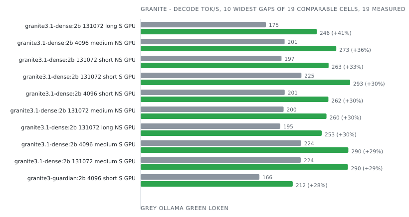

| Model                | Ctx    | Prompt | Mode       | Device | Engine              | Prefill tok/s | Decode tok/s | Tokens  | E2E ms     | J/req   | J/token   | Δ decode   | Δ energy   | Date             | Run      |
|----------------------|--------|--------|------------|--------|---------------------|---------------|--------------|---------|------------|---------|-----------|------------|------------|------------------|----------|
| granite3-guardian:2b | 4096   | short  | stream     | GPU    | Ollama 0.35.1       | 475.8         | 165.9        | 128     | 2 243      | 141     | 1.105     |            |            | 2026-10-03 20:32 | c2f3eb3c |
| granite3-guardian:2b | 4096   | short  | stream     | GPU    | **loken 0.1.0-dev** | **1 078.3**   | **212.5**    | **128** | **673**    | **127** | **0.994** | **+28.1%** | **+11.1%** | 2026-10-03 20:32 | c2f3eb3c |
| granite3.1-dense:2b  | 4096   | long   | non-stream | GPU    | Ollama 0.34.2       |  -            | 200.9        | 128     | 1 862      | 102     | 0.799     |            |            | 2026-09-04 00:36 | 8fe3fdfa |
| granite3.1-dense:2b  | 4096   | long   | non-stream | GPU    | **loken 0.1.0-dev** |  -            | **254.2**    | **128** | **537**    | **115** | **0.899** | **+26.5%** | -11.1%     | 2026-09-04 00:36 | 8fe3fdfa |
| granite3.1-dense:2b  | 4096   | long   | stream     | CPU    | Ollama 0.34.2       | 1 187.9       | 13.6         | 128     | 10 932     | 227     | 1.771     |            |            | 2026-09-05 06:46 | 77fe0cea |
| granite3.1-dense:2b  | 4096   | long   | stream     | CPU    | **loken 0.1.0-dev** | **168.8**     | **11.9**     | **128** | **12 674** | **402** | **3.141** | -12.5%     | -43.6%     | 2026-09-05 06:46 | 77fe0cea |
| granite3.1-dense:2b  | 4096   | long   | stream     | GPU    | Ollama 0.34.2       | 2 773.6       | 223.0        | 128     | 1 874      | 120     | 0.935     |            |            | 2026-09-03 22:59 | 299fe6be |
| granite3.1-dense:2b  | 4096   | long   | stream     | GPU    | **loken 0.1.0-dev** | **8 602.9**   | **273.3**    | **128** | **546**    | **114** | **0.888** | **+22.6%** | **+5.3%**  | 2026-09-03 22:59 | 299fe6be |
| granite3.1-dense:2b  | 4096   | medium | non-stream | GPU    | Ollama 0.34.2       |  -            | 201.1        | 128     | 1 872      | 99      | 0.777     |            |            | 2026-09-03 21:20 | c9f65a8d |
| granite3.1-dense:2b  | 4096   | medium | non-stream | GPU    | **loken 0.1.0-dev** |  -            | **273.3**    | **128** | **497**    | **109** | **0.849** | **+35.9%** | -8.5%      | 2026-09-03 21:20 | c9f65a8d |
| granite3.1-dense:2b  | 4096   | medium | stream     | CPU    | Ollama 0.34.2       | 217.3         | 13.8         | 128     | 10 350     | 223     | 1.740     |            |            | 2026-09-05 01:41 | 4573d26e |
| granite3.1-dense:2b  | 4096   | medium | stream     | CPU    | **loken 0.1.0-dev** | **103.8**     | **13.6**     | **128** | **10 086** | **438** | **3.423** | -2.1%      | -49.2%     | 2026-09-05 01:41 | 4573d26e |
| granite3.1-dense:2b  | 4096   | medium | stream     | GPU    | Ollama 0.34.2       | 689.1         | 224.2        | 128     | 1 890      | 100     | 0.778     |            |            | 2026-09-03 19:37 | 01d6e85c |
| granite3.1-dense:2b  | 4096   | medium | stream     | GPU    | **loken 0.1.0-dev** | **3 550.4**   | **290.2**    | **128** | **487**    | **110** | **0.863** | **+29.4%** | -9.8%      | 2026-09-03 19:37 | 01d6e85c |
| granite3.1-dense:2b  | 4096   | short  | non-stream | GPU    | Ollama 0.34.2       |  -            | 201.3        | 128     | 1 869      | 104     | 0.810     |            |            | 2026-09-03 17:58 | d8c044b5 |
| granite3.1-dense:2b  | 4096   | short  | non-stream | GPU    | **loken 0.1.0-dev** |  -            | **262.3**    | **128** | **496**    | **103** | **0.803** | **+30.3%** | **+0.8%**  | 2026-09-03 17:58 | d8c044b5 |
| granite3.1-dense:2b  | 4096   | short  | stream     | CPU    | Ollama 0.34.2       | 69.9          | 13.9         | 128     | 10 246     | 220     | 1.715     |            |            | 2026-09-04 21:06 | cdbf2671 |
| granite3.1-dense:2b  | 4096   | short  | stream     | CPU    | **loken 0.1.0-dev** | **47.2**      | **13.2**     | **128** | **10 139** | **419** | **3.274** | -4.8%      | -47.6%     | 2026-09-04 21:06 | cdbf2671 |
| granite3.1-dense:2b  | 4096   | short  | stream     | GPU    | Ollama 0.35.1       | 506.9         | 246.2        | 128     | 1 772      | 109     | 0.853     |            |            | 2026-10-03 20:34 | 5b9606b6 |
| granite3.1-dense:2b  | 4096   | short  | stream     | GPU    | **loken 0.1.0-dev** | **1 249.3**   | **293.7**    | **128** | **500**    | **102** | **0.795** | **+19.3%** | **+7.3%**  | 2026-10-03 20:34 | 5b9606b6 |
| granite3.1-dense:2b  | 131072 | long   | non-stream | GPU    | Ollama 0.34.2       |  -            | 195.0        | 128     | 2 010      | 113     | 0.884     |            |            | 2026-09-04 16:20 | 51365353 |
| granite3.1-dense:2b  | 131072 | long   | non-stream | GPU    | **loken 0.1.0-dev** |  -            | **253.0**    | **128** | **539**    | **112** | **0.875** | **+29.7%** | **+1.0%**  | 2026-09-04 16:20 | 51365353 |
| granite3.1-dense:2b  | 131072 | long   | stream     | CPU    | Ollama 0.34.2       | 1 146.3       | 13.6         | 128     | 11 556     | 227     | 1.772     |            |            | 2026-09-06 03:36 | a92440eb |
| granite3.1-dense:2b  | 131072 | long   | stream     | CPU    | **loken 0.1.0-dev** | **168.6**     | **11.9**     | **128** | **12 704** | **396** | **3.091** | -12.4%     | -42.7%     | 2026-09-06 03:36 | a92440eb |
| granite3.1-dense:2b  | 131072 | long   | stream     | GPU    | Ollama 0.34.2       | 1 831.6       | 174.9        | 128     | 3 471      | 140     | 1.091     |            |            | 2026-09-04 14:18 | 5014f440 |
| granite3.1-dense:2b  | 131072 | long   | stream     | GPU    | **loken 0.1.0-dev** | **5 756.6**   | **246.0**    | **128** | **615**    | **122** | **0.950** | **+40.6%** | **+14.8%** | 2026-09-04 14:18 | 5014f440 |
| granite3.1-dense:2b  | 131072 | medium | non-stream | GPU    | Ollama 0.34.2       |  -            | 199.7        | 128     | 2 125      | 102     | 0.798     |            |            | 2026-09-04 12:29 | f516d1fd |
| granite3.1-dense:2b  | 131072 | medium | non-stream | GPU    | **loken 0.1.0-dev** |  -            | **259.7**    | **128** | **507**    | **108** | **0.844** | **+30.1%** | -5.5%      | 2026-09-04 12:29 | f516d1fd |
| granite3.1-dense:2b  | 131072 | medium | stream     | CPU    | Ollama 0.34.2       | 209.0         | 13.9         | 128     | 10 878     | 221     | 1.727     |            |            | 2026-09-06 00:38 | a027e31c |
| granite3.1-dense:2b  | 131072 | medium | stream     | CPU    | **loken 0.1.0-dev** | **103.0**     | **13.6**     | **128** | **10 045** | **429** | **3.352** | -1.9%      | -48.5%     | 2026-09-06 00:38 | a027e31c |
| granite3.1-dense:2b  | 131072 | medium | stream     | GPU    | Ollama 0.34.2       | 687.6         | 223.8        | 128     | 2 100      | 111     | 0.869     |            |            | 2026-09-04 10:38 | d5a4ef19 |
| granite3.1-dense:2b  | 131072 | medium | stream     | GPU    | **loken 0.1.0-dev** | **3 468.5**   | **289.6**    | **128** | **488**    | **109** | **0.855** | **+29.4%** | **+1.7%**  | 2026-09-04 10:38 | d5a4ef19 |
| granite3.1-dense:2b  | 131072 | short  | non-stream | GPU    | Ollama 0.34.2       |  -            | 196.8        | 128     | 2 152      | 117     | 0.915     |            |            | 2026-09-04 08:35 | 2c6f31c2 |
| granite3.1-dense:2b  | 131072 | short  | non-stream | GPU    | **loken 0.1.0-dev** |  -            | **262.6**    | **128** | **504**    | **97**  | **0.759** | **+33.4%** | **+20.6%** | 2026-09-04 08:35 | 2c6f31c2 |
| granite3.1-dense:2b  | 131072 | short  | stream     | CPU    | Ollama 0.34.2       | 86.5          | 14.0         | 128     | 10 695     | 221     | 1.728     |            |            | 2026-09-05 21:44 | 15b00e02 |
| granite3.1-dense:2b  | 131072 | short  | stream     | CPU    | **loken 0.1.0-dev** | **47.5**      | **13.3**     | **128** | **10 125** | **438** | **3.423** | -4.9%      | -49.5%     | 2026-09-05 21:44 | 15b00e02 |
| granite3.1-dense:2b  | 131072 | short  | stream     | GPU    | Ollama 0.34.2       | 224.3         | 224.6        | 128     | 2 054      | 105     | 0.824     |            |            | 2026-09-04 02:40 | 3be6a3df |
| granite3.1-dense:2b  | 131072 | short  | stream     | GPU    | **loken 0.1.0-dev** | **1 128.3**   | **292.7**    | **128** | **484**    | **104** | **0.815** | **+30.3%** | **+1.2%**  | 2026-09-04 02:40 | 3be6a3df |

### granitemoe

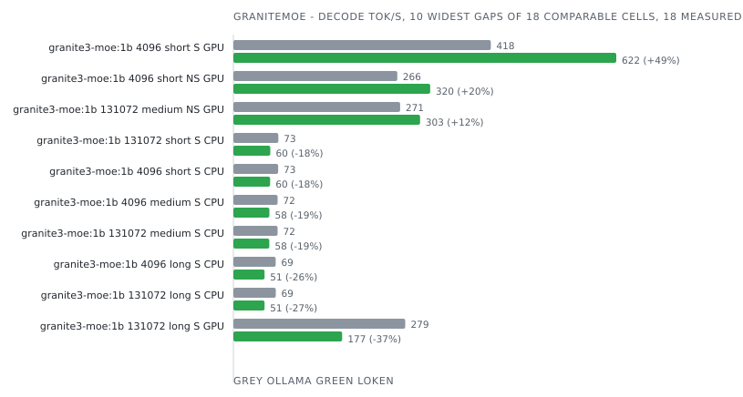

| Model           | Ctx    | Prompt | Mode       | Device | Engine              | Prefill tok/s | Decode tok/s | Tokens  | E2E ms    | J/req   | J/token   | Δ decode   | Δ energy   | Date             | Run      |
|-----------------|--------|--------|------------|--------|---------------------|---------------|--------------|---------|-----------|---------|-----------|------------|------------|------------------|----------|
| granite3-moe:1b | 4096   | long   | non-stream | GPU    | Ollama 0.34.2       |  -            | 280.5        | 128     | 529       | 55      | 0.428     |            |            | 2026-09-04 00:35 | 9c1a7549 |
| granite3-moe:1b | 4096   | long   | non-stream | GPU    | **loken 0.1.0-dev** |  -            | **279.4**    | **128** | **503**   | **57**  | **0.443** | -0.4%      | -3.5%      | 2026-09-04 00:35 | 9c1a7549 |
| granite3-moe:1b | 4096   | long   | stream     | CPU    | Ollama 0.34.2       | 1 643.3       | 68.8         | 128     | 2 871     | 49      | 0.385     |            |            | 2026-09-05 06:44 | 5bb8a1f2 |
| granite3-moe:1b | 4096   | long   | stream     | CPU    | **loken 0.1.0-dev** | **447.9**     | **50.7**     | **128** | **3 190** | **194** | **1.518** | -26.4%     | -74.6%     | 2026-09-05 06:44 | 5bb8a1f2 |
| granite3-moe:1b | 4096   | long   | stream     | GPU    | Ollama 0.34.2       | 1 955.1       | 328.6        | 128     | 534       | 54      | 0.422     |            |            | 2026-09-03 22:58 | c7ca571a |
| granite3-moe:1b | 4096   | long   | stream     | GPU    | **loken 0.1.0-dev** | **4 288.6**   | **319.6**    | **128** | **500**   | **63**  | **0.492** | -2.7%      | -14.2%     | 2026-09-03 22:58 | c7ca571a |
| granite3-moe:1b | 4096   | medium | non-stream | GPU    | Ollama 0.34.2       |  -            | 270.2        | 128     | 500       | 46      | 0.363     |            |            | 2026-09-03 21:19 | c8b4a6d2 |
| granite3-moe:1b | 4096   | medium | non-stream | GPU    | **loken 0.1.0-dev** |  -            | **291.5**    | **128** | **450**   | **48**  | **0.374** | **+7.9%**  | -3.0%      | 2026-09-03 21:19 | c8b4a6d2 |
| granite3-moe:1b | 4096   | medium | stream     | CPU    | Ollama 0.34.2       | 340.5         | 71.8         | 128     | 2 658     | 48      | 0.377     |            |            | 2026-09-05 01:39 | ed9d2a62 |
| granite3-moe:1b | 4096   | medium | stream     | CPU    | **loken 0.1.0-dev** | **204.4**     | **58.5**     | **128** | **2 431** | **147** | **1.145** | -18.5%     | -67.1%     | 2026-09-05 01:39 | ed9d2a62 |
| granite3-moe:1b | 4096   | medium | stream     | GPU    | Ollama 0.34.2       | 695.7         | 337.9        | 128     | 513       | 49      | 0.383     |            |            | 2026-09-03 19:36 | 0a7db34b |
| granite3-moe:1b | 4096   | medium | stream     | GPU    | **loken 0.1.0-dev** | **3 152.2**   | **327.3**    | **128** | **462**   | **46**  | **0.360** | -3.1%      | **+6.3%**  | 2026-09-03 19:36 | 0a7db34b |
| granite3-moe:1b | 4096   | short  | non-stream | GPU    | Ollama 0.34.2       |  -            | 266.4        | 128     | 513       | 46      | 0.359     |            |            | 2026-09-03 17:57 | 18550879 |
| granite3-moe:1b | 4096   | short  | non-stream | GPU    | **loken 0.1.0-dev** |  -            | **319.9**    | **128** | **440**   | **41**  | **0.321** | **+20.1%** | **+11.9%** | 2026-09-03 17:57 | 18550879 |
| granite3-moe:1b | 4096   | short  | stream     | CPU    | Ollama 0.34.2       | 104.8         | 72.7         | 128     | 2 643     | 49      | 0.380     |            |            | 2026-09-04 21:05 | a52cd66a |
| granite3-moe:1b | 4096   | short  | stream     | CPU    | **loken 0.1.0-dev** | **109.5**     | **59.7**     | **128** | **2 276** | **134** | **1.044** | -17.8%     | -63.6%     | 2026-09-04 21:05 | a52cd66a |
| granite3-moe:1b | 4096   | short  | stream     | GPU    | Ollama 0.35.1       | 909.0         | 418.4        | 128     | 2 544     | 44      | 0.343     |            |            | 2026-10-03 20:33 | 2f0644c5 |
| granite3-moe:1b | 4096   | short  | stream     | GPU    | **loken 0.1.0-dev** | **1 806.4**   | **622.2**    | **128** | **289**   | **42**  | **0.332** | **+48.7%** | **+3.3%**  | 2026-10-03 20:33 | 2f0644c5 |
| granite3-moe:1b | 131072 | long   | non-stream | GPU    | Ollama 0.34.2       |  -            | 280.9        | 128     | 516       | 50      | 0.394     |            |            | 2026-09-04 16:19 | 818eb6c5 |
| granite3-moe:1b | 131072 | long   | non-stream | GPU    | **loken 0.1.0-dev** |  -            | **281.5**    | **128** | **493**   | **66**  | **0.519** | **+0.2%**  | -24.1%     | 2026-09-04 16:19 | 818eb6c5 |
| granite3-moe:1b | 131072 | long   | stream     | CPU    | Ollama 0.34.2       | 1 774.0       | 68.9         | 128     | 2 817     | 50      | 0.394     |            |            | 2026-09-06 03:34 | 6fbc0f4d |
| granite3-moe:1b | 131072 | long   | stream     | CPU    | **loken 0.1.0-dev** | **434.8**     | **50.6**     | **128** | **3 183** | **192** | **1.502** | -26.5%     | -73.8%     | 2026-09-06 03:34 | 6fbc0f4d |
| granite3-moe:1b | 131072 | long   | stream     | GPU    | Ollama 0.34.2       | 4 300.5       | 279.3        | 128     | 566       | 55      | 0.427     |            |            | 2026-09-04 14:17 | 2f214307 |
| granite3-moe:1b | 131072 | long   | stream     | GPU    | **loken 0.1.0-dev** | **3 447.5**   | **176.8**    | **128** | **901**   | **80**  | **0.628** | -36.7%     | -31.9%     | 2026-09-04 14:17 | 2f214307 |
| granite3-moe:1b | 131072 | medium | non-stream | GPU    | Ollama 0.34.2       |  -            | 271.0        | 128     | 516       | 50      | 0.390     |            |            | 2026-09-04 12:28 | c862cd49 |
| granite3-moe:1b | 131072 | medium | non-stream | GPU    | **loken 0.1.0-dev** |  -            | **303.4**    | **128** | **464**   | **53**  | **0.418** | **+12.0%** | -6.6%      | 2026-09-04 12:28 | c862cd49 |
| granite3-moe:1b | 131072 | medium | stream     | CPU    | Ollama 0.34.2       | 271.5         | 71.9         | 128     | 2 662     | 47      | 0.367     |            |            | 2026-09-06 00:37 | 00da2b4c |
| granite3-moe:1b | 131072 | medium | stream     | CPU    | **loken 0.1.0-dev** | **223.1**     | **58.4**     | **128** | **2 422** | **139** | **1.088** | -18.7%     | -66.3%     | 2026-09-06 00:37 | 00da2b4c |
| granite3-moe:1b | 131072 | medium | stream     | GPU    | Ollama 0.34.2       | 707.6         | 336.8        | 128     | 487       | 55      | 0.428     |            |            | 2026-09-04 10:37 | f09f133c |
| granite3-moe:1b | 131072 | medium | stream     | GPU    | **loken 0.1.0-dev** | **2 846.4**   | **326.9**    | **128** | **449**   | **41**  | **0.318** | -3.0%      | **+34.7%** | 2026-09-04 10:37 | f09f133c |
| granite3-moe:1b | 131072 | short  | non-stream | GPU    | Ollama 0.34.2       |  -            | 280.2        | 128     | 534       | 46      | 0.360     |            |            | 2026-09-04 08:34 | 44188d23 |
| granite3-moe:1b | 131072 | short  | non-stream | GPU    | **loken 0.1.0-dev** |  -            | **296.3**    | **128** | **472**   | **49**  | **0.380** | **+5.7%**  | -5.3%      | 2026-09-04 08:34 | 44188d23 |
| granite3-moe:1b | 131072 | short  | stream     | CPU    | Ollama 0.34.2       | 95.2          | 73.0         | 128     | 2 645     | 48      | 0.376     |            |            | 2026-09-05 21:42 | 52954fc5 |
| granite3-moe:1b | 131072 | short  | stream     | CPU    | **loken 0.1.0-dev** | **108.1**     | **60.0**     | **128** | **2 295** | **136** | **1.061** | -17.8%     | -64.6%     | 2026-09-05 21:42 | 52954fc5 |
| granite3-moe:1b | 131072 | short  | stream     | GPU    | Ollama 0.34.2       | 252.3         | 334.9        | 128     | 518       | 50      | 0.390     |            |            | 2026-09-04 02:39 | f648a13c |
| granite3-moe:1b | 131072 | short  | stream     | GPU    | **loken 0.1.0-dev** | **1 028.0**   | **324.2**    | **128** | **468**   | **40**  | **0.313** | -3.2%      | **+24.7%** | 2026-09-04 02:39 | f648a13c |

### lfm2

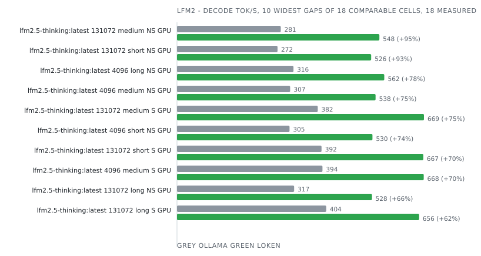

| Model                  | Ctx    | Prompt | Mode       | Device | Engine              | Prefill tok/s | Decode tok/s | Tokens  | E2E ms    | J/req   | J/token   | Δ decode   | Δ energy    | Date             | Run      |
|------------------------|--------|--------|------------|--------|---------------------|---------------|--------------|---------|-----------|---------|-----------|------------|-------------|------------------|----------|
| lfm2.5-thinking:latest | 4096   | long   | non-stream | GPU    | Ollama 0.34.2       |  -            | 315.7        | 128     | 1 615     | 69      | 0.538     |            |             | 2026-09-04 00:37 | ba240831 |
| lfm2.5-thinking:latest | 4096   | long   | non-stream | GPU    | **loken 0.1.0-dev** |  -            | **561.7**    | **128** | **430**   | **53**  | **0.411** | **+77.9%** | **+31.1%**  | 2026-09-04 00:37 | ba240831 |
| lfm2.5-thinking:latest | 4096   | long   | stream     | CPU    | Ollama 0.34.2       | 1 224.7       | 29.8         | 128     | 5 391     | 108     | 0.841     |            |             | 2026-09-05 06:47 | 56cf8a52 |
| lfm2.5-thinking:latest | 4096   | long   | stream     | CPU    | **loken 0.1.0-dev** | **2 341.2**   | **29.5**     | **128** | **4 777** | **262** | **2.044** | -0.9%      | -58.8%      | 2026-09-05 06:47 | 56cf8a52 |
| lfm2.5-thinking:latest | 4096   | long   | stream     | GPU    | Ollama 0.34.2       | 2 358.6       | 416.9        | 128     | 1 653     | 59      | 0.463     |            |             | 2026-09-03 23:00 | 13a00809 |
| lfm2.5-thinking:latest | 4096   | long   | stream     | GPU    | **loken 0.1.0-dev** | **33 797.8**  | **664.9**    | **128** | **435**   | **32**  | **0.254** | **+59.5%** | **+82.3%**  | 2026-09-03 23:00 | 13a00809 |
| lfm2.5-thinking:latest | 4096   | medium | non-stream | GPU    | Ollama 0.34.2       |  -            | 306.6        | 128     | 1 646     | 61      | 0.479     |            |             | 2026-09-03 21:21 | a5ad31ed |
| lfm2.5-thinking:latest | 4096   | medium | non-stream | GPU    | **loken 0.1.0-dev** |  -            | **538.0**    | **128** | **395**   | **50**  | **0.389** | **+75.5%** | **+23.2%**  | 2026-09-03 21:21 | a5ad31ed |
| lfm2.5-thinking:latest | 4096   | medium | stream     | CPU    | Ollama 0.34.2       | 196.6         | 30.0         | 128     | 5 198     | 107     | 0.836     |            |             | 2026-09-05 01:42 | d3f2ece4 |
| lfm2.5-thinking:latest | 4096   | medium | stream     | CPU    | **loken 0.1.0-dev** | **408.9**     | **30.0**     | **128** | **4 535** | **260** | **2.033** | **+0.0%**  | -58.9%      | 2026-09-05 01:42 | d3f2ece4 |
| lfm2.5-thinking:latest | 4096   | medium | stream     | GPU    | Ollama 0.34.2       | 436.3         | 394.2        | 128     | 1 668     | 55      | 0.429     |            |             | 2026-09-03 19:38 | 520302b3 |
| lfm2.5-thinking:latest | 4096   | medium | stream     | GPU    | **loken 0.1.0-dev** | **5 135.2**   | **668.5**    | **128** | **414**   | **30**  | **0.231** | **+69.6%** | **+85.7%**  | 2026-09-03 19:38 | 520302b3 |
| lfm2.5-thinking:latest | 4096   | short  | non-stream | GPU    | Ollama 0.34.2       |  -            | 305.0        | 128     | 1 651     | 52      | 0.409     |            |             | 2026-09-03 17:59 | b9f99be8 |
| lfm2.5-thinking:latest | 4096   | short  | non-stream | GPU    | **loken 0.1.0-dev** |  -            | **529.7**    | **128** | **399**   | **48**  | **0.373** | **+73.7%** | **+9.4%**   | 2026-09-03 17:59 | b9f99be8 |
| lfm2.5-thinking:latest | 4096   | short  | stream     | CPU    | Ollama 0.34.2       | 72.6          | 30.0         | 128     | 5 176     | 108     | 0.843     |            |             | 2026-09-04 21:08 | fc7240c5 |
| lfm2.5-thinking:latest | 4096   | short  | stream     | CPU    | **loken 0.1.0-dev** | **140.7**     | **30.6**     | **128** | **4 406** | **253** | **1.980** | **+2.0%**  | -57.4%      | 2026-09-04 21:08 | fc7240c5 |
| lfm2.5-thinking:latest | 4096   | short  | stream     | GPU    | Ollama 0.35.1       | 2 064.0       | 506.7        | 128     | 1 486     | 57      | 0.444     |            |             | 2026-10-05 20:31 | 470a7a69 |
| lfm2.5-thinking:latest | 4096   | short  | stream     | GPU    | **loken 0.2.0-dev** | **1 203.9**   | **740.5**    | **128** | **278**   | **45**  | **0.350** | **+46.1%** | **+26.7%**  | 2026-10-05 20:31 | 470a7a69 |
| lfm2.5-thinking:latest | 131072 | long   | non-stream | GPU    | Ollama 0.34.2       |  -            | 317.4        | 128     | 1 712     | 61      | 0.474     |            |             | 2026-09-04 16:21 | 14f56494 |
| lfm2.5-thinking:latest | 131072 | long   | non-stream | GPU    | **loken 0.1.0-dev** |  -            | **528.3**    | **128** | **441**   | **46**  | **0.362** | **+66.4%** | **+31.0%**  | 2026-09-04 16:21 | 14f56494 |
| lfm2.5-thinking:latest | 131072 | long   | stream     | CPU    | Ollama 0.34.2       | 1 125.9       | 29.9         | 128     | 5 439     | 108     | 0.840     |            |             | 2026-09-06 03:38 | 97d713bb |
| lfm2.5-thinking:latest | 131072 | long   | stream     | CPU    | **loken 0.1.0-dev** | **2 608.5**   | **29.5**     | **128** | **4 796** | **258** | **2.016** | -1.3%      | -58.3%      | 2026-09-06 03:38 | 97d713bb |
| lfm2.5-thinking:latest | 131072 | long   | stream     | GPU    | Ollama 0.34.2       | 2 027.7       | 404.4        | 128     | 2 256     | 67      | 0.523     |            |             | 2026-09-04 14:20 | 48682d77 |
| lfm2.5-thinking:latest | 131072 | long   | stream     | GPU    | **loken 0.1.0-dev** | **32 590.7**  | **656.1**    | **128** | **430**   | **29**  | **0.229** | **+62.2%** | **+128.9%** | 2026-09-04 14:20 | 48682d77 |
| lfm2.5-thinking:latest | 131072 | medium | non-stream | GPU    | Ollama 0.34.2       |  -            | 281.3        | 128     | 1 705     | 70      | 0.545     |            |             | 2026-09-04 12:29 | 99d60344 |
| lfm2.5-thinking:latest | 131072 | medium | non-stream | GPU    | **loken 0.1.0-dev** |  -            | **548.4**    | **128** | **419**   | **50**  | **0.390** | **+95.0%** | **+39.9%**  | 2026-09-04 12:29 | 99d60344 |
| lfm2.5-thinking:latest | 131072 | medium | stream     | CPU    | Ollama 0.34.2       | 219.4         | 30.0         | 128     | 5 260     | 104     | 0.815     |            |             | 2026-09-06 00:40 | 5b27c09b |
| lfm2.5-thinking:latest | 131072 | medium | stream     | CPU    | **loken 0.1.0-dev** | **404.7**     | **30.7**     | **128** | **4 443** | **251** | **1.961** | **+2.0%**  | -58.4%      | 2026-09-06 00:40 | 5b27c09b |
| lfm2.5-thinking:latest | 131072 | medium | stream     | GPU    | Ollama 0.34.2       | 457.4         | 381.5        | 128     | 1 714     | 74      | 0.575     |            |             | 2026-09-04 10:39 | 12765422 |
| lfm2.5-thinking:latest | 131072 | medium | stream     | GPU    | **loken 0.1.0-dev** | **4 881.4**   | **669.2**    | **128** | **390**   | **51**  | **0.397** | **+75.4%** | **+45.0%**  | 2026-09-04 10:39 | 12765422 |
| lfm2.5-thinking:latest | 131072 | short  | non-stream | GPU    | Ollama 0.34.2       |  -            | 272.5        | 128     | 1 835     | 70      | 0.548     |            |             | 2026-09-04 08:35 | 91d9861d |
| lfm2.5-thinking:latest | 131072 | short  | non-stream | GPU    | **loken 0.1.0-dev** |  -            | **526.1**    | **128** | **400**   | **46**  | **0.357** | **+93.1%** | **+53.7%**  | 2026-09-04 08:35 | 91d9861d |
| lfm2.5-thinking:latest | 131072 | short  | stream     | CPU    | Ollama 0.34.2       | 76.1          | 30.1         | 128     | 5 239     | 106     | 0.829     |            |             | 2026-09-05 21:45 | 4e6cfb45 |
| lfm2.5-thinking:latest | 131072 | short  | stream     | CPU    | **loken 0.1.0-dev** | **164.9**     | **30.5**     | **128** | **4 432** | **246** | **1.922** | **+1.2%**  | -56.9%      | 2026-09-05 21:45 | 4e6cfb45 |
| lfm2.5-thinking:latest | 131072 | short  | stream     | GPU    | Ollama 0.34.2       | 161.7         | 391.6        | 128     | 1 713     | 70      | 0.547     |            |             | 2026-09-04 02:41 | cb6e6f3a |
| lfm2.5-thinking:latest | 131072 | short  | stream     | GPU    | **loken 0.1.0-dev** | **1 330.1**   | **667.4**    | **128** | **386**   | **34**  | **0.268** | **+70.4%** | **+104.3%** | 2026-09-04 02:41 | cb6e6f3a |

### lfm2moe

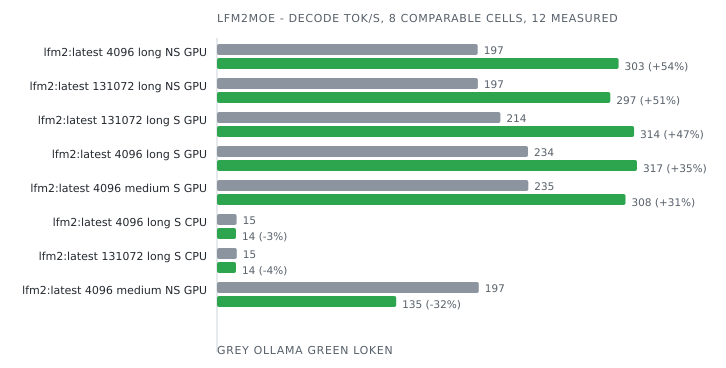

| Model       | Ctx    | Prompt | Mode       | Device | Engine              | Prefill tok/s | Decode tok/s | Tokens  | E2E ms     | J/req   | J/token   | Δ decode   | Δ energy   | Date             | Run      |
|-------------|--------|--------|------------|--------|---------------------|---------------|--------------|---------|------------|---------|-----------|------------|------------|------------------|----------|
| lfm2:latest | 4096   | long   | non-stream | GPU    | Ollama 0.34.2       |  -            | 196.6        | 128     | 3 147      | 118     | 0.918     |            |            | 2026-09-04 00:39 | 6d323138 |
| lfm2:latest | 4096   | long   | non-stream | GPU    | **loken 0.1.0-dev** |  -            | **302.8**    | **128** | **703**    | **80**  | **0.627** | **+54.0%** | **+46.4%** | 2026-09-04 00:39 | 6d323138 |
| lfm2:latest | 4096   | long   | stream     | CPU    | Ollama 0.34.2       | 782.2         | 14.8         | 128     | 13 277     | 215     | 1.682     |            |            | 2026-09-05 06:50 | 01f27f45 |
| lfm2:latest | 4096   | long   | stream     | CPU    | **loken 0.1.0-dev** | **2 037.9**   | **14.3**     | **128** | **12 909** | **218** | **1.704** | -3.7%      | -1.3%      | 2026-09-05 06:50 | 01f27f45 |
| lfm2:latest | 4096   | long   | stream     | GPU    | Ollama 0.34.2       | 2 416.2       | 234.5        | 128     | 3 111      | 118     | 0.923     |            |            | 2026-09-03 23:01 | e3c85d28 |
| lfm2:latest | 4096   | long   | stream     | GPU    | **loken 0.1.0-dev** | **19 531.2**  | **316.7**    | **128** | **676**    | **94**  | **0.733** | **+35.1%** | **+25.8%** | 2026-09-03 23:01 | e3c85d28 |
| lfm2:latest | 4096   | medium | non-stream | GPU    | Ollama 0.34.2       |  -            | 197.4        | 128     | 3 118      | 116     | 0.905     |            |            | 2026-09-03 21:22 | df96800d |
| lfm2:latest | 4096   | medium | non-stream | GPU    | **loken 0.1.0-dev** |  -            | **135.1**    | **4**   | **249**    | **13**  | **3.328** |            |            | 2026-09-03 21:22 | df96800d |
| lfm2:latest | 4096   | medium | stream     | CPU    | Ollama 0.34.2       | 152.2         | 14.8         | 5       | 4 724      | 15      | 2.998     |            |            | 2026-09-05 01:44 | 422f167c |
| lfm2:latest | 4096   | medium | stream     | CPU    | **loken 0.1.0-dev** |  -            |  -           | **40**  |  -         |  -      |  -        | incoherent |            | 2026-09-05 01:44 | 422f167c |
| lfm2:latest | 4096   | medium | stream     | GPU    | Ollama 0.34.2       | 409.1         | 234.7        | 128     | 3 117      | 122     | 0.951     |            |            | 2026-09-03 19:39 | 2aa102b9 |
| lfm2:latest | 4096   | medium | stream     | GPU    | **loken 0.1.0-dev** | **2 673.4**   | **308.0**    | **4**   | **240**    | **10**  | **2.469** |            |            | 2026-09-03 19:39 | 2aa102b9 |
| lfm2:latest | 4096   | short  | non-stream | GPU    | Ollama 0.34.2       |  -            |  -           | 128     |  -         |  -      |  -        | incoherent |            | 2026-09-03 18:01 | 24d972d1 |
| lfm2:latest | 4096   | short  | non-stream | GPU    | **loken 0.1.0-dev** |  -            |  -           | **128** |  -         |  -      |  -        | incoherent |            | 2026-09-03 18:01 | 24d972d1 |
| lfm2:latest | 4096   | short  | stream     | CPU    | Ollama 0.34.2       |  -            |  -           | 128     |  -         |  -      |  -        | incoherent |            | 2026-09-04 21:10 | e5762adc |
| lfm2:latest | 4096   | short  | stream     | CPU    | **loken 0.1.0-dev** |  -            |  -           | **84**  |  -         |  -      |  -        | incoherent |            | 2026-09-04 21:10 | e5762adc |
| lfm2:latest | 4096   | short  | stream     | GPU    | Ollama 0.35.1       |  -            |  -           | 128     |  -         |  -      |  -        | incoherent |            | 2026-10-05 20:33 | 3a74dae8 |
| lfm2:latest | 4096   | short  | stream     | GPU    | **loken 0.2.0-dev** |  -            |  -           | **128** |  -         |  -      |  -        | incoherent |            | 2026-10-05 20:33 | 3a74dae8 |
| lfm2:latest | 131072 | long   | non-stream | GPU    | Ollama 0.34.2       |  -            | 196.7        | 128     | 725        | 116     | 0.905     |            |            | 2026-09-04 16:23 | 0eb95b84 |
| lfm2:latest | 131072 | long   | non-stream | GPU    | **loken 0.1.0-dev** |  -            | **296.6**    | **128** | **689**    | **93**  | **0.726** | **+50.7%** | **+24.7%** | 2026-09-04 16:23 | 0eb95b84 |
| lfm2:latest | 131072 | long   | stream     | CPU    | Ollama 0.34.2       | 764.8         | 14.9         | 128     | 13 332     | 214     | 1.670     |            |            | 2026-09-06 03:40 | e0d1a45c |
| lfm2:latest | 131072 | long   | stream     | CPU    | **loken 0.1.0-dev** | **1 876.3**   | **14.3**     | **128** | **12 923** | **215** | **1.682** | -3.9%      | -0.8%      | 2026-09-06 03:40 | e0d1a45c |
| lfm2:latest | 131072 | long   | stream     | GPU    | Ollama 0.34.2       | 2 007.8       | 213.7        | 128     | 838        | 111     | 0.866     |            |            | 2026-09-04 14:21 | 3e3a5ce5 |
| lfm2:latest | 131072 | long   | stream     | GPU    | **loken 0.1.0-dev** | **16 831.4**  | **314.5**    | **128** | **761**    | **84**  | **0.655** | **+47.2%** | **+32.2%** | 2026-09-04 14:21 | 3e3a5ce5 |
| lfm2:latest | 131072 | medium | non-stream | GPU    | Ollama 0.34.2       |  -            |  -           |  -      |  -         |  -      |  -        | incoherent |            | 2026-09-04 12:31 | a7d8e110 |
| lfm2:latest | 131072 | medium | non-stream | GPU    | **loken 0.1.0-dev** |  -            | **141.8**    | **4**   | **270**    | **11**  | **2.747** |            |            | 2026-09-04 12:31 | a7d8e110 |
| lfm2:latest | 131072 | medium | stream     | CPU    | Ollama 0.34.2       | 130.7         | 14.8         | 5       | 4 838      | 17      | 3.407     |            |            | 2026-09-06 00:42 | ac797633 |
| lfm2:latest | 131072 | medium | stream     | CPU    | **loken 0.1.0-dev** |  -            |  -           | **40**  |  -         |  -      |  -        | incoherent |            | 2026-09-06 00:42 | ac797633 |
| lfm2:latest | 131072 | medium | stream     | GPU    | Ollama 0.34.2       |  -            |  -           | 33      |  -         |  -      |  -        | incoherent |            | 2026-09-04 10:40 | 519de733 |
| lfm2:latest | 131072 | medium | stream     | GPU    | **loken 0.1.0-dev** | **3 033.3**   | **195.8**    | **4**   | **269**    | **10**  | **2.475** |            |            | 2026-09-04 10:40 | 519de733 |
| lfm2:latest | 131072 | short  | non-stream | GPU    | Ollama 0.34.2       |  -            |  -           | 128     |  -         |  -      |  -        | incoherent |            | 2026-09-04 08:37 | e695c238 |
| lfm2:latest | 131072 | short  | non-stream | GPU    | **loken 0.1.0-dev** |  -            |  -           | **128** |  -         |  -      |  -        | incoherent |            | 2026-09-04 08:37 | e695c238 |
| lfm2:latest | 131072 | short  | stream     | CPU    | Ollama 0.34.2       |  -            |  -           | 128     |  -         |  -      |  -        | incoherent |            | 2026-09-05 21:48 | dda0c205 |
| lfm2:latest | 131072 | short  | stream     | CPU    | **loken 0.1.0-dev** |  -            |  -           | **84**  |  -         |  -      |  -        | incoherent |            | 2026-09-05 21:48 | dda0c205 |
| lfm2:latest | 131072 | short  | stream     | GPU    | Ollama 0.34.2       |  -            |  -           | 128     |  -         |  -      |  -        | incoherent |            | 2026-09-04 02:43 | e0f0b963 |
| lfm2:latest | 131072 | short  | stream     | GPU    | **loken 0.1.0-dev** |  -            |  -           | **128** |  -         |  -      |  -        | incoherent |            | 2026-09-04 02:43 | e0f0b963 |

### llama

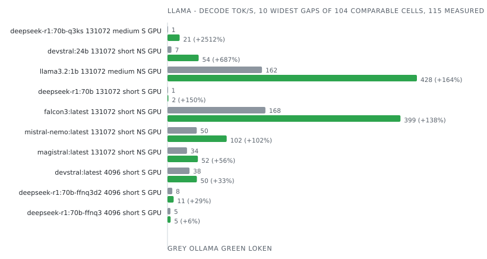

| Model                   | Ctx    | Prompt | Mode       | Device | Engine                            | Prefill tok/s | Decode tok/s | Tokens  | E2E ms        | J/req      | J/token       | Δ decode     | Δ energy    | Date             | Run      |
|-------------------------|--------|--------|------------|--------|-----------------------------------|---------------|--------------|---------|---------------|------------|---------------|--------------|-------------|------------------|----------|
| deepseek-r1:70b         | 4096   | long   | non-stream | GPU    | Ollama 0.34.2                     |  -            | 1.5          | 128     | 88 699        | 6 585      | 51.449        |              |             | 2026-09-03 23:46 | 526e1597 |
| deepseek-r1:70b         | 4096   | long   | non-stream | GPU    | **loken 0.1.0-dev**               |  -            | **1.4**      | **128** | **94 368**    | **6 763**  | **52.838**    | -9.5%        | -2.6%       | 2026-09-03 23:46 | 526e1597 |
| deepseek-r1:70b         | 4096   | long   | stream     | CPU    | Ollama 0.34.2                     | 107.0         | 0.5          | 128     | 265 836       | 5 587      | 43.648        |              |             | 2026-09-05 03:38 | 81b1bbb3 |
| deepseek-r1:70b         | 4096   | long   | stream     | CPU    | **loken 0.1.0-dev**               |  -            | **0.0**      | **24**  | **1 855 036** | **40 342** | **1 657.902** |              |             | 2026-09-05 03:38 | 81b1bbb3 |
| deepseek-r1:70b         | 4096   | long   | stream     | GPU    | Ollama 0.34.2                     | 248.4         | 1.5          | 128     | 88 730        | 6 609      | 51.632        |              |             | 2026-09-03 22:09 | b214bb05 |
| deepseek-r1:70b         | 4096   | long   | stream     | GPU    | **loken 0.1.0-dev**               | **24.0**      | **1.6**      | **128** | **89 227**    | **6 328**  | **49.439**    | **+5.3%**    | **+4.4%**   | 2026-09-03 22:09 | b214bb05 |
| deepseek-r1:70b         | 4096   | long   | stream     | GPU    | **loken 0.1.0-dev + llama3.2:1b** | **23.5**      | **2.0**      | **128** | **80 310**    | **6 143**  | **47.995**    | **+31.5%**   | **+7.6%**   | 2026-09-04 17:15 | bb1bf774 |
| deepseek-r1:70b         | 4096   | medium | non-stream | GPU    | Ollama 0.34.2                     |  -            | 1.5          | 128     | 88 182        | 6 516      | 50.903        |              |             | 2026-09-03 20:30 | cae97761 |
| deepseek-r1:70b         | 4096   | medium | non-stream | GPU    | **loken 0.1.0-dev**               |  -            | **1.4**      | **128** | **93 379**    | **6 966**  | **54.423**    | -9.0%        | -6.5%       | 2026-09-03 20:30 | cae97761 |
| deepseek-r1:70b         | 4096   | medium | stream     | CPU    | Ollama 0.34.2                     | 19.8          | 0.5          | 128     | 268 065       | 5 511      | 43.056        |              |             | 2026-09-04 23:10 | b00a8fd5 |
| deepseek-r1:70b         | 4096   | medium | stream     | CPU    | **loken 0.1.0-dev**               |  -            | **0.0**      | **29**  | **1 514 824** | **40 314** | **1 390.129** |              |             | 2026-09-04 23:10 | b00a8fd5 |
| deepseek-r1:70b         | 4096   | medium | stream     | GPU    | Ollama 0.34.2                     | 46.1          | 1.6          | 128     | 88 248        | 6 556      | 51.222        |              |             | 2026-09-03 18:47 | cbf45787 |
| deepseek-r1:70b         | 4096   | medium | stream     | GPU    | **loken 0.1.0-dev**               | **20.8**      | **1.5**      | **128** | **91 081**    | **6 851**  | **53.520**    | -5.3%        | -4.3%       | 2026-09-03 18:47 | cbf45787 |
| deepseek-r1:70b         | 4096   | medium | stream     | GPU    | **loken 0.1.0-dev + llama3.2:1b** | **20.1**      | **2.4**      | **128** | **67 571**    | **4 738**  | **37.019**    | **+57.0%**   | **+38.4%**  | 2026-09-04 17:09 | 9faf3a7f |
| deepseek-r1:70b         | 4096   | short  | non-stream | GPU    | Ollama 0.34.2                     |  -            | 1.6          | 128     | 87 920        | 6 570      | 51.329        |              |             | 2026-09-03 17:09 | f269d45d |
| deepseek-r1:70b         | 4096   | short  | non-stream | GPU    | **loken 0.1.0-dev**               |  -            | **1.5**      | **128** | **89 715**    | **6 798**  | **53.108**    | -5.3%        | -3.3%       | 2026-09-03 17:09 | f269d45d |
| deepseek-r1:70b         | 4096   | short  | stream     | CPU    | Ollama 0.34.2                     | 7.2           | 0.5          | 128     | 252 787       | 5 513      | 43.071        |              |             | 2026-09-04 17:50 | ebb364dd |
| deepseek-r1:70b         | 4096   | short  | stream     | CPU    | **loken 0.1.0-dev**               |  -            | **0.0**      | **32**  | **1 866 753** | **47 956** | **1 498.622** |              |             | 2026-09-04 17:50 | ebb364dd |
| deepseek-r1:70b         | 4096   | short  | stream     | GPU    | Ollama 0.35.1                     | 23.5          | 1.6          | 128     | 89 690        | 5 753      | 44.947        |              |             | 2026-10-03 19:38 | 372ebec4 |
| deepseek-r1:70b         | 4096   | short  | stream     | GPU    | **loken 0.1.0-dev**               | **11.8**      | **3.1**      | **128** | **60 963**    | **3 749**  | **29.289**    | **+99.9%**   | **+53.5%**  | 2026-10-03 19:38 | 372ebec4 |
| deepseek-r1:70b         | 4096   | short  | stream     | GPU    | **loken 0.1.0-dev + llama3.2:1b** | **13.5**      | **2.2**      | **128** | **70 934**    | **5 246**  | **40.981**    | **+42.2%**   | **+9.7%**   | 2026-09-04 17:04 | edc5859d |
| deepseek-r1:70b         | 131072 | long   | non-stream | GPU    | Ollama 0.34.2                     |  -            | 0.5          | 128     | 278 682       | 18 130     | 141.638       |              |             | 2026-09-04 15:24 | 7c9f90eb |
| deepseek-r1:70b         | 131072 | long   | non-stream | GPU    | **loken 0.1.0-dev**               |  -            | **0.6**      | **128** | **247 674**   | **13 959** | **109.052**   | **+19.9%**   | **+29.9%**  | 2026-09-04 15:24 | 7c9f90eb |
| deepseek-r1:70b         | 131072 | long   | stream     | GPU    | Ollama 0.34.2                     | 155.6         | 0.8          | 128     | 166 393       | 11 111     | 86.801        |              |             | 2026-09-04 13:24 | 5c499287 |
| deepseek-r1:70b         | 131072 | long   | stream     | GPU    | **loken 0.1.0-dev**               | **24.4**      | **1.6**      | **128** | **93 195**    | **6 752**  | **52.754**    | **+99.6%**   | **+64.5%**  | 2026-09-04 13:24 | 5c499287 |
| deepseek-r1:70b         | 131072 | medium | non-stream | GPU    | Ollama 0.34.2                     |  -            | 0.8          | 128     | 166 036       | 11 177     | 87.320        |              |             | 2026-09-04 11:34 | 97ca7130 |
| deepseek-r1:70b         | 131072 | medium | non-stream | GPU    | **loken 0.1.0-dev**               |  -            | **1.4**      | **128** | **98 527**    | **7 168**  | **56.003**    | **+71.6%**   | **+55.9%**  | 2026-09-04 11:34 | 97ca7130 |
| deepseek-r1:70b         | 131072 | medium | stream     | GPU    | Ollama 0.34.2                     | 28.2          | 0.8          | 128     | 166 643       | 11 135     | 86.993        |              |             | 2026-09-04 09:36 | be086186 |
| deepseek-r1:70b         | 131072 | medium | stream     | GPU    | **loken 0.1.0-dev**               | **21.1**      | **1.5**      | **128** | **95 919**    | **6 943**  | **54.246**    | **+79.2%**   | **+60.4%**  | 2026-09-04 09:36 | be086186 |
| deepseek-r1:70b         | 131072 | short  | non-stream | GPU    | Ollama 0.34.2                     |  -            | 0.7          | 128     | 188 180       | 12 028     | 93.969        |              |             | 2026-09-04 07:36 | 404ffe15 |
| deepseek-r1:70b         | 131072 | short  | non-stream | GPU    | **loken 0.1.0-dev**               |  -            | **0.9**      | **128** | **143 827**   | **9 863**  | **77.053**    | **+24.6%**   | **+22.0%**  | 2026-09-04 07:36 | 404ffe15 |
| deepseek-r1:70b         | 131072 | short  | stream     | GPU    | Ollama 0.34.2                     | 9.9           | 0.6          | 128     | 223 697       | 14 437     | 112.788       |              |             | 2026-09-04 01:39 | 073d8fcd |
| deepseek-r1:70b         | 131072 | short  | stream     | GPU    | **loken 0.1.0-dev**               | **12.2**      | **1.5**      | **128** | **105 678**   | **7 000**  | **54.689**    | **+148.0%**  | **+106.2%** | 2026-09-04 01:39 | 073d8fcd |
| deepseek-r1:70b-ffnq3   | 4096   | short  | stream     | GPU    | Ollama 0.35.1                     | 54.5          | 5.1          | 128     | 29 845        | 2 872      | 22.441        |              |             | 2026-10-05 22:54 | a4e265c6 |
| deepseek-r1:70b-ffnq3   | 4096   | short  | stream     | GPU    | **loken 0.2.0-dev**               | **34.0**      | **5.4**      | **128** | **24 012**    | **2 987**  | **23.334**    | **+6.5%**    | -3.8%       | 2026-10-05 22:54 | a4e265c6 |
| deepseek-r1:70b-ffnq3d2 | 4096   | short  | stream     | GPU    | Ollama 0.35.1                     | 98.4          | 8.2          | 128     | 23 362        | 2 306      | 18.012        |              |             | 2026-10-03 19:48 | bb3eb09e |
| deepseek-r1:70b-ffnq3d2 | 4096   | short  | stream     | GPU    | **loken 0.1.0-dev**               | **67.3**      | **10.6**     | **128** | **12 468**    | **2 177**  | **17.005**    | **+29.0%**   | **+5.9%**   | 2026-10-03 19:48 | bb3eb09e |
| deepseek-r1:70b-q3ks    | 4096   | long   | non-stream | GPU    | Ollama 0.34.2                     |  -            | 6.8          | 128     | 23 460        | 2 757      | 21.537        |              |             | 2026-09-03 23:57 | af74806e |
| deepseek-r1:70b-q3ks    | 4096   | long   | non-stream | GPU    | **loken 0.1.0-dev**               |  -            | **18.6**     | **128** | **7 187**     | **2 192**  | **17.122**    | **+172.9%**  | **+25.8%**  | 2026-09-03 23:57 | af74806e |
| deepseek-r1:70b-q3ks    | 4096   | long   | stream     | CPU    | Ollama 0.34.2                     | 144.4         | 0.7          | 128     | 197 724       | 3 955      | 30.899        |              |             | 2026-09-05 05:23 | 2aa3d287 |
| deepseek-r1:70b-q3ks    | 4096   | long   | stream     | CPU    | **loken 0.1.0-dev**               | **3.7**       | **0.7**      | **128** | **245 040**   | **5 587**  | **43.650**    | -7.2%        | -29.2%      | 2026-09-05 05:23 | 2aa3d287 |
| deepseek-r1:70b-q3ks    | 4096   | long   | stream     | GPU    | Ollama 0.34.2                     | 577.9         | 6.9          | 128     | 23 502        | 2 769      | 21.635        |              |             | 2026-09-03 22:20 | 8961f591 |
| deepseek-r1:70b-q3ks    | 4096   | long   | stream     | GPU    | **loken 0.1.0-dev**               | **296.0**     | **20.5**     | **128** | **7 224**     | **2 200**  | **17.185**    | **+196.4%**  | **+25.9%**  | 2026-09-03 22:20 | 8961f591 |
| deepseek-r1:70b-q3ks    | 4096   | medium | non-stream | GPU    | Ollama 0.34.2                     |  -            | 6.9          | 128     | 23 242        | 2 706      | 21.138        |              |             | 2026-09-03 20:41 | a703c789 |
| deepseek-r1:70b-q3ks    | 4096   | medium | non-stream | GPU    | **loken 0.1.0-dev**               |  -            | **20.7**     | **128** | **6 482**     | **2 022**  | **15.796**    | **+202.4%**  | **+33.8%**  | 2026-09-03 20:41 | a703c789 |
| deepseek-r1:70b-q3ks    | 4096   | medium | stream     | CPU    | Ollama 0.34.2                     | 17.8          | 0.5          | 128     | 270 552       | 8 798      | 68.731        |              |             | 2026-09-05 00:17 | 3c07dd37 |
| deepseek-r1:70b-q3ks    | 4096   | medium | stream     | CPU    | **loken 0.1.0-dev**               | **3.4**       | **0.7**      | **128** | **209 091**   | **4 431**  | **34.617**    | **+43.6%**   | **+98.6%**  | 2026-09-05 00:17 | 3c07dd37 |
| deepseek-r1:70b-q3ks    | 4096   | medium | stream     | GPU    | Ollama 0.34.2                     | 96.2          | 6.9          | 128     | 23 266        | 2 725      | 21.291        |              |             | 2026-09-03 18:58 | 423e98da |
| deepseek-r1:70b-q3ks    | 4096   | medium | stream     | GPU    | **loken 0.1.0-dev**               | **229.2**     | **21.2**     | **128** | **6 406**     | **2 019**  | **15.776**    | **+205.3%**  | **+35.0%**  | 2026-09-03 18:58 | 423e98da |
| deepseek-r1:70b-q3ks    | 4096   | short  | non-stream | GPU    | Ollama 0.34.2                     |  -            | 6.8          | 128     | 23 222        | 2 727      | 21.301        |              |             | 2026-09-03 17:19 | 7aac7a71 |
| deepseek-r1:70b-q3ks    | 4096   | short  | non-stream | GPU    | **loken 0.1.0-dev**               |  -            | **21.0**     | **128** | **6 449**     | **1 999**  | **15.615**    | **+207.5%**  | **+36.4%**  | 2026-09-03 17:19 | 7aac7a71 |
| deepseek-r1:70b-q3ks    | 4096   | short  | stream     | CPU    | Ollama 0.34.2                     | 9.7           | 0.7          | 128     | 178 714       | 3 957      | 30.912        |              |             | 2026-09-04 19:34 | ce382d30 |
| deepseek-r1:70b-q3ks    | 4096   | short  | stream     | CPU    | **loken 0.1.0-dev**               | **2.9**       | **0.7**      | **128** | **185 414**   | **4 251**  | **33.215**    | -4.5%        | -6.9%       | 2026-09-04 19:34 | ce382d30 |
| deepseek-r1:70b-q3ks    | 4096   | short  | stream     | GPU    | Ollama 0.35.1                     | 87.1          | 7.1          | 128     | 22 823        | 2 568      | 20.059        |              |             | 2026-10-03 19:52 | 4e245929 |
| deepseek-r1:70b-q3ks    | 4096   | short  | stream     | GPU    | **loken 0.1.0-dev**               | **61.0**      | **9.7**      | **128** | **13 447**    | **2 320**  | **18.128**    | **+37.6%**   | **+10.7%**  | 2026-10-03 19:52 | 4e245929 |
| deepseek-r1:70b-q3ks    | 131072 | long   | non-stream | GPU    | Ollama 0.34.2                     |  -            |  -           |  -      |  -            |  -         |  -            | failed       |             | 2026-09-04 15:40 | da16b743 |
| deepseek-r1:70b-q3ks    | 131072 | long   | non-stream | GPU    | **loken 0.1.0-dev**               |  -            | **18.6**     | **128** | **7 152**     | **2 164**  | **16.909**    |              |             | 2026-09-04 15:40 | da16b743 |
| deepseek-r1:70b-q3ks    | 131072 | long   | stream     | GPU    | Ollama 0.34.2                     | 205.4         | 1.1          | 128     | 119 483       | 7 454      | 58.235        |              |             | 2026-09-04 13:38 | a4ea1ea0 |
| deepseek-r1:70b-q3ks    | 131072 | long   | stream     | GPU    | **loken 0.1.0-dev**               | **294.9**     | **20.5**     | **128** | **7 199**     | **2 194**  | **17.139**    | **+1679.4%** | **+239.8%** | 2026-09-04 13:38 | a4ea1ea0 |
| deepseek-r1:70b-q3ks    | 131072 | medium | non-stream | GPU    | Ollama 0.34.2                     |  -            | 1.2          | 128     | 117 532       | 7 721      | 60.319        |              |             | 2026-09-04 11:47 | 499fb8c7 |
| deepseek-r1:70b-q3ks    | 131072 | medium | non-stream | GPU    | **loken 0.1.0-dev**               |  -            | **20.7**     | **128** | **6 477**     | **2 016**  | **15.750**    | **+1695.9%** | **+283.0%** | 2026-09-04 11:47 | 499fb8c7 |
| deepseek-r1:70b-q3ks    | 131072 | medium | stream     | GPU    | Ollama 0.34.2                     | 33.8          | 0.8          | 128     | 176 646       | 11 153     | 87.135        |              |             | 2026-09-04 09:52 | 7894b08f |
| deepseek-r1:70b-q3ks    | 131072 | medium | stream     | GPU    | **loken 0.1.0-dev**               | **224.5**     | **20.9**     | **128** | **6 907**     | **2 108**  | **16.467**    | **+2642.4%** | **+429.2%** | 2026-09-04 09:52 | 7894b08f |
| deepseek-r1:70b-q3ks    | 131072 | short  | non-stream | GPU    | Ollama 0.34.2                     |  -            | 1.2          | 128     | 124 769       | 7 981      | 62.351        |              |             | 2026-09-04 07:53 | 8205ab22 |
| deepseek-r1:70b-q3ks    | 131072 | short  | non-stream | GPU    | **loken 0.1.0-dev**               |  -            | **21.1**     | **128** | **6 385**     | **2 013**  | **15.728**    | **+1688.2%** | **+296.4%** | 2026-09-04 07:53 | 8205ab22 |
| deepseek-r1:70b-q3ks    | 131072 | short  | stream     | GPU    | Ollama 0.34.2                     | 10.2          | 1.0          | 128     | 135 561       | 8 555      | 66.839        |              |             | 2026-09-04 01:55 | 0fba3a43 |
| deepseek-r1:70b-q3ks    | 131072 | short  | stream     | GPU    | **loken 0.1.0-dev**               | **82.2**      | **20.2**     | **128** | **7 082**     | **2 045**  | **15.979**    | **+1909.9%** | **+318.3%** | 2026-09-04 01:55 | 0fba3a43 |
| devstral:24b            | 4096   | long   | non-stream | GPU    | Ollama 0.34.2                     |  -            |  -           | 1       | 2 824         | 31         |  -            | no answer    |             | 2026-09-04 00:02 | c61c1a3c |
| devstral:24b            | 4096   | long   | non-stream | GPU    | **loken 0.1.0-dev**               |  -            |  -           |  -      |  -            |  -         |  -            | failed       |             | 2026-09-04 00:02 | c61c1a3c |
| devstral:24b            | 4096   | long   | stream     | CPU    | Ollama 0.34.2                     |  -            |  -           |  -      |  -            |  -         |  -            | failed       |             | 2026-09-05 05:48 | 477c49ca |
| devstral:24b            | 4096   | long   | stream     | CPU    | **loken 0.1.0-dev**               |  -            |  -           |  -      |  -            |  -         |  -            | failed       |             | 2026-09-05 05:48 | 477c49ca |
| devstral:24b            | 4096   | long   | stream     | GPU    | Ollama 0.34.2                     |  -            |  -           |  -      |  -            |  -         |  -            | failed       |             | 2026-09-03 22:25 | 88726f6b |
| devstral:24b            | 4096   | long   | stream     | GPU    | **loken 0.1.0-dev**               |  -            |  -           |  -      |  -            |  -         |  -            | failed       |             | 2026-09-03 22:25 | 88726f6b |
| devstral:24b            | 4096   | medium | non-stream | GPU    | Ollama 0.34.2                     |  -            | 34.0         | 128     | 6 203         | 773        | 6.038         |              |             | 2026-09-03 20:46 | a91d8a86 |
| devstral:24b            | 4096   | medium | non-stream | GPU    | **loken 0.1.0-dev**               |  -            | **52.6**     | **128** | **2 494**     | **668**    | **5.216**     | **+55.0%**   | **+15.8%**  | 2026-09-03 20:46 | a91d8a86 |
| devstral:24b            | 4096   | medium | stream     | CPU    | Ollama 0.34.2                     | 48.6          | 1.6          | 128     | 84 967        | 1 830      | 14.294        |              |             | 2026-09-05 00:42 | 5d0bac5e |
| devstral:24b            | 4096   | medium | stream     | CPU    | **loken 0.1.0-dev**               | **20.2**      | **1.6**      | **128** | **84 223**    | **1 903**  | **14.866**    | -0.4%        | -3.8%       | 2026-09-05 00:42 | 5d0bac5e |
| devstral:24b            | 4096   | medium | stream     | GPU    | Ollama 0.34.2                     | 170.7         | 36.2         | 128     | 6 173         | 771        | 6.024         |              |             | 2026-09-03 19:03 | 0f923573 |
| devstral:24b            | 4096   | medium | stream     | GPU    | **loken 0.1.0-dev**               | **912.2**     | **53.1**     | **128** | **2 511**     | **666**    | **5.205**     | **+46.5%**   | **+15.7%**  | 2026-09-03 19:03 | 0f923573 |
| devstral:24b            | 4096   | short  | non-stream | GPU    | Ollama 0.34.2                     |  -            | 33.7         | 128     | 6 294         | 767        | 5.994         |              |             | 2026-09-03 17:24 | c32b0d4f |
| devstral:24b            | 4096   | short  | non-stream | GPU    | **loken 0.1.0-dev**               |  -            | **51.6**     | **128** | **2 544**     | **674**    | **5.268**     | **+53.1%**   | **+13.8%**  | 2026-09-03 17:24 | c32b0d4f |
| devstral:24b            | 4096   | short  | stream     | CPU    | Ollama 0.34.2                     | 15.8          | 1.1          | 128     | 119 255       | 2 993      | 23.386        |              |             | 2026-09-04 20:05 | 6f108282 |
| devstral:24b            | 4096   | short  | stream     | CPU    | **loken 0.1.0-dev**               | **11.7**      | **1.6**      | **128** | **84 113**    | **1 872**  | **14.628**    | **+44.9%**   | **+59.9%**  | 2026-09-04 20:05 | 6f108282 |
| devstral:24b            | 4096   | short  | stream     | GPU    | Ollama 0.35.1                     | 222.6         | 37.8         | 128     | 8 374         | 733        | 5.725         |              |             | 2026-10-05 20:26 | 9c5eece8 |
| devstral:24b            | 4096   | short  | stream     | GPU    | **loken 0.2.0-dev**               | **349.8**     | **59.8**     | **128** | **2 485**     | **673**    | **5.259**     | **+58.3%**   | **+8.9%**   | 2026-10-05 20:26 | 9c5eece8 |
| devstral:24b            | 131072 | long   | non-stream | GPU    | Ollama 0.34.2                     |  -            |  -           | 1       | 3 745         | 37         |  -            | no answer    |             | 2026-09-04 15:46 | 4247a812 |
| devstral:24b            | 131072 | long   | non-stream | GPU    | **loken 0.1.0-dev**               |  -            |  -           |  -      |  -            |  -         |  -            | failed       |             | 2026-09-04 15:46 | 4247a812 |
| devstral:24b            | 131072 | long   | stream     | CPU    | Ollama 0.34.2                     |  -            |  -           |  -      |  -            |  -         |  -            | failed       |             | 2026-09-06 02:34 | 4618fc6f |
| devstral:24b            | 131072 | long   | stream     | CPU    | **loken 0.1.0-dev**               |  -            |  -           |  -      |  -            |  -         |  -            | failed       |             | 2026-09-06 02:34 | 4618fc6f |
| devstral:24b            | 131072 | long   | stream     | GPU    | Ollama 0.34.2                     |  -            |  -           |  -      |  -            |  -         |  -            | failed       |             | 2026-09-04 13:44 | 1f850402 |
| devstral:24b            | 131072 | long   | stream     | GPU    | **loken 0.1.0-dev**               |  -            |  -           |  -      |  -            |  -         |  -            | failed       |             | 2026-09-04 13:44 | 1f850402 |
| devstral:24b            | 131072 | medium | non-stream | GPU    | Ollama 0.34.2                     |  -            | 6.8          | 128     | 22 032        | 1 603      | 12.520        |              |             | 2026-09-04 11:54 | 577c9eec |
| devstral:24b            | 131072 | medium | non-stream | GPU    | **loken 0.1.0-dev**               |  -            | **52.4**     | **128** | **2 498**     | **672**    | **5.250**     | **+670.0%**  | **+138.5%** | 2026-09-04 11:54 | 577c9eec |
| devstral:24b            | 131072 | medium | stream     | CPU    | Ollama 0.34.2                     | 49.4          | 1.6          | 128     | 85 065        | 1 818      | 14.205        |              |             | 2026-09-05 23:37 | 78f7e4c8 |
| devstral:24b            | 131072 | medium | stream     | CPU    | **loken 0.1.0-dev**               | **20.8**      | **1.6**      | **128** | **82 822**    | **1 859**  | **14.520**    | -0.3%        | -2.2%       | 2026-09-05 23:37 | 78f7e4c8 |
| devstral:24b            | 131072 | medium | stream     | GPU    | Ollama 0.34.2                     | 100.6         | 6.9          | 128     | 22 122        | 1 581      | 12.351        |              |             | 2026-09-04 10:01 | 57ff37fe |
| devstral:24b            | 131072 | medium | stream     | GPU    | **loken 0.1.0-dev**               | **693.8**     | **52.8**     | **128** | **2 532**     | **676**    | **5.280**     | **+664.3%**  | **+133.9%** | 2026-09-04 10:01 | 57ff37fe |
| devstral:24b            | 131072 | short  | non-stream | GPU    | Ollama 0.34.2                     |  -            | 6.8          | 128     | 21 939        | 1 614      | 12.606        |              |             | 2026-09-04 08:00 | 307966d7 |
| devstral:24b            | 131072 | short  | non-stream | GPU    | **loken 0.1.0-dev**               |  -            | **53.5**     | **128** | **2 439**     | **668**    | **5.218**     | **+684.4%**  | **+141.6%** | 2026-09-04 08:00 | 307966d7 |
| devstral:24b            | 131072 | short  | stream     | CPU    | Ollama 0.34.2                     | 17.5          | 1.6          | 128     | 84 015        | 1 804      | 14.096        |              |             | 2026-09-05 20:44 | 199c7756 |
| devstral:24b            | 131072 | short  | stream     | CPU    | **loken 0.1.0-dev**               | **15.6**      | **1.6**      | **128** | **82 115**    | **1 836**  | **14.343**    | -1.3%        | -1.7%       | 2026-09-05 20:44 | 199c7756 |
| devstral:24b            | 131072 | short  | stream     | GPU    | Ollama 0.34.2                     | 37.7          | 6.9          | 128     | 21 920        | 1 611      | 12.585        |              |             | 2026-09-04 02:03 | bb0b88b9 |
| devstral:24b            | 131072 | short  | stream     | GPU    | **loken 0.1.0-dev**               | **352.5**     | **51.9**     | **128** | **2 563**     | **694**    | **5.423**     | **+647.4%**  | **+132.1%** | 2026-09-04 02:03 | bb0b88b9 |
| devstral:latest         | 4096   | short  | stream     | GPU    | Ollama 0.35.1                     | 178.8         | 37.8         | 128     | 5 932         | 721        | 5.633         |              |             | 2026-10-03 20:11 | e269fe39 |
| devstral:latest         | 4096   | short  | stream     | GPU    | **loken 0.1.0-dev**               | **603.8**     | **50.4**     | **128** | **2 673**     | **693**    | **5.411**     | **+33.4%**   | **+4.1%**   | 2026-10-03 20:11 | e269fe39 |
| falcon3:latest          | 4096   | long   | non-stream | GPU    | Ollama 0.34.2                     |  -            | 159.5        | 128     | 2 101         | 110        | 0.856         |              |             | 2026-09-04 00:14 | 4e55f60a |
| falcon3:latest          | 4096   | long   | non-stream | GPU    | **loken 0.1.0-dev**               |  -            |  -           |  -      |  -            |  -         |  -            | failed       |             | 2026-09-04 00:14 | 4e55f60a |
| falcon3:latest          | 4096   | long   | stream     | CPU    | Ollama 0.34.2                     | 1 046.1       | 14.2         | 128     | 10 350        | 220        | 1.716         |              |             | 2026-09-05 05:51 | d9e6acd1 |
| falcon3:latest          | 4096   | long   | stream     | CPU    | **loken 0.1.0-dev**               |  -            |  -           |  -      |  -            |  -         |  -            | failed       |             | 2026-09-05 05:51 | d9e6acd1 |
| falcon3:latest          | 4096   | long   | stream     | GPU    | Ollama 0.34.2                     | 1 920.7       | 208.8        | 128     | 2 091         | 111        | 0.868         |              |             | 2026-09-03 22:37 | d39dc5b4 |
| falcon3:latest          | 4096   | long   | stream     | GPU    | **loken 0.1.0-dev**               |  -            |  -           |  -      |  -            |  -         |  -            | failed       |             | 2026-09-03 22:37 | d39dc5b4 |
| falcon3:latest          | 4096   | medium | non-stream | GPU    | Ollama 0.34.2                     |  -            | 159.5        | 128     | 2 105         | 107        | 0.839         |              |             | 2026-09-03 20:58 | d272ce8b |
| falcon3:latest          | 4096   | medium | non-stream | GPU    | **loken 0.1.0-dev**               |  -            | **365.1**    | **128** | **364**       | **65**     | **0.504**     | **+128.9%**  | **+66.4%**  | 2026-09-03 20:58 | d272ce8b |
| falcon3:latest          | 4096   | medium | stream     | CPU    | Ollama 0.34.2                     | 136.7         | 14.4         | 128     | 9 958         | 213        | 1.665         |              |             | 2026-09-05 00:48 | c756c90f |
| falcon3:latest          | 4096   | medium | stream     | CPU    | **loken 0.1.0-dev**               | **127.8**     | **14.4**     | **128** | **9 303**     | **432**    | **3.376**     | -0.4%        | -50.7%      | 2026-09-05 00:48 | c756c90f |
| falcon3:latest          | 4096   | medium | stream     | GPU    | Ollama 0.34.2                     | 256.5         | 211.2        | 128     | 2 072         | 103        | 0.803         |              |             | 2026-09-03 19:15 | ca53002c |
| falcon3:latest          | 4096   | medium | stream     | GPU    | **loken 0.1.0-dev**               | **1 879.9**   | **402.7**    | **128** | **365**       | **75**     | **0.588**     | **+90.7%**   | **+36.5%**  | 2026-09-03 19:15 | ca53002c |
| falcon3:latest          | 4096   | short  | non-stream | GPU    | Ollama 0.34.2                     |  -            | 168.7        | 128     | 2 121         | 106        | 0.830         |              |             | 2026-09-03 17:37 | bf353f3a |
| falcon3:latest          | 4096   | short  | non-stream | GPU    | **loken 0.1.0-dev**               |  -            | **401.3**    | **128** | **357**       | **56**     | **0.437**     | **+137.8%**  | **+89.9%**  | 2026-09-03 17:37 | bf353f3a |
| falcon3:latest          | 4096   | short  | stream     | CPU    | Ollama 0.34.2                     | 56.3          | 14.5         | 128     | 9 894         | 211        | 1.650         |              |             | 2026-09-04 20:13 | a68ca941 |
| falcon3:latest          | 4096   | short  | stream     | CPU    | **loken 0.1.0-dev**               | **68.5**      | **14.2**     | **128** | **9 005**     | **432**    | **3.376**     | -1.9%        | -51.1%      | 2026-09-04 20:13 | a68ca941 |
| falcon3:latest          | 4096   | short  | stream     | GPU    | Ollama 0.35.1                     | 624.7         | 271.6        | 128     | 3 095         | 79         | 0.614         |              |             | 2026-10-03 20:14 | 8546a7ef |
| falcon3:latest          | 4096   | short  | stream     | GPU    | **loken 0.1.0-dev**               | **1 412.3**   | **422.9**    | **128** | **392**       | **61**     | **0.479**     | **+55.7%**   | **+28.3%**  | 2026-10-03 20:14 | 8546a7ef |
| falcon3:latest          | 131072 | long   | non-stream | GPU    | Ollama 0.34.2                     |  -            | 167.6        | 128     | 779           | 109        | 0.854         |              |             | 2026-09-04 15:58 | 56159b2c |
| falcon3:latest          | 131072 | long   | non-stream | GPU    | **loken 0.1.0-dev**               |  -            |  -           |  -      |  -            |  -         |  -            | failed       |             | 2026-09-04 15:58 | 56159b2c |
| falcon3:latest          | 131072 | long   | stream     | CPU    | Ollama 0.34.2                     | 988.5         | 14.3         | 128     | 10 331        | 216        | 1.688         |              |             | 2026-09-06 02:37 | dc5b2c3c |
| falcon3:latest          | 131072 | long   | stream     | CPU    | **loken 0.1.0-dev**               |  -            |  -           |  -      |  -            |  -         |  -            | failed       |             | 2026-09-06 02:37 | dc5b2c3c |
| falcon3:latest          | 131072 | long   | stream     | GPU    | Ollama 0.34.2                     | 1 956.7       | 208.8        | 128     | 782           | 101        | 0.787         |              |             | 2026-09-04 13:56 | 1a122bc6 |
| falcon3:latest          | 131072 | long   | stream     | GPU    | **loken 0.1.0-dev**               |  -            |  -           |  -      |  -            |  -         |  -            | failed       |             | 2026-09-04 13:56 | 1a122bc6 |
| falcon3:latest          | 131072 | medium | non-stream | GPU    | Ollama 0.34.2                     |  -            | 167.6        | 128     | 788           | 106        | 0.825         |              |             | 2026-09-04 12:06 | 503566a5 |
| falcon3:latest          | 131072 | medium | non-stream | GPU    | **loken 0.1.0-dev**               |  -            | **365.5**    | **128** | **374**       | **72**     | **0.563**     | **+118.1%**  | **+46.4%**  | 2026-09-04 12:06 | 503566a5 |
| falcon3:latest          | 131072 | medium | stream     | CPU    | Ollama 0.34.2                     | 149.1         | 14.5         | 128     | 9 905         | 214        | 1.671         |              |             | 2026-09-05 23:43 | 825a87c4 |
| falcon3:latest          | 131072 | medium | stream     | CPU    | **loken 0.1.0-dev**               | **116.7**     | **14.4**     | **128** | **9 024**     | **444**    | **3.472**     | -0.9%        | -51.9%      | 2026-09-05 23:43 | 825a87c4 |
| falcon3:latest          | 131072 | medium | stream     | GPU    | Ollama 0.34.2                     | 274.3         | 210.2        | 128     | 783           | 99         | 0.776         |              |             | 2026-09-04 10:14 | 311e882a |
| falcon3:latest          | 131072 | medium | stream     | GPU    | **loken 0.1.0-dev**               | **1 659.0**   | **402.3**    | **128** | **371**       | **71**     | **0.556**     | **+91.4%**   | **+39.7%**  | 2026-09-04 10:14 | 311e882a |
| falcon3:latest          | 131072 | short  | non-stream | GPU    | Ollama 0.34.2                     |  -            | 167.9        | 128     | 770           | 105        | 0.823         |              |             | 2026-09-04 08:12 | e9d2fd1e |
| falcon3:latest          | 131072 | short  | non-stream | GPU    | **loken 0.1.0-dev**               |  -            | **399.4**    | **128** | **354**       | **68**     | **0.534**     | **+137.9%**  | **+54.0%**  | 2026-09-04 08:12 | e9d2fd1e |
| falcon3:latest          | 131072 | short  | stream     | CPU    | Ollama 0.34.2                     | 58.2          | 14.5         | 128     | 9 831         | 212        | 1.652         |              |             | 2026-09-05 20:50 | 80954a52 |
| falcon3:latest          | 131072 | short  | stream     | CPU    | **loken 0.1.0-dev**               | **63.1**      | **14.2**     | **128** | **8 992**     | **453**    | **3.539**     | -2.1%        | -53.3%      | 2026-09-05 20:50 | 80954a52 |
| falcon3:latest          | 131072 | short  | stream     | GPU    | Ollama 0.34.2                     | 100.5         | 211.5        | 128     | 768           | 105        | 0.820         |              |             | 2026-09-04 02:15 | addce23b |
| falcon3:latest          | 131072 | short  | stream     | GPU    | **loken 0.1.0-dev**               | **734.1**     | **403.8**    | **128** | **366**       | **77**     | **0.605**     | **+90.9%**   | **+35.5%**  | 2026-09-04 02:15 | addce23b |
| llama-guard3:1b         | 4096   | short  | stream     | GPU    | Ollama 0.35.1                     | 1 821.4       | 309.2        | 128     | 1 778         | 73         | 0.569         |              |             | 2026-10-03 20:39 | 98482377 |
| llama-guard3:1b         | 4096   | short  | stream     | GPU    | **loken 0.1.0-dev**               |  -            |  -           | **128** |  -            |  -         |  -            | incoherent   |             | 2026-10-03 20:39 | 98482377 |
| llama3.2:1b             | 4096   | long   | non-stream | GPU    | Ollama 0.34.2                     |  -            | 172.4        | 128     | 2 083         | 102        | 0.800         |              |             | 2026-09-04 00:40 | 80639faf |
| llama3.2:1b             | 4096   | long   | non-stream | GPU    | **loken 0.1.0-dev**               |  -            | **368.3**    | **128** | **356**       | **62**     | **0.483**     | **+113.7%**  | **+65.7%**  | 2026-09-04 00:40 | 80639faf |
| llama3.2:1b             | 4096   | long   | stream     | CPU    | Ollama 0.34.2                     | 679.9         | 16.2         | 128     | 9 191         | 196        | 1.529         |              |             | 2026-09-05 06:52 | 0aede4ef |
| llama3.2:1b             | 4096   | long   | stream     | CPU    | **loken 0.1.0-dev**               | **288.6**     | **21.2**     | **128** | **6 883**     | **404**    | **3.155**     | **+30.7%**   | -51.5%      | 2026-09-05 06:52 | 0aede4ef |
| llama3.2:1b             | 4096   | long   | stream     | GPU    | Ollama 0.34.2                     | 854.0         | 243.9        | 128     | 2 090         | 102        | 0.795         |              |             | 2026-09-03 23:02 | 06c2540e |
| llama3.2:1b             | 4096   | long   | stream     | GPU    | **loken 0.1.0-dev**               | **7 748.2**   | **420.5**    | **128** | **370**       | **63**     | **0.491**     | **+72.4%**   | **+61.8%**  | 2026-09-03 23:02 | 06c2540e |
| llama3.2:1b             | 4096   | medium | non-stream | GPU    | Ollama 0.34.2                     |  -            | 160.7        | 128     | 2 108         | 102        | 0.801         |              |             | 2026-09-03 21:23 | f3262f11 |
| llama3.2:1b             | 4096   | medium | non-stream | GPU    | **loken 0.1.0-dev**               |  -            | **400.7**    | **128** | **323**       | **57**     | **0.447**     | **+149.4%**  | **+79.1%**  | 2026-09-03 21:23 | f3262f11 |
| llama3.2:1b             | 4096   | medium | stream     | CPU    | Ollama 0.34.2                     | 130.4         | 16.3         | 128     | 9 173         | 201        | 1.571         |              |             | 2026-09-05 01:46 | e9625af0 |
| llama3.2:1b             | 4096   | medium | stream     | CPU    | **loken 0.1.0-dev**               | **138.2**     | **16.7**     | **128** | **8 007**     | **458**    | **3.577**     | **+2.3%**    | -56.1%      | 2026-09-05 01:46 | e9625af0 |
| llama3.2:1b             | 4096   | medium | stream     | GPU    | Ollama 0.34.2                     | 170.7         | 237.9        | 128     | 2 107         | 102        | 0.798         |              |             | 2026-09-03 19:40 | 3eb18e68 |
| llama3.2:1b             | 4096   | medium | stream     | GPU    | **loken 0.1.0-dev**               | **2 022.5**   | **463.6**    | **128** | **324**       | **56**     | **0.439**     | **+94.9%**   | **+81.8%**  | 2026-09-03 19:40 | 3eb18e68 |
| llama3.2:1b             | 4096   | short  | non-stream | GPU    | Ollama 0.34.2                     |  -            | 165.2        | 128     | 2 093         | 102        | 0.799         |              |             | 2026-09-03 18:02 | 797e22da |
| llama3.2:1b             | 4096   | short  | non-stream | GPU    | **loken 0.1.0-dev**               |  -            | **407.7**    | **128** | **326**       | **61**     | **0.473**     | **+146.8%**  | **+69.1%**  | 2026-09-03 18:02 | 797e22da |
| llama3.2:1b             | 4096   | short  | stream     | CPU    | Ollama 0.34.2                     | 48.3          | 16.3         | 128     | 8 984         | 196        | 1.532         |              |             | 2026-09-04 21:12 | 8fbdf6ff |
| llama3.2:1b             | 4096   | short  | stream     | CPU    | **loken 0.1.0-dev**               | **65.9**      | **16.6**     | **128** | **8 005**     | **463**    | **3.614**     | **+1.7%**    | -57.6%      | 2026-09-04 21:12 | 8fbdf6ff |
| llama3.2:1b             | 4096   | short  | stream     | GPU    | Ollama 0.35.1                     | 680.1         | 301.8        | 128     | 3 421         | 73         | 0.569         |              |             | 2026-10-05 20:34 | e3a6d100 |
| llama3.2:1b             | 4096   | short  | stream     | GPU    | **loken 0.2.0-dev**               | **819.4**     | **442.4**    | **128** | **400**       | **53**     | **0.417**     | **+46.6%**   | **+36.4%**  | 2026-10-05 20:34 | e3a6d100 |
| llama3.2:1b             | 131072 | long   | non-stream | GPU    | Ollama 0.34.2                     |  -            | 166.7        | 128     | 2 259         | 100        | 0.784         |              |             | 2026-09-04 16:24 | 08a9f677 |
| llama3.2:1b             | 131072 | long   | non-stream | GPU    | **loken 0.1.0-dev**               |  -            | **403.6**    | **128** | **339**       | **50**     | **0.389**     | **+142.1%**  | **+101.6%** | 2026-09-04 16:24 | 08a9f677 |
| llama3.2:1b             | 131072 | long   | stream     | CPU    | Ollama 0.34.2                     | 669.3         | 16.3         | 128     | 9 332         | 194        | 1.519         |              |             | 2026-09-06 03:42 | b4aa4616 |
| llama3.2:1b             | 131072 | long   | stream     | CPU    | **loken 0.1.0-dev**               | **289.3**     | **21.3**     | **128** | **6 896**     | **407**    | **3.180**     | **+30.8%**   | -52.2%      | 2026-09-06 03:42 | b4aa4616 |
| llama3.2:1b             | 131072 | long   | stream     | GPU    | Ollama 0.34.2                     | 1 021.5       | 238.2        | 128     | 2 287         | 105        | 0.822         |              |             | 2026-09-04 14:22 | c68837d3 |
| llama3.2:1b             | 131072 | long   | stream     | GPU    | **loken 0.1.0-dev**               | **8 720.0**   | **412.8**    | **128** | **368**       | **58**     | **0.456**     | **+73.3%**   | **+80.3%**  | 2026-09-04 14:22 | c68837d3 |
| llama3.2:1b             | 131072 | medium | non-stream | GPU    | Ollama 0.34.2                     |  -            | 162.0        | 128     | 2 278         | 103        | 0.807         |              |             | 2026-09-04 12:32 | caa3be35 |
| llama3.2:1b             | 131072 | medium | non-stream | GPU    | **loken 0.1.0-dev**               |  -            | **427.6**    | **128** | **318**       | **68**     | **0.529**     | **+164.0%**  | **+52.6%**  | 2026-09-04 12:32 | caa3be35 |
| llama3.2:1b             | 131072 | medium | stream     | CPU    | Ollama 0.34.2                     | 118.3         | 16.4         | 128     | 9 276         | 195        | 1.523         |              |             | 2026-09-06 00:43 | 77e0a10d |
| llama3.2:1b             | 131072 | medium | stream     | CPU    | **loken 0.1.0-dev**               | **134.3**     | **16.7**     | **128** | **8 002**     | **462**    | **3.610**     | **+1.4%**    | -57.8%      | 2026-09-06 00:43 | 77e0a10d |
| llama3.2:1b             | 131072 | medium | stream     | GPU    | Ollama 0.34.2                     | 190.1         | 222.1        | 128     | 2 293         | 97         | 0.757         |              |             | 2026-09-04 10:41 | 763df44f |
| llama3.2:1b             | 131072 | medium | stream     | GPU    | **loken 0.1.0-dev**               | **2 054.1**   | **463.4**    | **128** | **330**       | **65**     | **0.507**     | **+108.7%**  | **+49.2%**  | 2026-09-04 10:41 | 763df44f |
| llama3.2:1b             | 131072 | short  | non-stream | GPU    | Ollama 0.34.2                     |  -            | 156.8        | 128     | 2 312         | 100        | 0.779         |              |             | 2026-09-04 08:38 | 2d88c317 |
| llama3.2:1b             | 131072 | short  | non-stream | GPU    | **loken 0.1.0-dev**               |  -            | **401.9**    | **128** | **329**       | **61**     | **0.480**     | **+156.4%**  | **+62.3%**  | 2026-09-04 08:38 | 2d88c317 |
| llama3.2:1b             | 131072 | short  | stream     | CPU    | Ollama 0.34.2                     | 43.9          | 16.5         | 128     | 9 223         | 197        | 1.536         |              |             | 2026-09-05 21:49 | 20b01e45 |
| llama3.2:1b             | 131072 | short  | stream     | CPU    | **loken 0.1.0-dev**               | **62.2**      | **16.7**     | **128** | **7 955**     | **461**    | **3.600**     | **+1.2%**    | -57.3%      | 2026-09-05 21:49 | 20b01e45 |
| llama3.2:1b             | 131072 | short  | stream     | GPU    | Ollama 0.34.2                     | 66.6          | 229.4        | 128     | 2 385         | 98         | 0.768         |              |             | 2026-09-04 02:44 | e72b2027 |
| llama3.2:1b             | 131072 | short  | stream     | GPU    | **loken 0.1.0-dev**               | **672.9**     | **465.7**    | **128** | **323**       | **65**     | **0.510**     | **+103.0%**  | **+50.7%**  | 2026-09-04 02:44 | e72b2027 |
| magistral:latest        | 4096   | long   | non-stream | GPU    | Ollama 0.34.2                     |  -            |  -           | 1       | 2 800         | 33         |  -            | no answer    |             | 2026-09-04 00:41 | d3834d22 |
| magistral:latest        | 4096   | long   | non-stream | GPU    | **loken 0.1.0-dev**               |  -            |  -           |  -      |  -            |  -         |  -            | failed       |             | 2026-09-04 00:41 | d3834d22 |
| magistral:latest        | 4096   | long   | stream     | CPU    | Ollama 0.34.2                     |  -            |  -           |  -      |  -            |  -         |  -            | failed       |             | 2026-09-05 06:54 | 2bdedf7c |
| magistral:latest        | 4096   | long   | stream     | CPU    | **loken 0.1.0-dev**               |  -            |  -           |  -      |  -            |  -         |  -            | failed       |             | 2026-09-05 06:54 | 2bdedf7c |
| magistral:latest        | 4096   | long   | stream     | GPU    | Ollama 0.34.2                     |  -            |  -           |  -      |  -            |  -         |  -            | failed       |             | 2026-09-03 23:04 | 9c335f04 |
| magistral:latest        | 4096   | long   | stream     | GPU    | **loken 0.1.0-dev**               |  -            |  -           |  -      |  -            |  -         |  -            | failed       |             | 2026-09-03 23:04 | 9c335f04 |
| magistral:latest        | 4096   | medium | non-stream | GPU    | Ollama 0.34.2                     |  -            | 33.9         | 128     | 6 314         | 781        | 6.098         |              |             | 2026-09-03 21:25 | 0d197c95 |
| magistral:latest        | 4096   | medium | non-stream | GPU    | **loken 0.1.0-dev**               |  -            | **52.3**     | **128** | **2 523**     | **667**    | **5.213**     | **+54.1%**   | **+17.0%**  | 2026-09-03 21:25 | 0d197c95 |
| magistral:latest        | 4096   | medium | stream     | CPU    | Ollama 0.34.2                     | 47.5          | 1.6          | 128     | 86 349        | 1 932      | 15.094        |              |             | 2026-09-05 01:52 | ec85583e |
| magistral:latest        | 4096   | medium | stream     | CPU    | **loken 0.1.0-dev**               | **19.8**      | **1.6**      | **128** | **82 569**    | **1 873**  | **14.636**    | **+3.3%**    | **+3.1%**   | 2026-09-05 01:52 | ec85583e |
| magistral:latest        | 4096   | medium | stream     | GPU    | Ollama 0.34.2                     | 167.2         | 36.3         | 128     | 6 302         | 809        | 6.323         |              |             | 2026-09-03 19:42 | 49744e86 |
| magistral:latest        | 4096   | medium | stream     | GPU    | **loken 0.1.0-dev**               | **843.2**     | **52.6**     | **128** | **2 552**     | **676**    | **5.282**     | **+44.9%**   | **+19.7%**  | 2026-09-03 19:42 | 49744e86 |
| magistral:latest        | 4096   | short  | non-stream | GPU    | Ollama 0.34.2                     |  -            | 34.0         | 128     | 6 336         | 776        | 6.062         |              |             | 2026-09-03 18:03 | 154e0aba |
| magistral:latest        | 4096   | short  | non-stream | GPU    | **loken 0.1.0-dev**               |  -            | **52.2**     | **128** | **2 532**     | **674**    | **5.269**     | **+53.4%**   | **+15.1%**  | 2026-09-03 18:03 | 154e0aba |
| magistral:latest        | 4096   | short  | stream     | CPU    | Ollama 0.34.2                     | 17.6          | 1.6          | 128     | 85 523        | 1 901      | 14.850        |              |             | 2026-09-04 21:18 | d45f53eb |
| magistral:latest        | 4096   | short  | stream     | CPU    | **loken 0.1.0-dev**               | **12.8**      | **1.6**      | **128** | **85 671**    | **1 938**  | **15.141**    | -2.2%        | -1.9%       | 2026-09-04 21:18 | d45f53eb |
| magistral:latest        | 4096   | short  | stream     | GPU    | Ollama 0.35.1                     | 193.7         | 37.8         | 128     | 6 012         | 724        | 5.652         |              |             | 2026-10-03 20:43 | c4f7db7c |
| magistral:latest        | 4096   | short  | stream     | GPU    | **loken 0.1.0-dev**               | **503.1**     | **50.6**     | **128** | **2 691**     | **709**    | **5.538**     | **+34.1%**   | **+2.1%**   | 2026-10-03 20:43 | c4f7db7c |
| magistral:latest        | 131072 | long   | non-stream | GPU    | Ollama 0.34.2                     |  -            |  -           | 1       | 2 883         | 27         |  -            | no answer    |             | 2026-09-04 16:25 | c95964a9 |
| magistral:latest        | 131072 | long   | non-stream | GPU    | **loken 0.1.0-dev**               |  -            |  -           |  -      |  -            |  -         |  -            | failed       |             | 2026-09-04 16:25 | c95964a9 |
| magistral:latest        | 131072 | long   | stream     | CPU    | Ollama 0.34.2                     |  -            |  -           |  -      |  -            |  -         |  -            | failed       |             | 2026-09-06 03:44 | 66d6280e |
| magistral:latest        | 131072 | long   | stream     | CPU    | **loken 0.1.0-dev**               |  -            |  -           |  -      |  -            |  -         |  -            | failed       |             | 2026-09-06 03:44 | 66d6280e |
| magistral:latest        | 131072 | long   | stream     | GPU    | Ollama 0.34.2                     |  -            |  -           |  -      |  -            |  -         |  -            | failed       |             | 2026-09-04 14:24 | 6bfad8c5 |
| magistral:latest        | 131072 | long   | stream     | GPU    | **loken 0.1.0-dev**               |  -            |  -           |  -      |  -            |  -         |  -            | failed       |             | 2026-09-04 14:24 | 6bfad8c5 |
| magistral:latest        | 131072 | medium | non-stream | GPU    | Ollama 0.34.2                     |  -            | 33.8         | 128     | 6 255         | 811        | 6.337         |              |             | 2026-09-04 12:34 | a48cefbc |
| magistral:latest        | 131072 | medium | non-stream | GPU    | **loken 0.1.0-dev**               |  -            | **51.9**     | **128** | **2 526**     | **667**    | **5.215**     | **+53.8%**   | **+21.5%**  | 2026-09-04 12:34 | a48cefbc |
| magistral:latest        | 131072 | medium | stream     | CPU    | Ollama 0.34.2                     | 49.8          | 1.6          | 128     | 86 805        | 1 906      | 14.889        |              |             | 2026-09-06 00:49 | 8ef67616 |
| magistral:latest        | 131072 | medium | stream     | CPU    | **loken 0.1.0-dev**               | **19.8**      | **1.7**      | **128** | **81 830**    | **1 850**  | **14.452**    | **+4.0%**    | **+3.0%**   | 2026-09-06 00:49 | 8ef67616 |
| magistral:latest        | 131072 | medium | stream     | GPU    | Ollama 0.34.2                     | 172.3         | 36.3         | 128     | 6 230         | 807        | 6.303         |              |             | 2026-09-04 10:43 | b3530972 |
| magistral:latest        | 131072 | medium | stream     | GPU    | **loken 0.1.0-dev**               | **875.8**     | **52.6**     | **128** | **2 536**     | **672**    | **5.247**     | **+45.0%**   | **+20.1%**  | 2026-09-04 10:43 | b3530972 |
| magistral:latest        | 131072 | short  | non-stream | GPU    | Ollama 0.34.2                     |  -            | 33.5         | 128     | 6 277         | 779        | 6.090         |              |             | 2026-09-04 08:40 | 1482dad7 |
| magistral:latest        | 131072 | short  | non-stream | GPU    | **loken 0.1.0-dev**               |  -            | **52.1**     | **128** | **2 522**     | **667**    | **5.210**     | **+55.6%**   | **+16.9%**  | 2026-09-04 08:40 | 1482dad7 |
| magistral:latest        | 131072 | short  | stream     | CPU    | Ollama 0.34.2                     | 17.4          | 1.6          | 128     | 86 230        | 1 907      | 14.899        |              |             | 2026-09-05 21:55 | 948c832e |
| magistral:latest        | 131072 | short  | stream     | CPU    | **loken 0.1.0-dev**               | **14.4**      | **1.6**      | **128** | **85 311**    | **1 943**  | **15.176**    | -1.7%        | -1.8%       | 2026-09-05 21:55 | 948c832e |
| magistral:latest        | 131072 | short  | stream     | GPU    | Ollama 0.34.2                     | 61.2          | 36.3         | 128     | 6 241         | 778        | 6.079         |              |             | 2026-09-04 02:45 | e67f9e64 |
| magistral:latest        | 131072 | short  | stream     | GPU    | **loken 0.1.0-dev**               | **366.1**     | **52.5**     | **128** | **2 555**     | **675**    | **5.272**     | **+44.5%**   | **+15.3%**  | 2026-09-04 02:45 | e67f9e64 |
| mistral-nemo:latest     | 4096   | long   | non-stream | GPU    | Ollama 0.34.2                     |  -            | 60.4         | 128     | 3 918         | 366        | 2.857         |              |             | 2026-09-04 00:43 | 3a63d2ef |
| mistral-nemo:latest     | 4096   | long   | non-stream | GPU    | **loken 0.1.0-dev**               |  -            | **99.9**     | **128** | **1 324**     | **306**    | **2.389**     | **+65.3%**   | **+19.6%**  | 2026-09-04 00:43 | 3a63d2ef |
| mistral-nemo:latest     | 4096   | long   | stream     | CPU    | Ollama 0.34.2                     | 394.9         | 3.4          | 128     | 41 689        | 906        | 7.080         |              |             | 2026-09-05 06:58 | e1af6301 |
| mistral-nemo:latest     | 4096   | long   | stream     | CPU    | **loken 0.1.0-dev**               | **21.9**      | **3.9**      | **128** | **44 409**    | **1 029**  | **8.040**     | **+14.9%**   | -11.9%      | 2026-09-05 06:58 | e1af6301 |
| mistral-nemo:latest     | 4096   | long   | stream     | GPU    | Ollama 0.34.2                     | 1 031.3       | 68.8         | 128     | 3 902         | 372        | 2.909         |              |             | 2026-09-03 23:05 | c3dd9fb7 |
| mistral-nemo:latest     | 4096   | long   | stream     | GPU    | **loken 0.1.0-dev**               | **3 323.7**   | **105.2**    | **128** | **1 348**     | **310**    | **2.423**     | **+52.9%**   | **+20.0%**  | 2026-09-03 23:05 | c3dd9fb7 |
| mistral-nemo:latest     | 4096   | medium | non-stream | GPU    | Ollama 0.34.2                     |  -            | 60.7         | 128     | 3 926         | 354        | 2.766         |              |             | 2026-09-03 21:27 | d912b46b |
| mistral-nemo:latest     | 4096   | medium | non-stream | GPU    | **loken 0.1.0-dev**               |  -            | **102.5**    | **128** | **1 284**     | **295**    | **2.306**     | **+69.0%**   | **+19.9%**  | 2026-09-03 21:27 | d912b46b |
| mistral-nemo:latest     | 4096   | medium | stream     | CPU    | Ollama 0.34.2                     | 75.0          | 3.4          | 128     | 40 203        | 893        | 6.978         |              |             | 2026-09-05 01:59 | f3b4a9df |
| mistral-nemo:latest     | 4096   | medium | stream     | CPU    | **loken 0.1.0-dev**               | **17.6**      | **3.3**      | **128** | **41 844**    | **958**    | **7.483**     | -2.7%        | -6.7%       | 2026-09-05 01:59 | f3b4a9df |
| mistral-nemo:latest     | 4096   | medium | stream     | GPU    | Ollama 0.34.2                     | 184.9         | 68.0         | 128     | 3 957         | 359        | 2.805         |              |             | 2026-09-03 19:44 | 6e281ffc |
| mistral-nemo:latest     | 4096   | medium | stream     | GPU    | **loken 0.1.0-dev**               | **1 326.0**   | **106.0**    | **128** | **1 284**     | **287**    | **2.240**     | **+55.8%**   | **+25.2%**  | 2026-09-03 19:44 | 6e281ffc |
| mistral-nemo:latest     | 4096   | short  | non-stream | GPU    | Ollama 0.34.2                     |  -            | 60.9         | 128     | 3 911         | 356        | 2.785         |              |             | 2026-09-03 18:05 | e2bf3c15 |
| mistral-nemo:latest     | 4096   | short  | non-stream | GPU    | **loken 0.1.0-dev**               |  -            | **103.6**    | **128** | **1 266**     | **283**    | **2.210**     | **+70.3%**   | **+26.0%**  | 2026-09-03 18:05 | e2bf3c15 |
| mistral-nemo:latest     | 4096   | short  | stream     | CPU    | Ollama 0.34.2                     | 26.4          | 3.5          | 128     | 38 871        | 860        | 6.717         |              |             | 2026-09-04 21:25 | c4eec735 |
| mistral-nemo:latest     | 4096   | short  | stream     | CPU    | **loken 0.1.0-dev**               | **14.1**      | **3.4**      | **128** | **39 866**    | **913**    | **7.134**     | -4.3%        | -5.8%       | 2026-09-04 21:25 | c4eec735 |
| mistral-nemo:latest     | 4096   | short  | stream     | GPU    | Ollama 0.35.1                     | 362.4         | 73.6         | 128     | 5 469         | 334        | 2.609         |              |             | 2026-10-03 20:45 | 2cdb6b3a |
| mistral-nemo:latest     | 4096   | short  | stream     | GPU    | **loken 0.1.0-dev**               | **645.7**     | **102.4**    | **128** | **1 385**     | **301**    | **2.352**     | **+39.3%**   | **+10.9%**  | 2026-10-03 20:45 | 2cdb6b3a |
| mistral-nemo:latest     | 131072 | long   | non-stream | GPU    | Ollama 0.34.2                     |  -            | 61.2         | 128     | 3 982         | 374        | 2.921         |              |             | 2026-09-04 16:27 | e5f390f5 |
| mistral-nemo:latest     | 131072 | long   | non-stream | GPU    | **loken 0.1.0-dev**               |  -            | **99.9**     | **128** | **1 338**     | **315**    | **2.461**     | **+63.4%**   | **+18.7%**  | 2026-09-04 16:27 | e5f390f5 |
| mistral-nemo:latest     | 131072 | long   | stream     | CPU    | Ollama 0.34.2                     | 407.2         | 3.4          | 128     | 43 575        | 897        | 7.011         |              |             | 2026-09-06 03:48 | cda4ba3d |
| mistral-nemo:latest     | 131072 | long   | stream     | CPU    | **loken 0.1.0-dev**               | **21.9**      | **4.0**      | **128** | **43 870**    | **1 013**  | **7.916**     | **+15.9%**   | -11.4%      | 2026-09-06 03:48 | cda4ba3d |
| mistral-nemo:latest     | 131072 | long   | stream     | GPU    | Ollama 0.34.2                     | 1 047.9       | 68.8         | 128     | 3 984         | 371        | 2.900         |              |             | 2026-09-04 14:25 | e4addbda |
| mistral-nemo:latest     | 131072 | long   | stream     | GPU    | **loken 0.1.0-dev**               | **2 375.5**   | **103.3**    | **128** | **1 392**     | **308**    | **2.409**     | **+50.1%**   | **+20.4%**  | 2026-09-04 14:25 | e4addbda |
| mistral-nemo:latest     | 131072 | medium | non-stream | GPU    | Ollama 0.34.2                     |  -            | 60.6         | 128     | 4 016         | 356        | 2.785         |              |             | 2026-09-04 12:35 | 15d30896 |
| mistral-nemo:latest     | 131072 | medium | non-stream | GPU    | **loken 0.1.0-dev**               |  -            | **102.4**    | **128** | **1 288**     | **285**    | **2.226**     | **+69.2%**   | **+25.1%**  | 2026-09-04 12:35 | 15d30896 |
| mistral-nemo:latest     | 131072 | medium | stream     | CPU    | Ollama 0.34.2                     | 75.7          | 3.5          | 128     | 41 127        | 864        | 6.750         |              |             | 2026-09-06 00:57 | b8468dc3 |
| mistral-nemo:latest     | 131072 | medium | stream     | CPU    | **loken 0.1.0-dev**               | **18.3**      | **3.5**      | **128** | **39 558**    | **911**    | **7.119**     | -0.3%        | -5.2%       | 2026-09-06 00:57 | b8468dc3 |
| mistral-nemo:latest     | 131072 | medium | stream     | GPU    | Ollama 0.34.2                     | 158.0         | 68.1         | 128     | 4 008         | 358        | 2.797         |              |             | 2026-09-04 10:45 | d053edd7 |
| mistral-nemo:latest     | 131072 | medium | stream     | GPU    | **loken 0.1.0-dev**               | **1 139.9**   | **106.0**    | **128** | **1 296**     | **280**    | **2.187**     | **+55.7%**   | **+27.9%**  | 2026-09-04 10:45 | d053edd7 |
| mistral-nemo:latest     | 131072 | short  | non-stream | GPU    | Ollama 0.34.2                     |  -            | 50.2         | 128     | 5 229         | 392        | 3.061         |              |             | 2026-09-04 08:41 | 795164a7 |
| mistral-nemo:latest     | 131072 | short  | non-stream | GPU    | **loken 0.1.0-dev**               |  -            | **101.5**    | **128** | **1 358**     | **284**    | **2.217**     | **+102.2%**  | **+38.0%**  | 2026-09-04 08:41 | 795164a7 |
| mistral-nemo:latest     | 131072 | short  | stream     | CPU    | Ollama 0.34.2                     | 27.0          | 3.5          | 128     | 40 605        | 866        | 6.768         |              |             | 2026-09-05 22:03 | 20141ca0 |
| mistral-nemo:latest     | 131072 | short  | stream     | CPU    | **loken 0.1.0-dev**               | **15.5**      | **3.5**      | **128** | **38 290**    | **879**    | **6.870**     | -0.8%        | -1.5%       | 2026-09-05 22:03 | 20141ca0 |
| mistral-nemo:latest     | 131072 | short  | stream     | GPU    | Ollama 0.34.2                     | 64.1          | 68.2         | 128     | 4 021         | 352        | 2.747         |              |             | 2026-09-04 02:47 | f2ec7290 |
| mistral-nemo:latest     | 131072 | short  | stream     | GPU    | **loken 0.1.0-dev**               | **496.1**     | **107.0**    | **128** | **1 276**     | **281**    | **2.196**     | **+56.8%**   | **+25.1%**  | 2026-09-04 02:47 | f2ec7290 |

### mistral3

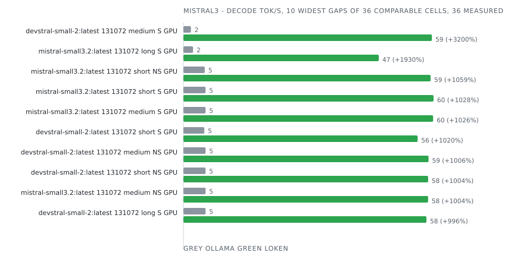

| Model                   | Ctx    | Prompt | Mode       | Device | Engine              | Prefill tok/s | Decode tok/s | Tokens  | E2E ms      | J/req     | J/token    | Δ decode     | Δ energy    | Date             | Run      |
|-------------------------|--------|--------|------------|--------|---------------------|---------------|--------------|---------|-------------|-----------|------------|--------------|-------------|------------------|----------|
| devstral-small-2:latest | 4096   | long   | non-stream | GPU    | Ollama 0.34.2       |  -            | 33.0         | 128     | 6 524       | 764       | 5.968      |              |             | 2026-09-04 00:00 | 0d0dbb98 |
| devstral-small-2:latest | 4096   | long   | non-stream | GPU    | **loken 0.1.0-dev** |  -            | **52.3**     | **128** | **2 661**   | **748**   | **5.842**  | **+58.5%**   | **+2.1%**   | 2026-09-04 00:00 | 0d0dbb98 |
| devstral-small-2:latest | 4096   | long   | stream     | CPU    | Ollama 0.34.2       | 251.3         | 1.6          | 128     | 87 507      | 1 823     | 14.239     |              |             | 2026-09-05 05:42 | 1cd13146 |
| devstral-small-2:latest | 4096   | long   | stream     | CPU    | **loken 0.1.0-dev** | **23.9**      | **1.8**      | **128** | **85 186**  | **1 901** | **14.848** | **+11.2%**   | -4.1%       | 2026-09-05 05:42 | 1cd13146 |
| devstral-small-2:latest | 4096   | long   | stream     | GPU    | Ollama 0.34.2       | 893.5         | 35.6         | 128     | 6 543       | 764       | 5.966      |              |             | 2026-09-03 22:23 | d9c7a586 |
| devstral-small-2:latest | 4096   | long   | stream     | GPU    | **loken 0.1.0-dev** | **997.6**     | **58.0**     | **128** | **2 668**   | **750**   | **5.858**  | **+63.1%**   | **+1.8%**   | 2026-09-03 22:23 | d9c7a586 |
| devstral-small-2:latest | 4096   | medium | non-stream | GPU    | Ollama 0.34.2       |  -            | 32.6         | 128     | 6 531       | 760       | 5.941      |              |             | 2026-09-03 20:44 | 0994a31e |
| devstral-small-2:latest | 4096   | medium | non-stream | GPU    | **loken 0.1.0-dev** |  -            | **58.0**     | **128** | **2 399**   | **692**   | **5.405**  | **+77.7%**   | **+9.9%**   | 2026-09-03 20:44 | 0994a31e |
| devstral-small-2:latest | 4096   | medium | stream     | CPU    | Ollama 0.34.2       | 48.2          | 1.6          | 128     | 85 815      | 1 847     | 14.432     |              |             | 2026-09-05 00:34 | b99427fc |
| devstral-small-2:latest | 4096   | medium | stream     | CPU    | **loken 0.1.0-dev** | **19.1**      | **3.7**      | **128** | **40 048**  | **841**   | **6.572**  | **+132.2%**  | **+119.6%** | 2026-09-05 00:34 | b99427fc |
| devstral-small-2:latest | 4096   | medium | stream     | GPU    | Ollama 0.34.2       | 154.3         | 35.4         | 128     | 6 538       | 765       | 5.974      |              |             | 2026-09-03 19:01 | 49b9aab9 |
| devstral-small-2:latest | 4096   | medium | stream     | GPU    | **loken 0.1.0-dev** | **705.7**     | **59.6**     | **128** | **2 404**   | **695**   | **5.433**  | **+68.6%**   | **+10.0%**  | 2026-09-03 19:01 | 49b9aab9 |
| devstral-small-2:latest | 4096   | short  | non-stream | GPU    | Ollama 0.34.2       |  -            | 33.2         | 128     | 6 497       | 754       | 5.887      |              |             | 2026-09-03 17:22 | 07bf05be |
| devstral-small-2:latest | 4096   | short  | non-stream | GPU    | **loken 0.1.0-dev** |  -            | **59.4**     | **128** | **2 358**   | **682**   | **5.327**  | **+79.1%**   | **+10.5%**  | 2026-09-03 17:22 | 07bf05be |
| devstral-small-2:latest | 4096   | short  | stream     | CPU    | Ollama 0.34.2       | 17.3          | 1.6          | 128     | 83 095      | 1 823     | 14.242     |              |             | 2026-09-04 19:49 | 661903b1 |
| devstral-small-2:latest | 4096   | short  | stream     | CPU    | **loken 0.1.0-dev** | **12.4**      | **1.2**      | **128** | **106 807** | **2 566** | **20.047** | -28.5%       | -29.0%      | 2026-09-04 19:49 | 661903b1 |
| devstral-small-2:latest | 4096   | short  | stream     | GPU    | Ollama 0.35.1       | 326.4         | 36.8         | 128     | 8 446       | 732       | 5.715      |              |             | 2026-10-03 20:07 | 9fe0ead5 |
| devstral-small-2:latest | 4096   | short  | stream     | GPU    | **loken 0.1.0-dev** | **414.5**     | **55.9**     | **128** | **2 437**   | **649**   | **5.073**  | **+52.2%**   | **+12.7%**  | 2026-10-03 20:07 | 9fe0ead5 |
| devstral-small-2:latest | 131072 | long   | non-stream | GPU    | Ollama 0.34.2       |  -            | 5.3          | 128     | 27 979      | 1 887     | 14.738     |              |             | 2026-09-04 15:44 | f5cb975e |
| devstral-small-2:latest | 131072 | long   | non-stream | GPU    | **loken 0.1.0-dev** |  -            | **51.8**     | **128** | **2 668**   | **772**   | **6.030**  | **+885.8%**  | **+144.4%** | 2026-09-04 15:44 | f5cb975e |
| devstral-small-2:latest | 131072 | long   | stream     | CPU    | Ollama 0.34.2       | 260.1         | 1.6          | 128     | 88 854      | 1 820     | 14.218     |              |             | 2026-09-06 02:28 | 94e2454c |
| devstral-small-2:latest | 131072 | long   | stream     | CPU    | **loken 0.1.0-dev** | **24.1**      | **1.8**      | **128** | **84 167**  | **1 882** | **14.702** | **+12.2%**   | -3.3%       | 2026-09-06 02:28 | 94e2454c |
| devstral-small-2:latest | 131072 | long   | stream     | GPU    | Ollama 0.34.2       | 489.3         | 5.3          | 128     | 27 871      | 1 871     | 14.614     |              |             | 2026-09-04 13:42 | 55708309 |
| devstral-small-2:latest | 131072 | long   | stream     | GPU    | **loken 0.1.0-dev** | **1 006.9**   | **58.1**     | **128** | **2 677**   | **768**   | **6.002**  | **+992.9%**  | **+143.5%** | 2026-09-04 13:42 | 55708309 |
| devstral-small-2:latest | 131072 | medium | non-stream | GPU    | Ollama 0.34.2       |  -            | 5.3          | 128     | 27 898      | 1 898     | 14.831     |              |             | 2026-09-04 11:51 | 03c6170d |
| devstral-small-2:latest | 131072 | medium | non-stream | GPU    | **loken 0.1.0-dev** |  -            | **58.6**     | **128** | **2 389**   | **697**   | **5.443**  | **+1014.9%** | **+172.5%** | 2026-09-04 11:51 | 03c6170d |
| devstral-small-2:latest | 131072 | medium | stream     | CPU    | Ollama 0.34.2       | 49.1          | 1.6          | 128     | 85 350      | 1 812     | 14.157     |              |             | 2026-09-05 23:29 | 28673482 |
| devstral-small-2:latest | 131072 | medium | stream     | CPU    | **loken 0.1.0-dev** | **20.9**      | **3.8**      | **128** | **38 308**  | **830**   | **6.487**  | **+131.8%**  | **+118.2%** | 2026-09-05 23:29 | 28673482 |
| devstral-small-2:latest | 131072 | medium | stream     | GPU    | Ollama 0.34.2       | 55.1          | 1.8          | 128     | 66 652      | 4 878     | 38.110     |              |             | 2026-09-04 09:59 | f13f614b |
| devstral-small-2:latest | 131072 | medium | stream     | GPU    | **loken 0.1.0-dev** | **706.5**     | **59.4**     | **128** | **2 431**   | **733**   | **5.725**  | **+3268.9%** | **+565.6%** | 2026-09-04 09:59 | f13f614b |
| devstral-small-2:latest | 131072 | short  | non-stream | GPU    | Ollama 0.34.2       |  -            | 5.3          | 128     | 27 688      | 1 881     | 14.698     |              |             | 2026-09-04 07:57 | c3b092d5 |
| devstral-small-2:latest | 131072 | short  | non-stream | GPU    | **loken 0.1.0-dev** |  -            | **58.5**     | **128** | **2 396**   | **705**   | **5.505**  | **+1010.0%** | **+167.0%** | 2026-09-04 07:57 | c3b092d5 |
| devstral-small-2:latest | 131072 | short  | stream     | CPU    | Ollama 0.34.2       | 16.9          | 1.6          | 128     | 84 405      | 1 821     | 14.224     |              |             | 2026-09-05 20:34 | 00db7c6d |
| devstral-small-2:latest | 131072 | short  | stream     | CPU    | **loken 0.1.0-dev** | **14.0**      | **1.6**      | **128** | **83 896**  | **1 841** | **14.384** | -3.3%        | -1.1%       | 2026-09-05 20:34 | 00db7c6d |
| devstral-small-2:latest | 131072 | short  | stream     | GPU    | Ollama 0.34.2       | 31.4          | 5.0          | 128     | 29 326      | 2 032     | 15.876     |              |             | 2026-09-04 01:59 | dce62ea2 |
| devstral-small-2:latest | 131072 | short  | stream     | GPU    | **loken 0.1.0-dev** | **165.1**     | **56.0**     | **128** | **2 887**   | **754**   | **5.890**  | **+1030.5%** | **+169.5%** | 2026-09-04 01:59 | dce62ea2 |
| mistral-small3.2:latest | 4096   | long   | non-stream | GPU    | Ollama 0.34.2       |  -            | 34.1         | 128     | 6 402       | 782       | 6.113      |              |             | 2026-09-04 00:44 | 702ef99e |
| mistral-small3.2:latest | 4096   | long   | non-stream | GPU    | **loken 0.1.0-dev** |  -            | **52.9**     | **128** | **2 626**   | **758**   | **5.925**  | **+55.2%**   | **+3.2%**   | 2026-09-04 00:44 | 702ef99e |
| mistral-small3.2:latest | 4096   | long   | stream     | CPU    | Ollama 0.34.2       | 257.8         | 1.6          | 128     | 88 700      | 1 876     | 14.654     |              |             | 2026-09-05 07:06 | c75cece7 |
| mistral-small3.2:latest | 4096   | long   | stream     | CPU    | **loken 0.1.0-dev** | **25.3**      | **1.7**      | **128** | **84 949**  | **1 927** | **15.051** | **+9.1%**    | -2.6%       | 2026-09-05 07:06 | c75cece7 |
| mistral-small3.2:latest | 4096   | long   | stream     | GPU    | Ollama 0.34.2       | 894.1         | 36.5         | 128     | 6 425       | 769       | 6.005      |              |             | 2026-09-03 23:07 | 3aae5144 |
| mistral-small3.2:latest | 4096   | long   | stream     | GPU    | **loken 0.1.0-dev** | **1 024.1**   | **58.2**     | **128** | **2 635**   | **754**   | **5.888**  | **+59.6%**   | **+2.0%**   | 2026-09-03 23:07 | 3aae5144 |
| mistral-small3.2:latest | 4096   | medium | non-stream | GPU    | Ollama 0.34.2       |  -            | 33.8         | 128     | 6 388       | 773       | 6.040      |              |             | 2026-09-03 21:29 | 2248984f |
| mistral-small3.2:latest | 4096   | medium | non-stream | GPU    | **loken 0.1.0-dev** |  -            | **58.1**     | **128** | **2 401**   | **719**   | **5.614**  | **+72.0%**   | **+7.6%**   | 2026-09-03 21:29 | 2248984f |
| mistral-small3.2:latest | 4096   | medium | stream     | CPU    | Ollama 0.34.2       | 48.2          | 1.6          | 128     | 84 212      | 1 847     | 14.431     |              |             | 2026-09-05 02:07 | bfaa5840 |
| mistral-small3.2:latest | 4096   | medium | stream     | CPU    | **loken 0.1.0-dev** | **18.8**      | **1.6**      | **128** | **85 787**  | **1 943** | **15.180** | -3.0%        | -4.9%       | 2026-09-05 02:07 | bfaa5840 |
| mistral-small3.2:latest | 4096   | medium | stream     | GPU    | Ollama 0.34.2       | 154.5         | 36.3         | 128     | 6 387       | 771       | 6.027      |              |             | 2026-09-03 19:45 | 2dddf6a4 |
| mistral-small3.2:latest | 4096   | medium | stream     | GPU    | **loken 0.1.0-dev** | **676.8**     | **59.7**     | **128** | **2 475**   | **714**   | **5.578**  | **+64.6%**   | **+8.1%**   | 2026-09-03 19:45 | 2dddf6a4 |
| mistral-small3.2:latest | 4096   | short  | non-stream | GPU    | Ollama 0.34.2       |  -            | 33.4         | 128     | 6 409       | 773       | 6.039      |              |             | 2026-09-03 18:07 | c6ae2ff4 |
| mistral-small3.2:latest | 4096   | short  | non-stream | GPU    | **loken 0.1.0-dev** |  -            | **58.2**     | **128** | **2 392**   | **705**   | **5.504**  | **+74.1%**   | **+9.7%**   | 2026-09-03 18:07 | c6ae2ff4 |
| mistral-small3.2:latest | 4096   | short  | stream     | CPU    | Ollama 0.34.2       | 17.7          | 1.6          | 128     | 83 788      | 1 859     | 14.526     |              |             | 2026-09-04 21:33 | f9af4cbb |
| mistral-small3.2:latest | 4096   | short  | stream     | CPU    | **loken 0.1.0-dev** | **12.7**      | **1.5**      | **128** | **86 025**  | **1 952** | **15.254** | -4.3%        | -4.8%       | 2026-09-04 21:33 | f9af4cbb |
| mistral-small3.2:latest | 4096   | short  | stream     | GPU    | Ollama 0.35.1       | 175.8         | 37.8         | 128     | 6 085       | 715       | 5.582      |              |             | 2026-10-03 20:46 | 2f95badd |
| mistral-small3.2:latest | 4096   | short  | stream     | GPU    | **loken 0.1.0-dev** | **499.8**     | **52.9**     | **128** | **2 541**   | **659**   | **5.149**  | **+40.1%**   | **+8.4%**   | 2026-10-03 20:46 | 2f95badd |
| mistral-small3.2:latest | 131072 | long   | non-stream | GPU    | Ollama 0.34.2       |  -            | 5.2          | 128     | 28 368      | 1 911     | 14.933     |              |             | 2026-09-04 16:30 | b3fec40f |
| mistral-small3.2:latest | 131072 | long   | non-stream | GPU    | **loken 0.1.0-dev** |  -            | **52.8**     | **128** | **2 624**   | **765**   | **5.976**  | **+909.0%**  | **+149.9%** | 2026-09-04 16:30 | b3fec40f |
| mistral-small3.2:latest | 131072 | long   | stream     | CPU    | Ollama 0.34.2       | 262.6         | 1.6          | 128     | 89 336      | 1 845     | 14.413     |              |             | 2026-09-06 03:56 | c7c429e9 |
| mistral-small3.2:latest | 131072 | long   | stream     | CPU    | **loken 0.1.0-dev** | **25.5**      | **1.7**      | **128** | **85 042**  | **1 908** | **14.909** | **+7.8%**    | -3.3%       | 2026-09-06 03:56 | c7c429e9 |
| mistral-small3.2:latest | 131072 | long   | stream     | GPU    | Ollama 0.34.2       | 390.6         | 2.3          | 128     | 57 532      | 3 850     | 30.077     |              |             | 2026-09-04 14:30 | 5c826ebe |
| mistral-small3.2:latest | 131072 | long   | stream     | GPU    | **loken 0.1.0-dev** | **674.5**     | **46.7**     | **128** | **3 716**   | **826**   | **6.450**  | **+1931.1%** | **+366.3%** | 2026-09-04 14:30 | 5c826ebe |
| mistral-small3.2:latest | 131072 | medium | non-stream | GPU    | Ollama 0.34.2       |  -            | 5.3          | 128     | 27 935      | 1 901     | 14.850     |              |             | 2026-09-04 12:38 | 4f141e18 |
| mistral-small3.2:latest | 131072 | medium | non-stream | GPU    | **loken 0.1.0-dev** |  -            | **58.5**     | **128** | **2 396**   | **713**   | **5.570**  | **+1000.7%** | **+166.6%** | 2026-09-04 12:38 | 4f141e18 |
| mistral-small3.2:latest | 131072 | medium | stream     | CPU    | Ollama 0.34.2       | 48.1          | 1.6          | 128     | 85 827      | 1 825     | 14.255     |              |             | 2026-09-06 01:04 | a29328f7 |
| mistral-small3.2:latest | 131072 | medium | stream     | CPU    | **loken 0.1.0-dev** | **19.7**      | **1.6**      | **128** | **85 781**  | **1 925** | **15.039** | -3.6%        | -5.2%       | 2026-09-06 01:04 | a29328f7 |
| mistral-small3.2:latest | 131072 | medium | stream     | GPU    | Ollama 0.34.2       | 89.2          | 5.3          | 128     | 28 342      | 1 914     | 14.951     |              |             | 2026-09-04 10:47 | 3ed6ac1c |
| mistral-small3.2:latest | 131072 | medium | stream     | GPU    | **loken 0.1.0-dev** | **653.9**     | **59.7**     | **128** | **2 440**   | **717**   | **5.598**  | **+1021.5%** | **+167.1%** | 2026-09-04 10:47 | 3ed6ac1c |
| mistral-small3.2:latest | 131072 | short  | non-stream | GPU    | Ollama 0.34.2       |  -            | 5.1          | 128     | 37 114      | 1 988     | 15.531     |              |             | 2026-09-04 08:45 | 948e132d |
| mistral-small3.2:latest | 131072 | short  | non-stream | GPU    | **loken 0.1.0-dev** |  -            | **59.1**     | **128** | **2 741**   | **714**   | **5.578**  | **+1054.2%** | **+178.4%** | 2026-09-04 08:45 | 948e132d |
| mistral-small3.2:latest | 131072 | short  | stream     | CPU    | Ollama 0.34.2       | 17.3          | 1.6          | 128     | 85 158      | 1 836     | 14.342     |              |             | 2026-09-05 22:11 | bc74d707 |
| mistral-small3.2:latest | 131072 | short  | stream     | CPU    | **loken 0.1.0-dev** | **14.3**      | **1.6**      | **128** | **85 781**  | **1 916** | **14.971** | -4.8%        | -4.2%       | 2026-09-05 22:11 | bc74d707 |
| mistral-small3.2:latest | 131072 | short  | stream     | GPU    | Ollama 0.34.2       | 32.0          | 5.3          | 128     | 28 089      | 1 934     | 15.111     |              |             | 2026-09-04 02:50 | 978be50a |
| mistral-small3.2:latest | 131072 | short  | stream     | GPU    | **loken 0.1.0-dev** | **314.8**     | **59.8**     | **128** | **2 409**   | **700**   | **5.467**  | **+1020.4%** | **+176.4%** | 2026-09-04 02:50 | 978be50a |

### nemotron_h_moe

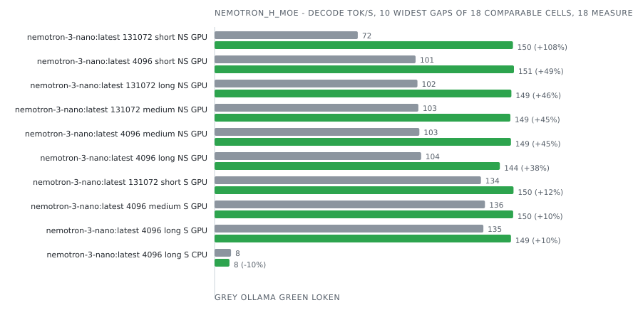

| Model                  | Ctx    | Prompt | Mode       | Device | Engine              | Prefill tok/s | Decode tok/s | Tokens  | E2E ms     | J/req   | J/token   | Δ decode    | Δ energy   | Date             | Run      |
|------------------------|--------|--------|------------|--------|---------------------|---------------|--------------|---------|------------|---------|-----------|-------------|------------|------------------|----------|
| nemotron-3-nano:latest | 4096   | long   | non-stream | GPU    | Ollama 0.34.2       |  -            | 104.0        | 128     | 4 731      | 187     | 1.460     |             |            | 2026-09-04 00:48 | bf709940 |
| nemotron-3-nano:latest | 4096   | long   | non-stream | GPU    | **loken 0.1.0-dev** |  -            | **143.6**    | **128** | **1 306**  | **169** | **1.317** | **+38.1%**  | **+10.9%** | 2026-09-04 00:48 | bf709940 |
| nemotron-3-nano:latest | 4096   | long   | stream     | CPU    | Ollama 0.34.2       | 431.9         | 8.3          | 128     | 20 361     | 373     | 2.914     |             |            | 2026-09-05 07:14 | d2a1e2c1 |
| nemotron-3-nano:latest | 4096   | long   | stream     | CPU    | **loken 0.1.0-dev** | **3 986.6**   | **7.5**      | **128** | **21 388** | **407** | **3.180** | -9.7%       | -8.4%      | 2026-09-05 07:14 | d2a1e2c1 |
| nemotron-3-nano:latest | 4096   | long   | stream     | GPU    | Ollama 0.34.2       | 845.8         | 135.3        | 128     | 4 698      | 186     | 1.453     |             |            | 2026-09-03 23:10 | 770f73a4 |
| nemotron-3-nano:latest | 4096   | long   | stream     | GPU    | **loken 0.1.0-dev** | **15 315.6**  | **149.2**    | **128** | **1 330**  | **167** | **1.305** | **+10.2%**  | **+11.4%** | 2026-09-03 23:10 | 770f73a4 |
| nemotron-3-nano:latest | 4096   | medium | non-stream | GPU    | Ollama 0.34.2       |  -            | 103.1        | 128     | 4 660      | 177     | 1.380     |             |            | 2026-09-03 21:32 | 2bb4e574 |
| nemotron-3-nano:latest | 4096   | medium | non-stream | GPU    | **loken 0.1.0-dev** |  -            | **149.2**    | **128** | **1 205**  | **164** | **1.280** | **+44.8%**  | **+7.8%**  | 2026-09-03 21:32 | 2bb4e574 |
| nemotron-3-nano:latest | 4096   | medium | stream     | CPU    | Ollama 0.34.2       | 81.3          | 8.3          | 128     | 19 502     | 375     | 2.928     |             |            | 2026-09-05 02:16 | d34d1007 |
| nemotron-3-nano:latest | 4096   | medium | stream     | CPU    | **loken 0.1.0-dev** | **678.5**     | **7.7**      | **128** | **17 467** | **391** | **3.057** | -6.5%       | -4.2%      | 2026-09-05 02:16 | d34d1007 |
| nemotron-3-nano:latest | 4096   | medium | stream     | GPU    | Ollama 0.34.2       | 137.6         | 136.1        | 128     | 4 633      | 177     | 1.382     |             |            | 2026-09-03 19:49 | c723338b |
| nemotron-3-nano:latest | 4096   | medium | stream     | GPU    | **loken 0.1.0-dev** | **2 098.0**   | **150.3**    | **128** | **1 203**  | **168** | **1.314** | **+10.4%**  | **+5.2%**  | 2026-09-03 19:49 | c723338b |
| nemotron-3-nano:latest | 4096   | short  | non-stream | GPU    | Ollama 0.34.2       |  -            | 101.2        | 128     | 4 640      | 183     | 1.426     |             |            | 2026-09-03 18:10 | e80c49a3 |
| nemotron-3-nano:latest | 4096   | short  | non-stream | GPU    | **loken 0.1.0-dev** |  -            | **150.7**    | **128** | **1 164**  | **161** | **1.261** | **+48.9%**  | **+13.0%** | 2026-09-03 18:10 | e80c49a3 |
| nemotron-3-nano:latest | 4096   | short  | stream     | CPU    | Ollama 0.34.2       | 28.1          | 8.3          | 127     | 19 139     | 369     | 2.903     |             |            | 2026-09-04 21:42 | 5e3f5dac |
| nemotron-3-nano:latest | 4096   | short  | stream     | CPU    | **loken 0.1.0-dev** | **203.4**     | **7.8**      | **128** | **16 936** | **390** | **3.047** | -6.4%       | -5.4%      | 2026-09-04 21:42 | 5e3f5dac |
| nemotron-3-nano:latest | 4096   | short  | stream     | GPU    | Ollama 0.35.1       | 161.5         | 156.1        | 128     | 6 450      | 159     | 1.243     |             |            | 2026-10-05 20:35 | 1e040914 |
| nemotron-3-nano:latest | 4096   | short  | stream     | GPU    | **loken 0.2.0-dev** | **1 562.0**   | **153.3**    | **128** | **995**    | **151** | **1.176** | -1.8%       | **+5.7%**  | 2026-10-05 20:35 | 1e040914 |
| nemotron-3-nano:latest | 131072 | long   | non-stream | GPU    | Ollama 0.34.2       |  -            | 102.1        | 128     | 4 803      | 178     | 1.390     |             |            | 2026-09-04 16:33 | ecaf4123 |
| nemotron-3-nano:latest | 131072 | long   | non-stream | GPU    | **loken 0.1.0-dev** |  -            | **149.4**    | **128** | **1 320**  | **166** | **1.296** | **+46.3%**  | **+7.3%**  | 2026-09-04 16:33 | ecaf4123 |
| nemotron-3-nano:latest | 131072 | long   | stream     | CPU    | Ollama 0.34.2       | 434.1         | 8.3          | 128     | 19 892     | 371     | 2.902     |             |            | 2026-09-06 04:05 | 8fd2b089 |
| nemotron-3-nano:latest | 131072 | long   | stream     | CPU    | **loken 0.1.0-dev** | **8 220.0**   | **7.6**      | **128** | **21 177** | **401** | **3.131** | -9.2%       | -7.3%      | 2026-09-06 04:05 | 8fd2b089 |
| nemotron-3-nano:latest | 131072 | long   | stream     | GPU    | Ollama 0.34.2       | 887.9         | 127.1        | 128     | 6 677      | 193     | 1.507     |             |            | 2026-09-04 14:33 | 8ae1a08d |
| nemotron-3-nano:latest | 131072 | long   | stream     | GPU    | **loken 0.1.0-dev** | **5 458.4**   | **135.1**    | **128** | **1 525**  | **185** | **1.446** | **+6.3%**   | **+4.2%**  | 2026-09-04 14:33 | 8ae1a08d |
| nemotron-3-nano:latest | 131072 | medium | non-stream | GPU    | Ollama 0.34.2       |  -            | 102.6        | 128     | 4 740      | 179     | 1.401     |             |            | 2026-09-04 12:41 | 49312a68 |
| nemotron-3-nano:latest | 131072 | medium | non-stream | GPU    | **loken 0.1.0-dev** |  -            | **148.9**    | **128** | **1 180**  | **160** | **1.249** | **+45.1%**  | **+12.2%** | 2026-09-04 12:41 | 49312a68 |
| nemotron-3-nano:latest | 131072 | medium | stream     | CPU    | Ollama 0.34.2       | 85.1          | 8.3          | 128     | 18 962     | 372     | 2.908     |             |            | 2026-09-06 01:13 | 1638a514 |
| nemotron-3-nano:latest | 131072 | medium | stream     | CPU    | **loken 0.1.0-dev** | **629.5**     | **7.8**      | **128** | **17 248** | **387** | **3.021** | -6.4%       | -3.7%      | 2026-09-06 01:13 | 1638a514 |
| nemotron-3-nano:latest | 131072 | medium | stream     | GPU    | Ollama 0.34.2       | 114.9         | 136.4        | 128     | 4 769      | 191     | 1.489     |             |            | 2026-09-04 10:51 | 51522ba1 |
| nemotron-3-nano:latest | 131072 | medium | stream     | GPU    | **loken 0.1.0-dev** | **983.6**     | **149.4**    | **128** | **1 219**  | **164** | **1.285** | **+9.6%**   | **+15.9%** | 2026-09-04 10:51 | 51522ba1 |
| nemotron-3-nano:latest | 131072 | short  | non-stream | GPU    | Ollama 0.34.2       |  -            | 72.1         | 128     | 7 841      | 217     | 1.697     |             |            | 2026-09-04 08:50 | d94aae4a |
| nemotron-3-nano:latest | 131072 | short  | non-stream | GPU    | **loken 0.1.0-dev** |  -            | **150.2**    | **128** | **1 236**  | **159** | **1.239** | **+108.3%** | **+36.9%** | 2026-09-04 08:50 | d94aae4a |
| nemotron-3-nano:latest | 131072 | short  | stream     | CPU    | Ollama 0.34.2       | 26.8          | 8.4          | 127     | 18 604     | 371     | 2.925     |             |            | 2026-09-05 22:19 | b1f5df00 |
| nemotron-3-nano:latest | 131072 | short  | stream     | CPU    | **loken 0.1.0-dev** | **204.9**     | **7.9**      | **128** | **16 693** | **387** | **3.024** | -6.0%       | -4.0%      | 2026-09-05 22:19 | b1f5df00 |
| nemotron-3-nano:latest | 131072 | short  | stream     | GPU    | Ollama 0.34.2       | 47.4          | 134.1        | 128     | 4 733      | 174     | 1.361     |             |            | 2026-09-04 02:53 | 26f816c3 |
| nemotron-3-nano:latest | 131072 | short  | stream     | GPU    | **loken 0.1.0-dev** | **902.0**     | **150.5**    | **128** | **1 226**  | **163** | **1.274** | **+12.3%**  | **+6.8%**  | 2026-09-04 02:53 | 26f816c3 |

### olmo2

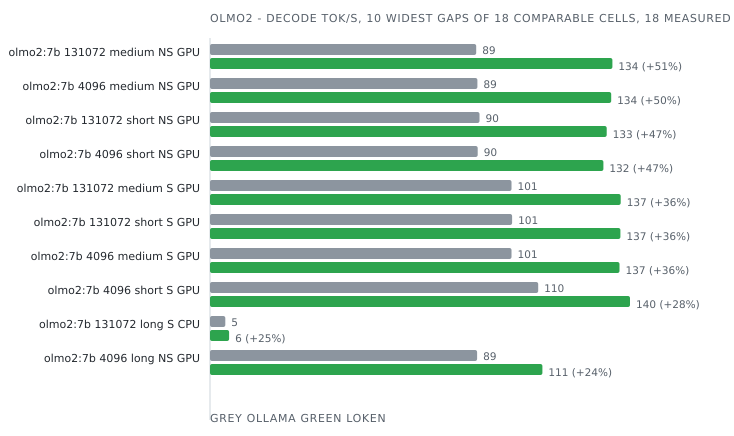

| Model    | Ctx    | Prompt | Mode       | Device | Engine              | Prefill tok/s | Decode tok/s | Tokens  | E2E ms     | J/req   | J/token   | Δ decode   | Δ energy   | Date             | Run      |
|----------|--------|--------|------------|--------|---------------------|---------------|--------------|---------|------------|---------|-----------|------------|------------|------------------|----------|
| olmo2:7b | 4096   | long   | non-stream | GPU    | Ollama 0.34.2       |  -            | 89.3         | 128     | 1 460      | 268     | 2.095     |            |            | 2026-09-04 00:49 | 7099eab7 |
| olmo2:7b | 4096   | long   | non-stream | GPU    | **loken 0.1.0-dev** |  -            | **111.1**    | **128** | **1 209**  | **273** | **2.130** | **+24.4%** | -1.6%      | 2026-09-04 00:49 | 7099eab7 |
| olmo2:7b | 4096   | long   | stream     | CPU    | Ollama 0.34.2       | 589.4         | 5.1          | 128     | 28 152     | 603     | 4.710     |            |            | 2026-09-05 07:17 | 4cc6b8cc |
| olmo2:7b | 4096   | long   | stream     | CPU    | **loken 0.1.0-dev** | **71.5**      | **6.3**      | **128** | **24 358** | **558** | **4.360** | **+23.9%** | **+8.0%**  | 2026-09-05 07:17 | 4cc6b8cc |
| olmo2:7b | 4096   | long   | stream     | GPU    | Ollama 0.34.2       | 1 764.8       | 98.4         | 128     | 1 474      | 272     | 2.127     |            |            | 2026-09-03 23:11 | f26791c9 |
| olmo2:7b | 4096   | long   | stream     | GPU    | **loken 0.1.0-dev** | **3 703.3**   | **116.5**    | **128** | **1 199**  | **272** | **2.122** | **+18.4%** | **+0.2%**  | 2026-09-03 23:11 | f26791c9 |
| olmo2:7b | 4096   | medium | non-stream | GPU    | Ollama 0.34.2       |  -            | 89.4         | 128     | 1 456      | 265     | 2.071     |            |            | 2026-09-03 21:33 | b631780c |
| olmo2:7b | 4096   | medium | non-stream | GPU    | **loken 0.1.0-dev** |  -            | **134.1**    | **128** | **993**    | **228** | **1.777** | **+49.9%** | **+16.5%** | 2026-09-03 21:33 | b631780c |
| olmo2:7b | 4096   | medium | stream     | CPU    | Ollama 0.34.2       | 106.1         | 5.2          | 128     | 26 505     | 584     | 4.559     |            |            | 2026-09-05 02:19 | f2749ac3 |
| olmo2:7b | 4096   | medium | stream     | CPU    | **loken 0.1.0-dev** | **52.8**      | **4.7**      | **128** | **28 757** | **659** | **5.146** | -10.3%     | -11.4%     | 2026-09-05 02:19 | f2749ac3 |
| olmo2:7b | 4096   | medium | stream     | GPU    | Ollama 0.34.2       | 240.6         | 100.8        | 128     | 1 454      | 272     | 2.124     |            |            | 2026-09-03 19:50 | 2c3ffbd1 |
| olmo2:7b | 4096   | medium | stream     | GPU    | **loken 0.1.0-dev** | **1 394.3**   | **136.9**    | **128** | **1 016**  | **229** | **1.788** | **+35.8%** | **+18.8%** | 2026-09-03 19:50 | 2c3ffbd1 |
| olmo2:7b | 4096   | short  | non-stream | GPU    | Ollama 0.34.2       |  -            | 89.5         | 128     | 1 439      | 265     | 2.071     |            |            | 2026-09-03 18:11 | b72f8568 |
| olmo2:7b | 4096   | short  | non-stream | GPU    | **loken 0.1.0-dev** |  -            | **131.5**    | **128** | **1 025**  | **237** | **1.853** | **+47.0%** | **+11.8%** | 2026-09-03 18:11 | b72f8568 |
| olmo2:7b | 4096   | short  | stream     | CPU    | Ollama 0.34.2       | 37.8          | 5.2          | 128     | 26 280     | 580     | 4.532     |            |            | 2026-09-04 21:45 | c698b1ae |
| olmo2:7b | 4096   | short  | stream     | CPU    | **loken 0.1.0-dev** | **28.7**      | **4.7**      | **128** | **28 091** | **641** | **5.007** | -9.6%      | -9.5%      | 2026-09-04 21:45 | c698b1ae |
| olmo2:7b | 4096   | short  | stream     | GPU    | Ollama 0.35.1       | 236.5         | 109.7        | 128     | 1 215      | 244     | 1.908     |            |            | 2026-10-03 20:57 | 8f3a7de7 |
| olmo2:7b | 4096   | short  | stream     | GPU    | **loken 0.1.0-dev** | **1 182.6**   | **140.4**    | **128** | **984**    | **229** | **1.791** | **+28.0%** | **+6.5%**  | 2026-10-03 20:57 | 8f3a7de7 |
| olmo2:7b | 131072 | long   | non-stream | GPU    | Ollama 0.34.2       |  -            | 89.9         | 128     | 1 459      | 269     | 2.102     |            |            | 2026-09-04 16:34 | 0f09d45a |
| olmo2:7b | 131072 | long   | non-stream | GPU    | **loken 0.1.0-dev** |  -            | **111.6**    | **128** | **1 199**  | **269** | **2.099** | **+24.1%** | **+0.1%**  | 2026-09-04 16:34 | 0f09d45a |
| olmo2:7b | 131072 | long   | stream     | CPU    | Ollama 0.34.2       | 569.4         | 5.1          | 128     | 28 134     | 602     | 4.707     |            |            | 2026-09-06 04:08 | de73cede |
| olmo2:7b | 131072 | long   | stream     | CPU    | **loken 0.1.0-dev** | **66.4**      | **6.4**      | **128** | **24 021** | **545** | **4.258** | **+27.1%** | **+10.5%** | 2026-09-06 04:08 | de73cede |
| olmo2:7b | 131072 | long   | stream     | GPU    | Ollama 0.34.2       | 1 544.3       | 97.7         | 128     | 1 473      | 269     | 2.101     |            |            | 2026-09-04 14:35 | 093186cd |
| olmo2:7b | 131072 | long   | stream     | GPU    | **loken 0.1.0-dev** | **3 462.8**   | **116.3**    | **128** | **1 198**  | **277** | **2.164** | **+19.0%** | -2.9%      | 2026-09-04 14:35 | 093186cd |
| olmo2:7b | 131072 | medium | non-stream | GPU    | Ollama 0.34.2       |  -            | 89.0         | 128     | 1 454      | 267     | 2.086     |            |            | 2026-09-04 12:42 | a00ce28c |
| olmo2:7b | 131072 | medium | non-stream | GPU    | **loken 0.1.0-dev** |  -            | **134.5**    | **128** | **986**    | **228** | **1.781** | **+51.1%** | **+17.1%** | 2026-09-04 12:42 | a00ce28c |
| olmo2:7b | 131072 | medium | stream     | CPU    | Ollama 0.34.2       | 106.2         | 5.2          | 128     | 26 399     | 579     | 4.525     |            |            | 2026-09-06 01:16 | ead6a78f |
| olmo2:7b | 131072 | medium | stream     | CPU    | **loken 0.1.0-dev** | **42.5**      | **4.8**      | **128** | **28 419** | **648** | **5.061** | -8.8%      | -10.6%     | 2026-09-06 01:16 | ead6a78f |
| olmo2:7b | 131072 | medium | stream     | GPU    | Ollama 0.34.2       | 221.0         | 100.8        | 128     | 1 457      | 268     | 2.096     |            |            | 2026-09-04 10:52 | a32adf4e |
| olmo2:7b | 131072 | medium | stream     | GPU    | **loken 0.1.0-dev** | **1 375.5**   | **137.3**    | **128** | **1 001**  | **228** | **1.778** | **+36.2%** | **+17.9%** | 2026-09-04 10:52 | a32adf4e |
| olmo2:7b | 131072 | short  | non-stream | GPU    | Ollama 0.34.2       |  -            | 90.1         | 128     | 1 443      | 264     | 2.060     |            |            | 2026-09-04 08:51 | 20f5a7da |
| olmo2:7b | 131072 | short  | non-stream | GPU    | **loken 0.1.0-dev** |  -            | **132.6**    | **128** | **1 005**  | **240** | **1.876** | **+47.2%** | **+9.8%**  | 2026-09-04 08:51 | 20f5a7da |
| olmo2:7b | 131072 | short  | stream     | CPU    | Ollama 0.34.2       | 36.4          | 5.3          | 128     | 26 219     | 572     | 4.469     |            |            | 2026-09-05 22:22 | f865e2ff |
| olmo2:7b | 131072 | short  | stream     | CPU    | **loken 0.1.0-dev** | **21.5**      | **4.8**      | **128** | **27 913** | **636** | **4.968** | -8.4%      | -10.1%     | 2026-09-05 22:22 | f865e2ff |
| olmo2:7b | 131072 | short  | stream     | GPU    | Ollama 0.34.2       | 89.2          | 101.0        | 128     | 1 434      | 261     | 2.041     |            |            | 2026-09-04 02:54 | 8d5f9d61 |
| olmo2:7b | 131072 | short  | stream     | GPU    | **loken 0.1.0-dev** | **621.8**     | **137.2**    | **128** | **1 006**  | **229** | **1.787** | **+35.8%** | **+14.2%** | 2026-09-04 02:54 | 8d5f9d61 |

### olmoe

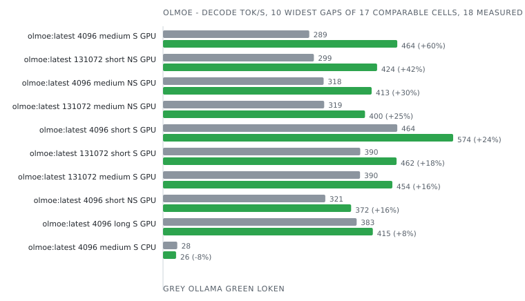

| Model        | Ctx    | Prompt | Mode       | Device | Engine              | Prefill tok/s | Decode tok/s | Tokens  | E2E ms    | J/req   | J/token   | Δ decode   | Δ energy   | Date             | Run      |
|--------------|--------|--------|------------|--------|---------------------|---------------|--------------|---------|-----------|---------|-----------|------------|------------|------------------|----------|
| olmoe:latest | 4096   | long   | non-stream | GPU    | Ollama 0.34.2       |  -            | 321.9        | 128     | 435       | 69      | 0.540     |            |            | 2026-09-04 00:50 | 69c748ac |
| olmoe:latest | 4096   | long   | non-stream | GPU    | **loken 0.1.0-dev** |  -            | **335.1**    | **128** | **438**   | **83**  | **0.647** | **+4.1%**  | -16.6%     | 2026-09-04 00:50 | 69c748ac |
| olmoe:latest | 4096   | long   | stream     | CPU    | Ollama 0.34.2       | 1 390.4       | 27.0         | 128     | 6 642     | 117     | 0.916     |            |            | 2026-09-05 07:20 | eb2b4177 |
| olmoe:latest | 4096   | long   | stream     | CPU    | **loken 0.1.0-dev** | **203.3**     | **24.9**     | **128** | **6 684** | **152** | **1.187** | -7.7%      | -22.9%     | 2026-09-05 07:20 | eb2b4177 |
| olmoe:latest | 4096   | long   | stream     | GPU    | Ollama 0.34.2       | 4 187.7       | 383.2        | 128     | 438       | 66      | 0.513     |            |            | 2026-09-03 23:12 | af9583f3 |
| olmoe:latest | 4096   | long   | stream     | GPU    | **loken 0.1.0-dev** | **2 818.2**   | **415.2**    | **128** | **442**   | **84**  | **0.658** | **+8.4%**  | -22.1%     | 2026-09-03 23:12 | af9583f3 |
| olmoe:latest | 4096   | medium | non-stream | GPU    | Ollama 0.34.2       |  -            | 317.8        | 128     | 434       | 66      | 0.519     |            |            | 2026-09-03 21:34 | e5c5c007 |
| olmoe:latest | 4096   | medium | non-stream | GPU    | **loken 0.1.0-dev** |  -            | **412.9**    | **122** | **354**   | **44**  | **0.363** |            |            | 2026-09-03 21:34 | e5c5c007 |
| olmoe:latest | 4096   | medium | stream     | CPU    | Ollama 0.34.2       | 266.4         | 28.2         | 128     | 6 171     | 113     | 0.880     |            |            | 2026-09-05 02:22 | 05755157 |
| olmoe:latest | 4096   | medium | stream     | CPU    | **loken 0.1.0-dev** | **110.9**     | **25.9**     | **118** | **5 068** | **166** | **1.410** |            |            | 2026-09-05 02:22 | 05755157 |
| olmoe:latest | 4096   | medium | stream     | GPU    | Ollama 0.34.2       | 231.0         | 289.4        | 128     | 681       | 72      | 0.560     |            |            | 2026-09-03 19:51 | ecab534a |
| olmoe:latest | 4096   | medium | stream     | GPU    | **loken 0.1.0-dev** | **1 941.9**   | **463.6**    | **128** | **343**   | **43**  | **0.338** | **+60.2%** | **+65.4%** | 2026-09-03 19:51 | ecab534a |
| olmoe:latest | 4096   | short  | non-stream | GPU    | Ollama 0.34.2       |  -            | 321.2        | 128     | 420       | 62      | 0.488     |            |            | 2026-09-03 18:12 | 22be3fbf |
| olmoe:latest | 4096   | short  | non-stream | GPU    | **loken 0.1.0-dev** |  -            | **372.3**    | **128** | **367**   | **54**  | **0.420** | **+15.9%** | **+16.2%** | 2026-09-03 18:12 | 22be3fbf |
| olmoe:latest | 4096   | short  | stream     | CPU    | Ollama 0.34.2       | 75.5          | 28.4         | 128     | 6 075     | 113     | 0.879     |            |            | 2026-09-04 21:48 | abddfe68 |
| olmoe:latest | 4096   | short  | stream     | CPU    | **loken 0.1.0-dev** | **44.4**      | **26.4**     | **128** | **5 474** | **175** | **1.370** | -6.9%      | -35.8%     | 2026-09-04 21:48 | abddfe68 |
| olmoe:latest | 4096   | short  | stream     | GPU    | Ollama 0.35.1       | 764.6         | 463.6        | 128     | 313       | 54      | 0.421     |            |            | 2026-10-03 20:58 | 924a8ab4 |
| olmoe:latest | 4096   | short  | stream     | GPU    | **loken 0.1.0-dev** | **1 827.4**   | **574.2**    | **128** | **272**   | **54**  | **0.422** | **+23.9%** | -0.1%      | 2026-10-03 20:58 | 924a8ab4 |
| olmoe:latest | 131072 | long   | non-stream | GPU    | Ollama 0.34.2       |  -            | 321.5        | 128     | 449       | 64      | 0.503     |            |            | 2026-09-04 16:35 | e23149c0 |
| olmoe:latest | 131072 | long   | non-stream | GPU    | **loken 0.1.0-dev** |  -            | **332.0**    | **128** | **422**   | **78**  | **0.608** | **+3.3%**  | -17.3%     | 2026-09-04 16:35 | e23149c0 |
| olmoe:latest | 131072 | long   | stream     | CPU    | Ollama 0.34.2       | 1 576.7       | 27.0         | 128     | 6 565     | 117     | 0.918     |            |            | 2026-09-06 04:11 | 84fbc210 |
| olmoe:latest | 131072 | long   | stream     | CPU    | **loken 0.1.0-dev** | **202.1**     | **24.9**     | **128** | **6 502** | **216** | **1.685** | -7.8%      | -45.5%     | 2026-09-06 04:11 | 84fbc210 |
| olmoe:latest | 131072 | long   | stream     | GPU    | **loken 0.1.0-dev** | **2 700.8**   | **413.8**    | **128** | **455**   | **76**  | **0.590** |            |            | 2026-09-04 14:35 | 772ca596 |
| olmoe:latest | 131072 | medium | non-stream | GPU    | Ollama 0.34.2       |  -            | 319.0        | 128     | 432       | 64      | 0.502     |            |            | 2026-09-04 12:43 | c225b25f |
| olmoe:latest | 131072 | medium | non-stream | GPU    | **loken 0.1.0-dev** |  -            | **399.7**    | **122** | **364**   | **49**  | **0.403** |            |            | 2026-09-04 12:43 | c225b25f |
| olmoe:latest | 131072 | medium | stream     | CPU    | Ollama 0.34.2       | 239.1         | 28.3         | 128     | 6 121     | 113     | 0.880     |            |            | 2026-09-06 01:19 | 76bd848c |
| olmoe:latest | 131072 | medium | stream     | CPU    | **loken 0.1.0-dev** | **128.3**     | **26.0**     | **118** | **5 032** | **116** | **0.986** |            |            | 2026-09-06 01:19 | 76bd848c |
| olmoe:latest | 131072 | medium | stream     | GPU    | Ollama 0.34.2       | 577.2         | 389.9        | 128     | 440       | 68      | 0.533     |            |            | 2026-09-04 10:53 | 224b4942 |
| olmoe:latest | 131072 | medium | stream     | GPU    | **loken 0.1.0-dev** | **1 042.9**   | **453.9**    | **128** | **367**   | **59**  | **0.462** | **+16.4%** | **+15.4%** | 2026-09-04 10:53 | 224b4942 |
| olmoe:latest | 131072 | short  | non-stream | GPU    | Ollama 0.34.2       |  -            | 298.6        | 128     | 428       | 70      | 0.544     |            |            | 2026-09-04 08:52 | e381010d |
| olmoe:latest | 131072 | short  | non-stream | GPU    | **loken 0.1.0-dev** |  -            | **423.7**    | **128** | **337**   | **50**  | **0.390** | **+41.9%** | **+39.6%** | 2026-09-04 08:52 | e381010d |
| olmoe:latest | 131072 | short  | stream     | CPU    | Ollama 0.34.2       | 81.9          | 28.5         | 128     | 6 072     | 110     | 0.860     |            |            | 2026-09-05 22:25 | 43ee3889 |
| olmoe:latest | 131072 | short  | stream     | CPU    | **loken 0.1.0-dev** | **43.0**      | **26.5**     | **128** | **5 444** | **177** | **1.381** | -7.2%      | -37.7%     | 2026-09-05 22:25 | 43ee3889 |
| olmoe:latest | 131072 | short  | stream     | GPU    | Ollama 0.34.2       | 189.7         | 390.3        | 128     | 430       | 61      | 0.480     |            |            | 2026-09-04 02:55 | 59ebb762 |
| olmoe:latest | 131072 | short  | stream     | GPU    | **loken 0.1.0-dev** | **1 153.5**   | **462.2**    | **128** | **334**   | **48**  | **0.375** | **+18.4%** | **+27.8%** | 2026-09-04 02:55 | 59ebb762 |

### phi2

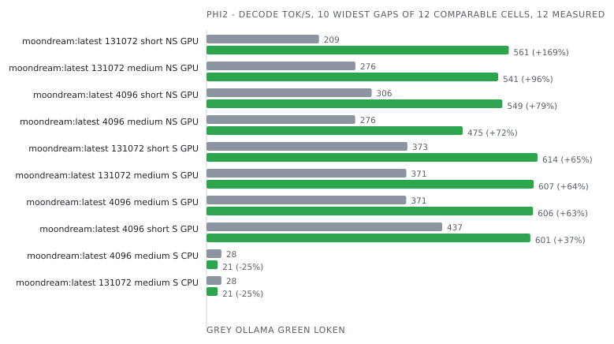

| Model            | Ctx    | Prompt | Mode       | Device | Engine              | Prefill tok/s | Decode tok/s | Tokens  | E2E ms    | J/req   | J/token   | Δ decode    | Δ energy   | Date             | Run      |
|------------------|--------|--------|------------|--------|---------------------|---------------|--------------|---------|-----------|---------|-----------|-------------|------------|------------------|----------|
| moondream:latest | 4096   | long   | non-stream | GPU    | Ollama 0.34.2       |  -            |  -           | 1       | 117       | 12      |  -        | no answer   |            | 2026-09-04 00:46 | ffbb8a41 |
| moondream:latest | 4096   | long   | non-stream | GPU    | **loken 0.1.0-dev** |  -            |  -           |  -      |  -        |  -      |  -        | failed      |            | 2026-09-04 00:46 | ffbb8a41 |
| moondream:latest | 4096   | long   | stream     | CPU    | Ollama 0.34.2       |  -            |  -           |  -      |  -        |  -      |  -        | failed      |            | 2026-09-05 07:11 | 09e9d562 |
| moondream:latest | 4096   | long   | stream     | CPU    | **loken 0.1.0-dev** |  -            |  -           |  -      |  -        |  -      |  -        | failed      |            | 2026-09-05 07:11 | 09e9d562 |
| moondream:latest | 4096   | long   | stream     | GPU    | Ollama 0.34.2       |  -            |  -           |  -      |  -        |  -      |  -        | failed      |            | 2026-09-03 23:08 | 157153e1 |
| moondream:latest | 4096   | long   | stream     | GPU    | **loken 0.1.0-dev** |  -            |  -           |  -      |  -        |  -      |  -        | failed      |            | 2026-09-03 23:08 | 157153e1 |
| moondream:latest | 4096   | medium | non-stream | GPU    | Ollama 0.34.2       |  -            | 276.0        | 128     | 451       | 63      | 0.492     |             |            | 2026-09-03 21:30 | 3bd8fbf9 |
| moondream:latest | 4096   | medium | non-stream | GPU    | **loken 0.1.0-dev** |  -            | **475.3**    | **128** | **262**   | **47**  | **0.366** | **+72.2%**  | **+34.4%** | 2026-09-03 21:30 | 3bd8fbf9 |
| moondream:latest | 4096   | medium | stream     | CPU    | Ollama 0.34.2       | 219.5         | 27.6         | 128     | 5 533     | 115     | 0.899     |             |            | 2026-09-05 02:12 | 46ca2741 |
| moondream:latest | 4096   | medium | stream     | CPU    | **loken 0.1.0-dev** | **108.7**     | **20.8**     | **128** | **6 562** | **322** | **2.513** | -24.8%      | -64.2%     | 2026-09-05 02:12 | 46ca2741 |
| moondream:latest | 4096   | medium | stream     | GPU    | Ollama 0.34.2       | 411.5         | 370.6        | 128     | 458       | 67      | 0.520     |             |            | 2026-09-03 19:47 | 07bda4aa |
| moondream:latest | 4096   | medium | stream     | GPU    | **loken 0.1.0-dev** | **2 759.4**   | **605.8**    | **128** | **248**   | **48**  | **0.374** | **+63.5%**  | **+39.2%** | 2026-09-03 19:47 | 07bda4aa |
| moondream:latest | 4096   | short  | non-stream | GPU    | Ollama 0.34.2       |  -            | 306.3        | 128     | 448       | 61      | 0.475     |             |            | 2026-09-03 18:08 | ab9c1792 |
| moondream:latest | 4096   | short  | non-stream | GPU    | **loken 0.1.0-dev** |  -            | **549.0**    | **128** | **253**   | **47**  | **0.364** | **+79.2%**  | **+30.5%** | 2026-09-03 18:08 | ab9c1792 |
| moondream:latest | 4096   | short  | stream     | CPU    | Ollama 0.34.2       | 94.4          | 27.9         | 128     | 5 466     | 112     | 0.874     |             |            | 2026-09-04 21:39 | 2c9d443a |
| moondream:latest | 4096   | short  | stream     | CPU    | **loken 0.1.0-dev** | **52.6**      | **21.2**     | **128** | **6 310** | **370** | **2.887** | -23.9%      | -69.7%     | 2026-09-04 21:39 | 2c9d443a |
| moondream:latest | 4096   | short  | stream     | GPU    | Ollama 0.35.1       | 562.5         | 437.2        | 128     | 1 362     | 60      | 0.472     |             |            | 2026-10-03 20:47 | 37dd9ba5 |
| moondream:latest | 4096   | short  | stream     | GPU    | **loken 0.1.0-dev** | **124.9**     | **600.9**    | **128** | **1 061** | **47**  | **0.370** | **+37.4%**  | **+27.7%** | 2026-10-03 20:47 | 37dd9ba5 |
| moondream:latest | 131072 | long   | non-stream | GPU    | Ollama 0.34.2       |  -            |  -           | 1       | 91        | 6       |  -        | no answer   |            | 2026-09-04 16:31 | 1e8a4c3d |
| moondream:latest | 131072 | long   | non-stream | GPU    | **loken 0.1.0-dev** |  -            |  -           |  -      |  -        |  -      |  -        | failed      |            | 2026-09-04 16:31 | 1e8a4c3d |
| moondream:latest | 131072 | long   | stream     | CPU    | Ollama 0.34.2       |  -            |  -           |  -      |  -        |  -      |  -        | failed      |            | 2026-09-06 04:02 | f37bcd4b |
| moondream:latest | 131072 | long   | stream     | CPU    | **loken 0.1.0-dev** |  -            |  -           |  -      |  -        |  -      |  -        | failed      |            | 2026-09-06 04:02 | f37bcd4b |
| moondream:latest | 131072 | long   | stream     | GPU    | Ollama 0.34.2       |  -            |  -           |  -      |  -        |  -      |  -        | failed      |            | 2026-09-04 14:31 | 075c44cb |
| moondream:latest | 131072 | long   | stream     | GPU    | **loken 0.1.0-dev** |  -            |  -           |  -      |  -        |  -      |  -        | failed      |            | 2026-09-04 14:31 | 075c44cb |
| moondream:latest | 131072 | medium | non-stream | GPU    | Ollama 0.34.2       |  -            | 276.3        | 128     | 463       | 62      | 0.482     |             |            | 2026-09-04 12:39 | 6f1a60eb |
| moondream:latest | 131072 | medium | non-stream | GPU    | **loken 0.1.0-dev** |  -            | **541.1**    | **128** | **252**   | **47**  | **0.370** | **+95.9%**  | **+30.3%** | 2026-09-04 12:39 | 6f1a60eb |
| moondream:latest | 131072 | medium | stream     | CPU    | Ollama 0.34.2       | 213.9         | 27.6         | 128     | 5 551     | 113     | 0.884     |             |            | 2026-09-06 01:10 | a6e1e752 |
| moondream:latest | 131072 | medium | stream     | CPU    | **loken 0.1.0-dev** | **92.2**      | **20.7**     | **128** | **6 596** | **382** | **2.985** | -24.8%      | -70.4%     | 2026-09-06 01:10 | a6e1e752 |
| moondream:latest | 131072 | medium | stream     | GPU    | Ollama 0.34.2       | 509.8         | 370.7        | 128     | 458       | 69      | 0.537     |             |            | 2026-09-04 10:49 | b7ad251e |
| moondream:latest | 131072 | medium | stream     | GPU    | **loken 0.1.0-dev** | **2 644.2**   | **607.0**    | **128** | **242**   | **46**  | **0.360** | **+63.7%**  | **+49.3%** | 2026-09-04 10:49 | b7ad251e |
| moondream:latest | 131072 | short  | non-stream | GPU    | Ollama 0.34.2       |  -            | 208.7        | 128     | 615       | 74      | 0.581     |             |            | 2026-09-04 08:48 | 8a8e4968 |
| moondream:latest | 131072 | short  | non-stream | GPU    | **loken 0.1.0-dev** |  -            | **560.8**    | **128** | **256**   | **45**  | **0.352** | **+168.8%** | **+65.2%** | 2026-09-04 08:48 | 8a8e4968 |
| moondream:latest | 131072 | short  | stream     | CPU    | Ollama 0.34.2       | 91.3          | 27.9         | 128     | 5 452     | 110     | 0.861     |             |            | 2026-09-05 22:16 | 0c53ceb6 |
| moondream:latest | 131072 | short  | stream     | CPU    | **loken 0.1.0-dev** | **56.2**      | **21.1**     | **128** | **6 322** | **355** | **2.774** | -24.2%      | -69.0%     | 2026-09-05 22:16 | 0c53ceb6 |
| moondream:latest | 131072 | short  | stream     | GPU    | Ollama 0.34.2       | 189.3         | 372.8        | 128     | 458       | 60      | 0.467     |             |            | 2026-09-04 02:51 | 9053bb8e |
| moondream:latest | 131072 | short  | stream     | GPU    | **loken 0.1.0-dev** | **1 357.8**   | **614.2**    | **128** | **244**   | **50**  | **0.388** | **+64.8%**  | **+20.4%** | 2026-09-04 02:51 | 9053bb8e |

### qwen2

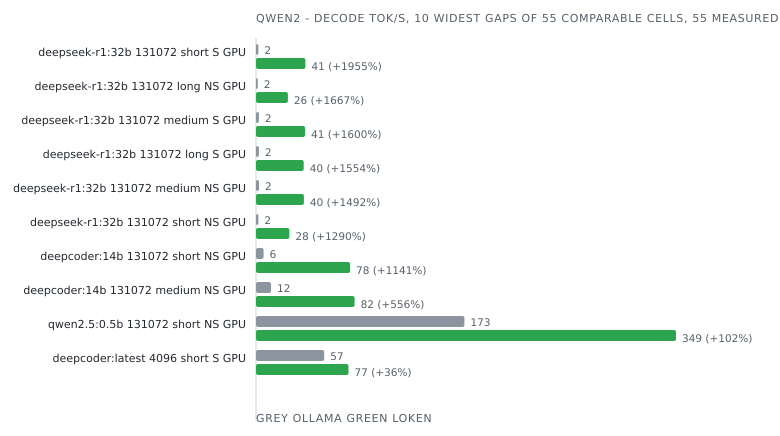

| Model            | Ctx    | Prompt | Mode       | Device | Engine                           | Prefill tok/s | Decode tok/s | Tokens  | E2E ms      | J/req     | J/token    | Δ decode     | Δ energy    | Date             | Run      |
|------------------|--------|--------|------------|--------|----------------------------------|---------------|--------------|---------|-------------|-----------|------------|--------------|-------------|------------------|----------|
| deepcoder:14b    | 4096   | long   | non-stream | GPU    | Ollama 0.34.2                    |  -            | 49.7         | 128     | 4 550       | 500       | 3.908      |              |             | 2026-09-03 23:35 | ba7ab3c2 |
| deepcoder:14b    | 4096   | long   | non-stream | GPU    | vLLM 0.29.1rc1.dev350+gd5f0a6e82 |  -            | 84.7         | 128     | 1 565       | 323       | 2.522      |              |             | 2026-09-03 23:35 | ba7ab3c2 |
| deepcoder:14b    | 4096   | long   | non-stream | GPU    | **loken 0.1.0-dev**              |  -            | **75.6**     | **128** | **1 722**   | **440**   | **3.437**  | -10.8%       | -26.6%      | 2026-09-03 23:35 | ba7ab3c2 |
| deepcoder:14b    | 4096   | long   | stream     | CPU    | Ollama 0.34.2                    | 367.0         | 2.6          | 128     | 54 486      | 1 174     | 9.172      |              |             | 2026-09-05 03:06 | 94a953a4 |
| deepcoder:14b    | 4096   | long   | stream     | CPU    | **loken 0.1.0-dev**              | **39.3**      | **2.6**      | **128** | **56 938**  | **1 281** | **10.009** | -0.0%        | -8.4%       | 2026-09-05 03:06 | 94a953a4 |
| deepcoder:14b    | 4096   | long   | stream     | GPU    | Ollama 0.34.2                    | 1 163.8       | 53.4         | 128     | 4 571       | 496       | 3.877      |              |             | 2026-09-03 21:58 | 1c0fd808 |
| deepcoder:14b    | 4096   | long   | stream     | GPU    | vLLM 0.29.1rc1.dev350+gd5f0a6e82 | 10 364.5      | 85.1         | 128     | 1 569       | 329       | 2.573      |              |             | 2026-09-03 21:58 | 1c0fd808 |
| deepcoder:14b    | 4096   | long   | stream     | GPU    | **loken 0.1.0-dev**              | **2 413.2**   | **79.2**     | **128** | **1 728**   | **439**   | **3.431**  | -6.9%        | -25.0%      | 2026-09-03 21:58 | 1c0fd808 |
| deepcoder:14b    | 4096   | medium | non-stream | GPU    | Ollama 0.34.2                    |  -            | 49.0         | 128     | 4 588       | 509       | 3.974      |              |             | 2026-09-03 20:19 | 9243b902 |
| deepcoder:14b    | 4096   | medium | non-stream | GPU    | vLLM 0.29.1rc1.dev350+gd5f0a6e82 |  -            | 83.1         | 128     | 1 557       | 321       | 2.509      |              |             | 2026-09-03 20:19 | 9243b902 |
| deepcoder:14b    | 4096   | medium | non-stream | GPU    | **loken 0.1.0-dev**              |  -            | **81.8**     | **128** | **1 572**   | **396**   | **3.092**  | -1.6%        | -18.8%      | 2026-09-03 20:19 | 9243b902 |
| deepcoder:14b    | 4096   | medium | stream     | CPU    | Ollama 0.34.2                    | 68.0          | 2.6          | 128     | 52 412      | 1 155     | 9.026      |              |             | 2026-09-04 22:38 | 87c73abc |
| deepcoder:14b    | 4096   | medium | stream     | CPU    | **loken 0.1.0-dev**              | **28.5**      | **2.6**      | **120** | **48 760**  | **1 105** | **9.207**  |              |             | 2026-09-04 22:38 | 87c73abc |
| deepcoder:14b    | 4096   | medium | stream     | GPU    | Ollama 0.34.2                    | 208.0         | 53.0         | 128     | 4 584       | 499       | 3.895      |              |             | 2026-09-03 18:36 | d721fa5a |
| deepcoder:14b    | 4096   | medium | stream     | GPU    | vLLM 0.29.1rc1.dev350+gd5f0a6e82 | 2 203.0       | 85.0         | 128     | 1 549       | 315       | 2.461      |              |             | 2026-09-03 18:36 | d721fa5a |
| deepcoder:14b    | 4096   | medium | stream     | GPU    | **loken 0.1.0-dev**              | **672.9**     | **84.2**     | **128** | **1 589**   | **398**   | **3.109**  | -1.0%        | -20.8%      | 2026-09-03 18:36 | d721fa5a |
| deepcoder:14b    | 4096   | short  | non-stream | GPU    | Ollama 0.34.2                    |  -            | 49.0         | 128     | 4 543       | 509       | 3.974      |              |             | 2026-09-03 16:58 | 23e50ef8 |
| deepcoder:14b    | 4096   | short  | non-stream | GPU    | vLLM 0.29.1rc1.dev350+gd5f0a6e82 |  -            | 83.4         | 128     | 1 561       | 337       | 2.637      |              |             | 2026-09-03 16:58 | 23e50ef8 |
| deepcoder:14b    | 4096   | short  | non-stream | GPU    | **loken 0.1.0-dev**              |  -            | **81.6**     | **128** | **1 586**   | **409**   | **3.198**  | -2.1%        | -17.5%      | 2026-09-03 16:58 | 23e50ef8 |
| deepcoder:14b    | 4096   | short  | stream     | CPU    | Ollama 0.34.2                    | 24.7          | 2.6          | 128     | 52 075      | 1 127     | 8.806      |              |             | 2026-09-04 17:19 | b643fe20 |
| deepcoder:14b    | 4096   | short  | stream     | CPU    | **loken 0.1.0-dev**              | **19.1**      | **2.7**      | **128** | **49 670**  | **1 102** | **8.607**  | **+3.3%**    | **+2.3%**   | 2026-09-04 17:19 | b643fe20 |
| deepcoder:14b    | 4096   | short  | stream     | GPU    | Ollama 0.35.1                    | 337.8         | 56.7         | 128     | 11 369      | 458       | 3.581      |              |             | 2026-10-03 19:28 | a203931b |
| deepcoder:14b    | 4096   | short  | stream     | GPU    | **loken 0.1.0-dev**              | **679.6**     | **76.8**     | **128** | **1 803**   | **444**   | **3.468**  | **+35.5%**   | **+3.3%**   | 2026-10-03 19:28 | a203931b |
| deepcoder:14b    | 131072 | long   | non-stream | GPU    | Ollama 0.34.2                    |  -            | 12.5         | 128     | 12 928      | 929       | 7.255      |              |             | 2026-09-04 15:02 | 3cdd0f50 |
| deepcoder:14b    | 131072 | long   | non-stream | GPU    | vLLM 0.29.1rc1.dev350+gd5f0a6e82 |  -            | 84.5         | 128     | 1 572       | 311       | 2.430      |              |             | 2026-09-04 15:02 | 3cdd0f50 |
| deepcoder:14b    | 131072 | long   | non-stream | GPU    | **loken 0.1.0-dev**              |  -            | **75.6**     | **128** | **1 721**   | **443**   | **3.461**  | -10.5%       | -29.8%      | 2026-09-04 15:02 | 3cdd0f50 |
| deepcoder:14b    | 131072 | long   | stream     | CPU    | Ollama 0.34.2                    | 368.0         | 2.6          | 128     | 56 776      | 1 161     | 9.070      |              |             | 2026-09-06 02:05 | 430b0510 |
| deepcoder:14b    | 131072 | long   | stream     | CPU    | **loken 0.1.0-dev**              | **38.9**      | **2.6**      | **128** | **56 507**  | **1 286** | **10.048** | **+0.6%**    | -9.7%       | 2026-09-06 02:05 | 430b0510 |
| deepcoder:14b    | 131072 | long   | stream     | GPU    | Ollama 0.34.2                    | 750.7         | 12.7         | 128     | 13 006      | 936       | 7.310      |              |             | 2026-09-04 13:06 | 64637634 |
| deepcoder:14b    | 131072 | long   | stream     | GPU    | vLLM 0.29.1rc1.dev350+gd5f0a6e82 | 4 523.1       | 85.2         | 128     | 1 600       | 342       | 2.671      |              |             | 2026-09-04 13:06 | 64637634 |
| deepcoder:14b    | 131072 | long   | stream     | GPU    | **loken 0.1.0-dev**              | **2 370.7**   | **79.2**     | **128** | **1 732**   | **448**   | **3.498**  | -7.0%        | -23.6%      | 2026-09-04 13:06 | 64637634 |
| deepcoder:14b    | 131072 | medium | non-stream | GPU    | Ollama 0.34.2                    |  -            | 12.5         | 128     | 12 987      | 928       | 7.250      |              |             | 2026-09-04 11:16 | 1a95a8c8 |
| deepcoder:14b    | 131072 | medium | non-stream | GPU    | vLLM 0.29.1rc1.dev350+gd5f0a6e82 |  -            | 84.1         | 128     | 1 553       | 328       | 2.565      |              |             | 2026-09-04 11:16 | 1a95a8c8 |
| deepcoder:14b    | 131072 | medium | non-stream | GPU    | **loken 0.1.0-dev**              |  -            | **82.0**     | **128** | **1 571**   | **398**   | **3.112**  | -2.6%        | -17.6%      | 2026-09-04 11:16 | 1a95a8c8 |
| deepcoder:14b    | 131072 | medium | stream     | CPU    | Ollama 0.34.2                    | 65.1          | 2.6          | 128     | 54 704      | 1 154     | 9.014      |              |             | 2026-09-05 23:07 | 0f077773 |
| deepcoder:14b    | 131072 | medium | stream     | CPU    | **loken 0.1.0-dev**              | **26.2**      | **2.6**      | **120** | **48 331**  | **1 089** | **9.076**  |              |             | 2026-09-05 23:07 | 0f077773 |
| deepcoder:14b    | 131072 | medium | stream     | GPU    | Ollama 0.34.2                    | 137.5         | 12.9         | 128     | 12 801      | 900       | 7.033      |              |             | 2026-09-04 09:17 | 33023ae6 |
| deepcoder:14b    | 131072 | medium | stream     | GPU    | vLLM 0.29.1rc1.dev350+gd5f0a6e82 | 2 007.8       | 85.0         | 128     | 1 551       | 317       | 2.478      |              |             | 2026-09-04 09:17 | 33023ae6 |
| deepcoder:14b    | 131072 | medium | stream     | GPU    | **loken 0.1.0-dev**              | **634.3**     | **84.2**     | **128** | **1 589**   | **400**   | **3.123**  | -0.9%        | -20.7%      | 2026-09-04 09:17 | 33023ae6 |
| deepcoder:14b    | 131072 | short  | non-stream | GPU    | Ollama 0.34.2                    |  -            | 6.3          | 128     | 17 326      | 1 602     | 12.515     |              |             | 2026-09-04 07:13 | cb9ee5a2 |
| deepcoder:14b    | 131072 | short  | non-stream | GPU    | vLLM 0.29.1rc1.dev350+gd5f0a6e82 |  -            | 84.4         | 128     | 1 573       | 325       | 2.542      |              |             | 2026-09-04 07:13 | cb9ee5a2 |
| deepcoder:14b    | 131072 | short  | non-stream | GPU    | **loken 0.1.0-dev**              |  -            | **78.2**     | **128** | **1 638**   | **414**   | **3.231**  | -7.3%        | -21.3%      | 2026-09-04 07:13 | cb9ee5a2 |
| deepcoder:14b    | 131072 | short  | stream     | CPU    | Ollama 0.34.2                    | 23.5          | 2.6          | 128     | 54 611      | 1 158     | 9.047      |              |             | 2026-09-05 08:08 | e3e8c65d |
| deepcoder:14b    | 131072 | short  | stream     | CPU    | **loken 0.1.0-dev**              | **19.7**      | **2.7**      | **128** | **49 536**  | **1 122** | **8.769**  | **+3.6%**    | **+3.2%**   | 2026-09-05 08:08 | e3e8c65d |
| deepcoder:14b    | 131072 | short  | stream     | GPU    | Ollama 0.34.2                    | 47.2          | 12.8         | 128     | 12 948      | 932       | 7.279      |              |             | 2026-09-04 01:14 | c903cc7f |
| deepcoder:14b    | 131072 | short  | stream     | GPU    | vLLM 0.29.1rc1.dev350+gd5f0a6e82 | 823.5         | 85.0         | 128     | 1 548       | 324       | 2.532      |              |             | 2026-09-04 01:14 | c903cc7f |
| deepcoder:14b    | 131072 | short  | stream     | GPU    | **loken 0.1.0-dev**              | **468.4**     | **82.4**     | **128** | **1 602**   | **399**   | **3.120**  | -3.0%        | -18.9%      | 2026-09-04 01:14 | c903cc7f |
| deepcoder:latest | 4096   | short  | stream     | GPU    | Ollama 0.35.1                    | 426.7         | 56.7         | 128     | 4 267       | 456       | 3.564      |              |             | 2026-10-03 19:29 | e2edfa42 |
| deepcoder:latest | 4096   | short  | stream     | GPU    | **loken 0.1.0-dev**              | **647.3**     | **76.9**     | **128** | **1 777**   | **444**   | **3.472**  | **+35.7%**   | **+2.6%**   | 2026-10-03 19:29 | e2edfa42 |
| deepseek-r1:32b  | 4096   | long   | non-stream | GPU    | Ollama 0.34.2                    |  -            | 25.0         | 128     | 8 176       | 1 068     | 8.342      |              |             | 2026-09-03 23:39 | 0605b456 |
| deepseek-r1:32b  | 4096   | long   | non-stream | GPU    | **loken 0.1.0-dev**              |  -            | **36.5**     | **128** | **3 773**   | **1 074** | **8.392**  | **+45.8%**   | -0.6%       | 2026-09-03 23:39 | 0605b456 |
| deepseek-r1:32b  | 4096   | long   | stream     | CPU    | Ollama 0.34.2                    | 217.0         | 1.2          | 128     | 120 780     | 2 513     | 19.635     |              |             | 2026-09-05 03:16 | 1bdcda30 |
| deepseek-r1:32b  | 4096   | long   | stream     | CPU    | **loken 0.1.0-dev**              | **17.1**      | **1.2**      | **128** | **123 092** | **2 750** | **21.485** | **+3.4%**    | -8.6%       | 2026-09-05 03:16 | 1bdcda30 |
| deepseek-r1:32b  | 4096   | long   | stream     | GPU    | Ollama 0.34.2                    | 1 001.9       | 25.9         | 128     | 8 135       | 1 076     | 8.408      |              |             | 2026-09-03 22:01 | 2fd383e5 |
| deepseek-r1:32b  | 4096   | long   | stream     | GPU    | **loken 0.1.0-dev**              | **673.9**     | **40.0**     | **128** | **3 812**   | **1 079** | **8.431**  | **+54.2%**   | -0.3%       | 2026-09-03 22:01 | 2fd383e5 |
| deepseek-r1:32b  | 4096   | medium | non-stream | GPU    | Ollama 0.34.2                    |  -            | 24.9         | 128     | 8 297       | 1 070     | 8.362      |              |             | 2026-09-03 20:23 | 8d99ef19 |
| deepseek-r1:32b  | 4096   | medium | non-stream | GPU    | **loken 0.1.0-dev**              |  -            | **40.1**     | **128** | **3 500**   | **1 003** | **7.839**  | **+60.9%**   | **+6.7%**   | 2026-09-03 20:23 | 8d99ef19 |
| deepseek-r1:32b  | 4096   | medium | stream     | CPU    | Ollama 0.34.2                    | 38.8          | 1.2          | 128     | 116 627     | 2 571     | 20.086     |              |             | 2026-09-04 22:48 | af405ba3 |
| deepseek-r1:32b  | 4096   | medium | stream     | CPU    | **loken 0.1.0-dev**              | **14.4**      | **1.2**      | **128** | **115 701** | **2 584** | **20.190** | **+0.5%**    | -0.5%       | 2026-09-04 22:48 | af405ba3 |
| deepseek-r1:32b  | 4096   | medium | stream     | GPU    | Ollama 0.34.2                    | 177.3         | 26.0         | 128     | 8 232       | 1 077     | 8.417      |              |             | 2026-09-03 18:40 | 3407696c |
| deepseek-r1:32b  | 4096   | medium | stream     | GPU    | **loken 0.1.0-dev**              | **374.9**     | **41.1**     | **128** | **3 485**   | **1 002** | **7.831**  | **+58.2%**   | **+7.5%**   | 2026-09-03 18:40 | 3407696c |
| deepseek-r1:32b  | 4096   | short  | non-stream | GPU    | Ollama 0.34.2                    |  -            | 24.9         | 128     | 8 053       | 1 065     | 8.323      |              |             | 2026-09-03 17:02 | 50112004 |
| deepseek-r1:32b  | 4096   | short  | non-stream | GPU    | **loken 0.1.0-dev**              |  -            | **40.6**     | **128** | **3 431**   | **965**   | **7.540**  | **+63.2%**   | **+10.4%**  | 2026-09-03 17:02 | 50112004 |
| deepseek-r1:32b  | 4096   | short  | stream     | CPU    | Ollama 0.34.2                    | 14.2          | 1.2          | 128     | 115 938     | 2 529     | 19.755     |              |             | 2026-09-04 17:29 | 0c3ef7a3 |
| deepseek-r1:32b  | 4096   | short  | stream     | CPU    | **loken 0.1.0-dev**              | **9.1**       | **1.2**      | **128** | **111 029** | **2 459** | **19.214** | **+3.7%**    | **+2.8%**   | 2026-09-04 17:29 | 0c3ef7a3 |
| deepseek-r1:32b  | 4096   | short  | stream     | GPU    | Ollama 0.35.1                    | 253.4         | 26.7         | 128     | 7 863       | 1 007     | 7.866      |              |             | 2026-10-03 19:31 | ef0791d9 |
| deepseek-r1:32b  | 4096   | short  | stream     | GPU    | **loken 0.1.0-dev**              | **326.1**     | **40.7**     | **128** | **3 521**   | **958**   | **7.484**  | **+52.5%**   | **+5.1%**   | 2026-10-03 19:31 | ef0791d9 |
| deepseek-r1:32b  | 131072 | long   | non-stream | GPU    | Ollama 0.34.2                    |  -            | 1.5          | 128     | 87 335      | 6 026     | 47.082     |              |             | 2026-09-04 15:10 | c1d5c491 |
| deepseek-r1:32b  | 131072 | long   | non-stream | GPU    | **loken 0.1.0-dev**              |  -            | **26.5**     | **128** | **4 800**   | **1 156** | **9.028**  | **+1720.5%** | **+421.5%** | 2026-09-04 15:10 | c1d5c491 |
| deepseek-r1:32b  | 131072 | long   | stream     | CPU    | Ollama 0.34.2                    | 214.0         | 1.2          | 128     | 123 990     | 2 530     | 19.765     |              |             | 2026-09-06 02:15 | e3de221d |
| deepseek-r1:32b  | 131072 | long   | stream     | CPU    | **loken 0.1.0-dev**              | **16.7**      | **1.2**      | **128** | **125 925** | **2 743** | **21.430** | **+3.0%**    | -7.8%       | 2026-09-06 02:15 | e3de221d |
| deepseek-r1:32b  | 131072 | long   | stream     | GPU    | Ollama 0.34.2                    | 362.7         | 2.4          | 128     | 57 941      | 3 861     | 30.165     |              |             | 2026-09-04 13:12 | d4f22fbb |
| deepseek-r1:32b  | 131072 | long   | stream     | GPU    | **loken 0.1.0-dev**              | **693.3**     | **39.7**     | **128** | **3 826**   | **1 089** | **8.512**  | **+1531.9%** | **+254.4%** | 2026-09-04 13:12 | d4f22fbb |
| deepseek-r1:32b  | 131072 | medium | non-stream | GPU    | Ollama 0.34.2                    |  -            | 2.5          | 128     | 57 402      | 3 806     | 29.737     |              |             | 2026-09-04 11:22 | 8d82c941 |
| deepseek-r1:32b  | 131072 | medium | non-stream | GPU    | **loken 0.1.0-dev**              |  -            | **39.8**     | **128** | **3 489**   | **1 023** | **7.993**  | **+1520.7%** | **+272.0%** | 2026-09-04 11:22 | 8d82c941 |
| deepseek-r1:32b  | 131072 | medium | stream     | CPU    | Ollama 0.34.2                    | 40.2          | 1.2          | 128     | 119 800     | 2 559     | 19.990     |              |             | 2026-09-05 23:17 | cdce7ca8 |
| deepseek-r1:32b  | 131072 | medium | stream     | CPU    | **loken 0.1.0-dev**              | **14.3**      | **1.2**      | **128** | **117 892** | **2 573** | **20.098** | **+0.9%**    | -0.5%       | 2026-09-05 23:17 | cdce7ca8 |
| deepseek-r1:32b  | 131072 | medium | stream     | GPU    | Ollama 0.34.2                    | 66.1          | 2.4          | 128     | 58 100      | 3 784     | 29.561     |              |             | 2026-09-04 09:23 | 6ecd3280 |
| deepseek-r1:32b  | 131072 | medium | stream     | GPU    | **loken 0.1.0-dev**              | **462.5**     | **40.8**     | **128** | **3 507**   | **1 013** | **7.916**  | **+1574.9%** | **+273.4%** | 2026-09-04 09:23 | 6ecd3280 |
| deepseek-r1:32b  | 131072 | short  | non-stream | GPU    | Ollama 0.34.2                    |  -            | 2.0          | 128     | 96 298      | 4 644     | 36.279     |              |             | 2026-09-04 07:22 | 889cf838 |
| deepseek-r1:32b  | 131072 | short  | non-stream | GPU    | **loken 0.1.0-dev**              |  -            | **27.8**     | **128** | **4 726**   | **1 082** | **8.453**  | **+1281.2%** | **+329.2%** | 2026-09-04 07:22 | 889cf838 |
| deepseek-r1:32b  | 131072 | short  | stream     | CPU    | Ollama 0.34.2                    | 13.8          | 1.2          | 128     | 118 305     | 2 534     | 19.796     |              |             | 2026-09-05 08:18 | 23bc6bcb |
| deepseek-r1:32b  | 131072 | short  | stream     | CPU    | **loken 0.1.0-dev**              | **8.7**       | **1.2**      | **128** | **114 417** | **2 453** | **19.164** | **+2.5%**    | **+3.3%**   | 2026-09-05 08:18 | 23bc6bcb |
| deepseek-r1:32b  | 131072 | short  | stream     | GPU    | Ollama 0.34.2                    | 23.5          | 2.0          | 128     | 73 370      | 4 701     | 36.729     |              |             | 2026-09-04 01:21 | b39a72ed |
| deepseek-r1:32b  | 131072 | short  | stream     | GPU    | **loken 0.1.0-dev**              | **163.6**     | **41.1**     | **128** | **3 453**   | **1 011** | **7.902**  | **+1994.7%** | **+364.8%** | 2026-09-04 01:21 | b39a72ed |
| qwen2.5:0.5b     | 4096   | long   | non-stream | GPU    | Ollama 0.34.2                    |  -            | 219.8        | 128     | 1 869       | 56        | 0.434      |              |             | 2026-09-04 00:51 | b4e336f7 |
| qwen2.5:0.5b     | 4096   | long   | non-stream | GPU    | **loken 0.1.0-dev**              |  -            | **319.0**    | **128** | **409**     | **45**    | **0.348**  | **+45.1%**   | **+24.8%**  | 2026-09-04 00:51 | b4e336f7 |
| qwen2.5:0.5b     | 4096   | long   | stream     | CPU    | Ollama 0.34.2                    | 881.0         | 51.7         | 128     | 3 476       | 66        | 0.518      |              |             | 2026-09-05 07:22 | b20348c8 |
| qwen2.5:0.5b     | 4096   | long   | stream     | CPU    | **loken 0.1.0-dev**              | **314.6**     | **49.9**     | **128** | **3 273**   | **198**   | **1.544**  | -3.4%        | -66.4%      | 2026-09-05 07:22 | b20348c8 |
| qwen2.5:0.5b     | 4096   | long   | stream     | GPU    | Ollama 0.34.2                    | 1 272.3       | 325.2        | 128     | 1 885       | 62        | 0.484      |              |             | 2026-09-03 23:13 | e371375f |
| qwen2.5:0.5b     | 4096   | long   | stream     | GPU    | **loken 0.1.0-dev**              | **8 275.0**   | **370.8**    | **128** | **399**     | **50**    | **0.392**  | **+14.0%**   | **+23.4%**  | 2026-09-03 23:13 | e371375f |
| qwen2.5:0.5b     | 4096   | medium | non-stream | GPU    | Ollama 0.34.2                    |  -            | 223.1        | 128     | 1 826       | 58        | 0.452      |              |             | 2026-09-03 21:35 | 30681d8c |
| qwen2.5:0.5b     | 4096   | medium | non-stream | GPU    | **loken 0.1.0-dev**              |  -            | **325.4**    | **128** | **385**     | **42**    | **0.326**  | **+45.8%**   | **+38.8%**  | 2026-09-03 21:35 | 30681d8c |
| qwen2.5:0.5b     | 4096   | medium | stream     | CPU    | Ollama 0.34.2                    | 169.4         | 52.8         | 128     | 3 321       | 67        | 0.523      |              |             | 2026-09-05 02:23 | 130c5bcf |
| qwen2.5:0.5b     | 4096   | medium | stream     | CPU    | **loken 0.1.0-dev**              | **150.8**     | **51.8**     | **128** | **2 758**   | **164**   | **1.283**  | -1.9%        | -59.2%      | 2026-09-05 02:23 | 130c5bcf |
| qwen2.5:0.5b     | 4096   | medium | stream     | GPU    | Ollama 0.34.2                    | 206.0         | 288.8        | 128     | 2 274       | 65        | 0.508      |              |             | 2026-09-03 19:52 | 2182633d |
| qwen2.5:0.5b     | 4096   | medium | stream     | GPU    | **loken 0.1.0-dev**              | **790.9**     | **245.6**    | **128** | **604**     | **65**    | **0.506**  | -15.0%       | **+0.3%**   | 2026-09-03 19:52 | 2182633d |
| qwen2.5:0.5b     | 4096   | short  | non-stream | GPU    | Ollama 0.34.2                    |  -            | 215.5        | 128     | 1 867       | 59        | 0.461      |              |             | 2026-09-03 18:13 | 5e1de105 |
| qwen2.5:0.5b     | 4096   | short  | non-stream | GPU    | **loken 0.1.0-dev**              |  -            | **351.5**    | **128** | **379**     | **45**    | **0.353**  | **+63.1%**   | **+30.3%**  | 2026-09-03 18:13 | 5e1de105 |
| qwen2.5:0.5b     | 4096   | short  | stream     | CPU    | Ollama 0.34.2                    | 55.3          | 53.1         | 128     | 3 322       | 67        | 0.524      |              |             | 2026-09-04 21:49 | a1a8b588 |
| qwen2.5:0.5b     | 4096   | short  | stream     | CPU    | **loken 0.1.0-dev**              | **71.8**      | **52.2**     | **128** | **2 684**   | **161**   | **1.259**  | -1.7%        | -58.4%      | 2026-09-04 21:49 | a1a8b588 |
| qwen2.5:0.5b     | 4096   | short  | stream     | GPU    | Ollama 0.35.1                    | 654.9         | 475.4        | 128     | 1 619       | 44        | 0.342      |              |             | 2026-10-03 21:06 | 629ee430 |
| qwen2.5:0.5b     | 4096   | short  | stream     | GPU    | **loken 0.1.0-dev**              | **1 288.0**   | **615.1**    | **128** | **293**     | **40**    | **0.311**  | **+29.4%**   | **+9.8%**   | 2026-10-03 21:06 | 629ee430 |
| qwen2.5:0.5b     | 131072 | long   | non-stream | GPU    | Ollama 0.34.2                    |  -            | 224.9        | 128     | 622         | 60        | 0.468      |              |             | 2026-09-04 16:36 | 10633120 |
| qwen2.5:0.5b     | 131072 | long   | non-stream | GPU    | **loken 0.1.0-dev**              |  -            | **359.0**    | **128** | **378**     | **49**    | **0.381**  | **+59.6%**   | **+22.9%**  | 2026-09-04 16:36 | 10633120 |
| qwen2.5:0.5b     | 131072 | long   | stream     | CPU    | Ollama 0.34.2                    | 997.3         | 51.7         | 128     | 3 529       | 66        | 0.519      |              |             | 2026-09-06 04:12 | da4e9774 |
| qwen2.5:0.5b     | 131072 | long   | stream     | CPU    | **loken 0.1.0-dev**              | **335.6**     | **51.4**     | **128** | **3 184**   | **190**   | **1.485**  | -0.7%        | -65.0%      | 2026-09-06 04:12 | da4e9774 |
| qwen2.5:0.5b     | 131072 | long   | stream     | GPU    | Ollama 0.34.2                    | 1 171.8       | 322.1        | 128     | 651         | 63        | 0.492      |              |             | 2026-09-04 14:37 | baa4d5c5 |
| qwen2.5:0.5b     | 131072 | long   | stream     | GPU    | **loken 0.1.0-dev**              | **6 656.5**   | **335.9**    | **128** | **447**     | **50**    | **0.394**  | **+4.3%**    | **+24.8%**  | 2026-09-04 14:37 | baa4d5c5 |
| qwen2.5:0.5b     | 131072 | medium | non-stream | GPU    | Ollama 0.34.2                    |  -            | 205.6        | 128     | 643         | 59        | 0.457      |              |             | 2026-09-04 12:45 | c0d9ee35 |
| qwen2.5:0.5b     | 131072 | medium | non-stream | GPU    | **loken 0.1.0-dev**              |  -            | **335.2**    | **128** | **376**     | **47**    | **0.369**  | **+63.0%**   | **+23.9%**  | 2026-09-04 12:45 | c0d9ee35 |
| qwen2.5:0.5b     | 131072 | medium | stream     | CPU    | Ollama 0.34.2                    | 168.4         | 52.8         | 128     | 3 421       | 67        | 0.526      |              |             | 2026-09-06 01:20 | 7ef65f37 |
| qwen2.5:0.5b     | 131072 | medium | stream     | CPU    | **loken 0.1.0-dev**              | **151.0**     | **52.1**     | **128** | **2 783**   | **163**   | **1.273**  | -1.3%        | -58.6%      | 2026-09-06 01:20 | 7ef65f37 |
| qwen2.5:0.5b     | 131072 | medium | stream     | GPU    | Ollama 0.34.2                    | 222.4         | 321.2        | 128     | 620         | 62        | 0.487      |              |             | 2026-09-04 10:54 | b1b6f4dc |
| qwen2.5:0.5b     | 131072 | medium | stream     | GPU    | **loken 0.1.0-dev**              | **1 903.3**   | **380.1**    | **128** | **381**     | **43**    | **0.333**  | **+18.4%**   | **+46.5%**  | 2026-09-04 10:54 | b1b6f4dc |
| qwen2.5:0.5b     | 131072 | short  | non-stream | GPU    | Ollama 0.34.2                    |  -            | 173.3        | 128     | 775         | 72        | 0.560      |              |             | 2026-09-04 08:53 | bcd47022 |
| qwen2.5:0.5b     | 131072 | short  | non-stream | GPU    | **loken 0.1.0-dev**              |  -            | **349.2**    | **128** | **391**     | **49**    | **0.383**  | **+101.5%**  | **+46.4%**  | 2026-09-04 08:53 | bcd47022 |
| qwen2.5:0.5b     | 131072 | short  | stream     | CPU    | Ollama 0.34.2                    | 54.6          | 53.1         | 128     | 3 416       | 65        | 0.511      |              |             | 2026-09-05 22:26 | 8c2fbbb3 |
| qwen2.5:0.5b     | 131072 | short  | stream     | CPU    | **loken 0.1.0-dev**              | **68.1**      | **52.4**     | **128** | **2 677**   | **165**   | **1.289**  | -1.3%        | -60.4%      | 2026-09-05 22:26 | 8c2fbbb3 |
| qwen2.5:0.5b     | 131072 | short  | stream     | GPU    | Ollama 0.34.2                    | 82.9          | 306.4        | 128     | 642         | 56        | 0.438      |              |             | 2026-09-04 02:56 | a2913d84 |
| qwen2.5:0.5b     | 131072 | short  | stream     | GPU    | **loken 0.1.0-dev**              | **683.3**     | **375.6**    | **128** | **391**     | **49**    | **0.379**  | **+22.6%**   | **+15.4%**  | 2026-09-04 02:56 | a2913d84 |

### qwen3

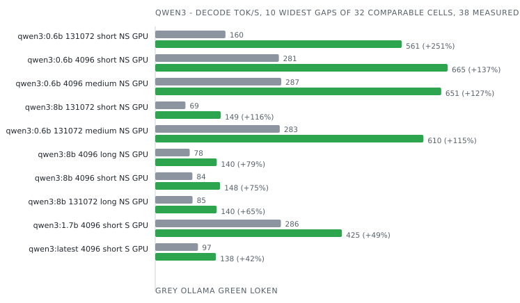

| Model        | Ctx    | Prompt | Mode       | Device | Engine                           | Prefill tok/s | Decode tok/s | Tokens  | E2E ms     | J/req     | J/token    | Δ decode    | Δ energy    | Date             | Run      |
|--------------|--------|--------|------------|--------|----------------------------------|---------------|--------------|---------|------------|-----------|------------|-------------|-------------|------------------|----------|
| qwen3:0.6b   | 4096   | long   | non-stream | GPU    | Ollama 0.34.2                    |  -            |  -           | 128     |  -         |  -        |  -         | incoherent  |             | 2026-09-04 01:05 | f0453008 |
| qwen3:0.6b   | 4096   | long   | non-stream | GPU    | **loken 0.1.0-dev**              |  -            | **542.4**    | **128** | **267**    | **36**    | **0.282**  |             |             | 2026-09-04 01:05 | f0453008 |
| qwen3:0.6b   | 4096   | long   | stream     | CPU    | Ollama 0.34.2                    |  -            |  -           | 128     |  -         |  -        |  -         | incoherent  |             | 2026-09-05 07:47 | 2947f6fc |
| qwen3:0.6b   | 4096   | long   | stream     | CPU    | **loken 0.1.0-dev**              | **443.9**     | **47.0**     | **128** | **3 255**  | **196**   | **1.535**  |             |             | 2026-09-05 07:47 | 2947f6fc |
| qwen3:0.6b   | 4096   | long   | stream     | GPU    | Ollama 0.34.2                    |  -            |  -           | 128     |  -         |  -        |  -         | incoherent  |             | 2026-09-03 23:26 | 9f2afd41 |
| qwen3:0.6b   | 4096   | long   | stream     | GPU    | **loken 0.1.0-dev**              | **7 965.8**   | **594.1**    | **128** | **283**    | **42**    | **0.325**  |             |             | 2026-09-03 23:26 | 9f2afd41 |
| qwen3:0.6b   | 4096   | medium | non-stream | GPU    | Ollama 0.34.2                    |  -            | 286.7        | 128     | 1 702      | 59        | 0.464      |             |             | 2026-09-03 21:49 | 13989297 |
| qwen3:0.6b   | 4096   | medium | non-stream | GPU    | **loken 0.1.0-dev**              |  -            | **650.6**    | **128** | **241**    | **28**    | **0.220**  | **+127.0%** | **+110.4%** | 2026-09-03 21:49 | 13989297 |
| qwen3:0.6b   | 4096   | medium | stream     | CPU    | Ollama 0.34.2                    | 155.7         | 48.6         | 128     | 3 643      | 71        | 0.555      |             |             | 2026-09-05 02:46 | de62262a |
| qwen3:0.6b   | 4096   | medium | stream     | CPU    | **loken 0.1.0-dev**              | **226.4**     | **49.3**     | **128** | **2 825**  | **164**   | **1.284**  | **+1.4%**   | -56.8%      | 2026-09-05 02:46 | de62262a |
| qwen3:0.6b   | 4096   | medium | stream     | GPU    | Ollama 0.34.2                    | 226.5         | 486.6        | 128     | 1 741      | 62        | 0.484      |             |             | 2026-09-03 20:09 | 8e37051e |
| qwen3:0.6b   | 4096   | medium | stream     | GPU    | **loken 0.1.0-dev**              | **1 803.3**   | **736.8**    | **128** | **248**    | **23**    | **0.182**  | **+51.4%**  | **+165.9%** | 2026-09-03 20:09 | 8e37051e |
| qwen3:0.6b   | 4096   | short  | non-stream | GPU    | Ollama 0.34.2                    |  -            | 281.2        | 128     | 1 712      | 61        | 0.479      |             |             | 2026-09-03 18:26 | e492325f |
| qwen3:0.6b   | 4096   | short  | non-stream | GPU    | **loken 0.1.0-dev**              |  -            | **665.1**    | **128** | **233**    | **30**    | **0.236**  | **+136.5%** | **+103.3%** | 2026-09-03 18:26 | e492325f |
| qwen3:0.6b   | 4096   | short  | stream     | CPU    | Ollama 0.34.2                    | 58.2          | 49.1         | 128     | 3 588      | 68        | 0.531      |             |             | 2026-09-04 22:14 | 28d6f6c9 |
| qwen3:0.6b   | 4096   | short  | stream     | CPU    | **loken 0.1.0-dev**              | **119.8**     | **51.2**     | **128** | **2 709**  | **154**   | **1.206**  | **+4.1%**   | -55.9%      | 2026-09-04 22:14 | 28d6f6c9 |
| qwen3:0.6b   | 4096   | short  | stream     | GPU    | Ollama 0.35.1                    | 915.2         | 471.3        | 128     | 1 598      | 49        | 0.381      |             |             | 2026-10-03 21:16 | e58862aa |
| qwen3:0.6b   | 4096   | short  | stream     | GPU    | **loken 0.1.0-dev**              | **1 266.4**   | **682.9**    | **128** | **281**    | **38**    | **0.298**  | **+44.9%**  | **+27.9%**  | 2026-10-03 21:16 | e58862aa |
| qwen3:0.6b   | 131072 | long   | non-stream | GPU    | Ollama 0.34.2                    |  -            |  -           | 128     |  -         |  -        |  -         | incoherent  |             | 2026-09-04 16:50 | 21d37831 |
| qwen3:0.6b   | 131072 | long   | non-stream | GPU    | **loken 0.1.0-dev**              |  -            | **466.5**    | **128** | **281**    | **41**    | **0.319**  |             |             | 2026-09-04 16:50 | 21d37831 |
| qwen3:0.6b   | 131072 | long   | stream     | CPU    | Ollama 0.34.2                    |  -            |  -           | 128     |  -         |  -        |  -         | incoherent  |             | 2026-09-06 04:37 | d42ea747 |
| qwen3:0.6b   | 131072 | long   | stream     | CPU    | **loken 0.1.0-dev**              | **440.2**     | **45.6**     | **128** | **3 403**  | **192**   | **1.502**  |             |             | 2026-09-06 04:37 | d42ea747 |
| qwen3:0.6b   | 131072 | long   | stream     | GPU    | Ollama 0.34.2                    |  -            |  -           | 128     |  -         |  -        |  -         | incoherent  |             | 2026-09-04 14:51 | f5550747 |
| qwen3:0.6b   | 131072 | long   | stream     | GPU    | **loken 0.1.0-dev**              | **6 459.6**   | **590.5**    | **128** | **287**    | **37**    | **0.290**  |             |             | 2026-09-04 14:51 | f5550747 |
| qwen3:0.6b   | 131072 | medium | non-stream | GPU    | Ollama 0.34.2                    |  -            | 283.3        | 128     | 1 782      | 62        | 0.483      |             |             | 2026-09-04 12:57 | 61aadec7 |
| qwen3:0.6b   | 131072 | medium | non-stream | GPU    | **loken 0.1.0-dev**              |  -            | **610.2**    | **128** | **242**    | **28**    | **0.221**  | **+115.4%** | **+118.5%** | 2026-09-04 12:57 | 61aadec7 |
| qwen3:0.6b   | 131072 | medium | stream     | CPU    | Ollama 0.34.2                    | 161.9         | 48.3         | 128     | 3 877      | 72        | 0.560      |             |             | 2026-09-06 01:44 | a59334d9 |
| qwen3:0.6b   | 131072 | medium | stream     | CPU    | **loken 0.1.0-dev**              | **183.9**     | **48.0**     | **128** | **2 896**  | **176**   | **1.373**  | -0.7%       | -59.2%      | 2026-09-06 01:44 | a59334d9 |
| qwen3:0.6b   | 131072 | medium | stream     | GPU    | Ollama 0.34.2                    | 231.7         | 484.1        | 128     | 1 797      | 60        | 0.470      |             |             | 2026-09-04 11:07 | 1c51db49 |
| qwen3:0.6b   | 131072 | medium | stream     | GPU    | **loken 0.1.0-dev**              | **1 651.5**   | **736.5**    | **128** | **249**    | **39**    | **0.306**  | **+52.1%**  | **+53.7%**  | 2026-09-04 11:07 | 1c51db49 |
| qwen3:0.6b   | 131072 | short  | non-stream | GPU    | Ollama 0.34.2                    |  -            | 159.8        | 128     | 2 620      | 82        | 0.637      |             |             | 2026-09-04 09:07 | 31d0ee9d |
| qwen3:0.6b   | 131072 | short  | non-stream | GPU    | **loken 0.1.0-dev**              |  -            | **560.7**    | **128** | **244**    | **32**    | **0.246**  | **+251.0%** | **+158.7%** | 2026-09-04 09:07 | 31d0ee9d |
| qwen3:0.6b   | 131072 | short  | stream     | CPU    | Ollama 0.34.2                    | 55.4          | 49.2         | 128     | 3 823      | 68        | 0.534      |             |             | 2026-09-05 22:49 | bc21a73d |
| qwen3:0.6b   | 131072 | short  | stream     | CPU    | **loken 0.1.0-dev**              | **100.9**     | **48.5**     | **128** | **2 842**  | **163**   | **1.276**  | -1.3%       | -58.1%      | 2026-09-05 22:49 | bc21a73d |
| qwen3:0.6b   | 131072 | short  | stream     | GPU    | Ollama 0.34.2                    | 81.3          | 486.7        | 128     | 1 796      | 58        | 0.453      |             |             | 2026-09-04 03:10 | 674dbeef |
| qwen3:0.6b   | 131072 | short  | stream     | GPU    | **loken 0.1.0-dev**              | **376.9**     | **735.2**    | **128** | **258**    | **39**    | **0.303**  | **+51.1%**  | **+49.3%**  | 2026-09-04 03:10 | 674dbeef |
| qwen3:1.7b   | 4096   | short  | stream     | GPU    | Ollama 0.35.1                    | 266.7         | 285.8        | 128     | 1 832      | 81        | 0.629      |             |             | 2026-10-03 21:17 | a5b1e62f |
| qwen3:1.7b   | 4096   | short  | stream     | GPU    | **loken 0.1.0-dev**              | **1 913.2**   | **424.6**    | **128** | **422**    | **58**    | **0.457**  | **+48.6%**  | **+37.8%**  | 2026-10-03 21:17 | a5b1e62f |
| qwen3:8b     | 4096   | long   | non-stream | GPU    | Ollama 0.34.2                    |  -            | 78.4         | 128     | 3 656      | 295       | 2.301      |             |             | 2026-09-04 01:06 | 1eb7de7f |
| qwen3:8b     | 4096   | long   | non-stream | GPU    | vLLM 0.29.1rc1.dev350+gd5f0a6e82 |  -            | 137.7        | 128     | 994        | 194       | 1.519      |             |             | 2026-09-04 01:06 | 1eb7de7f |
| qwen3:8b     | 4096   | long   | non-stream | GPU    | **loken 0.1.0-dev**              |  -            | **140.0**    | **128** | **959**    | **233**   | **1.822**  | **+1.7%**   | -16.6%      | 2026-09-04 01:06 | 1eb7de7f |
| qwen3:8b     | 4096   | long   | stream     | CPU    | Ollama 0.34.2                    | 487.4         | 4.5          | 128     | 31 637     | 679       | 5.303      |             |             | 2026-09-05 07:49 | e657bc85 |
| qwen3:8b     | 4096   | long   | stream     | CPU    | **loken 0.1.0-dev**              | **72.0**      | **5.0**      | **128** | **29 254** | **673**   | **5.254**  | **+12.3%**  | **+0.9%**   | 2026-09-05 07:49 | e657bc85 |
| qwen3:8b     | 4096   | long   | stream     | GPU    | Ollama 0.34.2                    | 1 235.5       | 96.6         | 128     | 3 194      | 294       | 2.298      |             |             | 2026-09-03 23:27 | 1e083809 |
| qwen3:8b     | 4096   | long   | stream     | GPU    | vLLM 0.29.1rc1.dev350+gd5f0a6e82 | 14 949.1      | 139.4        | 128     | 967        | 177       | 1.384      |             |             | 2026-09-03 23:27 | 1e083809 |
| qwen3:8b     | 4096   | long   | stream     | GPU    | **loken 0.1.0-dev**              | **3 312.2**   | **148.0**    | **128** | **969**    | **235**   | **1.839**  | **+6.2%**   | -24.7%      | 2026-09-03 23:27 | 1e083809 |
| qwen3:8b     | 4096   | medium | non-stream | GPU    | Ollama 0.34.2                    |  -            | 85.3         | 128     | 3 158      | 272       | 2.124      |             |             | 2026-09-03 21:50 | a0015da1 |
| qwen3:8b     | 4096   | medium | non-stream | GPU    | vLLM 0.29.1rc1.dev350+gd5f0a6e82 |  -            | 138.5        | 128     | 959        | 179       | 1.401      |             |             | 2026-09-03 21:50 | a0015da1 |
| qwen3:8b     | 4096   | medium | non-stream | GPU    | **loken 0.1.0-dev**              |  -            | **139.3**    | **128** | **939**    | **235**   | **1.835**  | **+0.6%**   | -23.7%      | 2026-09-03 21:50 | a0015da1 |
| qwen3:8b     | 4096   | medium | stream     | CPU    | Ollama 0.34.2                    | 88.1          | 4.5          | 128     | 30 424     | 675       | 5.277      |             |             | 2026-09-05 02:49 | f61ff794 |
| qwen3:8b     | 4096   | medium | stream     | CPU    | **loken 0.1.0-dev**              | **49.6**      | **4.7**      | **128** | **28 317** | **656**   | **5.124**  | **+5.0%**   | **+3.0%**   | 2026-09-05 02:49 | f61ff794 |
| qwen3:8b     | 4096   | medium | stream     | GPU    | Ollama 0.34.2                    | 214.6         | 96.1         | 128     | 3 214      | 291       | 2.270      |             |             | 2026-09-03 20:10 | d53b36b2 |
| qwen3:8b     | 4096   | medium | stream     | GPU    | vLLM 0.29.1rc1.dev350+gd5f0a6e82 | 3 021.2       | 139.4        | 128     | 964        | 179       | 1.402      |             |             | 2026-09-03 20:10 | d53b36b2 |
| qwen3:8b     | 4096   | medium | stream     | GPU    | **loken 0.1.0-dev**              | **982.8**     | **142.6**    | **128** | **997**    | **234**   | **1.828**  | **+2.2%**   | -23.3%      | 2026-09-03 20:10 | d53b36b2 |
| qwen3:8b     | 4096   | short  | non-stream | GPU    | Ollama 0.34.2                    |  -            | 84.5         | 128     | 3 737      | 296       | 2.313      |             |             | 2026-09-03 18:28 | 04cec839 |
| qwen3:8b     | 4096   | short  | non-stream | GPU    | vLLM 0.29.1rc1.dev350+gd5f0a6e82 |  -            | 137.7        | 128     | 970        | 187       | 1.461      |             |             | 2026-09-03 18:28 | 04cec839 |
| qwen3:8b     | 4096   | short  | non-stream | GPU    | **loken 0.1.0-dev**              |  -            | **147.6**    | **128** | **916**    | **224**   | **1.750**  | **+7.2%**   | -16.5%      | 2026-09-03 18:28 | 04cec839 |
| qwen3:8b     | 4096   | short  | stream     | CPU    | Ollama 0.34.2                    | 27.6          | 3.4          | 128     | 43 598     | 866       | 6.764      |             |             | 2026-09-04 22:18 | 643cb7ae |
| qwen3:8b     | 4096   | short  | stream     | CPU    | **loken 0.1.0-dev**              | **18.2**      | **2.1**      | **128** | **51 656** | **1 392** | **10.875** | -37.9%      | -37.8%      | 2026-09-04 22:18 | 643cb7ae |
| qwen3:8b     | 4096   | short  | stream     | GPU    | Ollama 0.35.1                    | 321.2         | 97.1         | 128     | 3 015      | 268       | 2.096      |             |             | 2026-10-05 20:43 | 323537c4 |
| qwen3:8b     | 4096   | short  | stream     | GPU    | **loken 0.2.0-dev**              | **548.7**     | **138.2**    | **128** | **1 029**  | **242**   | **1.893**  | **+42.3%**  | **+10.7%**  | 2026-10-05 20:43 | 323537c4 |
| qwen3:8b     | 131072 | long   | non-stream | GPU    | Ollama 0.34.2                    |  -            | 84.9         | 128     | 3 189      | 292       | 2.285      |             |             | 2026-09-04 16:51 | a6b948a6 |
| qwen3:8b     | 131072 | long   | non-stream | GPU    | vLLM 0.29.1rc1.dev350+gd5f0a6e82 |  -            | 138.4        | 128     | 971        | 181       | 1.414      |             |             | 2026-09-04 16:51 | a6b948a6 |
| qwen3:8b     | 131072 | long   | non-stream | GPU    | **loken 0.1.0-dev**              |  -            | **139.9**    | **128** | **947**    | **234**   | **1.829**  | **+1.1%**   | -22.7%      | 2026-09-04 16:51 | a6b948a6 |
| qwen3:8b     | 131072 | long   | stream     | CPU    | Ollama 0.34.2                    | 488.1         | 4.5          | 128     | 31 852     | 678       | 5.294      |             |             | 2026-09-06 04:40 | cdfa0a7b |
| qwen3:8b     | 131072 | long   | stream     | CPU    | **loken 0.1.0-dev**              | **73.1**      | **5.1**      | **128** | **29 174** | **660**   | **5.159**  | **+12.9%**  | **+2.6%**   | 2026-09-06 04:40 | cdfa0a7b |
| qwen3:8b     | 131072 | long   | stream     | GPU    | Ollama 0.34.2                    | 1 237.8       | 95.2         | 128     | 3 259      | 289       | 2.260      |             |             | 2026-09-04 14:52 | 58fabdcf |
| qwen3:8b     | 131072 | long   | stream     | GPU    | vLLM 0.29.1rc1.dev350+gd5f0a6e82 | 9 180.9       | 139.4        | 128     | 977        | 195       | 1.527      |             |             | 2026-09-04 14:52 | 58fabdcf |
| qwen3:8b     | 131072 | long   | stream     | GPU    | **loken 0.1.0-dev**              | **2 094.9**   | **142.9**    | **128** | **1 061**  | **243**   | **1.895**  | **+2.5%**   | -19.4%      | 2026-09-04 14:52 | 58fabdcf |
| qwen3:8b     | 131072 | medium | non-stream | GPU    | Ollama 0.34.2                    |  -            | 85.1         | 128     | 3 219      | 290       | 2.263      |             |             | 2026-09-04 12:58 | 7a778924 |
| qwen3:8b     | 131072 | medium | non-stream | GPU    | vLLM 0.29.1rc1.dev350+gd5f0a6e82 |  -            | 137.5        | 128     | 966        | 178       | 1.390      |             |             | 2026-09-04 12:58 | 7a778924 |
| qwen3:8b     | 131072 | medium | non-stream | GPU    | **loken 0.1.0-dev**              |  -            | **138.8**    | **128** | **950**    | **234**   | **1.825**  | **+0.9%**   | -23.8%      | 2026-09-04 12:58 | 7a778924 |
| qwen3:8b     | 131072 | medium | stream     | CPU    | Ollama 0.34.2                    | 88.1          | 4.5          | 128     | 30 753     | 672       | 5.247      |             |             | 2026-09-06 01:47 | 8d7e786b |
| qwen3:8b     | 131072 | medium | stream     | CPU    | **loken 0.1.0-dev**              | **48.9**      | **4.8**      | **128** | **28 199** | **644**   | **5.033**  | **+5.9%**   | **+4.3%**   | 2026-09-06 01:47 | 8d7e786b |
| qwen3:8b     | 131072 | medium | stream     | GPU    | Ollama 0.34.2                    | 213.7         | 97.3         | 128     | 3 202      | 288       | 2.251      |             |             | 2026-09-04 11:08 | d76695b0 |
| qwen3:8b     | 131072 | medium | stream     | GPU    | vLLM 0.29.1rc1.dev350+gd5f0a6e82 | 1 059.0       | 139.6        | 128     | 975        | 201       | 1.567      |             |             | 2026-09-04 11:08 | d76695b0 |
| qwen3:8b     | 131072 | medium | stream     | GPU    | **loken 0.1.0-dev**              | **1 446.0**   | **145.6**    | **128** | **946**    | **230**   | **1.794**  | **+4.3%**   | -12.6%      | 2026-09-04 11:08 | d76695b0 |
| qwen3:8b     | 131072 | short  | non-stream | GPU    | Ollama 0.34.2                    |  -            | 68.8         | 128     | 4 344      | 312       | 2.440      |             |             | 2026-09-04 09:08 | f404cd19 |
| qwen3:8b     | 131072 | short  | non-stream | GPU    | vLLM 0.29.1rc1.dev350+gd5f0a6e82 |  -            | 135.0        | 128     | 985        | 199       | 1.553      |             |             | 2026-09-04 09:08 | f404cd19 |
| qwen3:8b     | 131072 | short  | non-stream | GPU    | **loken 0.1.0-dev**              |  -            | **148.9**    | **128** | **905**    | **202**   | **1.577**  | **+10.3%**  | -1.5%       | 2026-09-04 09:08 | f404cd19 |
| qwen3:8b     | 131072 | short  | stream     | CPU    | Ollama 0.34.2                    | 31.0          | 4.5          | 128     | 30 451     | 673       | 5.257      |             |             | 2026-09-05 22:52 | a1164261 |
| qwen3:8b     | 131072 | short  | stream     | CPU    | **loken 0.1.0-dev**              | **25.1**      | **4.8**      | **128** | **27 666** | **635**   | **4.958**  | **+6.4%**   | **+6.0%**   | 2026-09-05 22:52 | a1164261 |
| qwen3:8b     | 131072 | short  | stream     | GPU    | Ollama 0.34.2                    | 75.5          | 97.3         | 128     | 3 177      | 288       | 2.247      |             |             | 2026-09-04 03:12 | a30c72c2 |
| qwen3:8b     | 131072 | short  | stream     | GPU    | vLLM 0.29.1rc1.dev350+gd5f0a6e82 | 697.9         | 139.6        | 128     | 967        | 189       | 1.474      |             |             | 2026-09-04 03:12 | a30c72c2 |
| qwen3:8b     | 131072 | short  | stream     | GPU    | **loken 0.1.0-dev**              | **243.3**     | **152.8**    | **128** | **924**    | **230**   | **1.793**  | **+9.4%**   | -17.8%      | 2026-09-04 03:12 | a30c72c2 |
| qwen3:latest | 4096   | short  | stream     | GPU    | Ollama 0.35.1                    | 473.8         | 97.2         | 128     | 3 047      | 266       | 2.080      |             |             | 2026-10-03 21:20 | 81fd07e9 |
| qwen3:latest | 4096   | short  | stream     | GPU    | **loken 0.1.0-dev**              | **923.1**     | **138.1**    | **128** | **1 029**  | **240**   | **1.872**  | **+42.0%**  | **+11.1%**  | 2026-10-03 21:20 | 81fd07e9 |

### qwen35

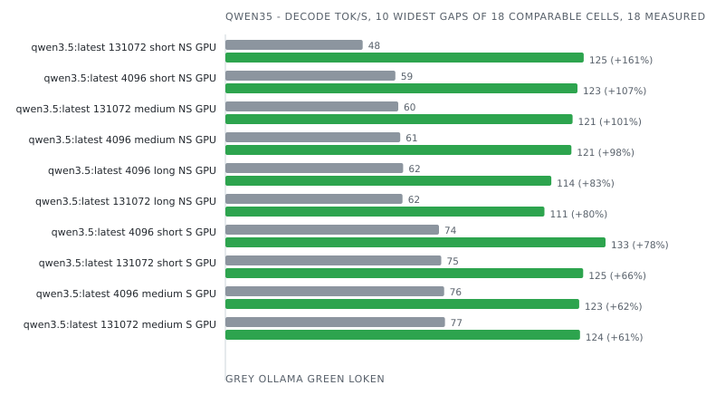

| Model          | Ctx    | Prompt | Mode       | Device | Engine              | Prefill tok/s | Decode tok/s | Tokens  | E2E ms     | J/req   | J/token   | Δ decode    | Δ energy   | Date             | Run      |
|----------------|--------|--------|------------|--------|---------------------|---------------|--------------|---------|------------|---------|-----------|-------------|------------|------------------|----------|
| qwen3.5:latest | 4096   | long   | non-stream | GPU    | Ollama 0.34.2       |  -            | 62.0         | 128     | 4 212      | 350     | 2.731     |             |            | 2026-09-04 01:04 | 38881075 |
| qwen3.5:latest | 4096   | long   | non-stream | GPU    | **loken 0.1.0-dev** |  -            | **113.7**    | **128** | **1 327**  | **261** | **2.038** | **+83.4%**  | **+34.1%** | 2026-09-04 01:04 | 38881075 |
| qwen3.5:latest | 4096   | long   | stream     | CPU    | Ollama 0.34.2       | 407.7         | 4.3          | 128     | 33 542     | 715     | 5.584     |             |            | 2026-09-05 07:44 | cdc3cd6e |
| qwen3.5:latest | 4096   | long   | stream     | CPU    | **loken 0.1.0-dev** | **2 526.2**   | **4.2**      | **128** | **33 086** | **717** | **5.599** | -2.4%       | -0.3%      | 2026-09-05 07:44 | cdc3cd6e |
| qwen3.5:latest | 4096   | long   | stream     | GPU    | Ollama 0.34.2       | 639.6         | 75.8         | 128     | 4 221      | 350     | 2.734     |             |            | 2026-09-03 23:25 | 0fb6ff72 |
| qwen3.5:latest | 4096   | long   | stream     | GPU    | **loken 0.1.0-dev** | **7 894.9**   | **114.2**    | **128** | **1 384**  | **261** | **2.035** | **+50.6%**  | **+34.3%** | 2026-09-03 23:25 | 0fb6ff72 |
| qwen3.5:latest | 4096   | medium | non-stream | GPU    | Ollama 0.34.2       |  -            | 61.0         | 128     | 4 244      | 341     | 2.662     |             |            | 2026-09-03 21:48 | 99b7aba5 |
| qwen3.5:latest | 4096   | medium | non-stream | GPU    | **loken 0.1.0-dev** |  -            | **120.7**    | **128** | **1 264**  | **258** | **2.013** | **+97.9%**  | **+32.2%** | 2026-09-03 21:48 | 99b7aba5 |
| qwen3.5:latest | 4096   | medium | stream     | CPU    | Ollama 0.34.2       | 61.7          | 4.3          | 128     | 32 397     | 719     | 5.614     |             |            | 2026-09-05 02:43 | 40e34e75 |
| qwen3.5:latest | 4096   | medium | stream     | CPU    | **loken 0.1.0-dev** | **272.5**     | **4.2**      | **128** | **31 557** | **722** | **5.637** | -2.5%       | -0.4%      | 2026-09-05 02:43 | 40e34e75 |
| qwen3.5:latest | 4096   | medium | stream     | GPU    | Ollama 0.34.2       | 101.9         | 76.3         | 128     | 4 208      | 349     | 2.726     |             |            | 2026-09-03 20:08 | 9f191873 |
| qwen3.5:latest | 4096   | medium | stream     | GPU    | **loken 0.1.0-dev** | **1 204.9**   | **123.4**    | **128** | **1 287**  | **263** | **2.053** | **+61.7%**  | **+32.8%** | 2026-09-03 20:08 | 9f191873 |
| qwen3.5:latest | 4096   | short  | non-stream | GPU    | Ollama 0.34.2       |  -            | 59.3         | 128     | 5 011      | 358     | 2.797     |             |            | 2026-09-03 18:25 | bb3e5b33 |
| qwen3.5:latest | 4096   | short  | non-stream | GPU    | **loken 0.1.0-dev** |  -            | **122.8**    | **128** | **1 224**  | **253** | **1.975** | **+107.0%** | **+41.6%** | 2026-09-03 18:25 | bb3e5b33 |
| qwen3.5:latest | 4096   | short  | stream     | CPU    | Ollama 0.34.2       | 21.7          | 4.3          | 128     | 32 412     | 717     | 5.604     |             |            | 2026-09-04 22:09 | 0bcd2450 |
| qwen3.5:latest | 4096   | short  | stream     | CPU    | **loken 0.1.0-dev** | **212.1**     | **4.1**      | **128** | **35 305** | **963** | **7.520** | -4.4%       | -25.5%     | 2026-09-04 22:09 | 0bcd2450 |
| qwen3.5:latest | 4096   | short  | stream     | GPU    | Ollama 0.35.1       | 136.3         | 74.5         | 128     | 3 916      | 308     | 2.408     |             |            | 2026-10-03 21:15 | d3567ea2 |
| qwen3.5:latest | 4096   | short  | stream     | GPU    | **loken 0.1.0-dev** | **1 692.0**   | **132.6**    | **128** | **1 135**  | **244** | **1.907** | **+78.1%**  | **+26.3%** | 2026-10-03 21:15 | d3567ea2 |
| qwen3.5:latest | 131072 | long   | non-stream | GPU    | Ollama 0.34.2       |  -            | 61.8         | 128     | 4 367      | 356     | 2.784     |             |            | 2026-09-04 16:49 | 10edb56c |
| qwen3.5:latest | 131072 | long   | non-stream | GPU    | **loken 0.1.0-dev** |  -            | **111.3**    | **128** | **1 351**  | **263** | **2.052** | **+80.0%**  | **+35.7%** | 2026-09-04 16:49 | 10edb56c |
| qwen3.5:latest | 131072 | long   | stream     | CPU    | Ollama 0.34.2       | 377.5         | 4.3          | 128     | 33 966     | 716     | 5.591     |             |            | 2026-09-06 04:34 | 3a0f9a1b |
| qwen3.5:latest | 131072 | long   | stream     | CPU    | **loken 0.1.0-dev** | **2 362.9**   | **4.2**      | **128** | **33 110** | **717** | **5.599** | -2.3%       | -0.2%      | 2026-09-06 04:34 | 3a0f9a1b |
| qwen3.5:latest | 131072 | long   | stream     | GPU    | Ollama 0.34.2       | 645.4         | 74.4         | 128     | 4 329      | 358     | 2.794     |             |            | 2026-09-04 14:50 | c8c36897 |
| qwen3.5:latest | 131072 | long   | stream     | GPU    | **loken 0.1.0-dev** | **7 696.3**   | **113.6**    | **128** | **1 385**  | **273** | **2.133** | **+52.7%**  | **+31.0%** | 2026-09-04 14:50 | c8c36897 |
| qwen3.5:latest | 131072 | medium | non-stream | GPU    | Ollama 0.34.2       |  -            | 60.3         | 128     | 4 395      | 335     | 2.617     |             |            | 2026-09-04 12:56 | c5224714 |
| qwen3.5:latest | 131072 | medium | non-stream | GPU    | **loken 0.1.0-dev** |  -            | **121.1**    | **128** | **1 238**  | **249** | **1.946** | **+100.9%** | **+34.5%** | 2026-09-04 12:56 | c5224714 |
| qwen3.5:latest | 131072 | medium | stream     | CPU    | Ollama 0.34.2       | 59.6          | 4.3          | 128     | 32 638     | 713     | 5.570     |             |            | 2026-09-06 01:41 | 049cea79 |
| qwen3.5:latest | 131072 | medium | stream     | CPU    | **loken 0.1.0-dev** | **355.7**     | **4.2**      | **128** | **31 718** | **716** | **5.592** | -3.2%       | -0.4%      | 2026-09-06 01:41 | 049cea79 |
| qwen3.5:latest | 131072 | medium | stream     | GPU    | Ollama 0.34.2       | 97.6          | 76.6         | 128     | 4 265      | 335     | 2.615     |             |            | 2026-09-04 11:06 | 916fec1a |
| qwen3.5:latest | 131072 | medium | stream     | GPU    | **loken 0.1.0-dev** | **1 203.2**   | **123.7**    | **128** | **1 290**  | **257** | **2.011** | **+61.6%**  | **+30.1%** | 2026-09-04 11:06 | 916fec1a |
| qwen3.5:latest | 131072 | short  | non-stream | GPU    | Ollama 0.34.2       |  -            | 47.9         | 128     | 6 358      | 378     | 2.954     |             |            | 2026-09-04 09:06 | 1646490c |
| qwen3.5:latest | 131072 | short  | non-stream | GPU    | **loken 0.1.0-dev** |  -            | **125.0**    | **128** | **1 210**  | **254** | **1.986** | **+161.3%** | **+48.7%** | 2026-09-04 09:06 | 1646490c |
| qwen3.5:latest | 131072 | short  | stream     | CPU    | Ollama 0.34.2       | 21.6          | 4.3          | 128     | 32 682     | 716     | 5.591     |             |            | 2026-09-05 22:46 | 13afb361 |
| qwen3.5:latest | 131072 | short  | stream     | CPU    | **loken 0.1.0-dev** | **118.5**     | **4.2**      | **128** | **31 282** | **715** | **5.584** | -2.1%       | **+0.1%**  | 2026-09-05 22:46 | 13afb361 |
| qwen3.5:latest | 131072 | short  | stream     | GPU    | Ollama 0.34.2       | 33.3          | 75.3         | 128     | 4 301      | 353     | 2.760     |             |            | 2026-09-04 03:09 | 33fd96d5 |
| qwen3.5:latest | 131072 | short  | stream     | GPU    | **loken 0.1.0-dev** | **475.4**     | **124.8**    | **128** | **1 299**  | **242** | **1.888** | **+65.8%**  | **+46.2%** | 2026-09-04 03:09 | 33fd96d5 |

### qwen35moe

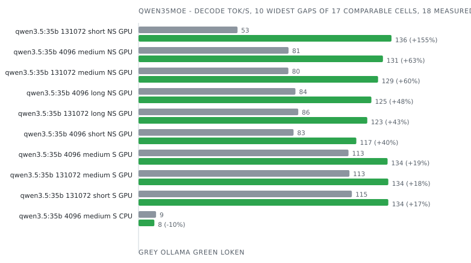

| Model       | Ctx    | Prompt | Mode       | Device | Engine              | Prefill tok/s | Decode tok/s | Tokens  | E2E ms     | J/req   | J/token   | Δ decode    | Δ energy   | Date             | Run      |
|-------------|--------|--------|------------|--------|---------------------|---------------|--------------|---------|------------|---------|-----------|-------------|------------|------------------|----------|
| qwen3.5:35b | 4096   | long   | non-stream | GPU    | Ollama 0.34.2       |  -            | 84.3         | 128     | 19 547     | 202     | 1.580     |             |            | 2026-09-04 01:02 | 8899ca7e |
| qwen3.5:35b | 4096   | long   | non-stream | GPU    | **loken 0.1.0-dev** |  -            | **125.1**    | **128** | **1 468**  | **176** | **1.371** | **+48.4%**  | **+15.3%** | 2026-09-04 01:02 | 8899ca7e |
| qwen3.5:35b | 4096   | long   | stream     | CPU    | Ollama 0.34.2       | 402.0         | 9.3          | 128     | 20 046     | 338     | 2.644     |             |            | 2026-09-05 07:40 | 3d99ece7 |
| qwen3.5:35b | 4096   | long   | stream     | CPU    | **loken 0.1.0-dev** | **2 731.2**   | **8.7**      | **128** | **31 494** | **353** | **2.754** | -7.0%       | -4.0%      | 2026-09-05 07:40 | 3d99ece7 |
| qwen3.5:35b | 4096   | long   | stream     | GPU    | Ollama 0.34.2       | 633.9         | 117.6        | 128     | 5 254      | 196     | 1.531     |             |            | 2026-09-03 23:23 | 851c919f |
| qwen3.5:35b | 4096   | long   | stream     | GPU    | **loken 0.1.0-dev** | **7 134.7**   | **127.3**    | **128** | **1 499**  | **169** | **1.317** | **+8.3%**   | **+16.3%** | 2026-09-03 23:23 | 851c919f |
| qwen3.5:35b | 4096   | medium | non-stream | GPU    | Ollama 0.34.2       |  -            | 80.6         | 128     | 19 881     | 207     | 1.617     |             |            | 2026-09-03 21:46 | 6ee574ea |
| qwen3.5:35b | 4096   | medium | non-stream | GPU    | **loken 0.1.0-dev** |  -            | **131.3**    | **128** | **1 342**  | **165** | **1.288** | **+62.8%**  | **+25.5%** | 2026-09-03 21:46 | 6ee574ea |
| qwen3.5:35b | 4096   | medium | stream     | CPU    | Ollama 0.34.2       | 67.3          | 9.4          | 128     | 19 494     | 340     | 2.653     |             |            | 2026-09-05 02:40 | 4ad6ab88 |
| qwen3.5:35b | 4096   | medium | stream     | CPU    | **loken 0.1.0-dev** | **449.9**     | **8.5**      | **128** | **20 471** | **359** | **2.807** | -9.0%       | -5.5%      | 2026-09-05 02:40 | 4ad6ab88 |
| qwen3.5:35b | 4096   | medium | stream     | GPU    | Ollama 0.34.2       | 87.3          | 112.8        | 128     | 20 303     | 205     | 1.603     |             |            | 2026-09-03 20:06 | f0fcc8d4 |
| qwen3.5:35b | 4096   | medium | stream     | GPU    | **loken 0.1.0-dev** | **654.2**     | **133.8**    | **128** | **1 399**  | **169** | **1.321** | **+18.7%**  | **+21.4%** | 2026-09-03 20:06 | f0fcc8d4 |
| qwen3.5:35b | 4096   | short  | non-stream | GPU    | Ollama 0.34.2       |  -            | 83.3         | 128     | 9 355      | 197     | 1.537     |             |            | 2026-09-03 18:23 | c437ba3b |
| qwen3.5:35b | 4096   | short  | non-stream | GPU    | **loken 0.1.0-dev** |  -            | **117.0**    | **128** | **1 638**  | **175** | **1.366** | **+40.5%**  | **+12.5%** | 2026-09-03 18:23 | c437ba3b |
| qwen3.5:35b | 4096   | short  | stream     | CPU    | Ollama 0.34.2       | 24.2          | 9.3          | 128     | 19 491     | 340     | 2.656     |             |            | 2026-09-04 22:05 | 81345cba |
| qwen3.5:35b | 4096   | short  | stream     | CPU    | **loken 0.1.0-dev** | **134.4**     | **8.7**      | **128** | **19 703** | **353** | **2.757** | -7.1%       | -3.7%      | 2026-09-04 22:05 | 81345cba |
| qwen3.5:35b | 4096   | short  | stream     | GPU    | Ollama 0.35.1       | 105.2         | 151.2        | 128     | 4 291      | 162     | 1.266     |             |            | 2026-10-05 20:42 | d0790484 |
| qwen3.5:35b | 4096   | short  | stream     | GPU    | **loken 0.2.0-dev** | **1 383.9**   | **154.9**    | **128** | **996**    | **146** | **1.144** | **+2.4%**   | **+10.6%** | 2026-10-05 20:42 | d0790484 |
| qwen3.5:35b | 131072 | long   | non-stream | GPU    | Ollama 0.34.2       |  -            | 85.8         | 128     | 20 313     | 204     | 1.596     |             |            | 2026-09-04 16:47 | ea93ed84 |
| qwen3.5:35b | 131072 | long   | non-stream | GPU    | **loken 0.1.0-dev** |  -            | **122.9**    | **128** | **1 477**  | **175** | **1.366** | **+43.3%**  | **+16.9%** | 2026-09-04 16:47 | ea93ed84 |
| qwen3.5:35b | 131072 | long   | stream     | CPU    | Ollama 0.34.2       | 421.6         | 9.4          | 128     | 20 210     | 337     | 2.633     |             |            | 2026-09-06 04:29 | 5473cc04 |
| qwen3.5:35b | 131072 | long   | stream     | CPU    | **loken 0.1.0-dev** | **3 473.8**   | **8.6**      | **128** | **33 191** | **351** | **2.744** | -7.9%       | -4.1%      | 2026-09-06 04:29 | 5473cc04 |
| qwen3.5:35b | 131072 | long   | stream     | GPU    | Ollama 0.34.2       |  -            |  -           |  -      |  -         |  -      |  -        | failed      |            | 2026-09-04 14:48 | 191a8f3b |
| qwen3.5:35b | 131072 | long   | stream     | GPU    | **loken 0.1.0-dev** | **8 744.8**   | **124.9**    | **128** | **1 473**  | **177** | **1.386** |             |            | 2026-09-04 14:48 | 191a8f3b |
| qwen3.5:35b | 131072 | medium | non-stream | GPU    | Ollama 0.34.2       |  -            | 80.5         | 128     | 5 180      | 207     | 1.620     |             |            | 2026-09-04 12:54 | 36b4a78a |
| qwen3.5:35b | 131072 | medium | non-stream | GPU    | **loken 0.1.0-dev** |  -            | **128.7**    | **128** | **1 347**  | **165** | **1.290** | **+59.8%**  | **+25.6%** | 2026-09-04 12:54 | 36b4a78a |
| qwen3.5:35b | 131072 | medium | stream     | CPU    | Ollama 0.34.2       | 65.1          | 9.4          | 128     | 19 697     | 338     | 2.638     |             |            | 2026-09-06 01:37 | 7185dcaa |
| qwen3.5:35b | 131072 | medium | stream     | CPU    | **loken 0.1.0-dev** | **352.6**     | **8.6**      | **128** | **29 173** | **358** | **2.799** | -8.4%       | -5.7%      | 2026-09-06 01:37 | 7185dcaa |
| qwen3.5:35b | 131072 | medium | stream     | GPU    | Ollama 0.34.2       | 91.9          | 113.3        | 128     | 13 630     | 206     | 1.608     |             |            | 2026-09-04 11:04 | 9860e8ab |
| qwen3.5:35b | 131072 | medium | stream     | GPU    | **loken 0.1.0-dev** | **1 188.7**   | **134.2**    | **128** | **1 382**  | **171** | **1.334** | **+18.5%**  | **+20.6%** | 2026-09-04 11:04 | 9860e8ab |
| qwen3.5:35b | 131072 | short  | non-stream | GPU    | Ollama 0.34.2       |  -            | 53.2         | 128     | 7 250      | 243     | 1.896     |             |            | 2026-09-04 09:04 | 109829d8 |
| qwen3.5:35b | 131072 | short  | non-stream | GPU    | **loken 0.1.0-dev** |  -            | **135.9**    | **128** | **1 312**  | **153** | **1.199** | **+155.3%** | **+58.2%** | 2026-09-04 09:04 | 109829d8 |
| qwen3.5:35b | 131072 | short  | stream     | CPU    | Ollama 0.34.2       | 23.9          | 9.4          | 128     | 19 552     | 338     | 2.643     |             |            | 2026-09-05 22:43 | eb023156 |
| qwen3.5:35b | 131072 | short  | stream     | CPU    | **loken 0.1.0-dev** | **193.0**     | **8.7**      | **128** | **19 453** | **352** | **2.752** | -7.4%       | -4.0%      | 2026-09-05 22:43 | eb023156 |
| qwen3.5:35b | 131072 | short  | stream     | GPU    | Ollama 0.34.2       | 32.7          | 114.6        | 128     | 20 057     | 200     | 1.563     |             |            | 2026-09-04 03:07 | 17c31132 |
| qwen3.5:35b | 131072 | short  | stream     | GPU    | **loken 0.1.0-dev** | **379.1**     | **134.2**    | **128** | **1 325**  | **166** | **1.297** | **+17.1%**  | **+20.5%** | 2026-09-04 03:07 | 17c31132 |

### qwen3moe

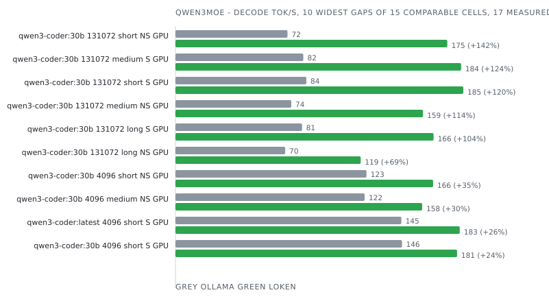

| Model              | Ctx    | Prompt | Mode       | Device | Engine                           | Prefill tok/s | Decode tok/s | Tokens  | E2E ms     | J/req   | J/token   | Δ decode   | Δ energy   | Date             | Run      |
|--------------------|--------|--------|------------|--------|----------------------------------|---------------|--------------|---------|------------|---------|-----------|------------|------------|------------------|----------|
| qwen3-coder:30b    | 4096   | long   | non-stream | GPU    | Ollama 0.34.2                    |  -            |  -           | 128     |  -         |  -      |  -        | incoherent |            | 2026-09-04 00:57 | 09366daa |
| qwen3-coder:30b    | 4096   | long   | non-stream | GPU    | vLLM 0.29.1rc1.dev350+gd5f0a6e82 |  -            | 124.4        | 128     | 1 081      | 164     | 1.282     |            |            | 2026-09-04 00:57 | 09366daa |
| qwen3-coder:30b    | 4096   | long   | non-stream | GPU    | **loken 0.1.0-dev**              |  -            | **118.8**    | **128** | **1 429**  | **242** | **1.888** | -4.5%      | -32.1%     | 2026-09-04 00:57 | 09366daa |
| qwen3-coder:30b    | 4096   | long   | stream     | CPU    | Ollama 0.34.2                    |  -            |  -           | 128     |  -         |  -      |  -        | incoherent |            | 2026-09-05 07:36 | caed868a |
| qwen3-coder:30b    | 4096   | long   | stream     | CPU    | **loken 0.1.0-dev**              |  -            |  -           | **128** |  -         |  -      |  -        | incoherent |            | 2026-09-05 07:36 | caed868a |
| qwen3-coder:30b    | 4096   | long   | stream     | GPU    | Ollama 0.34.2                    |  -            |  -           | 128     |  -         |  -      |  -        | incoherent |            | 2026-09-03 23:19 | e8b6c87f |
| qwen3-coder:30b    | 4096   | long   | stream     | GPU    | vLLM 0.29.1rc1.dev350+gd5f0a6e82 | 10 261.2      | 134.2        | 128     | 1 036      | 164     | 1.278     |            |            | 2026-09-03 23:19 | e8b6c87f |
| qwen3-coder:30b    | 4096   | long   | stream     | GPU    | **loken 0.1.0-dev**              | **631.5**     | **177.7**    | **128** | **1 416**  | **242** | **1.890** | **+32.4%** | -32.4%     | 2026-09-03 23:19 | e8b6c87f |
| qwen3-coder:30b    | 4096   | medium | non-stream | GPU    | Ollama 0.34.2                    |  -            | 121.5        | 128     | 3 877      | 159     | 1.246     |            |            | 2026-09-03 21:41 | d9d507d5 |
| qwen3-coder:30b    | 4096   | medium | non-stream | GPU    | vLLM 0.29.1rc1.dev350+gd5f0a6e82 |  -            | 124.6        | 128     | 1 062      | 170     | 1.332     |            |            | 2026-09-03 21:41 | d9d507d5 |
| qwen3-coder:30b    | 4096   | medium | non-stream | GPU    | **loken 0.1.0-dev**              |  -            | **158.5**    | **128** | **1 110**  | **167** | **1.303** | **+27.2%** | -4.4%      | 2026-09-03 21:41 | d9d507d5 |
| qwen3-coder:30b    | 4096   | medium | stream     | CPU    | Ollama 0.34.2                    | 129.6         | 10.9         | 128     | 16 766     | 293     | 2.287     |            |            | 2026-09-05 02:36 | 5750fd67 |
| qwen3-coder:30b    | 4096   | medium | stream     | CPU    | **loken 0.1.0-dev**              | **32.0**      | **10.5**     | **128** | **18 920** | **323** | **2.527** | -3.5%      | -9.5%      | 2026-09-05 02:36 | 5750fd67 |
| qwen3-coder:30b    | 4096   | medium | stream     | GPU    | Ollama 0.34.2                    | 188.5         | 148.1        | 128     | 3 947      | 176     | 1.374     |            |            | 2026-09-03 20:01 | 4bfd8894 |
| qwen3-coder:30b    | 4096   | medium | stream     | GPU    | vLLM 0.29.1rc1.dev350+gd5f0a6e82 | 1 938.7       | 126.4        | 128     | 1 051      | 172     | 1.340     |            |            | 2026-09-03 20:01 | 4bfd8894 |
| qwen3-coder:30b    | 4096   | medium | stream     | GPU    | **loken 0.1.0-dev**              | **459.7**     | **184.1**    | **128** | **1 116**  | **168** | **1.312** | **+24.3%** | **+2.2%**  | 2026-09-03 20:01 | 4bfd8894 |
| qwen3-coder:30b    | 4096   | short  | non-stream | GPU    | Ollama 0.34.2                    |  -            | 122.7        | 128     | 3 866      | 164     | 1.285     |            |            | 2026-09-03 18:19 | 5c4c6768 |
| qwen3-coder:30b    | 4096   | short  | non-stream | GPU    | vLLM 0.29.1rc1.dev350+gd5f0a6e82 |  -            | 134.2        | 128     | 991        | 163     | 1.275     |            |            | 2026-09-03 18:19 | 5c4c6768 |
| qwen3-coder:30b    | 4096   | short  | non-stream | GPU    | **loken 0.1.0-dev**              |  -            | **165.5**    | **128** | **1 052**  | **157** | **1.226** | **+23.3%** | **+4.0%**  | 2026-09-03 18:19 | 5c4c6768 |
| qwen3-coder:30b    | 4096   | short  | stream     | CPU    | Ollama 0.34.2                    | 38.9          | 11.0         | 128     | 16 735     | 288     | 2.247     |            |            | 2026-09-04 22:01 | 5dd2a483 |
| qwen3-coder:30b    | 4096   | short  | stream     | CPU    | **loken 0.1.0-dev**              | **18.5**      | **10.6**     | **128** | **18 275** | **305** | **2.380** | -3.6%      | -5.6%      | 2026-09-04 22:01 | 5dd2a483 |
| qwen3-coder:30b    | 4096   | short  | stream     | GPU    | Ollama 0.35.1                    | 804.0         | 143.9        | 128     | 3 811      | 144     | 1.124     |            |            | 2026-10-05 23:01 | 14028f87 |
| qwen3-coder:30b    | 4096   | short  | stream     | GPU    | **loken 0.2.0-dev**              | **377.4**     | **163.5**    | **128** | **962**    | **165** | **1.286** | **+13.6%** | -12.7%     | 2026-10-05 23:01 | 14028f87 |
| qwen3-coder:30b    | 131072 | long   | non-stream | GPU    | Ollama 0.34.2                    |  -            | 70.5         | 128     | 5 454      | 216     | 1.689     |            |            | 2026-09-04 16:42 | 277295cd |
| qwen3-coder:30b    | 131072 | long   | non-stream | GPU    | vLLM 0.29.1rc1.dev350+gd5f0a6e82 |  -            | 124.3        | 128     | 1 084      | 159     | 1.241     |            |            | 2026-09-04 16:42 | 277295cd |
| qwen3-coder:30b    | 131072 | long   | non-stream | GPU    | **loken 0.1.0-dev**              |  -            | **119.0**    | **128** | **1 393**  | **248** | **1.937** | -4.3%      | -36.0%     | 2026-09-04 16:42 | 277295cd |
| qwen3-coder:30b    | 131072 | long   | stream     | CPU    | Ollama 0.34.2                    |  -            |  -           | 128     |  -         |  -      |  -        | incoherent |            | 2026-09-06 04:26 | 679608be |
| qwen3-coder:30b    | 131072 | long   | stream     | CPU    | **loken 0.1.0-dev**              |  -            |  -           | **128** |  -         |  -      |  -        | incoherent |            | 2026-09-06 04:26 | 679608be |
| qwen3-coder:30b    | 131072 | long   | stream     | GPU    | Ollama 0.34.2                    | 12.1          | 81.3         | 128     | 20 918     | 1 823   | 14.242    |            |            | 2026-09-04 14:44 | e4840b93 |
| qwen3-coder:30b    | 131072 | long   | stream     | GPU    | vLLM 0.29.1rc1.dev350+gd5f0a6e82 | 10 138.2      | 126.3        | 128     | 1 075      | 172     | 1.341     |            |            | 2026-09-04 14:44 | e4840b93 |
| qwen3-coder:30b    | 131072 | long   | stream     | GPU    | **loken 0.1.0-dev**              | **565.1**     | **165.8**    | **128** | **1 558**  | **246** | **1.920** | **+31.3%** | -30.2%     | 2026-09-04 14:44 | e4840b93 |
| qwen3-coder:30b    | 131072 | medium | non-stream | GPU    | Ollama 0.34.2                    |  -            | 74.4         | 128     | 5 393      | 207     | 1.618     |            |            | 2026-09-04 12:50 | a5db6b85 |
| qwen3-coder:30b    | 131072 | medium | non-stream | GPU    | vLLM 0.29.1rc1.dev350+gd5f0a6e82 |  -            | 124.5        | 128     | 1 073      | 168     | 1.312     |            |            | 2026-09-04 12:50 | a5db6b85 |
| qwen3-coder:30b    | 131072 | medium | non-stream | GPU    | **loken 0.1.0-dev**              |  -            | **159.0**    | **128** | **1 109**  | **164** | **1.284** | **+27.7%** | **+2.2%**  | 2026-09-04 12:50 | a5db6b85 |
| qwen3-coder:30b    | 131072 | medium | stream     | CPU    | Ollama 0.34.2                    | 120.7         | 10.9         | 128     | 17 882     | 282     | 2.203     |            |            | 2026-09-06 01:33 | e04d3a20 |
| qwen3-coder:30b    | 131072 | medium | stream     | CPU    | **loken 0.1.0-dev**              | **32.0**      | **10.6**     | **128** | **18 668** | **315** | **2.464** | -3.3%      | -10.6%     | 2026-09-06 01:33 | e04d3a20 |
| qwen3-coder:30b    | 131072 | medium | stream     | GPU    | Ollama 0.34.2                    | 164.8         | 82.1         | 128     | 5 485      | 215     | 1.678     |            |            | 2026-09-04 11:00 | 3c98be19 |
| qwen3-coder:30b    | 131072 | medium | stream     | GPU    | vLLM 0.29.1rc1.dev350+gd5f0a6e82 | 1 957.5       | 126.3        | 128     | 1 052      | 175     | 1.366     |            |            | 2026-09-04 11:00 | 3c98be19 |
| qwen3-coder:30b    | 131072 | medium | stream     | GPU    | **loken 0.1.0-dev**              | **453.2**     | **183.5**    | **128** | **1 105**  | **167** | **1.309** | **+45.3%** | **+4.4%**  | 2026-09-04 11:00 | 3c98be19 |
| qwen3-coder:30b    | 131072 | short  | non-stream | GPU    | Ollama 0.34.2                    |  -            | 72.0         | 128     | 5 437      | 207     | 1.617     |            |            | 2026-09-04 09:00 | c633779c |
| qwen3-coder:30b    | 131072 | short  | non-stream | GPU    | vLLM 0.29.1rc1.dev350+gd5f0a6e82 |  -            | 129.8        | 128     | 1 045      | 173     | 1.353     |            |            | 2026-09-04 09:00 | c633779c |
| qwen3-coder:30b    | 131072 | short  | non-stream | GPU    | **loken 0.1.0-dev**              |  -            | **174.6**    | **128** | **1 063**  | **134** | **1.046** | **+34.5%** | **+29.3%** | 2026-09-04 09:00 | c633779c |
| qwen3-coder:30b    | 131072 | short  | stream     | CPU    | Ollama 0.34.2                    | 44.4          | 11.0         | 128     | 17 879     | 280     | 2.191     |            |            | 2026-09-05 22:39 | aa05955a |
| qwen3-coder:30b    | 131072 | short  | stream     | CPU    | **loken 0.1.0-dev**              | **18.2**      | **10.6**     | **128** | **18 230** | **302** | **2.356** | -3.4%      | -7.0%      | 2026-09-05 22:39 | aa05955a |
| qwen3-coder:30b    | 131072 | short  | stream     | GPU    | Ollama 0.34.2                    | 73.1          | 84.1         | 128     | 5 367      | 207     | 1.615     |            |            | 2026-09-04 03:02 | 2f9f6060 |
| qwen3-coder:30b    | 131072 | short  | stream     | GPU    | vLLM 0.29.1rc1.dev350+gd5f0a6e82 | 640.6         | 134.3        | 128     | 1 010      | 168     | 1.313     |            |            | 2026-09-04 03:02 | 2f9f6060 |
| qwen3-coder:30b    | 131072 | short  | stream     | GPU    | **loken 0.1.0-dev**              | **260.2**     | **184.9**    | **128** | **1 076**  | **157** | **1.223** | **+37.7%** | **+7.3%**  | 2026-09-04 03:02 | 2f9f6060 |
| qwen3-coder:latest | 4096   | short  | stream     | GPU    | Ollama 0.35.1                    | 668.9         | 145.1        | 128     | 3 749      | 146     | 1.144     |            |            | 2026-10-03 21:12 | 54dc9120 |
| qwen3-coder:latest | 4096   | short  | stream     | GPU    | **loken 0.1.0-dev**              | **501.7**     | **182.6**    | **128** | **822**    | **133** | **1.042** | **+25.9%** | **+9.8%**  | 2026-10-03 21:12 | 54dc9120 |

### qwen3next

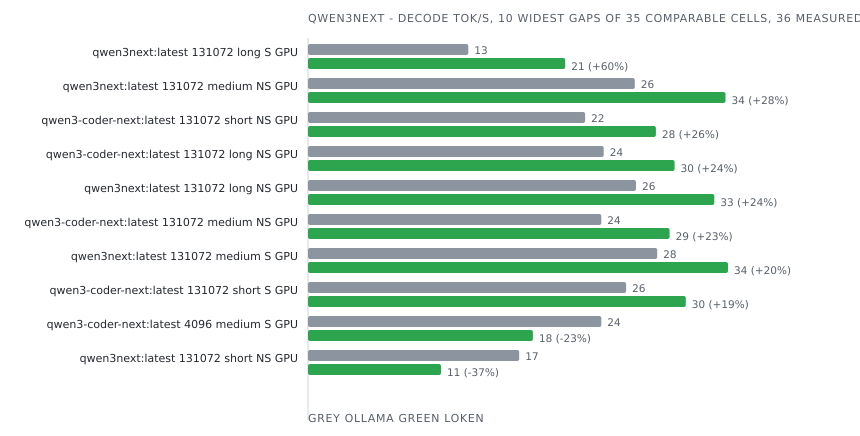

| Model                   | Ctx    | Prompt | Mode       | Device | Engine              | Prefill tok/s | Decode tok/s | Tokens  | E2E ms      | J/req   | J/token   | Δ decode   | Δ energy    | Date             | Run      |
|-------------------------|--------|--------|------------|--------|---------------------|---------------|--------------|---------|-------------|---------|-----------|------------|-------------|------------------|----------|
| qwen3-coder-next:latest | 4096   | long   | non-stream | GPU    | Ollama 0.34.2       |  -            | 26.2         | 128     | 11 032      | 431     | 3.370     |            |             | 2026-09-04 00:54 | e0797220 |
| qwen3-coder-next:latest | 4096   | long   | non-stream | GPU    | **loken 0.1.0-dev** |  -            | **28.7**     | **128** | **18 940**  | **440** | **3.439** | **+9.6%**  | -2.0%       | 2026-09-04 00:54 | e0797220 |
| qwen3-coder-next:latest | 4096   | long   | stream     | CPU    | Ollama 0.34.2       | 458.5         | 7.6          | 128     | 45 517      | 408     | 3.185     |            |             | 2026-09-05 07:27 | cdc246f5 |
| qwen3-coder-next:latest | 4096   | long   | stream     | CPU    | **loken 0.1.0-dev** | **50.9**      | **6.4**      | **128** | **123 711** | **576** | **4.502** | -15.5%     | -29.3%      | 2026-09-05 07:27 | cdc246f5 |
| qwen3-coder-next:latest | 4096   | long   | stream     | GPU    | Ollama 0.34.2       | 592.8         | 28.1         | 128     | 11 080      | 430     | 3.359     |            |             | 2026-09-03 23:17 | 0565915d |
| qwen3-coder-next:latest | 4096   | long   | stream     | GPU    | **loken 0.1.0-dev** | **4 661.8**   | **28.8**     | **128** | **12 205**  | **438** | **3.418** | **+2.4%**  | -1.7%       | 2026-09-03 23:17 | 0565915d |
| qwen3-coder-next:latest | 4096   | medium | non-stream | GPU    | Ollama 0.34.2       |  -            | 25.8         | 128     | 10 621      | 431     | 3.364     |            |             | 2026-09-03 21:39 | d7140eaa |
| qwen3-coder-next:latest | 4096   | medium | non-stream | GPU    | **loken 0.1.0-dev** |  -            | **29.3**     | **128** | **10 608**  | **424** | **3.313** | **+13.6%** | **+1.5%**   | 2026-09-03 21:39 | d7140eaa |
| qwen3-coder-next:latest | 4096   | medium | stream     | CPU    | Ollama 0.34.2       | 77.3          | 7.6          | 128     | 49 071      | 412     | 3.220     |            |             | 2026-09-05 02:28 | 64050e00 |
| qwen3-coder-next:latest | 4096   | medium | stream     | CPU    | **loken 0.1.0-dev** | **140.2**     | **6.6**      | **128** | **102 586** | **470** | **3.670** | -13.4%     | -12.2%      | 2026-09-05 02:28 | 64050e00 |
| qwen3-coder-next:latest | 4096   | medium | stream     | GPU    | Ollama 0.34.2       | 88.9          | 23.6         | 128     | 17 032      | 786     | 6.140     |            |             | 2026-09-03 19:56 | d170d822 |
| qwen3-coder-next:latest | 4096   | medium | stream     | GPU    | **loken 0.1.0-dev** | **670.0**     | **18.1**     | **128** | **20 743**  | **618** | **4.826** | -23.4%     | **+27.2%**  | 2026-09-03 19:56 | d170d822 |
| qwen3-coder-next:latest | 4096   | short  | non-stream | GPU    | Ollama 0.34.2       |  -            | 25.6         | 128     | 10 397      | 434     | 3.389     |            |             | 2026-09-03 18:17 | 787b365a |
| qwen3-coder-next:latest | 4096   | short  | non-stream | GPU    | **loken 0.1.0-dev** |  -            | **29.3**     | **128** | **10 239**  | **424** | **3.316** | **+14.6%** | **+2.2%**   | 2026-09-03 18:17 | 787b365a |
| qwen3-coder-next:latest | 4096   | short  | stream     | CPU    | Ollama 0.34.2       | 27.8          | 7.6          | 128     | 43 122      | 411     | 3.209     |            |             | 2026-09-04 21:54 | 0c0bbf73 |
| qwen3-coder-next:latest | 4096   | short  | stream     | CPU    | **loken 0.1.0-dev** | **46.5**      | **6.7**      | **128** | **95 749**  | **454** | **3.550** | -11.2%     | -9.6%       | 2026-09-04 21:54 | 0c0bbf73 |
| qwen3-coder-next:latest | 4096   | short  | stream     | GPU    | Ollama 0.35.1       | 81.8          | 34.3         | 128     | 11 503      | 344     | 2.684     |            |             | 2026-10-05 20:38 | 130f3794 |
| qwen3-coder-next:latest | 4096   | short  | stream     | GPU    | **loken 0.2.0-dev** | **653.6**     | **41.0**     | **128** | **3 783**   | **307** | **2.402** | **+19.4%** | **+11.7%**  | 2026-10-05 20:38 | 130f3794 |
| qwen3-coder-next:latest | 131072 | long   | non-stream | GPU    | Ollama 0.34.2       |  -            | 23.8         | 128     | 11 348      | 457     | 3.572     |            |             | 2026-09-04 16:40 | 65c07356 |
| qwen3-coder-next:latest | 131072 | long   | non-stream | GPU    | **loken 0.1.0-dev** |  -            | **29.5**     | **128** | **11 788**  | **427** | **3.340** | **+23.9%** | **+7.0%**   | 2026-09-04 16:40 | 65c07356 |
| qwen3-coder-next:latest | 131072 | long   | stream     | CPU    | Ollama 0.34.2       | 455.9         | 7.6          | 128     | 45 707      | 408     | 3.191     |            |             | 2026-09-06 04:17 | c75f25f9 |
| qwen3-coder-next:latest | 131072 | long   | stream     | CPU    | **loken 0.1.0-dev** | **269.2**     | **6.6**      | **128** | **110 591** | **478** | **3.736** | -13.7%     | -14.6%      | 2026-09-06 04:17 | c75f25f9 |
| qwen3-coder-next:latest | 131072 | long   | stream     | GPU    | Ollama 0.34.2       |  -            |  -           |  -      |  -          |  -      |  -        | failed     |             | 2026-09-04 14:40 | a7f9909d |
| qwen3-coder-next:latest | 131072 | long   | stream     | GPU    | **loken 0.1.0-dev** | **7 280.4**   | **23.9**     | **128** | **15 042**  | **490** | **3.831** |            |             | 2026-09-04 14:40 | a7f9909d |
| qwen3-coder-next:latest | 131072 | medium | non-stream | GPU    | Ollama 0.34.2       |  -            | 23.6         | 128     | 10 809      | 462     | 3.606     |            |             | 2026-09-04 12:48 | e3ac95e1 |
| qwen3-coder-next:latest | 131072 | medium | non-stream | GPU    | **loken 0.1.0-dev** |  -            | **29.1**     | **128** | **10 605**  | **435** | **3.402** | **+23.1%** | **+6.0%**   | 2026-09-04 12:48 | e3ac95e1 |
| qwen3-coder-next:latest | 131072 | medium | stream     | CPU    | Ollama 0.34.2       | 86.9          | 7.6          | 128     | 46 688      | 405     | 3.167     |            |             | 2026-09-06 01:26 | 89578e20 |
| qwen3-coder-next:latest | 131072 | medium | stream     | CPU    | **loken 0.1.0-dev** | **69.4**      | **6.6**      | **128** | **102 502** | **470** | **3.670** | -14.0%     | -13.7%      | 2026-09-06 01:26 | 89578e20 |
| qwen3-coder-next:latest | 131072 | medium | stream     | GPU    | Ollama 0.34.2       | 91.2          | 25.7         | 128     | 10 912      | 454     | 3.547     |            |             | 2026-09-04 10:57 | 78e75289 |
| qwen3-coder-next:latest | 131072 | medium | stream     | GPU    | **loken 0.1.0-dev** | **844.6**     | **30.3**     | **128** | **10 186**  | **419** | **3.275** | **+18.1%** | **+8.3%**   | 2026-09-04 10:57 | 78e75289 |
| qwen3-coder-next:latest | 131072 | short  | non-stream | GPU    | Ollama 0.34.2       |  -            | 22.3         | 128     | 10 901      | 471     | 3.681     |            |             | 2026-09-04 08:57 | 2e008c12 |
| qwen3-coder-next:latest | 131072 | short  | non-stream | GPU    | **loken 0.1.0-dev** |  -            | **28.0**     | **128** | **11 739**  | **432** | **3.378** | **+25.6%** | **+9.0%**   | 2026-09-04 08:57 | 2e008c12 |
| qwen3-coder-next:latest | 131072 | short  | stream     | CPU    | Ollama 0.34.2       | 29.0          | 7.6          | 128     | 49 830      | 406     | 3.175     |            |             | 2026-09-05 22:32 | 81d570ca |
| qwen3-coder-next:latest | 131072 | short  | stream     | CPU    | **loken 0.1.0-dev** | **33.7**      | **6.7**      | **128** | **89 728**  | **458** | **3.581** | -12.4%     | -11.3%      | 2026-09-05 22:32 | 81d570ca |
| qwen3-coder-next:latest | 131072 | short  | stream     | GPU    | Ollama 0.34.2       | 33.9          | 25.6         | 128     | 10 611      | 453     | 3.538     |            |             | 2026-09-04 03:00 | 3d29294d |
| qwen3-coder-next:latest | 131072 | short  | stream     | GPU    | **loken 0.1.0-dev** | **328.2**     | **30.4**     | **128** | **9 781**   | **418** | **3.265** | **+18.6%** | **+8.4%**   | 2026-09-04 03:00 | 3d29294d |
| qwen3next:latest        | 4096   | long   | non-stream | GPU    | Ollama 0.34.2       |  -            | 29.5         | 128     | 10 163      | 394     | 3.080     |            |             | 2026-09-04 01:11 | 62f80326 |
| qwen3next:latest        | 4096   | long   | non-stream | GPU    | **loken 0.1.0-dev** |  -            | **32.8**     | **128** | **10 439**  | **397** | **3.103** | **+11.2%** | -0.7%       | 2026-09-04 01:11 | 62f80326 |
| qwen3next:latest        | 4096   | long   | stream     | CPU    | Ollama 0.34.2       | 448.6         | 7.5          | 128     | 53 950      | 406     | 3.171     |            |             | 2026-09-05 07:56 | 4d824de3 |
| qwen3next:latest        | 4096   | long   | stream     | CPU    | **loken 0.1.0-dev** | **279.7**     | **6.5**      | **128** | **112 715** | **480** | **3.748** | -14.3%     | -15.4%      | 2026-09-05 07:56 | 4d824de3 |
| qwen3next:latest        | 4096   | long   | stream     | GPU    | Ollama 0.34.2       | 629.9         | 32.5         | 128     | 10 173      | 385     | 3.009     |            |             | 2026-09-03 23:32 | d872157c |
| qwen3next:latest        | 4096   | long   | stream     | GPU    | **loken 0.1.0-dev** | **4 675.9**   | **32.9**     | **128** | **10 553**  | **397** | **3.100** | **+1.4%**  | -2.9%       | 2026-09-03 23:32 | d872157c |
| qwen3next:latest        | 4096   | medium | non-stream | GPU    | Ollama 0.34.2       |  -            | 30.0         | 128     | 9 894       | 388     | 3.027     |            |             | 2026-09-03 21:55 | 0e7cf307 |
| qwen3next:latest        | 4096   | medium | non-stream | GPU    | **loken 0.1.0-dev** |  -            | **33.4**     | **128** | **9 488**   | **389** | **3.038** | **+11.5%** | -0.4%       | 2026-09-03 21:55 | 0e7cf307 |
| qwen3next:latest        | 4096   | medium | stream     | CPU    | Ollama 0.34.2       | 86.1          | 7.6          | 128     | 29 201      | 408     | 3.188     |            |             | 2026-09-05 02:55 | 0d825b93 |
| qwen3next:latest        | 4096   | medium | stream     | CPU    | **loken 0.1.0-dev** | **64.1**      | **6.5**      | **128** | **98 725**  | **479** | **3.745** | -14.4%     | -14.9%      | 2026-09-05 02:55 | 0d825b93 |
| qwen3next:latest        | 4096   | medium | stream     | GPU    | Ollama 0.34.2       | 22.0          | 21.1         | 128     | 16 724      | 1 039   | 8.120     |            |             | 2026-09-03 20:15 | 5c69d903 |
| qwen3next:latest        | 4096   | medium | stream     | GPU    | **loken 0.1.0-dev** | **1 190.2**   | **18.9**     | **128** | **16 327**  | **591** | **4.615** | -10.2%     | **+75.9%**  | 2026-09-03 20:15 | 5c69d903 |
| qwen3next:latest        | 4096   | short  | non-stream | GPU    | Ollama 0.34.2       |  -            | 28.9         | 128     | 9 765       | 404     | 3.153     |            |             | 2026-09-03 18:33 | 4d5f6aec |
| qwen3next:latest        | 4096   | short  | non-stream | GPU    | **loken 0.1.0-dev** |  -            | **33.5**     | **128** | **12 043**  | **396** | **3.093** | **+15.8%** | **+1.9%**   | 2026-09-03 18:33 | 4d5f6aec |
| qwen3next:latest        | 4096   | short  | stream     | CPU    | Ollama 0.34.2       | 28.3          | 7.1          | 128     | 69 549      | 428     | 3.347     |            |             | 2026-09-04 22:28 | d878bbb4 |
| qwen3next:latest        | 4096   | short  | stream     | CPU    | **loken 0.1.0-dev** | **31.7**      | **6.7**      | **128** | **86 817**  | **458** | **3.578** | -6.5%      | -6.5%       | 2026-09-04 22:28 | d878bbb4 |
| qwen3next:latest        | 4096   | short  | stream     | GPU    | Ollama 0.35.1       | 81.7          | 37.2         | 128     | 8 933       | 329     | 2.570     |            |             | 2026-10-05 20:45 | 42bb27be |
| qwen3next:latest        | 4096   | short  | stream     | GPU    | **loken 0.2.0-dev** | **792.5**     | **40.7**     | **128** | **3 481**   | **313** | **2.449** | **+9.4%**  | **+4.9%**   | 2026-10-05 20:45 | 42bb27be |
| qwen3next:latest        | 131072 | long   | non-stream | GPU    | Ollama 0.34.2       |  -            | 26.4         | 128     | 10 648      | 425     | 3.322     |            |             | 2026-09-04 16:56 | a4af8282 |
| qwen3next:latest        | 131072 | long   | non-stream | GPU    | **loken 0.1.0-dev** |  -            | **32.7**     | **128** | **10 579**  | **400** | **3.128** | **+23.9%** | **+6.2%**   | 2026-09-04 16:56 | a4af8282 |
| qwen3next:latest        | 131072 | long   | stream     | CPU    | Ollama 0.34.2       | 449.8         | 7.6          | 128     | 54 732      | 403     | 3.145     |            |             | 2026-09-06 04:47 | 3399e2ac |
| qwen3next:latest        | 131072 | long   | stream     | CPU    | **loken 0.1.0-dev** | **232.9**     | **6.5**      | **128** | **110 380** | **478** | **3.736** | -14.9%     | -15.8%      | 2026-09-06 04:47 | 3399e2ac |
| qwen3next:latest        | 131072 | long   | stream     | GPU    | Ollama 0.34.2       | 537.3         | 12.9         | 128     | 20 312      | 1 499   | 11.711    |            |             | 2026-09-04 14:58 | c1bef3e7 |
| qwen3next:latest        | 131072 | long   | stream     | GPU    | **loken 0.1.0-dev** | **4 329.9**   | **20.7**     | **128** | **17 620**  | **560** | **4.377** | **+60.3%** | **+167.6%** | 2026-09-04 14:58 | c1bef3e7 |
| qwen3next:latest        | 131072 | medium | non-stream | GPU    | Ollama 0.34.2       |  -            | 26.3         | 128     | 10 125      | 428     | 3.341     |            |             | 2026-09-04 13:03 | e843be9c |
| qwen3next:latest        | 131072 | medium | non-stream | GPU    | **loken 0.1.0-dev** |  -            | **33.6**     | **128** | **9 450**   | **382** | **2.985** | **+27.7%** | **+11.9%**  | 2026-09-04 13:03 | e843be9c |
| qwen3next:latest        | 131072 | medium | stream     | CPU    | Ollama 0.34.2       | 86.6          | 7.6          | 128     | 53 167      | 405     | 3.162     |            |             | 2026-09-06 01:54 | e513f64b |
| qwen3next:latest        | 131072 | medium | stream     | CPU    | **loken 0.1.0-dev** | **109.0**     | **6.6**      | **128** | **99 662**  | **462** | **3.607** | -12.9%     | -12.3%      | 2026-09-06 01:54 | e513f64b |
| qwen3next:latest        | 131072 | medium | stream     | GPU    | Ollama 0.34.2       | 96.0          | 28.1         | 128     | 10 227      | 433     | 3.380     |            |             | 2026-09-04 11:12 | 7cee20f3 |
| qwen3next:latest        | 131072 | medium | stream     | GPU    | **loken 0.1.0-dev** | **817.0**     | **33.8**     | **128** | **9 410**   | **392** | **3.061** | **+20.4%** | **+10.4%**  | 2026-09-04 11:12 | 7cee20f3 |
| qwen3next:latest        | 131072 | short  | non-stream | GPU    | Ollama 0.34.2       |  -            | 17.0         | 128     | 19 935      | 599     | 4.680     |            |             | 2026-09-04 09:13 | 37ac248a |
| qwen3next:latest        | 131072 | short  | non-stream | GPU    | **loken 0.1.0-dev** |  -            | **10.7**     | **128** | **18 049**  | **958** | **7.481** | -37.1%     | -37.4%      | 2026-09-04 09:13 | 37ac248a |
| qwen3next:latest        | 131072 | short  | stream     | CPU    | Ollama 0.34.2       | 30.1          | 7.6          | 128     | 29 160      | 407     | 3.178     |            |             | 2026-09-05 22:57 | 9338f9e4 |
| qwen3next:latest        | 131072 | short  | stream     | CPU    | **loken 0.1.0-dev** | **73.0**      | **6.7**      | **128** | **78 355**  | **451** | **3.521** | -12.5%     | -9.8%       | 2026-09-05 22:57 | 9338f9e4 |
| qwen3next:latest        | 131072 | short  | stream     | GPU    | Ollama 0.34.2       | 33.6          | 28.4         | 128     | 10 087      | 418     | 3.267     |            |             | 2026-09-04 03:16 | 40dcaede |
| qwen3next:latest        | 131072 | short  | stream     | GPU    | **loken 0.1.0-dev** | **300.5**     | **33.5**     | **128** | **9 016**   | **389** | **3.040** | **+18.0%** | **+7.5%**   | 2026-09-04 03:16 | 40dcaede |

### smollm3

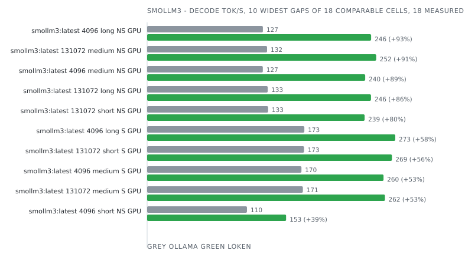

| Model          | Ctx    | Prompt | Mode       | Device | Engine              | Prefill tok/s | Decode tok/s | Tokens  | E2E ms     | J/req   | J/token   | Δ decode   | Δ energy   | Date             | Run      |
|----------------|--------|--------|------------|--------|---------------------|---------------|--------------|---------|------------|---------|-----------|------------|------------|------------------|----------|
| smollm3:latest | 4096   | long   | non-stream | GPU    | Ollama 0.34.2       |  -            | 127.3        | 128     | 2 419      | 154     | 1.207     |            |            | 2026-09-04 01:13 | c37798f7 |
| smollm3:latest | 4096   | long   | non-stream | GPU    | **loken 0.1.0-dev** |  -            | **246.3**    | **128** | **549**    | **118** | **0.925** | **+93.5%** | **+30.5%** | 2026-09-04 01:13 | c37798f7 |
| smollm3:latest | 4096   | long   | stream     | CPU    | Ollama 0.34.2       | 646.3         | 11.2         | 128     | 13 269     | 276     | 2.158     |            |            | 2026-09-05 08:04 | 3a2f18d2 |
| smollm3:latest | 4096   | long   | stream     | CPU    | **loken 0.1.0-dev** | **162.0**     | **10.4**     | **128** | **14 029** | **348** | **2.721** | -6.6%      | -20.7%     | 2026-09-05 08:04 | 3a2f18d2 |
| smollm3:latest | 4096   | long   | stream     | GPU    | Ollama 0.34.2       | 1 012.1       | 172.9        | 128     | 2 384      | 154     | 1.206     |            |            | 2026-09-03 23:33 | 64990424 |
| smollm3:latest | 4096   | long   | stream     | GPU    | **loken 0.1.0-dev** | **3 818.9**   | **272.9**    | **128** | **558**    | **115** | **0.896** | **+57.8%** | **+34.6%** | 2026-09-03 23:33 | 64990424 |
| smollm3:latest | 4096   | medium | non-stream | GPU    | Ollama 0.34.2       |  -            | 127.2        | 128     | 2 433      | 154     | 1.202     |            |            | 2026-09-03 21:56 | a7c15832 |
| smollm3:latest | 4096   | medium | non-stream | GPU    | **loken 0.1.0-dev** |  -            | **239.8**    | **128** | **567**    | **121** | **0.944** | **+88.4%** | **+27.3%** | 2026-09-03 21:56 | a7c15832 |
| smollm3:latest | 4096   | medium | stream     | CPU    | Ollama 0.34.2       | 110.9         | 11.4         | 128     | 12 664     | 273     | 2.136     |            |            | 2026-09-05 03:01 | d396fb0b |
| smollm3:latest | 4096   | medium | stream     | CPU    | **loken 0.1.0-dev** | **91.1**      | **10.7**     | **128** | **12 639** | **387** | **3.026** | -6.1%      | -29.4%     | 2026-09-05 03:01 | d396fb0b |
| smollm3:latest | 4096   | medium | stream     | GPU    | Ollama 0.34.2       | 147.4         | 169.7        | 128     | 2 719      | 151     | 1.183     |            |            | 2026-09-03 20:17 | 2bf0fc55 |
| smollm3:latest | 4096   | medium | stream     | GPU    | **loken 0.1.0-dev** | **741.4**     | **260.0**    | **128** | **578**    | **128** | **0.999** | **+53.2%** | **+18.4%** | 2026-09-03 20:17 | 2bf0fc55 |
| smollm3:latest | 4096   | short  | non-stream | GPU    | Ollama 0.34.2       |  -            | 109.8        | 128     | 3 346      | 170     | 1.327     |            |            | 2026-09-03 18:35 | 16081b2e |
| smollm3:latest | 4096   | short  | non-stream | GPU    | **loken 0.1.0-dev** |  -            | **152.8**    | **128** | **899**    | **133** | **1.043** | **+39.2%** | **+27.2%** | 2026-09-03 18:35 | 16081b2e |
| smollm3:latest | 4096   | short  | stream     | CPU    | Ollama 0.34.2       | 39.8          | 11.4         | 128     | 12 665     | 268     | 2.094     |            |            | 2026-09-04 22:34 | 5d7d528b |
| smollm3:latest | 4096   | short  | stream     | CPU    | **loken 0.1.0-dev** | **35.6**      | **10.8**     | **128** | **12 586** | **375** | **2.929** | -5.0%      | -28.5%     | 2026-09-04 22:34 | 5d7d528b |
| smollm3:latest | 4096   | short  | stream     | GPU    | Ollama 0.35.1       | 1 050.9       | 207.5        | 128     | 2 057      | 126     | 0.984     |            |            | 2026-10-03 21:49 | 2a916c38 |
| smollm3:latest | 4096   | short  | stream     | GPU    | **loken 0.1.0-dev** | **763.3**     | **277.8**    | **128** | **598**    | **106** | **0.831** | **+33.9%** | **+18.4%** | 2026-10-03 21:49 | 2a916c38 |
| smollm3:latest | 131072 | long   | non-stream | GPU    | Ollama 0.34.2       |  -            | 132.6        | 128     | 2 486      | 156     | 1.220     |            |            | 2026-09-04 16:58 | 8626d615 |
| smollm3:latest | 131072 | long   | non-stream | GPU    | **loken 0.1.0-dev** |  -            | **246.2**    | **128** | **551**    | **115** | **0.898** | **+85.7%** | **+35.8%** | 2026-09-04 16:58 | 8626d615 |
| smollm3:latest | 131072 | long   | stream     | CPU    | Ollama 0.34.2       | 559.3         | 11.3         | 128     | 13 483     | 273     | 2.129     |            |            | 2026-09-06 04:54 | d64002fd |
| smollm3:latest | 131072 | long   | stream     | CPU    | **loken 0.1.0-dev** | **152.6**     | **10.5**     | **128** | **13 947** | **351** | **2.740** | -6.9%      | -22.3%     | 2026-09-06 04:54 | d64002fd |
| smollm3:latest | 131072 | long   | stream     | GPU    | Ollama 0.34.2       | 461.9         | 132.2        | 128     | 3 768      | 189     | 1.478     |            |            | 2026-09-04 15:00 | 575739db |
| smollm3:latest | 131072 | long   | stream     | GPU    | **loken 0.1.0-dev** | **3 147.1**   | **168.9**    | **128** | **890**    | **140** | **1.098** | **+27.8%** | **+34.7%** | 2026-09-04 15:00 | 575739db |
| smollm3:latest | 131072 | medium | non-stream | GPU    | Ollama 0.34.2       |  -            | 131.9        | 128     | 2 513      | 157     | 1.230     |            |            | 2026-09-04 13:04 | ad052b73 |
| smollm3:latest | 131072 | medium | non-stream | GPU    | **loken 0.1.0-dev** |  -            | **251.9**    | **128** | **551**    | **111** | **0.871** | **+91.0%** | **+41.3%** | 2026-09-04 13:04 | ad052b73 |
| smollm3:latest | 131072 | medium | stream     | CPU    | Ollama 0.34.2       | 105.6         | 11.4         | 128     | 13 013     | 268     | 2.095     |            |            | 2026-09-06 02:00 | 122dcb8f |
| smollm3:latest | 131072 | medium | stream     | CPU    | **loken 0.1.0-dev** | **88.7**      | **10.7**     | **128** | **12 606** | **380** | **2.967** | -6.2%      | -29.4%     | 2026-09-06 02:00 | 122dcb8f |
| smollm3:latest | 131072 | medium | stream     | GPU    | Ollama 0.34.2       | 152.7         | 171.3        | 128     | 2 477      | 163     | 1.273     |            |            | 2026-09-04 11:14 | a2b42114 |
| smollm3:latest | 131072 | medium | stream     | GPU    | **loken 0.1.0-dev** | **1 605.8**   | **261.5**    | **128** | **556**    | **104** | **0.812** | **+52.6%** | **+56.7%** | 2026-09-04 11:14 | a2b42114 |
| smollm3:latest | 131072 | short  | non-stream | GPU    | Ollama 0.34.2       |  -            | 133.1        | 128     | 2 505      | 160     | 1.247     |            |            | 2026-09-04 09:15 | 890ca6c8 |
| smollm3:latest | 131072 | short  | non-stream | GPU    | **loken 0.1.0-dev** |  -            | **239.2**    | **128** | **556**    | **120** | **0.938** | **+79.6%** | **+33.0%** | 2026-09-04 09:15 | 890ca6c8 |
| smollm3:latest | 131072 | short  | stream     | CPU    | Ollama 0.34.2       | 39.2          | 11.5         | 128     | 12 956     | 267     | 2.085     |            |            | 2026-09-05 23:03 | 6b2b7782 |
| smollm3:latest | 131072 | short  | stream     | CPU    | **loken 0.1.0-dev** | **43.1**      | **10.8**     | **128** | **12 397** | **383** | **2.990** | -5.7%      | -30.3%     | 2026-09-05 23:03 | 6b2b7782 |
| smollm3:latest | 131072 | short  | stream     | GPU    | Ollama 0.34.2       | 64.3          | 172.6        | 128     | 2 490      | 158     | 1.235     |            |            | 2026-09-04 03:18 | 01771149 |
| smollm3:latest | 131072 | short  | stream     | GPU    | **loken 0.1.0-dev** | **727.6**     | **269.2**    | **128** | **550**    | **113** | **0.880** | **+56.0%** | **+40.4%** | 2026-09-04 03:18 | 01771149 |

### unfiled

Measured, and not yet placed in a family section.

| Model                                             | Ctx  | Prompt | Mode   | Device | Engine              | Prefill tok/s | Decode tok/s | Tokens  | E2E ms     | J/req     | J/token    | Δ decode   | Δ energy | Date             | Run      |
|---------------------------------------------------|------|--------|--------|--------|---------------------|---------------|--------------|---------|------------|-----------|------------|------------|----------|------------------|----------|
| ISTA-DASLab/Qwen3.8-Flash-Next-GSQ-RCO-Coder-GGUF | 4096 | short  | stream | GPU    | Ollama 0.35.1       |  -            |  -           |  -      |  -         |  -        |  -         | impossible |          | 2026-10-05 19:42 | 6cdf7094 |
| ISTA-DASLab/Qwen3.8-Flash-Next-GSQ-RCO-Coder-GGUF | 4096 | short  | stream | GPU    | **loken 0.2.0-dev** | **389.9**     | **21.0**     | **128** | **6 325**  | **621**   | **4.848**  |            |          | 2026-10-05 19:42 | 6cdf7094 |
| Jab1718/qwen3.8-flash-coder-26gb-gguf             | 4096 | short  | stream | GPU    | Ollama 0.35.1       |  -            |  -           |  -      |  -         |  -        |  -         | impossible |          | 2026-10-05 19:44 | de181339 |
| Jab1718/qwen3.8-flash-coder-26gb-gguf             | 4096 | short  | stream | GPU    | **loken 0.2.0-dev** | **622.7**     | **26.3**     | **101** | **4 275**  | **351**   | **3.483**  |            |          | 2026-10-05 19:44 | de181339 |
| Quickpanda/deepcoder-14b-preview-awq              | 4096 | short  | stream | GPU    | vLLM 0.30.0         | 419.3         | 84.6         | 128     | 1 537      | 325       | 2.542      |            |          | 2026-10-05 19:46 | f6763436 |
| Quickpanda/deepcoder-14b-preview-awq              | 4096 | short  | stream | GPU    | **loken 0.2.0-dev** | **392.8**     | **78.2**     | **128** | **1 744**  | **337**   | **2.636**  | -7.6%      | -3.6%    | 2026-10-05 19:46 | f6763436 |
| Qwen/Qwen-Image                                   | 4096 | short  | stream | GPU    | **loken 0.2.0-dev** |  -            |  -           |  -      |  -         |  -        |  -         | failed     |          | 2026-10-05 19:56 | 6fd68021 |
| Qwen/Qwen-Image-Edit                              | 4096 | short  | stream | GPU    | **loken 0.2.0-dev** |  -            |  -           |  -      |  -         |  -        |  -         | failed     |          | 2026-10-05 20:02 | d8af2aa2 |
| Qwen/Qwen3-8B-AWQ                                 | 4096 | short  | stream | GPU    | vLLM 0.30.0         | 407.9         | 139.7        | 128     | 944        | 188       | 1.472      |            |          | 2026-10-05 20:08 | 7ad3377c |
| Qwen/Qwen3-8B-AWQ                                 | 4096 | short  | stream | GPU    | **loken 0.2.0-dev** | **253.5**     | **129.7**    | **128** | **1 109**  | **204**   | **1.596**  | -7.2%      | -7.8%    | 2026-10-05 20:08 | 7ad3377c |
| Serveurperso/ACE-Step-1.5-GGUF                    | 4096 | short  | stream | GPU    | **loken 0.1.0-dev** |  -            |  -           |  -      |  -         |  -        |  -         | failed     |          | 2026-10-03 18:49 | 9fcd19dc |
| Systran/faster-whisper-base                       | 4096 | short  | stream | GPU    | **loken 0.1.0-dev** |  -            |  -           |  -      |  -         |  -        |  -         | impossible |          | 2026-10-03 18:49 | dca01952 |
| Systran/faster-whisper-small                      | 4096 | short  | stream | GPU    | **loken 0.1.0-dev** |  -            |  -           |  -      |  -         |  -        |  -         | impossible |          | 2026-10-03 18:49 | bc3acc30 |
| Tongyi-MAI/Z-Image-Turbo                          | 4096 | short  | stream | GPU    | **loken 0.1.0-dev** |  -            |  -           |  -      |  -         |  -        |  -         | failed     |          | 2026-10-03 18:51 | e7f74350 |
| ace-step-base                                     | 4096 | short  | stream | GPU    | **loken 0.1.0-dev** |  -            |  -           |  -      |  -         |  -        |  -         | failed     |          | 2026-10-03 18:53 | 1662d3b8 |
| ace-step-sft                                      | 4096 | short  | stream | GPU    | **loken 0.1.0-dev** |  -            |  -           |  -      |  -         |  -        |  -         | failed     |          | 2026-10-03 18:54 | 9dc070d2 |
| ace-step-turbo                                    | 4096 | short  | stream | GPU    | **loken 0.2.0-dev** |  -            |  -           |  -      |  -         |  -        |  -         | failed     |          | 2026-10-05 20:13 | 1b8341e6 |
| ace-step-xl-base                                  | 4096 | short  | stream | GPU    | **loken 0.1.0-dev** |  -            |  -           |  -      |  -         |  -        |  -         | failed     |          | 2026-10-03 18:57 | 5f7d8e06 |
| ace-step-xl-sft                                   | 4096 | short  | stream | GPU    | **loken 0.1.0-dev** |  -            |  -           |  -      |  -         |  -        |  -         | failed     |          | 2026-10-03 18:59 | 75e6e089 |
| ace-step-xl-turbo                                 | 4096 | short  | stream | GPU    | **loken 0.1.0-dev** |  -            |  -           |  -      |  -         |  -        |  -         | failed     |          | 2026-10-03 19:01 | adc9659a |
| black-forest-labs/FLUX.1-schnell                  | 4096 | short  | stream | GPU    | **loken 0.1.0-dev** |  -            |  -           |  -      |  -         |  -        |  -         | impossible |          | 2026-10-03 19:01 | 121dce73 |
| boogu                                             | 4096 | short  | stream | GPU    | **loken 0.1.0-dev** |  -            |  -           |  -      |  -         |  -        |  -         | failed     |          | 2026-10-03 19:02 | 4f0e7de9 |
| casperhansen/deepseek-r1-distill-qwen-32b-awq     | 4096 | short  | stream | GPU    | vLLM 0.30.0         |  -            |  -           |  -      |  -         |  -        |  -         | impossible |          | 2026-10-03 19:04 | 42aa3de4 |
| casperhansen/deepseek-r1-distill-qwen-32b-awq     | 4096 | short  | stream | GPU    | **loken 0.1.0-dev** | **369.8**     | **32.4**     | **128** | **4 084**  | **801**   | **6.259**  |            |          | 2026-10-03 19:04 | 42aa3de4 |
| coqui/XTTS-v2                                     | 4096 | short  | stream | GPU    | vLLM 0.30.0         |  -            |  -           |  -      |  -         |  -        |  -         | impossible |          | 2026-09-28 14:34 | bdab7c45 |
| coqui/XTTS-v2                                     | 4096 | short  | stream | GPU    | **loken 0.1.0-dev** |  -            |  -           |  -      |  -         |  -        |  -         | impossible |          | 2026-10-03 19:15 | 2c59084d |
| cyankiwi/Devstral-Small-2507-AWQ-4bit             | 4096 | short  | stream | GPU    | vLLM 0.30.0         |  -            |  -           |  -      |  -         |  -        |  -         | impossible |          | 2026-10-03 19:16 | 47745da4 |
| cyankiwi/Devstral-Small-2507-AWQ-4bit             | 4096 | short  | stream | GPU    | **loken 0.1.0-dev** | **539.3**     | **64.3**     | **128** | **2 093**  | **414**   | **3.238**  |            |          | 2026-10-03 19:16 | 47745da4 |
| ezaudio                                           | 4096 | short  | stream | GPU    | **loken 0.1.0-dev** |  -            |  -           |  -      |  -         |  -        |  -         | failed     |          | 2026-10-03 20:13 | 69d3dee0 |
| flux-kontext                                      | 4096 | short  | stream | GPU    | **loken 0.1.0-dev** |  -            |  -           |  -      |  -         |  -        |  -         | failed     |          | 2026-10-03 20:17 | 538c6bd3 |
| flux2-klein-4b                                    | 4096 | short  | stream | GPU    | **loken 0.1.0-dev** |  -            |  -           |  -      |  -         |  -        |  -         | failed     |          | 2026-10-03 20:18 | b4fb4ca3 |
| kyutai/pocket-tts                                 | 4096 | short  | stream | GPU    | **loken 0.1.0-dev** |  -            |  -           |  -      |  -         |  -        |  -         | failed     |          | 2026-10-03 20:35 | daf8834a |
| kyutai/tts-1.6b-en_fr                             | 4096 | short  | stream | GPU    | **loken 0.1.0-dev** |  -            |  -           |  -      |  -         |  -        |  -         | failed     |          | 2026-10-03 20:36 | f25cfad1 |
| kyutai/tts-voices                                 | 4096 | short  | stream | GPU    | **loken 0.1.0-dev** |  -            |  -           |  -      |  -         |  -        |  -         | impossible |          | 2026-10-03 20:36 | c69dbbc5 |
| lmz/candle-flux                                   | 4096 | short  | stream | GPU    | **loken 0.1.0-dev** |  -            |  -           |  -      |  -         |  -        |  -         | failed     |          | 2026-10-03 20:42 | b0b36538 |
| midi                                              | 4096 | short  | stream | GPU    | **loken 0.1.0-dev** |  -            |  -           |  -      |  -         |  -        |  -         | impossible |          | 2026-10-03 20:44 | 9d4a5ce1 |
| myshell-ai/OpenVoiceV2                            | 4096 | short  | stream | GPU    | vLLM 0.30.0         |  -            |  -           |  -      |  -         |  -        |  -         | impossible |          | 2026-09-28 16:55 | e6e85214 |
| myshell-ai/OpenVoiceV2                            | 4096 | short  | stream | GPU    | **loken 0.1.0-dev** |  -            |  -           |  -      |  -         |  -        |  -         | impossible |          | 2026-10-03 20:48 | e1aafeac |
| nvidia/Qwen-Image-Flash                           | 4096 | short  | stream | GPU    | **loken 0.1.0-dev** |  -            |  -           |  -      |  -         |  -        |  -         | failed     |          | 2026-10-03 20:56 | ba2b69e4 |
| openai/clip-vit-large-patch14                     | 4096 | short  | stream | GPU    | vLLM 0.30.0         |  -            |  -           |  -      |  -         |  -        |  -         | impossible |          | 2026-09-28 17:10 | 5dbd615a |
| openai/clip-vit-large-patch14                     | 4096 | short  | stream | GPU    | **loken 0.1.0-dev** |  -            |  -           |  -      |  -         |  -        |  -         | impossible |          | 2026-10-03 20:59 | 49c61bc6 |
| openai/whisper-large-v3                           | 4096 | short  | stream | GPU    | **loken 0.1.0-dev** |  -            |  -           |  -      |  -         |  -        |  -         | impossible |          | 2026-10-03 20:59 | 270dd9dc |
| openai/whisper-large-v3-turbo                     | 4096 | short  | stream | GPU    | **loken 0.1.0-dev** |  -            |  -           |  -      |  -         |  -        |  -         | impossible |          | 2026-10-03 20:59 | 6d6e18e8 |
| openai/whisper-small                              | 4096 | short  | stream | GPU    | **loken 0.1.0-dev** |  -            |  -           |  -      |  -         |  -        |  -         | impossible |          | 2026-10-03 20:59 | f5929d65 |
| parler-tts/parler-tts-mini-v1                     | 4096 | short  | stream | GPU    | **loken 0.1.0-dev** |  -            |  -           |  -      |  -         |  -        |  -         | failed     |          | 2026-10-03 20:59 | 66dbbae4 |
| qwen-image-edit                                   | 4096 | short  | stream | GPU    | **loken 0.1.0-dev** |  -            |  -           |  -      |  -         |  -        |  -         | failed     |          | 2026-10-03 21:06 | bd9e72cf |
| qwen-image-flash                                  | 4096 | short  | stream | GPU    | **loken 0.1.0-dev** |  -            |  -           |  -      |  -         |  -        |  -         | failed     |          | 2026-09-30 01:16 | 5b3e93c7 |
| rayburn                                           | 4096 | short  | stream | GPU    | **loken 0.1.0-dev** |  -            |  -           |  -      |  -         |  -        |  -         | failed     |          | 2026-10-03 21:25 | b12ae3cc |
| rayctifier                                        | 4096 | short  | stream | GPU    | **loken 0.1.0-dev** |  -            |  -           |  -      |  -         |  -        |  -         | failed     |          | 2026-10-03 21:26 | fae0d0a1 |
| rayflux                                           | 4096 | short  | stream | GPU    | **loken 0.1.0-dev** |  -            |  -           |  -      |  -         |  -        |  -         | failed     |          | 2026-10-03 21:29 | 027446c8 |
| rayflux-horndog                                   | 4096 | short  | stream | GPU    | **loken 0.1.0-dev** |  -            |  -           |  -      |  -         |  -        |  -         | failed     |          | 2026-10-03 21:32 | dce19a81 |
| rayflux-krea                                      | 4096 | short  | stream | GPU    | **loken 0.1.0-dev** |  -            |  -           |  -      |  -         |  -        |  -         | failed     |          | 2026-10-03 21:35 | 463fcdde |
| raymnants                                         | 4096 | short  | stream | GPU    | **loken 0.1.0-dev** |  -            |  -           |  -      |  -         |  -        |  -         | failed     |          | 2026-10-03 21:37 | 613e6663 |
| rayqwest                                          | 4096 | short  | stream | GPU    | **loken 0.1.0-dev** |  -            |  -           |  -      |  -         |  -        |  -         | failed     |          | 2026-10-03 21:45 | f21a903c |
| rayzist                                           | 4096 | short  | stream | GPU    | **loken 0.1.0-dev** |  -            |  -           |  -      |  -         |  -        |  -         | failed     |          | 2026-10-03 21:47 | ae8f1324 |
| stable-audio                                      | 4096 | short  | stream | GPU    | **loken 0.1.0-dev** |  -            |  -           |  -      |  -         |  -        |  -         | failed     |          | 2026-10-03 21:50 | 1ae27751 |
| unsloth/Qwen3-235B-A22B-GGUF                      | 4096 | short  | stream | GPU    | Ollama 0.35.1       |  -            |  -           |  -      |  -         |  -        |  -         | impossible |          | 2026-10-03 21:50 | 28403ff0 |
| unsloth/Qwen3-235B-A22B-GGUF                      | 4096 | short  | stream | GPU    | **loken 0.1.0-dev** | **7.0**       | **4.7**      | **128** | **31 824** | **2 051** | **16.022** |            |          | 2026-10-03 21:50 | 28403ff0 |
| wan                                               | 4096 | short  | stream | GPU    | **loken 0.1.0-dev** |  -            |  -           |  -      |  -         |  -        |  -         | impossible |          | 2026-10-03 21:53 | 6edcd4a4 |
| wan-14b                                           | 4096 | short  | stream | GPU    | **loken 0.1.0-dev** |  -            |  -           |  -      |  -         |  -        |  -         | impossible |          | 2026-10-03 21:53 | 74d1dc60 |
| wan-causvid-1.3b                                  | 4096 | short  | stream | GPU    | **loken 0.1.0-dev** |  -            |  -           |  -      |  -         |  -        |  -         | impossible |          | 2026-10-03 21:53 | bdbd448d |
| wan-causvid-14b                                   | 4096 | short  | stream | GPU    | **loken 0.1.0-dev** |  -            |  -           |  -      |  -         |  -        |  -         | impossible |          | 2026-10-03 21:53 | d69c255c |
| wan-fusionx-14b                                   | 4096 | short  | stream | GPU    | **loken 0.1.0-dev** |  -            |  -           |  -      |  -         |  -        |  -         | impossible |          | 2026-10-03 21:53 | 050b0e1a |
| wan-i2v-14b                                       | 4096 | short  | stream | GPU    | **loken 0.1.0-dev** |  -            |  -           |  -      |  -         |  -        |  -         | impossible |          | 2026-10-03 21:53 | c54e3070 |
| wan-i2vdistill-14b                                | 4096 | short  | stream | GPU    | **loken 0.1.0-dev** |  -            |  -           |  -      |  -         |  -        |  -         | impossible |          | 2026-10-03 21:53 | 8b7e27b5 |
| wan-i2vq4-14b                                     | 4096 | short  | stream | GPU    | **loken 0.1.0-dev** |  -            |  -           |  -      |  -         |  -        |  -         | impossible |          | 2026-10-03 21:53 | 240045dd |
