# The generation loop

<link rel="stylesheet" href="../anatomy/anatomy.css">
<header class="phead">

lokend anatomy
<h2 class="ptitle">Generation, experts and models</h2>
<button type="button" class="fs" aria-pressed="false" aria-label="Full screen" hidden><svg viewBox="0 0 24 24" aria-hidden="true" focusable="false"><path d="M4 9V4h5M20 9V4h-5M4 15v5h5M20 15v5h-5"/></svg>Full screen</button></header><nav class="key" aria-label="Groups on this plate"><button type="button" data-group="loop" aria-pressed="false" style="--c:var(--a-g-loop)"><i></i>Generation loop</button><button type="button" data-group="experts" aria-pressed="false" style="--c:var(--a-g-experts)"><i></i>Experts and streaming</button><button type="button" data-group="models" aria-pressed="false" style="--c:var(--a-g-models)"><i></i>Models and formats</button><button type="button" data-group="operations" aria-pressed="false" style="--c:var(--a-g-operations)"><i></i>Security and operations</button></nav>

<button type="button" data-scene="chunks" aria-pressed="false">Long prompt</button><button type="button" data-scene="draft" aria-pressed="false">Draft and check</button>
<button type="button" class="play" id="ana-generation-play">Play</button><button type="button" class="go" id="ana-generation-prev" aria-label="Previous step">Previous</button><button type="button" class="go" id="ana-generation-next" aria-label="Next step">Next</button>

<figure>

<figcaption>Layer stack tinted by an example plan, from layer 0 up: <b style="background:var(--a-dev-cuda)"></b>fastest card, a CUDA card <b style="background:var(--a-dev-rocm)"></b>next card, a ROCm card <b style="background:var(--a-dev-host)"></b>hostA large pulse is computing. A small one is moving data.</figcaption></figure>
<section data-scene="chunks"><h3>A long prompt read in chunks</h3><ol class="steps"><li>A long prompt arrives. Its chunk length comes from the free memory of the tightest card and the widest feed-forward of the model.</li><li>Each chunk climbs the layers in one pass. Each of its tokens attends to the tokens before it.</li><li>The chunk's tokens add their key and value to the cache.</li><li>A chunk that runs a card out of memory is halved. When the cache can be cut back and the model keeps no recurrent state, reading goes on from that chunk and the tokens before it keep their cache. Otherwise the prompt is read again from where this reading began.</li><li>Only the last chunk's logits are kept. They give the first token.</li></ol>
Steps 2 and 3 repeat for every chunk. A halved chunk length is kept for the next requests, until the cards have more free memory than when it shrank.
</section><section data-scene="draft"><h3>Tokens guessed ahead, then checked</h3><ol class="steps"><li>The decode step climbs the layers and the output head draws a token.</li><li>The draft head guesses the next tokens. It is 1 more layer of the model's own kind, shipped with the checkpoint. It drafts only under <code>fidelity = "fast"</code>.</li><li>The loop learns how many tokens to guess from the measured acceptance and the cost of a cycle.</li><li>The model checks every guess in one pass through the layers. When every layer and the head sit on 1 card, that pass is replayed as a recorded graph. A model with a wide residual stream replays it across several cards too.</li><li>The guesses the model agrees with are kept, with 1 token of its own. The KV cache and a recurrent state are cut back to the kept tokens.</li></ol>
A model without a draft head can still guess ahead:
<ul class="notes"><li>A smaller drafter model, when the model spills to the host.</li><li>Prompt lookup, which guesses the next tokens from the prompt's own text.</li></ul></section>

<!-- site: replace name=anatomy-generation-static -->

<!-- site: end -->

Read more in the lessons [Prefill and decode](../learn/05-prefill-and-decode.md), [Sampling](../learn/07-sampling.md) and [Speculative decoding](../learn/08-speculative-decoding.md), the guide [Speed up a model that spills to the host with a drafter](../guides/drafter.md) and [Draft head](../MODELS.md#draft-head).
