# Map of lokend

The layer stack runs up the middle, layer 0 at the bottom.
The placement plan cuts it into runs, one device for each run.
The rest of the daemon is cut into groups.
Select a group to see what it does and the levels of the plan it reads.

<link rel="stylesheet" href="../anatomy/anatomy.css">
<header class="phead">

lokend anatomy
<h2 class="ptitle">Overview</h2>
<button type="button" class="fs" aria-pressed="false" aria-label="Full screen" hidden><svg viewBox="0 0 24 24" aria-hidden="true" focusable="false"><path d="M4 9V4h5M20 9V4h-5M4 15v5h5M20 15v5h-5"/></svg>Full screen</button></header><nav class="key" aria-label="Groups on this plate"><button type="button" data-group="stack" aria-pressed="false" style="--c:var(--a-g-stack)"><i></i>Layer stack and placement</button><button type="button" data-group="loop" aria-pressed="false" style="--c:var(--a-g-loop)"><i></i>Generation loop</button><button type="button" data-group="kv" aria-pressed="false" style="--c:var(--a-g-kv)"><i></i>KV and state</button><button type="button" data-group="requests" aria-pressed="false" style="--c:var(--a-g-requests)"><i></i>Requests and responses</button><button type="button" data-group="senses" aria-pressed="false" style="--c:var(--a-g-senses)"><i></i>Vision and audio input</button><button type="button" data-group="experts" aria-pressed="false" style="--c:var(--a-g-experts)"><i></i>Experts and streaming</button><button type="button" data-group="models" aria-pressed="false" style="--c:var(--a-g-models)"><i></i>Models and formats</button><button type="button" data-group="backends" aria-pressed="false" style="--c:var(--a-g-backends)"><i></i>Backends</button><button type="button" data-group="media" aria-pressed="false" style="--c:var(--a-g-media)"><i></i>Media generation</button><button type="button" data-group="cluster" aria-pressed="false" style="--c:var(--a-g-cluster)"><i></i>Cluster</button><button type="button" data-group="operations" aria-pressed="false" style="--c:var(--a-g-operations)"><i></i>Security and operations</button></nav>
<button type="button" class="play" id="ana-map-play">Play</button><button type="button" class="go" id="ana-map-prev" aria-label="Previous step">Previous</button><button type="button" class="go" id="ana-map-next" aria-label="Next step">Next</button>

<figure>

<figcaption>Layer stack tinted by an example plan, from layer 0 up: <b style="background:var(--a-dev-cuda)"></b>fastest card, a CUDA card <b style="background:var(--a-dev-rocm)"></b>next card, a ROCm card <b style="background:var(--a-dev-host)"></b>hostA large pulse is computing. A small one is moving data.</figcaption></figure>
<section data-scene="request"><h3>The way of a request</h3><ol class="steps"><li><b>Received</b>: the request arrives on an API surface. Its template is applied and its text turned into tokens.</li><li><b>Prefilled</b>: the prompt's tokens climb the layers together, a long prompt in chunks. Each token leaves its key and value in the KV cache.</li><li><b>Forwarded</b>: each decode step climbs the layer stack, run after run.</li><li><b>Remembered</b>: the step reads the KV cache and adds its own token to it.</li><li><b>Sampled</b>: the output head gives the logits and the sampler draws the next token. Once requests have overlapped several times in a row, their steps run as one batch.</li><li><b>Streamed</b>: the answer streams out as it is decoded.</li></ol>
Steps 3 to 6 repeat for every token.
</section>

<!-- site: replace name=anatomy-overview-static -->

<!-- site: end -->

The terms are in [Concepts](../start/concepts.md), and each mechanism has its lesson in [How inference works](../learn/README.md).
