# Across machines

<link rel="stylesheet" href="../anatomy/anatomy.css">
<header class="phead">

lokend anatomy
<h2 class="ptitle">Cluster</h2>
<button type="button" class="fs" aria-pressed="false" aria-label="Full screen" hidden><svg viewBox="0 0 24 24" aria-hidden="true" focusable="false"><path d="M4 9V4h5M20 9V4h-5M4 15v5h5M20 15v5h-5"/></svg>Full screen</button></header><nav class="key" aria-label="Groups on this plate"><button type="button" data-group="stack" aria-pressed="false" style="--c:var(--a-g-stack)"><i></i>Layer stack and placement</button><button type="button" data-group="cluster" aria-pressed="false" style="--c:var(--a-g-cluster)"><i></i>Cluster</button><button type="button" data-group="operations" aria-pressed="false" style="--c:var(--a-g-operations)"><i></i>Security and operations</button></nav>

<button type="button" data-scene="forward" aria-pressed="false">Forward whole</button><button type="button" data-scene="pipeline" aria-pressed="false">Pipeline split</button><button type="button" data-scene="prefill" aria-pressed="false">Prefill on a peer</button>
<button type="button" class="play" id="ana-nodes-play">Play</button><button type="button" class="go" id="ana-nodes-prev" aria-label="Previous step">Previous</button><button type="button" class="go" id="ana-nodes-next" aria-label="Next step">Next</button>

<figure>

<figcaption>Layer stack tinted by an example plan, from layer 0 up: <b style="background:var(--a-dev-cuda)"></b>fastest card, a CUDA card <b style="background:var(--a-dev-rocm)"></b>next card, a ROCm card <b style="background:var(--a-dev-host)"></b>hostA large pulse is computing. A small one is moving data.</figcaption></figure>
<section data-scene="forward"><h3>A request forwarded</h3><ol class="steps"><li>A chat request reaches any machine of the cluster.</li><li>That machine predicts the completion time of the request on itself and on each peer, round trip included.</li><li>A peer wins when it beats the local estimate by <code>min_speedup</code>, or when this machine cannot serve the model.</li><li>The request goes to the winner whole, and its stream comes back unchanged.</li></ol>
A request moves once at most. A media request goes to a machine that holds the model and whose cards admit it whole.
</section><section data-scene="pipeline"><h3>A model cut across 2 machines</h3><ol class="steps"><li>The machine that loads the model becomes the head. It times a layer on its cards and on its host.</li><li>Every machine publishes its own figures, and each poll between machines times their round trip.</li><li>The planner gives each machine one contiguous run of layers. It minimises the predicted time of 1 token: the compute of each machine plus the crossing of each boundary.</li><li>When the cut pays, each other machine reloads its own layers from its own copy of the model file.</li><li>For each token, the head runs its layers and sends the boundary activations to the next machine. They travel in binary frames on a connection that stays open.</li><li>The machine of the last layers answers with the logits, and the head draws the token.</li></ol>
Each machine keeps the KV cache of its own layers. When 1 machine alone is fastest, the head serves without a cut.
</section><section data-scene="prefill"><h3>A prompt read by a peer</h3><ol class="steps"><li>A long prompt reaches a machine whose <code>prefill_peer</code> names another instance that serves the same model.</li><li>The machine sends the prompt to that peer.</li><li>The peer reads the prompt through its layers and answers with its KV cache. A model whose recurrent or windowed layers support it hands over its whole decode state instead.</li><li>The machine checks the cache against its own cache shape and the prompt's tokens, then imports it as a snapshot.</li><li>The prefix reuse restores the snapshot in whole prefill chunks. The rest of the prompt is read here, and the machine decodes.</li></ol>
The prompt is read here when the peer cannot answer, or when it adds less than 1 prefill chunk to what the cache holds. A request with an image reads its prompt here.
</section>

<!-- site: replace name=anatomy-nodes-static -->

<!-- site: end -->

Read more in [Run 2 machines](../operate/cluster.md), [Cluster internals](../CLUSTER.md) and [Prompts read by another instance](../CONFIGURATION.md#prompts-read-by-another-instance).
