# Requests and the KV cache

<link rel="stylesheet" href="../anatomy/anatomy.css">
<header class="phead">

lokend anatomy
<h2 class="ptitle">Requests, input and KV</h2>
<button type="button" class="fs" aria-pressed="false" aria-label="Full screen" hidden><svg viewBox="0 0 24 24" aria-hidden="true" focusable="false"><path d="M4 9V4h5M20 9V4h-5M4 15v5h5M20 15v5h-5"/></svg>Full screen</button></header><nav class="key" aria-label="Groups on this plate"><button type="button" data-group="kv" aria-pressed="false" style="--c:var(--a-g-kv)"><i></i>KV and state</button><button type="button" data-group="requests" aria-pressed="false" style="--c:var(--a-g-requests)"><i></i>Requests and responses</button><button type="button" data-group="senses" aria-pressed="false" style="--c:var(--a-g-senses)"><i></i>Vision and audio input</button><button type="button" data-group="operations" aria-pressed="false" style="--c:var(--a-g-operations)"><i></i>Security and operations</button></nav>

<button type="button" data-scene="vision" aria-pressed="false">Image</button><button type="button" data-scene="turn" aria-pressed="false">Next turn</button>
<button type="button" class="play" id="ana-requests-play">Play</button><button type="button" class="go" id="ana-requests-prev" aria-label="Previous step">Previous</button><button type="button" class="go" id="ana-requests-next" aria-label="Next step">Next</button>

<figure>

<figcaption>Layer stack tinted by an example plan, from layer 0 up: <b style="background:var(--a-dev-cuda)"></b>fastest card, a CUDA card <b style="background:var(--a-dev-rocm)"></b>next card, a ROCm card <b style="background:var(--a-dev-host)"></b>hostA large pulse is computing. A small one is moving data.</figcaption></figure>
<section data-scene="vision"><h3>An image in a chat</h3>
The way of an image through a model whose vision tower splices into the text:
<ol class="steps"><li>A chat request with an image arrives. The template puts 1 image placeholder in the prompt, and the tokenizer turns the text into ids.</li><li>The vision tower turns the image into embeddings.</li><li>At prefill, the placeholder grows into a run of tokens, 1 per merged patch of the image. The embeddings take the place of that run.</li><li>The prompt is read through the layers, the image rows with the text rows.</li></ol>
A model that reads images serves its requests 1 at a time and never joins the batch. A request with an image keeps no snapshot and writes nothing to disk. Some families place the image embeddings before the text instead of splicing them.
</section><section data-scene="turn"><h3>A conversation continued</h3>
The way of the next turn of a text conversation:
<ol class="steps"><li>After an answer, the resident KV is copied aside as a snapshot, under its tokens.</li><li>With <code>kv_disk_dir</code> set, a thread writes the full blocks of the cache to disk, off the request path. Each block is named by a hash chained over its own tokens and those of the blocks before it.</li><li>The next turn repeats the conversation. The daemon finds the snapshot or the longest chain of blocks that the prompt shares.</li><li>It keeps the rows up to the last turn marker of the template, or up to the last whole prefill chunk when that keeps more.</li><li>Only the answer and the new turn are read through the layers.</li></ol></section>

<!-- site: replace name=anatomy-requests-static -->

<!-- site: end -->

Read more in [Keep conversations in memory between requests](../guides/kv-memory.md), [KV reuse across requests](../CONFIGURATION.md#kv-reuse-across-requests), the [API](../API.md) and the lessons [Tokens](../learn/01-tokens.md) and [The KV cache](../learn/06-kv-cache.md).
