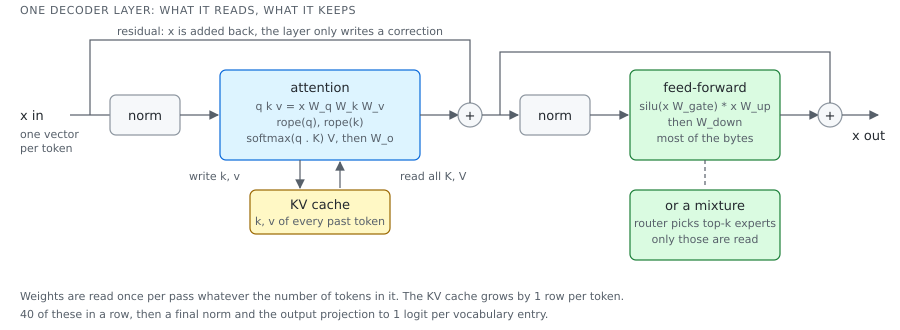

# One layer, then 40 of them

A transformer is 1 block applied 28 or 92 times.

## The idea

An id becomes a vector by a table lookup, the **embedding**, of width `d` (1024 on qwen3:0.6b).

A layer is a function from a vector to a corrected vector.
The correction, the **residual**, is added to the input, so a layer only learns what to change.



A layer has 2 sub-layers, each behind a **norm**.
RMSNorm divides the vector by its root-mean-square and scales it by a learned weight.

- **Attention** lets a token read the others.
  3 projections give each token a query, a key and a value.  
  The query is scored against every earlier key.  
  The scores go through a softmax, and the token's output is the values weighted by those scores, then 1 more projection.
- **RoPE** rotates query and key by an angle that grows with the position, before the scoring.
  This is how the model knows distance.
- **Heads** run attention in parallel on slices of the vector.
- **Grouped-query attention** has several query heads share 1 key and value head, 16 against 8 on qwen3.
  It halves what is kept per token.
- **Latent attention** (DeepSeek) keeps 1 compressed vector per token and decompresses it when read.
- **Feed-forward** is 2 matrices with a gate between them: `silu(x W_gate) * (x W_up)`, then `W_down`.
  It holds most of a dense model's bytes.
- **Mixture of experts** replaces the feed-forward with many such blocks and a router.
  A small projection scores the experts, the top `k` run (8 of 128, say) and their outputs are summed with the router's weights.
  Only those experts' bytes are read for that token.

After the last layer, a final norm and the output projection give 1 **logit** per vocabulary entry.  
[Lesson 7](07-sampling.md) turns that row into a token.  
[The map of lokend](../inside/map.md) draws the layer stack inside the daemon.

| | A layer |
|---|---|
| Reads | Its weights, once per pass, whatever the number of tokens in the pass. |
| Keeps | The key and value of every token it has seen ([lesson 6](06-kv-cache.md)). |

## What loken does

| Part | Behaviour |
|---|---|
| Architectures | 1 decoder implementation serves the dense families (Qwen2 and 3, Gemma, Phi and others). It adapts to the checkpoint: split or fused QKV, q and k norms, extra norms, sliding-window layers, a mixture of experts. |
| Positions | RoPE, with YaRN scaling so a model answers past its trained length. |
| Attention variants | Grouped-query, and latent attention for DeepSeek. |
| Mixtures | A router picks the top experts per token and only those are read. |
| Ports | A family with its own design, such as DeepSeek V4.1, has a dedicated port. |

## What was measured

**Judging a port without running the original (2026-09-12 to 14).** The DeepSeek V4.1 port was gated against the authors' own reference implementation, unmodified, run on the CPU.

The authors' kernel module was replaced by a pure-torch one.
The authors' linear layer dispatches on the weight's dtype, so bf16 never reaches a compiled kernel.

The reference dumps each phase's inputs and outputs, and the port replays the phase on them.

| Stage | Gate |
|---|---|
| Attention | within 1.3e-2 relative L2 |
| Mixture | within 3.8e-3 |
| Hyper-connections | under 5e-3 |
| fp8 and fp4 dequantisers | bit-exact |

2 pitfalls gave finite, wrong output and no error:

- Casting the reference's rotary table to fp32 drops the imaginary half, so RoPE applies half its rotation.
- A lazily evaluated closure bound its loop variable late, so every expert came from the last layer.
  1 layer matched, 2 layers gave cosine 0.92, and finding it took an hour.

**Gating a mixture is not gating a matrix (2026-09-13).** The router's top-k is a discrete choice.
Any precision gap between an f32 port and a bf16 reference flips the occasional borderline token to another expert.

1 flipped token out of 64 moved the block's relative L2 from 1e-2 to 6e-2.
Every other token agreed and the cosine stayed at 0.998.

<!-- site: widget chart type=bar id=forward-pass-l2 -->
| Stage | Relative L2 |
|---|---|
| Attention sub-layer | 0.015 |
| Stream after the hyper-connection | 0.0098 |
| Block output | 0.058 |
<!-- site: end -->

A tight global threshold fails correct code, and a loose one hides real bugs.  
The gate that separates them has 3 parts:

- the cosine over the whole tensor
- a bounded count of tokens over a per-token threshold
- the pre-routing stages gated tightly on their own

## Try it

<!-- site: widget steps id=forward-pass-steps -->
1. Read the shape of the model from its metadata.

   ```sh
   curl -s localhost:11435/api/show -d '{"model":"qwen3:0.6b"}' | python3 -c "
   import sys, json
   d = json.load(sys.stdin)['model_info']
   for k in ('block_count', 'embedding_length', 'attention.head_count',
             'attention.head_count_kv', 'feed_forward_length'):
       print(k, d.get('qwen3.' + k))"
   ```

2. Check the output: 28 blocks, a width of 1024, 16 query heads against 8 key and value heads.
   2 query heads share each key head.
3. Repeat on a mixture model and look for the expert count keys.
<!-- site: end -->

## Quiz

<!-- site: widget quiz answer=2 id=forward-pass-quiz-1 -->
What does a layer add to its input?

1. A new embedding.
2. A correction, the residual.
3. The next token.

A layer only learns what to change.
<!-- site: end -->

<!-- site: widget quiz answer=1 id=forward-pass-quiz-2 -->
What does grouped-query attention change on qwen3?

1. 16 query heads share 8 key and value heads, which halves what is kept per token.
2. It removes the softmax.
3. It routes each token to 8 of 128 experts.

The routing to experts belongs to a mixture of experts.
<!-- site: end -->

<!-- site: widget quiz answer=3 id=forward-pass-quiz-3 -->
How many expert weights does a mixture read per token?

1. All of them.
2. None.
3. Only the top `k` the router picks.

The router scores the experts and only those run.
<!-- site: end -->

## Key terms

<!-- site: widget flashcards id=forward-pass-terms -->
| Term | Meaning |
|---|---|
| Embedding | The table lookup that turns an id into a vector of width `d`. |
| Residual | The layer's correction, added to its input. |
| RoPE | A rotation of query and key by an angle that grows with the position. |
| Grouped-query attention | Several query heads sharing 1 key and value head. |
| Mixture of experts | A router and many feed-forward blocks, of which only the top `k` run per token. |
| Logit | The score of 1 vocabulary entry, output by the last projection. |
<!-- site: end -->
