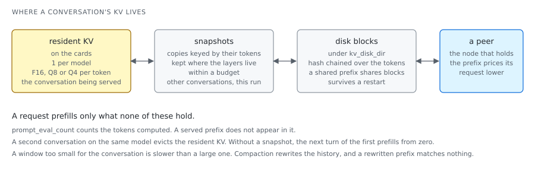

# What the model remembers between tokens

Without a cache, every step would recompute the keys and values of every earlier token.
The KV cache stores them.

## The idea

Each layer stores 1 key row and 1 value row per key head, for every token seen. qwen3:0.6b stores 28 x 8 x 128 x 2 = 57 344 numbers per token, 112 KB at F16.

A 4 096-token window takes 460 MB, close to the weights.
On a larger model the cache dominates memory.  
Grouped-query and latent attention exist to shrink its per-token bytes.

The next turn of a conversation is the same prompt plus a little.
A server that keeps the cache prefills only the little.

| Design | What it does |
|---|---|
| Paging | The cache is a pool of fixed blocks. A sequence holds a block table. Several sequences share one pool without reserving a full window each, and 2 prompts with a common prefix share its blocks. |
| Quantised caches | Keys and values at 8 bits, or at 4 bits with the key scale taken per channel. A key's channels have systematic outliers, and a per-token scale loses them. |
| Sliding windows | Some layers attend only to the last n positions and keep no more. |
| Snapshots | After a request the resident cache is copied aside under its tokens. Another conversation can take the cards, and this one can come back. |
| Disk tier | Full token blocks are written after a response, keyed by a hash chained over the tokens. A shared prefix is written once and survives a restart. |
| Reuse past the window | When a conversation outgrows the window, the tail is kept and its positions are re-phased. The window is not prefilled again. |



- **One live cache per model.** 2 conversations served in alternation evict each other, unless a snapshot holds the other.
- **A window too small is slower than a large one.** Compaction rewrites the history from near its start, and a rewritten prefix matches nothing that is held.

## What loken does

loken keeps 1 live cache per model, paged into fixed blocks.  
The cache is F16, 8 bits, or 4 bits with a per-channel key scale.  
It keeps a snapshot of a finished conversation, so an alternated conversation comes back without a full prefill.

A new prompt reuses the longest prefix it finds, searched in this order:

1. The resident cache.
2. A snapshot that covers more.
3. A disk sequence that covers more still.

The reused prefix is rounded down to a prefill chunk.

| Setting | Effect |
|---|---|
| `kv_disk_dir` | Turns the disk tier on. The tier holds what its disk allows. |
| Snapshots | No key. They are automatic. |
| `fidelity = "reference"` | Turns off the shift past the window. |

See [the KV memory guide](../guides/kv-memory.md).

## What was measured

### Snapshots

Setup: 2026-09-06, desktop node, 2 conversations of 200 lines each, alternated, 8 192-token window.
Tokens prefilled on an alternated turn:

<!-- site: widget chart type=bar id=kv-cache-snapshot-chart -->
| Model | Cold | With snapshot |
|---|---|---|
| gemma4 | 5195 | 1100 |
| llama3.2 (Q8) | 4553 | 457 |
| qwen3 (Q4) | 5233 | 1137 |
<!-- site: end -->

- gemma4: the prefill went from 1 170 ms to 300 ms.
- Quantised caches are captured by dequantising a layer to F16, and restored by re-quantising it on the same grid.
- llama3.2 at Q8: the output is bit-identical.
- qwen3 at Q4: the output is within 1 quantisation step.

The disk tier persists only prefix-uniform snapshots.  
A sliding-window model's windowed layers go in a side blob.

On gemma4, 1 248 of 3 296 tokens were re-prefilled after a restart.

2 attempts were removed:

- Deflate on the blocks: 395 MB in 15 s, against 433 MB in 5 s without.
- A second on-disk format at 8 bits.

The disk holds the native dtype, and disk and memory hold the same values bit for bit.

### 3 bits, measured and refused

A randomised Hadamard rotation spreads the outliers (excess kurtosis 35.7 to -0.6) and beats F16, as promised.

Against the 4-bit cache, the rotation does not.
Per-channel grouping removes the outliers first, so rotating changes the error by under 0.5%.  
Q4_0 is 2.6 times more accurate for 1 more bit ([Status](../STATUS.md#measured-and-refused)).

### One cache per model

Date: 2026-09-11.  
An agent's speculative read ran at batch priority on the same model as its conversation.
Every interactive step re-prefilled from nothing: 137 s, where a reuse costs 1.2 s.

Work that yields now goes to a peer that can serve the model, or is declined.  
The pricing cannot see this cost, because it falls on a different request than the one priced.

The same question at 2 windows, on the same day:

| Window | Same question | Later turns |
|---|---|---|
| 32 768 tokens | 301 s | 250 ms |
| 131 072 tokens | 24 s | 60 s |

The agent's default window is the large one.

## Try it

On a small model with a free card the chunk is 2 048 tokens, so the conversation must be longer than that to show anything.

<!-- site: widget steps id=kv-cache-steps -->
1. Send a first turn of about 4 400 tokens on conversation A.
2. Send the second turn of A.
3. Send a first turn of another conversation B.
4. Send the second turn of A again.
5. Read `prompt_eval_count` and `prompt_eval_duration` on each reply.
<!-- site: end -->

Send every request with `"options":{"num_ctx":8192}`.

Observed on qwen3:0.6b, RTX 5070 Ti:

| Turn | `prompt_eval_count` | `prompt_eval_duration` |
|---|---|---|
| A, first turn, cold | 4422 | 592 ms |
| A, second turn | 381 | 24 ms |
| B, first turn, cold | 4522 | 472 ms |
| A, second turn again | 381 | 26 ms |

The second turn computed 381 tokens.
2 chunks of the 4 477 shared tokens were reused, and the remainder was recomputed.  
The last turn came from a snapshot, and the daemon's log says so:

```
kv snapshot restored: 4477 tokens shared with the prompt, 4506 resident
```

With turns shorter than a chunk nothing is reused, and the counts show it.

## Check yourself

<!-- site: widget quiz answer=2 id=kv-cache-quiz-1 -->
What does the KV cache store?

1. The weights of each layer
2. The key and value vectors of every token already read
3. The sampled token ids

A step computes only the new token's key and value vectors.
<!-- site: end -->

<!-- site: widget quiz answer=1 id=kv-cache-quiz-2 -->
2 conversations are served in alternation on one model, with no snapshot.  
What happens?

1. They evict each other from the single live cache
2. Each keeps its own live cache
3. The second one is refused

loken keeps 1 live cache per model.  
A snapshot lets an alternated conversation come back without a full prefill.
<!-- site: end -->

<!-- site: widget quiz answer=3 id=kv-cache-quiz-3 -->
A new prompt shares 4 477 tokens with the resident cache, and a chunk is 2 048 tokens.  
How many tokens are reused?

1. 4 477
2. 2 048
3. 4 096

The reused prefix is rounded down to a prefill chunk, here 2 chunks.
Turns shorter than a chunk reuse nothing.
<!-- site: end -->

<!-- site: widget flashcards id=kv-cache-terms -->
| Term | Meaning |
|---|---|
| KV cache | The key and value vectors of every token already read. |
| Paging | A pool of fixed blocks and a block table per sequence. |
| Snapshot | A copy of the resident cache set aside under its tokens. |
| Disk tier | Token blocks written to disk, keyed by a hash chained over the tokens. Set with `kv_disk_dir`. |
| Sliding window | A layer that attends only to the last n positions. |
| Shift past the window | Keeping a conversation's tail and re-phasing its positions. Off at `fidelity = "reference"`. |
<!-- site: end -->
