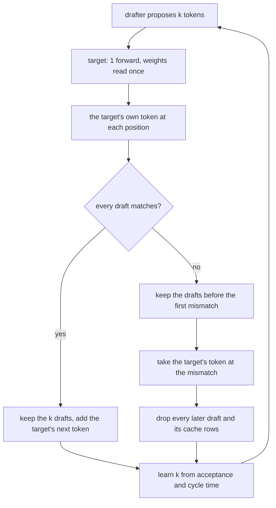

# More than one token per weight read

Decode reads the whole model to produce 1 token and leaves most arithmetic units idle.  
Speculative decoding uses them to check several guessed tokens in the pass that would have produced 1.

## The idea

A cheap **drafter** proposes k tokens.  
The target model runs 1 forward over the prompt plus those k tokens.
That pass reads the weights once and costs about 1 decode step in bytes.
It yields the target's own token at each position.

The target keeps the drafts it agrees with.  
It replaces the first draft it disagrees with by its own token and drops everything after.
When every draft matches, the pass also yields the target's token after the last one.
Under greedy decoding the output is token for token what the target generates alone.

The gain is the number of drafts accepted per pass.  
The cost is drafting plus a verification pass slightly heavier than a plain step.

A drafter comes from 1 of 3 sources:

- A **separate small model** of the same family, with the same vocabulary.
- A **draft head** that reads the target's hidden state with the next token's embedding.
  It is 1 more decoder layer, and it reuses the target's embedding table and output head.  
  A checkpoint can ship one as its multi-token-prediction layer.
  EAGLE trains one apart from the model.
- The **prompt itself**.
  An n-gram that already occurred is continued as it was before.  
  It costs nothing and suits repetitive text such as code.

Drafting pays where verification is far cheaper per token than generation.
A model that spills to the host crosses the bus once for k tokens instead of once per token.  
On a model that fits a card, verification costs about what drafting saves.

## What loken does

loken drafts with a separate small model, or with prompt lookup over a rolling buffer of the prompt and the generated tokens.  
Under `fidelity = "fast"`, it also drafts with the draft head a checkpoint ships.

loken decides whether drafting pays from measured timings.  
It drops rejected drafts from the cache.  
The target draws its own token at each position with the request's sampling, so drafting runs at any temperature.
Token-for-token parity with the target alone is measured under greedy decoding only.

[Pick and attach a drafter](../guides/drafter.md) covers the choice of drafter and the attach route.

## What was measured

| Case | Date | Result |
|---|---|---|
| deepseek-r1:70b at Q4_K_M, 26 of 80 layers on the host, drafted by llama3.2:1b | 2026-09-03, desktop node | 2.21 tokens/s at 41.0 J/token, against 1.49 tokens/s at 51.8 J/token alone. Same answer token for token, 18% of drafts accepted. |
| Same target, one loop with a learned draft length | 2026-09-27 | 2.79 to 2.85 tokens/s |
| EAGLE head on deepcoder, held out, earlier implementation | not re-measured | 1.71 to 1.82 times the plain rate |

<!-- site: widget chart type=bar id=speculative-rate -->
| Variant | Tokens per second |
|---|---|
| Plain | 1.49 |
| llama3.2:1b drafting | 2.21 |
| Learned draft length | 2.85 |
<!-- site: end -->

The 18% acceptance leaves room: a better-matched drafter accepts more ([status](https://github.com/loken-ai/loken/blob/main/docs/STATUS.md#placement-measured-separately)).

The learned draft length comes from measured acceptance per position and measured cycle time.  
Plain decoding is one of the candidate lengths.

The loop drives both the drafter loken picks and one attached by hand.  
A drafter attached to a model that fits the cards is dropped by the same rule.

## Try it

You need a target that spills, such as a 70B on 2 cards of 16 GB.

loken gives the target the smallest model in the store that shares its vocabulary, here llama3.2:1b.  
The load log says so: `deepseek-r1:70b spills to the host: llama3.2:1b drafts for it`.

<!-- site: widget steps id=speculative-try -->
1. Send 1 prompt that generates hundreds of tokens.
2. Request `GET /api/draft/status`.
   It lists the pair and the draft length learned so far.  
   The first request explores the lengths, plain decoding included.
3. Compare `eval_count / eval_duration` on the first reply and on a later one.
4. Send `POST /api/draft/detach` with `{"target":"deepseek-r1:70b"}` and run the prompt again.
   The `response` text is the same, at the plain rate.
<!-- site: end -->

## Check yourself

<!-- site: widget quiz answer=2 id=speculative-quiz-1 -->
What does the target do with a draft it disagrees with?

1. It keeps it and flags the output.
2. It replaces it with its own choice and drops every later draft.
3. It reruns the draft with a lower temperature.

<!-- site: end -->

<!-- site: widget quiz answer=1 id=speculative-quiz-2 -->
Where does speculative decoding pay most?

1. On a model that spills to the host.
2. On a model that fits a card.
3. On a model with a short prompt.

Verification crosses the bus once for k tokens instead of once per token.
<!-- site: end -->

<!-- site: widget quiz answer=3 id=speculative-quiz-3 -->
What does loken use to decide whether drafting pays?

1. A fixed draft length.
2. The size of the drafter.
3. Measured acceptance and cycle times.

Plain decoding is one of the lengths it compares.
<!-- site: end -->

<!-- site: widget flashcards id=speculative-terms -->
| Term | Meaning |
|---|---|
| Drafter | A cheap source of k guessed tokens. |
| Target | The model whose output is kept. It verifies the drafts in 1 forward. |
| Acceptance | The share of drafts the target agrees with. |
| EAGLE | A trained head on the target's last hidden state that drafts tokens. |
| Prompt lookup | Drafts taken from an n-gram that already occurred in the prompt or output. |
<!-- site: end -->
