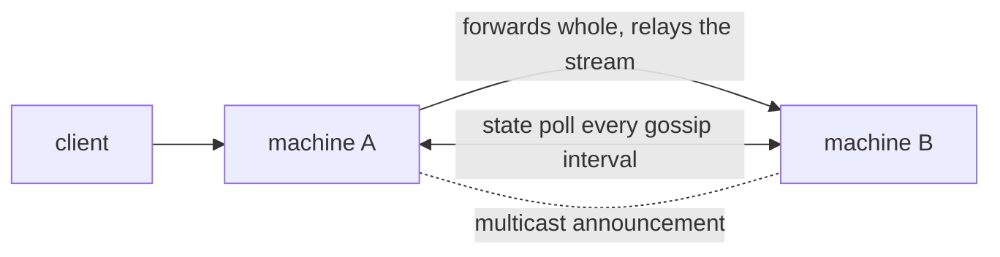

# Run 2 machines

Any machine of the cluster accepts a request and serves it, or forwards it whole to the machine that answers faster and relays the stream back.

## Before you start

<!-- site: widget checklist id=operate-cluster-prereq -->
- [ ] `lokend` is installed on both machines, with the model files of the models to serve ([Install](../start/install.md)).
- [ ] Each machine reaches the other on the port of `[server]`, 11435 by default.
- [ ] `[server] host` on both machines is an address the other can reach. The default `127.0.0.1` accepts local connections only.
- [ ] `require_auth` is off on both machines. Peers poll `/api/cluster/state` without a key, and a node that demands one refuses the poll.
<!-- site: end -->



## Smallest configuration

Each machine needs a `[cluster]` block. Everything else is measured at run time.

<!-- site: widget tabs group=machine id=operate-cluster-config -->
### Machine A

```toml
[server]
host = "0.0.0.0"

[cluster]
name = "home"
advertise = "http://192.0.2.10:11435"
join = ["http://192.0.2.11:11435"]
```

### Machine B

```toml
[server]
host = "0.0.0.0"

[cluster]
name = "home"
advertise = "http://192.0.2.11:11435"
join = ["http://192.0.2.10:11435"]
```
<!-- site: end -->

| Key | Effect |
|---|---|
| `name` | The cluster name. Nodes announcing another name are ignored, so 2 clusters can share a network. |
| `advertise` | The address peers reach this node at. Empty advertises `http://<node_id>:<port>`, and `node_id` defaults to the hostname. |
| `join` | Addresses of peers. A node forwards requests only when `join` is not empty. Nodes on one network also find each other by multicast. |

The other keys are in [Configuration](../CONFIGURATION.md#cluster).

## Run it

<!-- site: widget steps id=operate-cluster-steps -->
1. Start `lokend serve` on both machines.
2. On machine A, list the peers it sees.

   ```sh
   curl -s localhost:11435/api/cluster/peers
   ```

3. Send a request to machine A.

   ```sh
   curl -s localhost:11435/api/chat -d '{
     "model": "qwen3:1.7b",
     "messages": [{"role": "user", "content": "Say hello."}],
     "stream": false
   }'
   ```
<!-- site: end -->

On a fresh node, the first request pays a one-off compilation of the CUDA kernels before the first token.

## Expected result

The peers answer lists both machines, each with `alive` and the measured `rtt_ms`. For example:

```json
{"clustered": true, "peers": [
  {"node_id": "machine-a", "is_self": true, "alive": true},
  {"node_id": "machine-b", "is_self": false, "alive": true, "rtt_ms": 0.4}
]}
```

The log of the node that took the request says what it chose: `forwarding to machine-b: ...` or `cluster: serving locally: ...`, with the reason.
`GET /api/tags` on either machine lists the models of the whole cluster, those held elsewhere under the machine that holds them.

## What is forwarded

| Request | Where it goes |
|---|---|
| Ollama generate and chat, OpenAI chat and completions, Messages API | The machine with the lowest predicted completion time. |
| Image generation, edits and variations, video, sound and music, speech, transcription and translation, embeddings, reranking, and each turn of the conversation route | A machine that has the model and whose cards admit it whole. An upload travels as it arrived. |
| A request that only loads a model | A machine that has it. |

A machine forwards only when the peer is at least `min_speedup` times faster.
A request that no peer can take runs on the machine that received it, split across its cards when they hold the model together, spilled to the host when they do not.
A request is forwarded once. The peer serves it whatever its own estimate says.

A model too large for any single machine is split across the machines by layers when the measured cost beats serving it alone.
That runs for DeepSeek V4.1 and for dense transformers. [Status](../STATUS.md#the-cluster) says what has been measured.

## Troubleshooting

Every row below comes from the log lines and status codes of the daemon.

| Symptom | Cause | Fix |
|---|---|---|
| `/api/cluster/peers` answers `{"clustered": false, "peers": []}` | The `[cluster]` section is absent from `config.toml`. | Add the block and restart. |
| The peers list holds only this machine | The other machine is unreachable, runs another `name`, or answers `401`. | Open the port between the machines, give both the same `name`, turn `require_auth` off. |
| The log says `cluster: no multicast discovery (...); seeds only` | The network offers no multicast. | List the peers in `join`. |
| The log says `cluster: serving locally: single node` | `join` is empty on this node. | Put the address of 1 peer in `join`. |
| The log says `cluster: serving locally: no local price for this model yet` | The node has not completed a request for this model, so it has no measured rate to compare. | Nothing. The first request stays local and becomes the measurement. |
| The log says `cluster: serving locally: peer ... is only 1.10x faster, below the 1.15x a hand-over has to earn` | The peer is not faster than `min_speedup` requires. | Lower `min_speedup`, or accept that this machine serves it. |
| The log says `cluster: hand-over to ... failed (...) - serving here instead` | The peer did not answer the forwarded request. | The request was served locally. Check the peer and its address in `advertise`. |
| A stream ends early and the log says `cluster: the peer serving this request stopped before finishing it` | The peer died mid-generation. | The node closes the stream. Send the request again. |
| `409` with `this node is holding a conversation and has nowhere to place work that yields` | A request of batch priority found no peer, and a conversation is resident. | Send the request without the batch priority, or add a peer. |

## Next

- [Expose loken on a network](network.md)
- [Troubleshoot](troubleshooting.md)
- [Cluster internals](../CLUSTER.md)
