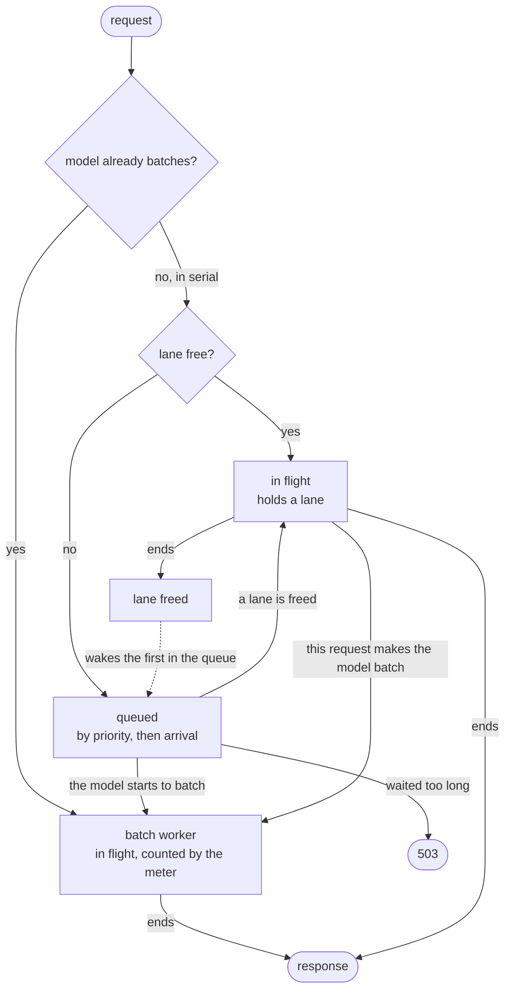
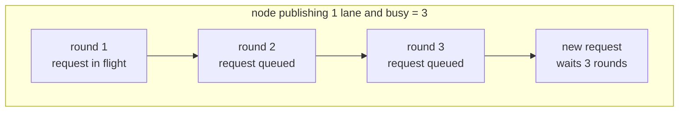

# Requests in flight and lanes

A node serves a few requests at once and makes the others wait.
This page defines the words the API, the cluster and the monitors use for that.

## The words

| Word | Meaning |
|---|---|
| In flight | A request that holds a slot and runs. |
| Queued | A request that waits for a slot. |
| Lane | One slot. The number of lanes is the number of requests the gate lets run together. |
| Gate | The admission point in front of a model that serves 1 request at a time. It hands out the lanes. |
| Busy | The count a node publishes for the requests it holds. |

A lane is not a SIMD lane of a kernel.
The 2 meanings share a word and nothing else.

## The gate

Every request is counted by the meter of the node from the moment it arrives.

A model serves requests 1 at a time, in serial, until they overlap several times in a row.
Then it batches them in its worker on the cards.
A run of lone requests returns it to serial.
See [Configuration](../CONFIGURATION.md) for batched serving.

A request on a model in serial asks the gate for a lane before it runs.
When a lane is free, the request takes it and is in flight.
When none is free, the request joins the queue.

A request on a model that already batches does not cross the gate.
The worker takes it at once.

The request that makes a model start batching holds a lane when it does.
It gives the lane up, and the requests queued behind it reach the worker at once.

The gate has a width, which is the number of lanes.
The width is 1 on a node.
A model served on several cards through `replicas` has a gate of its own, as wide as it has copies.
See [Configuration](../CONFIGURATION.md) for `replicas`.

A request that waits too long for a lane is answered with `503`.
[Troubleshooting](troubleshooting.md) lists the message.

## The order of the queue

A freed lane goes to the waiting request of the highest priority.
Within a priority, the request that arrived first goes first.

| Priority | Requests |
|---|---|
| Fill in the middle | A completion with a `suffix`, from an editor. It goes first. |
| Interactive | A chat or a generation. |
| Batch | The lines of the batch APIs, and work that a peer relayed as batch. |

The gate does not preempt.
A generation in flight runs to its end, then the next waiting request takes its lane.

## What `/api/inflight` shows

`GET /api/inflight` reports the gate of the node.

| Field | Meaning |
|---|---|
| `in_flight` | The requests that hold a lane. |
| `queue_depth` | The requests that wait. |
| `queued_batch`, `queued_interactive`, `queued_fim` | The queue by priority. |
| `requests` | One row per request: its id, priority, model, endpoint, state and times. |

The rows list the running requests first, then the queued ones by priority and arrival.
A request that does not cross the gate is not in this list.
The gate of a model served on several cards is not in this list either.

## What a node publishes

The cluster state of a node carries `lanes`, `busy` and `load`.

| Field | Meaning |
|---|---|
| `lanes` | How many requests the node runs at once. |
| `busy` | The requests in flight and queued on the gate, plus the generations the meter of the node counts as running, plus the media jobs. |
| `load` | The requests in flight and queued on the gate plus the media jobs, over `lanes`, capped at 1. |

The meter counts every generation, in serial or in a batch.
A request in serial is counted by the gate and by the meter, so it weighs 2 in `busy`.
A request in a batch worker is counted by the meter alone.

A node of an older build publishes no `lanes`.
Its peers then price it from its `load`, unless it has measured the throughput it sustains.

## How routing uses them

A node that receives a request prices every candidate node, and the lowest estimate wins.
See [Cluster](../CLUSTER.md) for the steps.
The wait ahead of the request is priced by one of 3 models.

| Model | Used when | The wait |
|---|---|---|
| `batching` | The node measured the throughput it sustains across everything in flight. | `busy + 1` requests share that throughput, so `lanes` is not read. |
| `lanes` | There is no such measure and the node publishes `lanes`. | `busy / lanes` whole rounds of service, each as long as the request itself. |
| `share` | The node publishes no `lanes`. | The request runs at a fraction of the node, set by `load`. |

Under the `lanes` model, a node that publishes 1 lane and `busy` 3 makes a new request wait 3 rounds.
A fraction of the node cannot say that, which is why `lanes` is published.

## Read more

- The [API](../API.md) for `/api/inflight` and `/metrics`.
- [Cluster](../CLUSTER.md) for the cluster state and the routing.
- [Requests and the KV cache](../inside/requests.md) for what a request holds while it runs.
