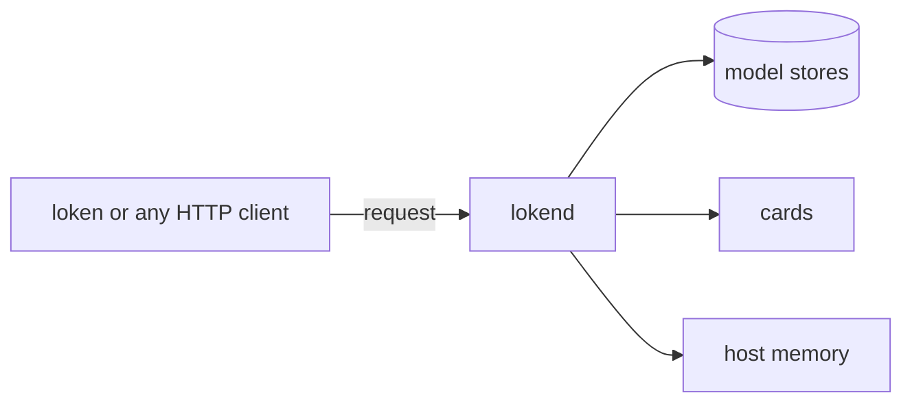

# Concepts

## Daemon and client

`lokend` is the daemon. It owns the models, the memory and the port, and answers every request. `loken` is the client. It sends commands to the daemon: `pull`, `list`, `ps`, `delete`, `chat`.

Any other client talks to the daemon directly over HTTP. The default address is `127.0.0.1:11435`, set by `host` and `port` under `[server]`, see [Configuration](../CONFIGURATION.md).

## API surfaces

One port serves 3 APIs. A client written for one of them works unchanged.

| Surface | Routes | Use it for |
|---|---|---|
| OpenAI | `/v1/...` | OpenAI SDKs and the tools built on them, see [OpenAI SDK](../guides/openai-sdk.md) |
| Ollama | `/api/...` | Ollama clients, and the model management routes such as `/api/tags` and `/api/ps`, see [Ollama clients](../guides/ollama-clients.md) |
| Messages | `/v1/messages` | Clients written for the Messages API, such as `loken launch claude` |

[API](../API.md) lists every route.

## Model stores and names

A model is a set of files in a store. The daemon reads 2 stores.

| Store | Key | A request names a model as |
|---|---|---|
| Ollama | `ollama_models_dir` | `name:tag`, as in `qwen3:0.6b` |
| Hugging Face | `huggingface_models_dir` | `owner/repo`, as in `Qwen/Qwen3-0.6B`, or the file name of a bare GGUF |

`loken pull <name> --source ollama|huggingface` fills the matching store. `loken list` prints what both hold.

A request carries the name in its `model` field. When it names none, the daemon uses `model_id` under `[inference]`. A model not yet loaded is loaded by the first request that names it, and `loken ps` shows what is resident. [Models](../MODELS.md) has the details.

## Model families

A family is a line of models that share an architecture, such as Llama, Qwen, Gemma or Whisper. The family decides what the model does: chat, vision, speech in, images, video, audio, forecasting, embeddings. Language families are read from the file or checkpoint, so a new size of a known family needs no new loader.

Each media family is a build feature. A family that is not built reports its models as unknown. [Choose a model](choose-a-model.md) lists the families.

## Placement

Placement decides where each part of a model lives. The daemon asks each card what it holds, fills the fastest card first, then spills to the other cards, then to the host. For a mixture of experts, only the experts that do not fit leave the cards.

Nothing is configured for this. The placement plan picks the card and the layers, see [Configuration](../CONFIGURATION.md#decided-by-loken).

## What stays on the machine

Inference runs on the machine. loken needs no account and no API key, and has no hosted fallback. The network is used to fetch a model you asked for, and by a cluster node you configured to announce itself. Logs carry lengths and counts, never a prompt or a generated text.

> [!WARNING]
> The server has no authentication and no rate limit until `require_auth`, `api_keys` and `rate_limit_per_minute` are set under `[server]`.

## Terms

<!-- site: widget flashcards id=concepts-terms -->
| Term | Meaning |
|---|---|
| `lokend` | The daemon: owns the models, the memory and the port |
| `loken` | The client command that talks to the daemon |
| Surface | One of the 3 APIs on the port: OpenAI, Ollama, Messages |
| Store | A directory of model files: Ollama layout or Hugging Face layout |
| Tag | The part of an Ollama name after the colon, as `0.6b` in `qwen3:0.6b` |
| Family | A line of models sharing an architecture |
| Resident | Loaded in memory and ready to answer |
| Placement | The choice of card or host for each part of a model |
| Spill | Placing on the host what no card holds |
| Mixture | A model whose layers hold many experts, of which each token uses a few |
<!-- site: end -->

## Next

- [Choose a model](choose-a-model.md)
- [Install](install.md) and [First run](first-run.md)
